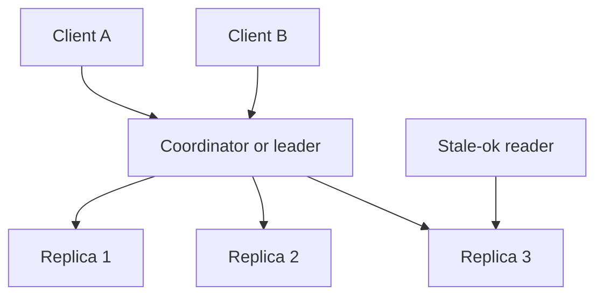

## Why this matters

Almost every data-tier question in a product interview is a consistency question wearing a costume. News feeds can be slightly stale. Payments cannot. Inventory for a concert ticket is a race. A like counter is not. Candidates who say "CAP means we pick AP or CP" without saying what operation is linearizable, what happens during a partition, and what the user observes in the normal case, get stopped there.

This lesson gives the real definitions, the PACELC extension you actually design with most days, and a ladder of consistency models you can attach to a specific read or write.

## Intuition

You and a friend edit the same shared note from two cities. While the network between the cities is fine, you can wait for every save to be confirmed everywhere before either of you reads. That wait is latency, paid for a single order of history. If the link between cities breaks, you have two choices: keep editing on both sides and merge later, or stop accepting edits on at least one side until the link returns. You cannot both keep accepting conflicting edits and promise that every read sees one fresh global order. That is the partition case.

On an ordinary day the link is up. You still choose how long a save waits for remote replicas. That ordinary-day choice is the "else" in PACELC, and it is the choice you make on most requests.

## Core concept in depth

### CAP, stated carefully

CAP is a theorem about a distributed data system under a **network partition**. In the Gilbert and Lynch formulation, the three letters are:

- **Consistency** here means **linearizability** of the data object: there is a single total order of operations, and a read returns the value of the latest completed write in that order. It does not mean "the database checks foreign keys," and it does not mean "all the nodes agree eventually."
- **Availability** means every request to a non-failed node receives a non-error response in finite time. It does not mean "the cluster has a load balancer" and it does not mean a latency SLO. A response that blocks until the partition heals is not available under this definition.
- **Partition tolerance** means the system continues to operate despite lost or delayed messages between nodes. On a real network you do not get to decline partition tolerance. Packets will drop. Zones will stop talking.

Therefore the engineering reading is: **when a partition happens, you cannot be both linearizable and available for the same operations.** You choose which one to sacrifice until the partition heals.

You do not "pick two" in the healthy case. A system can be linearizable and available when the network is fine. CAP says nothing interesting about that regime. That is why PACELC exists.

Misreadings to avoid in the interview:

- "SQL is CP and NoSQL is AP." Both camps ship multiple modes. A single system can offer linearizable reads on one key and stale reads on another.
- "We are CA." If you run one node, there is no partition inside the system, and you also have no partition tolerance. The moment you add a replica across a network, P is in play.
- "Eventual consistency means we lose writes." It means replicas may disagree for a while. Durable writes can still be acknowledged once they hit a chosen set of replicas.

### PACELC

PACELC (Abadi) extends the picture:

- **If there is a Partition**, choose **Availability or Consistency** (the CAP choice).
- **Else** (normal operation), choose **Latency or Consistency**.

Waiting for a quorum in another region costs latency even when nothing is broken. Spanner-style designs pay that latency for strong reads and writes. Dynamo-style designs return quickly from a local replica and resolve conflicts later. Most product systems are a mix: the payment ledger is PC/EC (sacrifice availability or latency for consistency), the feed fan-out is PA/EL (serve a local, slightly stale timeline).

Say the choice per operation, not per company.

### A ladder of models

Stronger models imply weaker ones. Weaker models allow more local, faster responses.

**Linearizability.** Once a write completes, every later read, on any replica, from any client, sees that write or a newer one. Real-time matters: you cannot read a stale value after you have observed a newer one. This matches "the object behaves like one copy on one machine." Use it for locks, leader election, unique seat assignment, and account balances if you read-modify-write without another concurrency control. Cost: a coordination round, often a quorum, and unavailability of that key if a quorum cannot be formed.

**Sequential consistency.** All clients see the same total order, but that order does not have to match real time. Less intuitive, still expensive. Rarely what you ask for by name in a product interview; know it exists so you do not confuse it with linearizability.

**Causal consistency.** If operation A happened before operation B in a causal sense (same client order, or a read-from relationship), everyone sees A before B. Concurrent writes may be seen in different orders. This preserves conversation order in a chat reply thread without forcing a global total order on unrelated rooms. Implementations track dependencies (vector clocks, hybrid logical clocks, explicit parent ids).

**Session guarantees** are the practical subset users notice. They apply to one client session, not the whole world:

| Guarantee | Promise | Broken example |
| --- | --- | --- |
| Read-your-writes | A client sees its own completed writes | Post a tweet, refresh, it is missing |
| Monotonic reads | A client never goes backward in time | A comment appears, then vanishes on the next refresh |
| Monotonic writes | A client's writes apply in the order sent | Profile rename arrives before profile create |
| Writes-follow-reads | A write is ordered after the reads that prompted it | Reply stored on a replica that has not seen the parent |

You can offer session guarantees on top of an eventually consistent store by pinning a session to a replica, by threading a version token, or by reading from the primary for a short time after a write.

**Eventual consistency.** If writes stop (or, in practice, if they flow), replicas converge to the same state. There is no bound promised unless you add one ("within 5 seconds" is a staleness SLO, stronger than plain eventual). Conflicts need a rule: last-writer-wins, application merge, or a CRDT.

### Quorums

With N replicas, a write quorum W and a read quorum R:

- If **R + W exceeds N**, a read quorum overlaps every write quorum, so you can build linearizable reads if you also handle clocks, latest-value selection, and leader leases carefully. Overlap is necessary, not a full proof of linearizability.
- If **W exceeds N/2**, two writes cannot both succeed on disjoint sets. You get single-copy write semantics at the cost of refusing writes when a majority is down.
- Smaller W and R (for example W = 1, R = 1) stay available during partitions and diverge.

Typical majority: N = 3, R = 2, W = 2. You tolerate one unavailable replica. A client read may contact two replicas and take the freshest version by timestamp or logical clock.

**Sloppy quorums** and hinted handoff (Dynamo) write to substitute nodes when the preferred ones are down, which preserves availability and weakens the overlap guarantee until hints drain.

### Conflict handling

- **Last-writer-wins** picks the highest timestamp. Simple, and it silently drops the other write. Clock skew makes "last" wrong. Acceptable for caches and some profile fields, dangerous for counters and inventories.
- **Application merge** keeps both versions and asks domain code, or the user, to resolve them. Correct for carts and documents. Needs version vectors so you know when a conflict exists.
- **CRDTs** restrict the data type so merges are automatic and convergent: grow-only sets, counters that increment via per-replica deltas, maps with defined join rules. Great for collaborative presence and counts. Awkward for arbitrary rows.

### What to assign in common products

| Operation | Model | Why |
| --- | --- | --- |
| Seat hold, payment capture, inventory decrement | Linearizable or single-primary transaction | Lost updates cost money or double-sell |
| Unique username create | Linearizable compare-and-set, or a single partition owner | Two creators must not both succeed |
| Chat send in one conversation | Causal or primary-per-conversation | Order inside the thread matters; global order does not |
| Social like count | Eventual, CRDT or periodic reconcile | Off-by-one is acceptable |
| Timeline read | Eventual with read-your-writes | The author must see their post; strangers can wait a second |
| Configuration that gates a security control | Linearizable or versioned with mandatory refresh | Stale "allow" is a defect |

## Diagram



During a partition that isolates Replica 3, a linearizable write path refuses to commit unless a majority of the preferred replicas acknowledge. The stale-ok reader can still read Replica 3 and must be labeled as such in the API so a checkout flow cannot use it by accident.

### Dry-run: N = 3, two writers, one partition

| Step | Majority side | Minority side | Linearizable config | Eventual config |
| --- | --- | --- | --- | --- |
| Link breaks | Replicas 1 and 2 | Replica 3 | Writes continue if leader is on the majority | Both sides accept writes |
| Read on minority | n/a | Replica 3 | Read errors or redirects | Read returns local, possibly stale data |
| Heal | Versions compared | Versions compared | Minority writes did not commit, so no merge | Conflict rule runs |
| User-visible risk | Short write errors on minority | Served stale or conflicting state | Availability dip | Lost update if last-writer-wins |

## Runnable Python

```python
def quorum_overlaps(n: int, r: int, w: int) -> dict:
    return {
        "read_write_overlap": r + w > n,
        "writes_intersect": w * 2 > n,
        "tolerates_failures": n - max(r, w),
    }


def linearizable_read_required(operation: str) -> bool:
    strong = {
        "seat_hold",
        "payment_capture",
        "unique_name",
        "inventory_decrement",
        "lock",
    }
    return operation in strong


if __name__ == "__main__":
    print("majority", quorum_overlaps(3, 2, 2))
    print("fast", quorum_overlaps(3, 1, 1))
    for op in ("seat_hold", "like_count", "timeline_read"):
        print(op, linearizable_read_required(op))
```

Majority quorums overlap and survive one failure. The fast pair does not overlap: a read can miss a completed write. The helper is a reminder to classify the operation before you pick R and W. A like counter is absent from the strong set on purpose.

## Complexity / trade-off analysis

| Model or knob | What you gain | What you pay |
| --- | --- | --- |
| Linearizability | A single copy in real time | Quorum latency, unavailability without a quorum |
| Causal consistency | Sensible order without a global lock | Dependency metadata, harder debugging |
| Session guarantees | Users do not see their own writes vanish | Sticky routing or version tokens |
| Eventual consistency | Local writes and reads during partitions | Conflicts, staleness, harder tests |
| Larger W | More durable ack | Higher write latency, more failures to refuse |
| Larger R | Fresher reads | Higher read latency and load |
| Last-writer-wins | Easy merge | Silent data loss |
| CRDT | Automatic converge | Data type must fit the algebra |

PACELC in one line: partitions force A versus C; the rest of the year forces L versus C. You can pick differently per key range.

## Tricks, tips, patterns

- Name the operation, then the model. "The feed is eventual. The follow graph write is linearizable."
- Translate CAP consistency to linearizability so you do not debate a different C than the interviewer.
- Offer read-your-writes even when the global model is eventual. Users notice their own posts.
- Use "R + W exceeds N" as the start of a quorum explanation, then mention it is not a complete linearizability proof.
- Put a staleness SLO on eventual data ("under 2 seconds for a follower's timeline") instead of saying "eventual" and stopping.
- Isolate strong state into a small partition key: one row per concert seat, one row per username, not one global lock.
- Prefer a single writer per partition (leader) when the conflict rule would be embarrassing.

## Common mistakes and edge cases

- Declaring the whole architecture AP. Different keys have different answers.
- Using last-writer-wins on a counter. Increments get lost.
- Forgetting clock skew. Wall-clock "last" is not causal "last."
- Returning a linearizable error to the user as a blank page. The client needs a retry or a clear failure.
- Reading from a replica immediately after a write and breaking read-your-writes.
- Assuming quorum overlap yields linearizability without leader leases or careful timestamp selection. Concurrent reads can still observe anomalies if the protocol is sloppy.
- Treating a partition and a slow node as different. Timeouts are how you decide a partition has happened. A long timeout looks like unavailability; a short one looks like a false partition.

## Interview notes

When you draw a database, pause and say: "Writes for this aggregate go to a leader with a majority ack. Reads of the user's own write are leader reads. Fan-out timeline reads are replica reads, staleness under a couple of seconds. If the majority is down, this write fails rather than diverging." That is a complete PACELC answer.

If the interviewer asks "what about CAP?", restate the partition case only, then move to the normal-case latency trade-off so you do not sound like you memorized a triangle.

A good follow-up question from you: "Is it acceptable for two buyers to pass the inventory check in the same second?" The answer picks the model for you.

## Practice problems

1. **Classify three operations (easy).** For a ticket app, assign a consistency model to: browsing the event page, holding a seat for two minutes, and incrementing a "people viewing now" counter. Justify each in one sentence.
2. **Quorum (medium).** N = 5 replicas across two regions. Pick R and W for a configuration that overlaps, survives two replica failures, and state the latency cost if three replicas are remote.
3. **Read-your-writes (medium).** After posting a comment, a refresh hits a read replica that has not applied the write. Name two concrete mechanisms that fix this without making every timeline read linearizable.

Related: [Replication, indexing, and sharding](/lessons/sd-indexing-sharding-replication), [Payments](/lessons/sd-payments).

## Summary / cheat sheet

- CAP: during a partition, linearizability and availability cannot both hold. Partition tolerance is not optional on a real network.
- PACELC: otherwise you still trade latency against consistency.
- Linearizability is the strong end. Eventual consistency is the weak end. Causal and session guarantees sit in between and solve most product complaints.
- Read-your-writes, monotonic reads, and monotonic writes are what users interpret as "the app is not broken."
- R + W exceeds N is the quorum overlap rule. Majority quorums survive a minority outage and refuse to split-brain writes.
- Pick the model per operation. Ledgers and unique allocation go strong. Feeds, likes, and presence can lag with a stated bound.
- Last-writer-wins drops data. Do not use it where every update counts.

## Further reading

- [Brewer: CAP twelve years later](https://www.infoq.com/articles/cap-twelve-years-later-how-the-rules-have-changed/)
- [Gilbert and Lynch: Brewer's conjecture and the feasibility of consistent, available, partition-tolerant web services](https://dl.acm.org/doi/10.1145/564585.564601)
- [Abadi: PACELC](https://www.cs.umd.edu/~abadi/papers/abadi-pacelc.pdf)
- [Kleppmann: Please stop calling databases CP or AP](https://martin.kleppmann.com/2015/05/11/please-stop-calling-databases-cp-or-ap.html)
- [Amazon Dynamo paper](https://www.allthingsdistributed.com/files/amazon-dynamo-sosp2007.pdf)
- [Designing Data-Intensive Applications, Kleppmann](https://dataintensive.net/)
