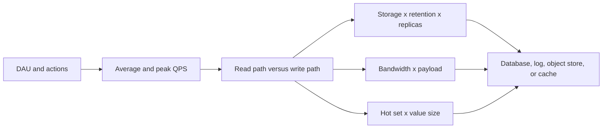

## Why this matters

Interviewers use estimation to see whether your design matches the load. A cache sized for a thousand users is a different system from a cache sized for a hundred million. A video product that ignores bitrate will "solve" delivery with a single database. You are not expected to know the company's real traffic. You are expected to state assumptions, do arithmetic you can defend, and let the numbers choose the building blocks.

This lesson is a drill book: the constants worth memorizing, the formulas, and several full estimates in the shape of interview openings.

## Intuition

Treat estimation like packing a truck. You need the weight of one box, the number of boxes per day, the peak hour, and how long you keep the boxes. Precision beyond one significant digit is theater. Being wrong by 10x because you forgot that photos are megabytes, not kilobytes, changes the architecture. Being wrong by 20 percent does not.

Round aggressively to powers of ten and two. There are about 10^5 seconds in a day (86,400). There are about 3 × 10^7 seconds in a year if you need a yearly figure; for QPS, the day is the useful unit. Peak is often 2× to 10× the average unless the product is a ticket drop or a live event, in which case you ask.

## Core concept in depth

### Constants worth memorizing

Use these orders of magnitude. They are round on purpose.

| Thing | Order of magnitude | Interview use |
| --- | --- | --- |
| L2 cache hit | a few nanoseconds | Why in-process cache is not a network cache |
| Main memory reference | about 100 nanoseconds | RAM is the latency budget for local state |
| SSD random read | tens to low hundreds of microseconds | Index lookups can be disk-bound |
| HDD seek | a few to 10 milliseconds | Avoid random HDD reads on the critical path |
| Same-zone round trip | well under 1 millisecond | Chatter inside the region is acceptable in moderation |
| Cross-continent round trip | about 100 to 200 milliseconds | Do not put it on a sync path casually |
| 1 day | about 10^5 seconds | Divide daily volume by 10^5 to get average per second |
| 1 Gbit/s | about 100 MB/s | Bandwidth to machines and egress |
| Commodity machine RAM | tens to a few hundred GB | Working set must fit or be partitioned |
| Highly available disk service | you replicate 3× | Raw bytes are not billable bytes |

Also remember payload sizes:

- A tweet or short text row: about 300 bytes to 1 KB of stored fields, more with indexes.
- An image thumbnail: tens of KB. A phone photo: 2 to 5 MB.
- A song: a few MB. An hour of video: roughly 1 to 3 GB at typical streaming bitrates (about 5 Mbit/s is roughly 2 GB per hour). Always state the bitrate you assumed.
- An id: 8 bytes as an integer, 16 bytes as a UUID, plus index overhead.

### The five quantities

Almost every estimate is a combination of these:

1. **Average QPS** = (DAU × actions per user per day) / 10^5.
2. **Peak QPS** = average × peak factor. State the factor. Consumer social is often 2× to 5×. A flash sale can be 20× or more for a few minutes; use a queue in that case rather than provisioning the peak as steady capacity.
3. **Read/write ratio.** A 100:1 read-heavy product wants a cache and replicas. A 1:1 ingest product wants a log and partitioning.
4. **Storage per day** = writes per day × bytes per write × replication × index overhead. Then multiply by retention.
5. **Bandwidth** = QPS × bytes on the wire. Check both client egress and the internal fan-out, which can be larger.

Memory for a cache is a sixth quantity when the working set matters: hot keys × value size × replication. If the daily active working set fits in RAM across a small fleet, say so. If it does not, the cache is partial and you must talk about hit ratio.

### Overhead factors people forget

- **Replication.** Three copies triple disk. Quorum systems still store N copies.
- **Indexes.** A secondary index can be a large fraction of the table. For interviews, add 50 to 100 percent unless you know the schema is one primary key.
- **Encoding and protocol.** JSON is several times the size of a tight binary row on the wire.
- **Compression.** Logs and text often shrink 3× to 10×. Already-compressed video and images do not.
- **Headroom.** After the engineering estimate, add 30 to 50 percent for growth and zone loss, or say you will autoscale the stateless tier and only pre-provision state.
- **Fan-out amplification.** A write that notifies 500 followers is 1 write to storage and 500 deliveries. Estimate both.

### How to show the work

Write the assumption, the formula, and the rounded result. Invite correction: "I am assuming 50 million DAU and 20 timeline fetches a day. If the real number is 5 million, we drop a tier of cache." Interviewers often hand you a better number. The method is the grade.

Keep one significant digit. 1.2 × 10^4 is 10^4 in this setting. Do not spend three minutes on long multiplication.

### Drill: URL shortener

Assumptions: 100 million new short links per month, read/write = 100:1, retention 5 years, 500 bytes per row including the index, replication 3.

| Quantity | Arithmetic | Result |
| --- | --- | --- |
| New links per second | 100e6 / (30 × 10^5) | about 30 writes/s average |
| Peak writes | × 5 | about 150/s |
| Reads | × 100 | about 3,000/s average, 15,000/s peak |
| Storage per month | 100e6 × 500 B × 3 | about 150 GB |
| Five-year storage | × 60 months | about 9 TB including replicas |

Conclusion you say next: write QPS is tiny for one primary; read QPS wants a cache; storage is comfortable for one relational database for a long time, with object-like growth later. The hard part is the unguessable key and redirect latency, not sharding on day one. That conclusion is the point of the arithmetic.

### Drill: chat send path

Assumptions: 200 million DAU, 40 messages sent per user per day, 200 bytes stored per message, fan-out delivery is separate, retention 1 year, replication 3.

| Quantity | Arithmetic | Result |
| --- | --- | --- |
| Messages per day | 200e6 × 40 | 8 billion |
| Average write QPS | 8e9 / 1e5 | 80,000/s |
| Peak writes | × 3 | about 250,000/s |
| Stored bytes per day | 8e9 × 200 × 3 | about 4.8 TB/day |
| Yearly storage | × 365 | about 1.7 PB/year |

Conclusion: a single primary cannot take 80,000 writes per second of this shape. Partition by conversation id. Retention and media (not included) dominate cost. Receipts and presence are extra streams; do not pretend they are free. Media at even 5 percent of messages being a 200 KB image adds 8e9 × 0.05 × 200 KB, on the order of tens of petabytes a year before replication. Call that out as a separate object store.

### Drill: video catalog egress

Assumptions: 20 million hours watched per day, average bitrate 5 Mbit/s.

5 Mbit/s × 20e6 hours. First convert hours to seconds: 20e6 × 3,600 = 7.2e10 seconds of video. Times 5 Mbit/s = 3.6e11 Mbit = 3.6e8 Gbit of data per day, which is 3.6e8 / 8 = 4.5e7 GB, about 45 PB/day of egress if served from origin.

That number is why video designs start with a CDN and edge cache, not with a bigger database. Even a 90 percent edge hit ratio leaves several PB/day at the origin, so you still want origin shielding and a small set of popular titles cached as pre-generated bitrates.

### Drill: cache memory

Assumptions: 50 million distinct timelines touched per day, but the hot set is the top 5 percent, each cached payload is 100 KB, two cache replicas.

Hot keys = 2.5 million. Raw payload = 2.5e6 × 100 KB = 250 GB. Times 2 replicas = 500 GB. That fits in a small partitioned cache fleet. The long tail should not all be cached; admit keys by request count. Say the expected hit ratio and what a miss costs, or the memory number is decoration.

### A checklist before you draw

- DAU and actions per day, or the interviewer-supplied QPS.
- Peak factor.
- Read/write split.
- Payload size on disk and on the wire.
- Retention.
- Replication and index overhead.
- Fan-out, if one write becomes many reads or pushes.
- Working set versus total data, if you propose a cache.
- Which result would change the design if it were 10× off.

If none of the results would change the design, you estimated the wrong thing.

## Diagram



### Dry-run: which number flips the design

| If this is 10× higher than you guessed | Design change |
| --- | --- |
| Write QPS | Move from single primary to partitioned log or shards |
| Read QPS only | Add cache and replicas; keep one primary |
| Payload size | Object store and CDN, not a row in SQL |
| Retention | Tier cold data; lifecycle policies |
| Fan-out degree | Async pipeline; do not do the fan-out in the request |
| Hot-set RAM | Partition the cache or cache only the head |

## Runnable Python

```python
SECONDS_PER_DAY = 100_000  # interview rounding of 86,400


def estimate(dau: int, actions_per_day: float, bytes_per_write: int, read_write_ratio: float, retention_days: int, replication: int = 3, peak_factor: float = 3.0) -> dict:
    writes_per_day = dau * actions_per_day
    avg_write_qps = writes_per_day / SECONDS_PER_DAY
    avg_read_qps = avg_write_qps * read_write_ratio
    disk_bytes = writes_per_day * bytes_per_write * replication * retention_days
    return {
        "avg_write_qps": round(avg_write_qps, 1),
        "peak_write_qps": round(avg_write_qps * peak_factor, 1),
        "avg_read_qps": round(avg_read_qps, 1),
        "peak_read_qps": round(avg_read_qps * peak_factor, 1),
        "disk_tb": round(disk_bytes / 1e12, 2),
    }


if __name__ == "__main__":
    print("shortener_month_storage_inputs_are_daily", estimate(100_000_000, 1 / 30, 500, 100, 365 * 5))
    print("chat", estimate(200_000_000, 40, 200, 2, 365))
```

The shortener call treats "100 million new links per month" as DAU-equivalent users creating 1/30 of a link per day, which is the same 100 million per month. Disk lands in the low tens of TB over five years at 3× replication before you add index slack; in the hand drill we used 9 TB at 500 bytes because 100e6 × 500 × 3 × 60 months is 9e12 bytes. Re-run the function if the interviewer changes retention. The chat call is the one that forces partitioning: tens of thousands of writes per second and petabyte-scale yearly disk.

## Complexity / trade-off analysis

| Shortcut | Benefit | When it misleads |
| --- | --- | --- |
| 10^5 seconds per day | Mental math | Fine at 20 percent error, bad if you then quote four digits |
| Peak = 3 × average | Fast | Live sports, ticket drops, and cron herds are spikier |
| Replication = 3 | Matches common quorum and object stores | Erasure coding is closer to 1.5×; say which you mean |
| Cache the hot 5 percent | Explains RAM | Some products have a flat key distribution and a useless cache |
| Ignore indexes | Faster | Feed queries with three secondary indexes can double storage |

Estimation error compounds. State the assumption most likely to be 10× wrong, and say what you would redesign if it is.

## Tricks, tips, patterns

- Write assumptions before arithmetic. Correcting an assumption is progress; hiding it looks like bluffing.
- Divide daily counts by 10^5, not by 86,400, unless you are at a whiteboard with time to spare.
- Estimate writes and reads separately. The ratio picks cache versus shard.
- Estimate stored bytes and wire bytes separately. Video is a bandwidth problem. Chat text is a write-rate and retention problem.
- Ask "what is the hot set?" before you price a cache.
- End every estimate with a design conclusion: single primary, partitioned log, CDN, or queue.
- If the interviewer corrects DAU, scale linearly out loud. Do not restart from zero in silence.
- Round replication, indexes, and headroom as explicit multipliers so they can be challenged.

## Common mistakes and edge cases

- Caching a working set that is larger than any fleet you described. Quote RAM.
- Forgetting that fan-out, not the original write, is the expensive part of social products.
- Storing media bytes in the same capacity number as metadata rows.
- Using average QPS to size a ticket on-sale. The peak is the product.
- Reporting storage without replication, then comparing it to a vendor bill that includes three copies.
- Over-precision. 13,742 requests per second signals that you multiplied 86,400 and lost the plot.
- Never tying the number back to a component. A naked "10 TB" does not justify a database choice.

## Interview notes

Spend about five minutes, not fifteen. Structure: assumptions, table of QPS / storage / bandwidth / RAM, one-sentence architecture implication, then the picture. Revisit the estimate when you add a fan-out or a cache so the interviewer sees the numbers driving the boxes.

A line that sounds senior: "Metadata is 80,000 writes per second and wants partitioning by conversation. Media is a separate object store fronted by a CDN. I am not putting both problems in one database."

Practice until the URL shortener, a chat send path, and a video egress estimate take under three minutes each.

## Practice problems

1. **Photo app (easy).** 10 million DAU, each uploads 2 photos a day at 3 MB, views 50 photos a day, retention 3 years, replication 3. Estimate write QPS, read QPS, and storage. Where do the bytes live?
2. **Rate of a fan-out (medium).** 5 million celebrities are not the issue; one user has 20 million followers and posts once. If each follower has a timeline row of 100 bytes inserted synchronously, how long does that write take at 50,000 inserts per second, and what design avoids blocking the post call?
3. **Cache or not (medium).** 200 million users, each with a 2 KB profile. Does the full profile set fit in a 1 TB cache fleet with 2× replication? What fraction fits if RAM for profiles is only 200 GB?

Related: [Scalability, availability, and reliability](/lessons/scalability-availability-reliability), [URL shortener](/lessons/sd-url-shortener).

## Summary / cheat sheet

- State assumptions, round to powers of ten, conclude with a component choice.
- Average QPS ≈ daily count / 10^5. Peak is a stated multiple.
- Storage = writes × bytes × replicas × retention, plus index slack.
- Bandwidth = QPS × wire size. Fan-out multiplies it.
- Cache RAM = hot keys × value size × cache replicas.
- Text metadata, media bytes, and fan-out delivery are three different estimates.
- If a number being 10× off would not change the design, you estimated a distraction.
- Single primary, partitioned log, CDN, or queue: pick one from the largest number on the page.

## Further reading

- [Designing Data-Intensive Applications, Kleppmann](https://dataintensive.net/)
- [The System Design Primer, Donne Martin](https://github.com/donnemartin/system-design-primer)
- [Google SRE book: Handling Overload](https://sre.google/sre-book/handling-overload/)
- [Latency numbers every programmer should know](https://colin-scott.github.io/personal_website/research/interactive_latency.html)
- [AWS Well-Architected Performance Efficiency](https://docs.aws.amazon.com/wellarchitected/latest/performance-efficiency-pillar/welcome.html)
