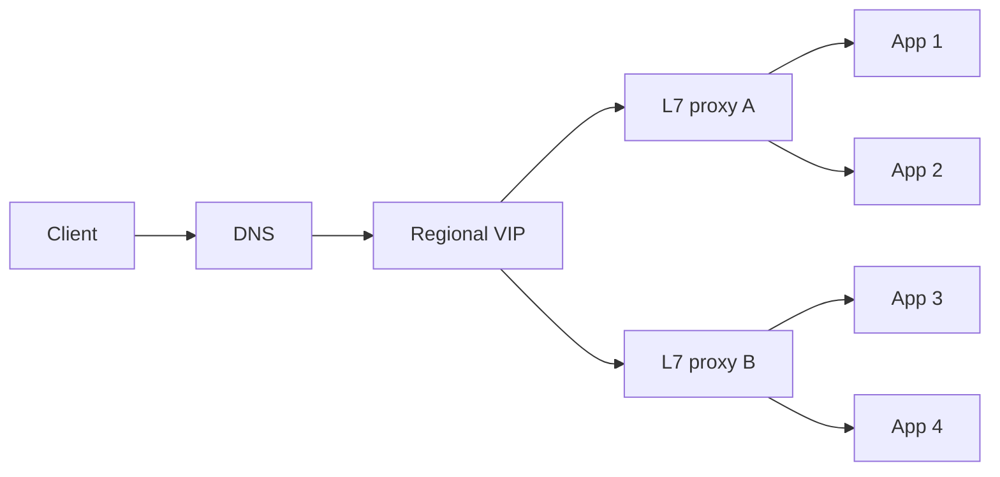

## Why this matters

Every horizontally scaled service starts with a way to spread requests and a place to terminate TLS, route by path, and shed bad traffic. Interviewers ask "what happens when an instance dies mid-request?" and "where does the certificate live?" Those answers are the load balancer and the reverse proxy. Mixing them up, or forgetting health checks, produces a drawing that cannot survive a deploy.

## Intuition

A load balancer is the person at the restaurant door who seats parties at tables that are open and not already drowning. A reverse proxy is the host stand that also checks coats, speaks the guests' language, and refuses people who are not on the list, before they ever reach a table. In many products one vendor box does both jobs. You still need to know which responsibility you are using, because the failure modes differ: seating poorly causes hot instances; a confused front door causes certificate outages and path-routing bugs.

A forward proxy sits near the client and acts on the client's behalf (corporate egress, caching browsers). A reverse proxy sits near the servers and acts on the server's behalf. If you cannot say which side you are on, the design is ambiguous.

## Core concept in depth

### Layer 4 versus layer 7

**Layer 4** balancing uses the TCP or UDP connection: source and destination IP and port. The balancer does not read HTTP. It is fast, simple, and can pass through arbitrary TCP. It cannot route `/api` to one fleet and `/static` to another, and it cannot retry a failed HTTP request on another server because it does not know request boundaries once the stream is spliced (unless it is a smarter TCP proxy that still does not parse the app protocol).

**Layer 7** balancing understands HTTP or gRPC. It can route on host, path, header, and method; inject request ids; authenticate; retry idempotent GETs; and compress. It costs more CPU and becomes a place where request semantics can be wrong (retries of POST, header size limits, WebSocket timeouts).

Use L4 when you need raw throughput, static IPs, or non-HTTP protocols. Use L7 when the product is HTTP and you need routing or safe retries. Large systems often do both: an L4 edge sprays connections across L7 proxies, and the L7 tier routes to services.

### Algorithms

| Algorithm | Behavior | Use when |
| --- | --- | --- |
| Round robin | Rotate through healthy targets | Similar instances, short similar requests |
| Weighted round robin | Some targets get more turns | Canary or mixed instance sizes |
| Least connections | Prefer the target with the fewest in flight | Long-lived or uneven request cost |
| Least response time | Prefer low latency and low in flight | Heterogeneous backends |
| Hash of a key | Same client or resource sticks to a target | Stateful protocols, cache locality |
| Random with two choices | Sample two healthy targets, pick the less loaded | Large fleets, cheap and balanced |

Pure round robin is unfair when some requests last 50 ms and others last 30 seconds. Least connections or a request-cost score is the better default for APIs. Consistent hashing belongs when you want cache affinity; it is covered with the hash ring lesson. Sticky sessions by cookie are a last resort: they pin load to a dead instance's replacement poorly and fight autoscaling.

### Health checks

A target that accepts TCP can still be unable to serve. Use two layers:

- **Liveness:** process is up. Failure means restart.
- **Readiness:** process can take traffic (dependencies warmed, migrations done). Failure means the balancer stops sending new work.

Checks should hit a cheap endpoint that verifies the real dependency you care about, without creating a dependency loop (every instance hammering the database once a second from every proxy). Frequency, timeout, and unhealthy threshold decide MTTR. A 30-second interval with 3 failures is already a minute and a half of bad traffic. For user-facing APIs, a few seconds is more honest.

**Connection draining** (deregistration delay) lets an instance finish in-flight requests after it fails readiness, which is how you deploy without cutting requests. Set the drain longer than p99 request time and shorter than your deploy patience. WebSockets need a much longer drain or a separate reconnect protocol.

### Anycast, DNS, and global balancing

DNS round robin is a weak balancer: caches ignore your TTL, and there is no health feedback. Use DNS to steer clients to a nearby **regional** load balancer (latency-based or geo DNS), and let that regional tier do real health checks. Anycast advertises the same IP from many sites and lets the network deliver the packet to a nearby site. It is how large CDNs and DNS services work. Failover is a routing change, which is fast for new packets and confusing for existing TCP connections.

Global load balancing does not fix data locality. Sending a user in Frankfurt to Virginia because Virginia is "healthier" can violate both latency and privacy constraints. Steer to a region that is healthy and allowed to hold that user's data.

### Reverse proxy responsibilities

A reverse proxy (Nginx, Envoy, HAProxy, a managed API gateway) commonly owns:

- **TLS termination.** Certificates live at the edge, rotated centrally. Internal hops may be re-encrypted (mTLS) or, less ideally, plain inside a trusted network. Say which.
- **HTTP normalization.** Limits on header size, body size, and time to first byte. These limits are availability features: they stop one client from pinning proxy memory.
- **Routing.** Path and host to a backend cluster, with timeouts per route. The proxy timeout must be shorter than the client's patience and coordinated with the app timeout.
- **Observability.** Request id, access logs, and metrics at the edge, which is the first place you see user-perceived errors.
- **Protection.** Coarse rate limits, WAF rules, and connection caps. Fine-grained product quotas may live deeper; the proxy still needs a ceiling so a bug behind it cannot be driven at unlimited QPS.

The proxy is a shared dependency. Run it in at least two failure domains, with a health-checked VIP or anycast in front. A single proxy node is a single point of failure even if you have fifty app servers.

### What happens on failure

Instance dies mid-request: the balancer marks it unhealthy after the check threshold (or immediately on a connection reset) and sends new requests elsewhere. The in-flight request fails. Idempotent callers retry; non-idempotent callers must not blindly retry. That is why POST retry policy is an application decision, not a default checkbox on the proxy.

Proxy dies: clients reconnect to another proxy via the VIP. In-flight requests fail. Capacity planning must assume one proxy is down and the rest can hold the connection count. Connection counts, not only QPS, limit proxy fleets when you have many idle keepalives or WebSockets.

## Diagram



### Dry-run: deploy plus a dead instance

| Event | Balancer action | User-visible result |
| --- | --- | --- |
| App 2 fails readiness | Remove from rotation within one check cycle | New requests avoid it |
| In-flight request on App 2 | Connection reset | One error; idempotent GET retried at the client or proxy |
| Deploy of App 4 | Drain, then stop | In-flight calls finish up to the drain timeout |
| Proxy A dies | VIP sends new connections to Proxy B | B must have connection headroom |
| All apps at 95 percent CPU | Least-connections still piles onto the least-worse app | Need autoscaling or shed, not a smarter algorithm alone |

## Runnable Python

```python
def pick_least_connections(targets: list[dict]) -> str:
    healthy = [t for t in targets if t["healthy"]]
    if not healthy:
        raise RuntimeError("no healthy target")
    chosen = min(healthy, key=lambda t: (t["in_flight"], t["name"]))
    return chosen["name"]


def draining(target: dict, now: float) -> bool:
    # Still serves in-flight work until drain_deadline, takes no new work.
    return target["state"] == "draining" and now < target["drain_deadline"]


if __name__ == "__main__":
    fleet = [
        {"name": "a", "healthy": True, "in_flight": 40, "state": "up", "drain_deadline": 0},
        {"name": "b", "healthy": True, "in_flight": 12, "state": "up", "drain_deadline": 0},
        {"name": "c", "healthy": False, "in_flight": 1, "state": "down", "drain_deadline": 0},
    ]
    print(pick_least_connections(fleet))
    print("c draining?", draining({"state": "draining", "drain_deadline": 10}, now=4))
```

The picker chooses `b` because it is healthy and has fewer in-flight requests. `c` is excluded even though it looks idle. That is the whole health-check story in one function: capacity you cannot safely use is not capacity.

## Complexity / trade-off analysis

| Choice | Gain | Cost |
| --- | --- | --- |
| L4 passthrough | High throughput, any TCP | No path routing, limited retries |
| L7 proxy | Routing, TLS, metrics, safe GET retry | CPU, another hop, timeout puzzles |
| Least connections | Fairer under uneven cost | Needs a connection count; slightly more state |
| Sticky cookies | Simple session affinity | Hot instances, poor failover, fights scale-in |
| Regional DNS steering | Lower latency | DNS cache delay, data-residency mistakes |
| Connection draining | Safer deploys | Slower rollouts; long polls need a special plan |
| Retries at the proxy | Hides a single dead app | Duplicate POSTs if you retry blindly |

## Tricks, tips, patterns

- Say L4 or L7 out loud, then the algorithm, then the health check. Those three sentences answer most of the prompt.
- Readiness is not liveness. Deployments depend on the difference.
- Size the proxy tier for connections and TLS handshakes, not only for request QPS.
- Keep a drain timeout above p99 latency.
- Retry only idempotent methods at the proxy, and cap the retry budget.
- Put global steering in DNS or anycast, and per-request balancing in the region.
- Do not use a single proxy instance "for now" in a design you claim is highly available.

## Common mistakes and edge cases

- Health checks that always return success. The balancer will send traffic to a process wedged on the database.
- Health checks that are so heavy they cause the outage they detect.
- Sticky sessions as a substitute for moving session state to a store or keeping the app stateless.
- Forgetting WebSocket and server-sent event timeouts on the proxy. Defaults are often 30 or 60 seconds.
- Header and body limits left at vendor defaults that reject legitimate traffic, or raised so high that one client can exhaust proxy memory.
- DNS failover assumed to be instant. Resolvers cache. Design the regional tier to fail over inside the region without a DNS change.
- Cross-region balancer "for simplicity" that adds 150 ms to every chat send.

## Interview notes

Draw the client, the regional VIP, at least two proxies, and a stateless app tier. Label the algorithm and the readiness check. When asked about deploys, walk the drain row of the table. When asked about a proxy failure, point at the second proxy and the connection headroom.

If the service is gRPC, mention L7 with HTTP/2 and that long-lived connections make least-connections and draining more important than round robin, because one connection carries many RPCs.

## Practice problems

1. **Algorithm choice (easy).** A report-export service has requests that last from 100 ms to 2 minutes. Which balancing algorithm do you want, and why is round robin weak here?
2. **Deploy (medium).** p99 of checkout is 800 ms. You are rolling 40 instances. Propose a drain window, a readiness rule, and what the client should do on the one request that still gets cut.
3. **Global (medium).** Users in India and Ireland share one database in Ireland. Should the load balancer send Indian users to an India app tier? What must be true of that tier before you do?

Related: [API gateway and rate limiting](/lessons/sd-api-gateway-rate-limiting), [CDN](/lessons/sd-cdn).

## Summary / cheat sheet

- L4 spreads connections. L7 understands HTTP, routes, and can retry safe methods.
- A reverse proxy represents the servers: TLS, limits, routing, and a hard ceiling on abuse. A forward proxy represents the client.
- Prefer least connections or power-of-two when request cost varies. Avoid sticky cookies unless the protocol forces them.
- Readiness removes a target from rotation. Liveness restarts it. Drain before stopping.
- DNS and anycast pick a region. The in-region balancer picks a process. Neither replaces data locality.
- The proxy tier is a fleet with spare connection capacity, not a single box in front of a scalable app.

## Further reading

- [AWS Elastic Load Balancing documentation](https://docs.aws.amazon.com/elasticloadbalancing/)
- [Envoy proxy documentation](https://www.envoyproxy.io/docs/envoy/latest/intro/what_is_envoy)
- [HAProxy configuration reference](https://www.haproxy.com/documentation/)
- [Nginx reverse proxy guide](https://nginx.org/en/docs/http/ngx_http_proxy_module.html)
- [The Tail at Scale, Dean and Barroso](https://research.google/pubs/the-tail-at-scale/)
