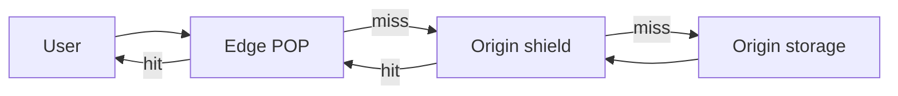

## Why this matters

Video, images, app binaries, and public APIs become bandwidth and latency problems long before they become database problems. A CDN places copies near users so a request from São Paulo does not travel to Virginia for a file that changes once a month. Interviewers bring this up in YouTube, Instagram, software download, and storefront designs. They also bring it up to see if you will cache personalized HTML by accident.

## Intuition

A CDN is a chain of warehouses. The origin is the factory. Edge locations are city warehouses. An origin shield is a regional warehouse that stops every city from calling the factory on the same miss. The label on the box, the cache key, decides whether two customers can share a box. If the label includes a user id, you do not have a shared warehouse; you have a private locker for every person, and the point of the CDN is gone.

## Core concept in depth

### What is cached

CDNs are best at **immutable or slowly changing public bytes**:

- Images, CSS, fonts, and app bundles with content-hashed names.
- Video segments and thumbnails.
- Public API GETs that are the same for many users (a product page, a sports score with a one-second TTL).
- Software packages and OS images.

They are a poor primary store for:

- Authorized, per-user JSON. You can do it with signed cookies and a private cache, but the hit ratio collapses if the key includes the user.
- Writes. The CDN is not the system of record.
- Data that must be linearizable. A cached price that is 30 seconds stale may be fine; a cached bank balance is not.

### Cache key

The default key is method, host, and path. Query strings may or may not be included; this single choice causes "why is the CDN serving the wrong image?" incidents. A correct key includes every input that changes the bytes and excludes everything that does not.

| Include in the key | Exclude |
| --- | --- |
| Path and content hash | User-Agent, unless you truly vary on it |
| Relevant query parameters (width, format) | Cache-busters that change every request |
| A normalized Accept or device class, if variants exist | Cookies, unless the content is private and you accept a low hit ratio |
| Protocol if HTTP and HTTPS bodies differ | Timestamps, random parameters |

**Vary** and custom cache policies must stay small. Varying on Accept-Language without a normalized set of languages fragments the cache into thousands of barely used copies.

### TTL, validation, and purge

Three ways to refresh:

- **TTL.** Serve until `max-age` or `s-maxage` expires. Simple. Stale until then. Use for data with a known freshness bound (a scoreboard, a public profile).
- **Content hash in the name.** The URL changes when the bytes change. TTL can be a year. This is the right model for static assets. You never purge; you publish a new name and later garbage-collect the old one.
- **Purge or ban.** The origin tells the CDN to drop a key or a tag. Purges are eventually consistent across thousands of edge nodes. Do not design a payment flow that depends on a purge completing worldwide in 100 ms. Use purges for emergency takedowns and for semi-static pages, and measure how long a ban actually takes.

**Stale-while-revalidate** and **stale-if-error** keep serving the previous object while a refresh happens or the origin is sick. That is a direct availability win for read-heavy public content. Say the stale window out loud so product partners agree.

### Origin shield and collapse

Without a shield, 200 edges missing the same new video segment at the same moment will open 200 origin fetches. An **origin shield** is a mid-tier cache: edges miss to the shield, and only the shield misses to origin. **Request collapsing** (coalescing) at each tier ensures one miss fetch is shared by concurrent waiters.

This is the CDN version of a cache stampede. Hot new content (a trailer drop, a software patch) is exactly when you need it.

### Signed URLs and private objects

For private video or downloads, the CDN still serves the bytes, but only if the URL or cookie carries a signature the edge can verify without calling origin every time: typically an expiry, a path, and an HMAC. Origin mints the signature after auth. Edges reject expired or tampered URLs. This keeps authorization at your API and keeps heavy egress at the edge.

Do not put long-lived secrets in the URL. Do not sign a URL that ignores the path, or a leaked signature becomes a site-wide bypass.

### What the CDN does not fix

- **Dynamic HTML personalized per user.** Hit ratio near zero if the key is honest.
- **Origin compute.** A cache miss still runs your expensive query. Shield and collapse reduce the multiplier, not the cost of one miss.
- **Write latency.** Uploads can ingress via the edge, but the durable write is still your object store.
- **Consistency across edges.** Two users can see different versions until TTL or purge convergence. For a given product, either that is acceptable or the object should not be cached.

### Capacity sketch

Assume 20 million hours of video a day at 5 Mbit/s, from the estimation lesson: on the order of tens of PB/day of egress. If the edge hit ratio is 95 percent, origin still sees about 5 percent, which is multiple PB/day unless the catalog is concentrated. A shield plus a handful of very hot titles cached as pre-generated renditions is what makes origin survivable. Quote a hit ratio; do not say "we use a CDN" and move on.

## Diagram



### Dry-run: a trailer published at the top of the hour

| Step | Edge | Shield | Origin |
| --- | --- | --- | --- |
| Object published with a new URL | Empty | Empty | Holds the segments |
| First viewer in a city | Miss, one fetch to shield | Miss, one fetch to origin, then fill | One GET per segment, not one per viewer |
| Next thousand viewers in that city | Hit | Idle | Idle |
| Bad segment must be pulled | New URL, or a tagged purge | Serves new object after its own miss | Replaces the object |
| Origin blip during the event | Serves stale if policy allows | Same | Errors on true misses only |

Hashed URLs make the "bad segment" row a publish of a new name, which is safer than a global purge under load.

## Runnable Python

```python
import hashlib


def cache_key(host: str, path: str, query: dict, include_params: set[str]) -> str:
    parts = [host, path]
    for name in sorted(include_params):
        if name in query:
            parts.append(name + "=" + str(query[name]))
    raw = "|".join(parts)
    return hashlib.sha256(raw.encode()).hexdigest()[:16]


def decision(age_seconds: int, max_age: int, stale_if_error: int, origin_healthy: bool) -> str:
    if age_seconds <= max_age:
        return "hit"
    if not origin_healthy and age_seconds <= max_age + stale_if_error:
        return "stale-if-error"
    return "miss"


if __name__ == "__main__":
    q = {"width": "400", "user": "42", "cb": "1711"}
    print(cache_key("img.example", "/p/9.jpg", q, {"width"}))
    print(decision(age_seconds=30, max_age=20, stale_if_error=60, origin_healthy=False))
```

The key includes width and ignores `user` and the cache-buster `cb`. Two shoppers asking for the same resized image share an object. The decision returns stale-if-error because the object is past TTL but inside the stale window while origin is unhealthy. That is the availability policy, encoded so you can argue about numbers instead of slogans.

## Complexity / trade-off analysis

| Choice | Gain | Cost |
| --- | --- | --- |
| Long TTL plus hashed names | Hit ratio, simple invalidation | Old names linger until GC; clients must learn the new URL |
| Short TTL | Fresher public data | More origin misses, lower hit ratio |
| Purge | Faster takedown than TTL | Slow global convergence, easy to over-purge |
| Origin shield | Protects origin on a miss storm | Another hop on the miss path |
| Signed URLs | Private bytes still egress at the edge | Clock skew, leaked URLs until expiry |
| Caching personalized pages | Looks fast in a demo | Terrible hit ratio, privacy bugs if the key is wrong |

## Tricks, tips, patterns

- Immutable assets get content-hashed URLs and a long TTL. Say that sentence for every static file.
- Define the cache key explicitly. Mention query-string allow-lists.
- Put an origin shield in any design whose miss storm would flatten origin.
- Use stale-if-error for public reads so an origin blip is not a user outage.
- Separate "can this be shared across users?" from "can this be cached at all?"
- For private media, authorize at the API and sign a short-lived edge URL.
- Estimate egress and the residual origin traffic after a stated hit ratio.

## Common mistakes and edge cases

- Caching a response that includes `Set-Cookie` or a per-user body under a shared key. One user's data leaks to the next.
- Forgetting that purge is not instantaneous. A takedown still needs a plan for the next few minutes, sometimes at the player or the app.
- Varying on the raw User-Agent header. Cache cardinality explodes.
- A query parameter that changes every page view (`timestamp`) included in the key. Hit ratio goes to zero.
- Assuming the CDN is in your availability zone math. Edges fail open or closed based on policy; know which.
- Using the CDN as the only copy of an upload. The system of record is the origin object store, with its own durability story.
- Signed URL expiry shorter than the video length, so playback breaks mid-title, or so long that sharing the URL is a permanent leak.

## Interview notes

For a media or image question, draw user, edge, shield, origin. State the cache key, the TTL or hash strategy, the hit ratio you are assuming, and what a miss costs. If the content is private, add the signature step before the edge GET.

If the interviewer says "users must never see the deleted video," do not promise an instant global purge. Offer hashed URLs that the API stops handing out, a purge for the old URL, and a player that re-checks authorization on a schedule.

## Practice problems

1. **Cache key (easy).** An image URL is `/p/9.jpg?width=400&user=42&ts=1711`. Which parameters belong in the CDN cache key if the resize is public?
2. **Launch storm (medium).** A game patch is 2 GB and 5 million clients start downloading within 10 minutes. What does an origin shield change about origin QPS compared with 200 edges missing independently?
3. **Private video (medium).** Design the authorization flow so the edge can serve bytes without a database call per segment, and state how you revoke access within 10 minutes.

Related: [Caching](/lessons/sd-caching), [YouTube and Netflix](/lessons/sd-video-streaming).

## Summary / cheat sheet

- A CDN caches shared bytes near users. The cache key decides whether sharing is correct.
- Prefer content-hashed names and long TTLs for immutable files. Use short TTLs or purge for mutable public data, and do not pretend purge is instant.
- Origin shield plus request collapsing protects the factory from a city-wide miss.
- Stale-if-error keeps public reads up when origin is not.
- Private content: authenticate at your API, sign a short-lived URL, serve bytes at the edge.
- Always subtract edge hits from egress before you size origin. "We use a CDN" is not a capacity plan.

## Further reading

- [RFC 9111 HTTP Caching](https://www.rfc-editor.org/rfc/rfc9111)
- [Cloudflare cache documentation](https://developers.cloudflare.com/cache/)
- [AWS CloudFront developer guide](https://docs.aws.amazon.com/AmazonCloudFront/latest/DeveloperGuide/Introduction.html)
- [Google Cloud CDN overview](https://cloud.google.com/cdn/docs/overview)
- [Designing Data-Intensive Applications, Kleppmann](https://dataintensive.net/)
