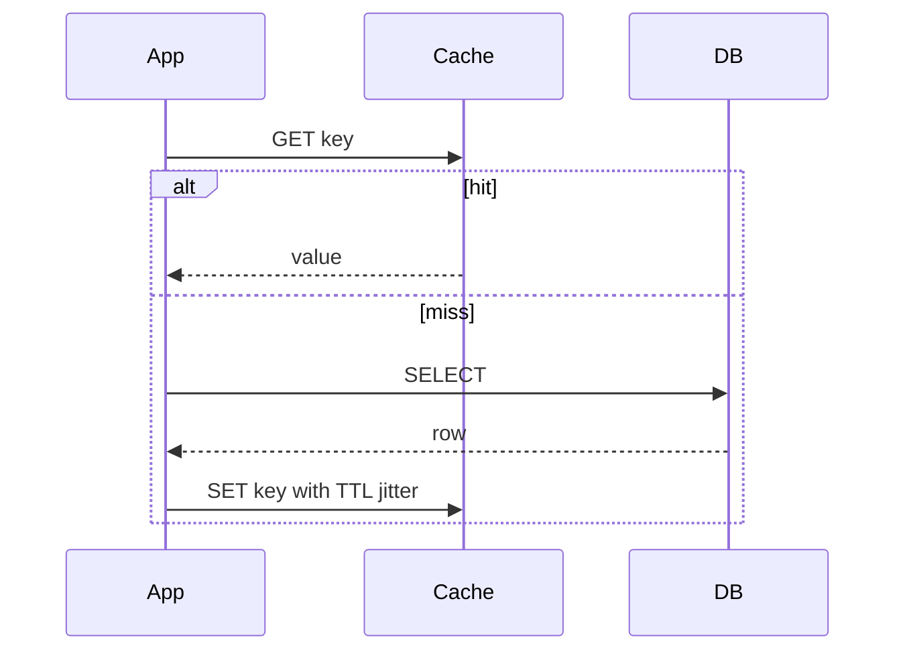

## Why this matters

Most read-heavy designs only meet their latency SLO because a cache absorbs the majority of gets. Most cache outages happen because invalidation was vague, a hot key expired, or the cache was treated as a durable database. Interviewers ask where the cache sits, what the hit ratio must be, and what the database sees when the cache is empty. You need patterns with failure behavior, not the word "Redis" by itself.

## Intuition

A cache is a small fast notebook of answers you expect to need again. The textbook on the shelf is the database: complete, slower, and still right after the notebook is erased. If you write an answer only in the notebook and the notebook is lost, the answer is gone. That is the line between a cache and a store.

The hard part is not the get. It is deciding when a notebook line is no longer true, and stopping a thousand readers from running to the shelf at the same second when a popular line is erased.

## Core concept in depth

### Where caches sit

- **Client cache.** Fastest, hardest to invalidate, tiny shared hit ratio. Use for immutable assets and short-lived private data.
- **CDN.** Shared public bytes at the edge. Previous lesson.
- **Reverse-proxy cache.** Shared HTTP GETs near the app, good for identical responses.
- **Application cache** (Redis, Memcached, in-process). The default in API designs. Holds keyed records, computed timelines, and rate-limit counters.
- **Database buffer pool.** Always there. Do not confuse it with an application cache you control; you cannot put a product-level TTL on it.

In-process caches are latency-cheap and coherence-expensive: every app instance has its own copy, so invalidation must reach every process or you accept staleness. A remote cache is one logical copy (plus its replicas) and costs a network round trip, often under a millisecond inside the region.

### Admission patterns

**Cache-aside (lazy loading).** The app reads the cache; on miss, it reads the database and fills the cache. Writes update the database and then delete or update the cache. This is the default because the cache only fills with data people actually read, and a cache failure degrades to the database rather than becoming a second source of truth.

**Write-through.** The write updates the cache and the database before success returns. Reads are usually hits for data that was just written. Write latency includes both. The cache is still not the durability source unless you say so explicitly.

**Write-back (write-behind).** The write acknowledges after the cache update and flushes to the database asynchronously. Very fast writes. A crash before flush loses data. Use only when loss is acceptable or when the cache tier itself is replicated and acknowledged, and even then say the durability story. It is a poor default for orders and payments.

**Read-through.** The cache library, not your handler, loads from the database on miss. Same consistency issues as cache-aside, with less application code and less visibility.

### Invalidation

There are two honest strategies:

- **TTL.** Every value expires. Staleness is bounded by the TTL. Simple, and it causes synchronized expiry if you are careless. Add jitter so a million keys do not expire on the same second.
- **Explicit delete on write.** After a successful database commit, delete the cache key (or update it). The next read refills. Deleting is safer than updating, because a failed delete retries into a miss, whereas a failed update can leave a wrong value with a long TTL.

A race you must mention: request A reads the database (version 1), request B writes version 2 and deletes the cache, then A fills the cache with version 1. The stale value sits until TTL. Mitigations: short TTL as a backstop, version tokens so an older fill cannot overwrite a newer key, or a lease that lets only the latest writer populate. Say the race even if you then choose "short TTL, acceptable for this product."

Do not update the database and the cache in an order that can succeed on the cache and fail on the database if the database is the source of truth. Commit the database first, then invalidate.

### Stampede and hot keys

A **stampede** (dogpile) happens when a popular key misses and thousands of requests all hit the database. Fixes:

- **Single-flight / lock.** One request rebuilds the key; others wait briefly or serve stale.
- **Stale-while-revalidate.** Keep the expired value and refresh in the background.
- **Probabilistic early refresh.** Refresh before TTL with probability that rises as expiry approaches, so one caller refreshes rather than everyone at once.

A **hot key** is a key so popular that one cache shard's CPU or NIC saturates. Fixes: replicate that key to several shards with a suffix, client-side caching of that one value, or application-level collapsing. Consistent hashing alone does not fix a single key; it only places it on one node.

### Eviction and sizing

When the cache is full it evicts. **LRU** removes the least recently used. **LFU** removes the least frequently used, which is better for a long-lived popularity skew and worse right after a traffic shift. **TTL eviction** is about freshness, not about RAM; you still need a capacity policy.

Size the cache from the hot set, not the full dataset. A 90 percent hit ratio with a cheap miss may beat a 99 percent hit ratio that costs a fleet larger than the database. State the hit ratio you need: if the database can take 5,000 reads per second and peak demand is 100,000, you need at least a 95 percent hit ratio or a different read path.

### What not to cache

- Data whose miss storm exceeds database capacity and that you cannot single-flight.
- Secrets that must disappear immediately across all processes, unless invalidation is synchronous and tested.
- Large values that blow the NIC for a modest QPS. Cache an id list and fetch bodies in a cheaper store, or compress.
- Results of authorized queries if the key forgets the caller. That is a data leak, not a performance bug.

### Failure

The cache should be optional for correctness whenever you can afford the latency. App code catches cache timeouts and reads the database, ideally with a tighter database budget so a cache outage does not also pile unbounded load downstream. If the database cannot absorb a full miss, you need stale serving, a queue, or shedding. Call that dependency out: "cache is an availability dependency, not just a latency optimization," when the hit ratio is load-bearing.

## Diagram



### Dry-run: write, then the stale-fill race

| Time | Writer | Reader | Cache |
| --- | --- | --- | --- |
| 1 |  | Reads DB version 1 | Empty |
| 2 | Commits version 2 |  |  |
| 3 | Deletes key |  | Empty |
| 4 |  | SET version 1 | Holds version 1 until TTL |
| 5 |  | Later read | Stale until expiry or a version check rejects the fill |

If step 4 uses "set only if the cached version is absent or older," and the writer stored a version watermark, the stale fill fails. If you skip that, the TTL is your bound. Pick one and say it.

## Runnable Python

```python
import random
import time


def ttl_with_jitter(base_seconds: int, jitter_ratio: float = 0.1) -> int:
    spread = int(base_seconds * jitter_ratio)
    return base_seconds + random.randint(-spread, spread)


class SingleFlight:
    def __init__(self):
        self.inflight: set[str] = set()

    def should_rebuild(self, key: str) -> bool:
        if key in self.inflight:
            return False
        self.inflight.add(key)
        return True

    def done(self, key: str) -> None:
        self.inflight.discard(key)


def hit_ratio_required(peak_qps: float, db_budget_qps: float) -> float:
    if peak_qps <= 0:
        raise ValueError("peak_qps must be positive")
    # Misses that reach the DB must fit in db_budget_qps.
    return max(0.0, 1 - (db_budget_qps / peak_qps))


if __name__ == "__main__":
    print("ttl", ttl_with_jitter(60))
    gate = SingleFlight()
    print("leader", gate.should_rebuild("hot"))
    print("waiter", gate.should_rebuild("hot"))
    print("min hit ratio", round(hit_ratio_required(100_000, 5_000), 3))
```

The hit-ratio helper says you need at least a 95 percent hit ratio when 100,000 peak reads meet a database that can take 5,000. Single-flight lets one caller rebuild `hot` while the other waits or serves stale. Jitter keeps TTLs from lining up. None of this makes the cache durable.

## Complexity / trade-off analysis

| Pattern | Read latency | Write latency | Failure |
| --- | --- | --- | --- |
| Cache-aside | Miss pays database once | Commit then delete | Stale until TTL if a race or a missed delete |
| Write-through | Usually a hit after write | Slower; both stores | Cache loss is fine if DB committed |
| Write-back | Hit | Fast ack | Data loss if cache dies before flush |
| Short TTL | More misses | Invalidation mostly free | Fresher, more database load |
| Long TTL | High hit ratio | Must delete explicitly | Longer staleness window |
| In-process cache | No network | Must invalidate N processes | Skew between instances |

## Tricks, tips, patterns

- Default to cache-aside plus delete-on-write plus a jittered TTL backstop.
- Compute the hit ratio the database requires before you promise the SLO.
- Single-flight the rebuild of any key whose miss would be expensive.
- Treat one hot key as a capacity problem, not a hashing problem.
- Cache the smallest useful value. A list of ids is often better than a megabyte blob.
- Measure hit ratio, miss latency, and eviction rate. A full cache that evicts your working set is a sizing bug.
- Say whether the system is correct if the cache is empty. If it is not, the cache is a database and needs a durability design.

## Common mistakes and edge cases

- Two writers, no version check, and a long TTL. The race in the dry-run becomes a one-hour bug.
- Negative caching forgotten. A missing key thrashes the database. Cache a short-lived "absent" marker.
- Caching errors. A blip becomes a sticky 500 until TTL. Cache successes, or cache failures for a much shorter time on purpose.
- Serialization so slow that the cache round trip costs more than the query.
- A shared cache key for an authorized response. Cross-user data leak.
- Restarting the whole cache fleet at once. That is a scheduled stampede. Roll restarts, and pre-warm if the database cannot take a cold start.
- Using the cache as a lock service and as a database and as a queue. It can do small coordination; it should not be the system of record for orders.

## Interview notes

Say: "Cache-aside in Redis, key is user id plus resource, TTL 60 seconds with jitter, delete the key after the database commit. Rebuilds are single-flighted. At a 95 percent hit ratio the database sees about 5,000 of the 100,000 peak reads. If Redis is down we serve from the database only while error rate stays inside a budget; past that we shed non-core reads." That answer covers pattern, invalidation, capacity, and failure.

If the interviewer asks "can the cache be wrong?", the answer is yes, for at most the TTL, plus the fill race, and here is why the product can live with it — or no, so this data is not cached.

## Practice problems

1. **Hit ratio (easy).** Peak read QPS is 40,000. The database can sustain 4,000. What hit ratio do you need? What does the database see if the ratio falls to 80 percent?
2. **Invalidation (medium).** A user updates a display name. List the ordered steps for cache-aside so a concurrent reader cannot permanently pin the old name for a one-hour TTL.
3. **Hot key (medium).** One celebrity profile is read 200,000 times per second and the value is 4 KB. What bottleneck appears on a single cache node, and name two mitigations that are not "add a bigger box" alone?

Related: [CDN](/lessons/sd-cdn), [Distributed cache](/lessons/sd-distributed-cache).

## Summary / cheat sheet

- A cache is a fast partial copy. The database remains the source of truth unless you explicitly design write-back durability.
- Cache-aside, delete after commit, jittered TTL: the default trio.
- The stale fill race is real. Bound it with TTL or reject older versions.
- Stampedes need single-flight or stale-while-revalidate. Hot keys need replication or collapsing, not only a hash ring.
- Size RAM from the hot set and back-solve the hit ratio from database budget.
- If correctness depends on the cache being up and fresh, you do not have a cache; you have a second database.

## Further reading

- [RFC 9111 HTTP Caching](https://www.rfc-editor.org/rfc/rfc9111)
- [Redis documentation: eviction policies](https://redis.io/docs/latest/develop/reference/eviction/)
- [Facebook: Scaling Memcache](https://research.facebook.com/publications/scaling-memcache-at-facebook/)
- [Google SRE book: Addressing Cascading Failures](https://sre.google/sre-book/addressing-cascading-failures/)
- [Designing Data-Intensive Applications, Kleppmann](https://dataintensive.net/)
