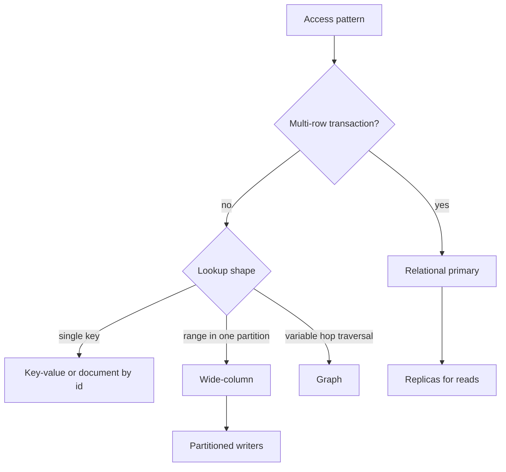

## Why this matters

The database choice is where system-design interviews are won or lost, because it fixes consistency, query shape, and how you shard later. "Use NoSQL because it scales" is not a design. Relational engines scale with replicas and careful partitioning; several NoSQL engines give you transactions now; both camps will hurt you if the access pattern does not match the data model. This lesson is a decision method you can apply in every case study.

## Intuition

A relational database is a set of tables you can recombine at read time. It is the right workshop when you do not yet know every question, and when many questions must be correct together (an order, its payment, and its inventory). A NoSQL store usually makes you store data in the shape of the question you will ask. You pay at write time, with duplicated data, so the read is a single lookup. That trade is excellent when the question is stable and huge, and painful when product managers invent a new filter every week.

Pick the model from the queries, the transaction boundary, and the write rate. The logo on the box comes last.

## Core concept in depth

### Relational (SQL)

Tables, typed columns, secondary indexes, and **ACID transactions** over a set of rows you can name. Isolation levels matter:

| Level | Prevents | Still allows |
| --- | --- | --- |
| Read uncommitted | Almost nothing; rarely used | Dirty reads |
| Read committed | Dirty reads | Non-repeatable reads |
| Repeatable read | Non-repeatable reads inside a transaction | Phantom rows, depending on the engine |
| Serializable | Anomalies that violate a serial order | Lower concurrency; possible retries |

**Atomicity** means the transaction commits entirely or not at all. **Consistency** here means constraints (foreign keys, unique, checks) hold after commit; this is not the C in CAP. **Isolation** means concurrent transactions do not see each other's half-finished work beyond the level you set. **Durability** means a commit survives a crash, typically via a write-ahead log flushed to disk and often to a replica.

Use SQL when you need multi-row transactions, rich ad-hoc queries, or strong constraints: payments, reservations, account metadata, back-office tools. A single primary handles a surprising amount of work (often thousands to low tens of thousands of simple writes per second, depending on query cost and hardware). Past that, you add read replicas, then partition by a key that matches the transaction boundary. Cross-shard transactions exist and are expensive; design so one user or one order lives on one shard.

### Key-value

A map from key to opaque value. Gets and puts by primary key are the product. Extreme scale and simple operational behavior (Dynamo-style, or Redis if it fits in memory and you accept its durability settings). No secondary queries unless you build them. Use for sessions, feature flags, shopping-cart blobs, and caches that you have decided are allowed to be the store. Do not use it as the only store if you must ask "all unpaid orders in Germany."

### Document

JSON-like documents, often with secondary indexes. A natural fit when the aggregate is one object you always read together: a product listing, a user profile, a blog post with embedded comments if comments are bounded. Transactions may exist inside one document or one partition. Weak fit for many-to-many relationships you need to query from both sides. Embedding is fast until the embedded array grows without bound (every comment on a celebrity post). Then you reference, and you have reinvented a join in application code.

### Wide-column

Rows grouped into partitions, with many sparse columns or cells, sorted inside the partition (Cassandra, Bigtable, HBase). The partition key decides distribution. The clustering key decides order on disk. You must know the queries before you pick the keys, because a query that is not "equality on partition key, then a range on the clustering key" is a cluster scan. Phenomenal for time-series, activity feeds per user, and high write rates. Hostile to arbitrary updates of a global secondary attribute unless you maintain a second table.

### Graph

Nodes and edges as first-class data. Use when the query is a traversal of variable depth: "friends of friends who like this page," fraud rings, dependency graphs. Terrible default for "store orders and scan by date," which will be slower and more expensive than SQL or a log. Most products do not need a graph database; a few edges in SQL or a precomputed table are enough until the traversal depth and fan-out are the actual product.

### How to choose

Ask four questions in order:

1. **What is the transaction?** If two pieces of data must commit together (seat sold and payment recorded), start with a relational transaction or a single-partition aggregate that holds both.
2. **What are the primary lookups?** List the queries the API actually runs. If they are all key lookups, key-value or a document by id is enough.
3. **What is the write rate and the partition key?** If writes exceed one primary, the key must spread load and still keep the transaction on one shard.
4. **What consistency does each query need?** A strongly consistent unique name fits SQL or a linearizable key. A huge append-only activity log fits a wide-column partition per user.

Polyglot persistence is normal: SQL for accounts and payments, object storage for media, Redis for cache and counters, a log for events. Each extra store is an operational and consistency burden. Add one when the access pattern demands it, not because the architecture diagram looks modern.

### A worked choice: ticket inventory versus a feed

Seat inventory: few rows per event relative to feed data, but each seat update must not double-sell. Relational row per seat, transaction that sets status from free to held if and only if it was free, unique constraint as a backstop. Sharding later by event id keeps one event's seats together.

Home feed: enormous append rate, reads are "latest N for this user," staleness of a second is fine. Wide-column or a log partitioned by user id, clustering by time descending. A relational table of all posts worldwide, queried with `ORDER BY time`, will become the incident.

Same company, two stores, two justifications. That is the interview answer.

## Diagram



### Dry-run: mapping three queries

| Query | Model | Why |
| --- | --- | --- |
| Create order and decrement stock atomically | SQL transaction on one shard keyed by warehouse or sku bucket | Isolation prevents oversell |
| Fetch profile by user id | Document or SQL by primary key, cached | One aggregate, no join on the hot path |
| Last 50 events for a device | Wide-column, partition device id, cluster by time | Write-heavy, range read, no ad-hoc join |
| "Find all devices in this city" if you did not model it | Not supported by the wide-column key above | Needs a second table or a different key; design it up front |

## Runnable Python

```python
def choose_store(needs_multi_row_txn: bool, query: str, writes_per_second: int) -> str:
    if needs_multi_row_txn and writes_per_second < 5_000:
        return "sql-single-primary"
    if needs_multi_row_txn:
        return "sql-sharded-by-transaction-key"
    if query == "get_by_id":
        return "key-value-or-document"
    if query == "range_in_partition":
        return "wide-column"
    if query == "multi_hop":
        return "graph-or-precomputed"
    return "sql-until-the-query-is-clear"


if __name__ == "__main__":
    print(choose_store(True, "order", 800))
    print(choose_store(True, "order", 20_000))
    print(choose_store(False, "range_in_partition", 80_000))
    print(choose_store(False, "search_anything", 100))
```

The helper is deliberately conservative. A transactional workload under a few thousand writes per second stays on one SQL primary. The same workload at 20,000 writes per second still wants transactions, so it shards by the transaction key instead of jumping to a store that cannot do the transaction. A range-in-partition workload at high write rate lands on wide-column. An unclear query stays on SQL where you can still add an index tomorrow.

## Complexity / trade-off analysis

| Model | Flexible queries | Write scale | Transaction scope | Typical miss |
| --- | --- | --- | --- | --- |
| Relational | High, with indexes | Medium until you shard | Multi-row, often multi-index | Hot row, cross-shard txn |
| Key-value | Only the key | Very high | One key | "How do I query by email?" |
| Document | Indexes on fields you add | High inside a partition | Usually one document or partition | Unbounded arrays, dual-sided relations |
| Wide-column | Only the designed key | Very high | One partition | A new filter the key does not support |
| Graph | Traversal | Moderate | Varies | Using it as a system of record for flat data |

Secondary indexes in distributed stores are either local (fast write, scatter read) or global (read is easy, write must update another partition). Mention that cost when you say "we will just index it."

## Tricks, tips, patterns

- List three queries before you name an engine.
- Keep the transaction boundary inside one shard. Design the key around that.
- SQL is a reasonable default for new transactional products. Explain the number that would push you off a single primary.
- Embed documents when the child collection is bounded and always read with the parent. Reference when it grows or is queried alone.
- For wide-column, say partition key and clustering key explicitly. If you cannot, you are not ready to pick that store.
- Duplicate data on purpose to match a second query, and name the job that repairs drift.
- Separate blob storage from metadata. A photo's bytes do not belong in a row.

## Common mistakes and edge cases

- Choosing a store because it is fashionable, then doing joins in the application across millions of keys.
- Assuming NoSQL means no transactions. Many engines have them inside a partition; know the boundary.
- Assuming SQL cannot scale. Replicas and sharding are normal. The pain is cross-shard transactions and operational skill, not a law of physics.
- A unique constraint you forgot. Two users create the same name because uniqueness lived only in the app.
- Isolation too weak for a read-modify-write. Two checkouts read stock = 1 and both write stock = 0. You needed a conditional update or a higher isolation level.
- Graph database for a feed. The feed is a time-ordered partition, not a traversal.
- One giant document that is rewritten on every tiny update. Write amplification and conflicts follow.

## Interview notes

Phrase the choice as: "The write is a transaction over seat and hold, so I want a relational primary, row per seat, conditional update, shard by event id when one event no longer fits. The feed read is last 50 items by user, so that table is partitioned by user id and ordered by time, and it is allowed to be a second store." Offer the migration trigger: "I leave orders on one primary until write QPS or disk approaches the limit we estimated."

If you are unsure of the query, say you will keep SQL so you can add indexes, and you will not prematurely commit to a partition key you cannot change online without a rewrite.

## Practice problems

1. **Pick a model (easy).** A URL shortener maps code to URL, with an optional daily click count. Which store, and which key? What changes if analytics must slice clicks by country in real time?
2. **Transaction bug (medium).** Two requests read balance 100 and both subtract 80 under read committed without a conditional write. What balance can you end with, and what SQL pattern prevents it?
3. **Key design (medium).** Device telemetry arrives at 200,000 points per second and is read as "last 24 hours for one device." Propose a partition key and a clustering key, and name one query this schema cannot serve.

Related: [Indexing, sharding, and replication](/lessons/sd-indexing-sharding-replication), [CAP, PACELC, and consistency](/lessons/sd-cap-pacelc-consistency).

## Summary / cheat sheet

- Choose from queries, transaction boundary, and write rate. The brand comes last.
- Relational ACID is the right default for multi-row correctness. Isolation level is part of the design.
- Key-value and document stores serve a known aggregate by key. Wide-column serves a designed partition and range.
- Graph stores serve traversal. Feeds and orders usually are not traversals.
- Shard so the transaction stays on one shard. Cross-shard transactions are the expensive exception.
- Polyglot is fine: SQL for money and identity, object store for bytes, cache for hot reads, log for append-only events.
- If you cannot name the partition key, you are not ready to leave a single SQL primary.

## Further reading

- [Designing Data-Intensive Applications, Kleppmann](https://dataintensive.net/)
- [Amazon Dynamo paper](https://www.allthingsdistributed.com/files/amazon-dynamo-sosp2007.pdf)
- [Google Bigtable paper](https://research.google/pubs/bigtable-a-distributed-storage-system-for-structured-data/)
- [PostgreSQL transaction isolation](https://www.postgresql.org/docs/current/transaction-iso.html)
- [MongoDB data modeling](https://www.mongodb.com/docs/manual/data-modeling/)
