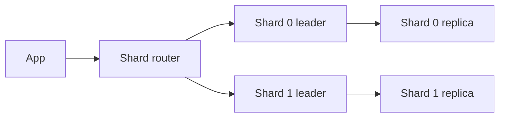

## Why this matters

A data model that cannot be indexed, copied, or split will not survive the capacity number you just estimated. Interviewers ask why a query is slow, what happens when the primary dies, and how you would split a table that no longer fits one machine. Those are indexes, replication, and sharding. They interact: an index is extra write cost, a replica is a consistency choice, and a shard key that does not match your queries creates a scatter-gather outage.

## Intuition

An index is a second table of contents that lets you open the book at the right page instead of reading every page. Replication is photocopying the book so a coffee spill does not end the store, and so more people can read at once. Sharding is splitting the encyclopedia across buildings by the first letter. If everyone suddenly wants only the letter "S," one building still burns down. The letter you pick is the whole design.

## Core concept in depth

### Indexes

An index is a data structure, usually a **B-tree** or a **log-structured merge tree**, that maps a key to a row location.

- **B-tree.** Balanced tree, good at point lookups and ranges, updates in place. The default in relational engines. Depth is small (three or four levels) so a point read is a handful of disk or cache accesses.
- **LSM-tree.** Writes hit a memory table and flush to sorted files, merged in the background. Very high write throughput. Reads may check several files unless a bloom filter says "not here." Compaction is the tax. Common in wide-column and many document stores.
- **Hash index.** Point lookup only, no useful range scan. Good for equality on a key-value engine.

A **primary index** is how the row is stored or uniquely found. A **secondary index** supports a different predicate (email, status, time). Every secondary index is write amplification: one logical update becomes several physical updates. It also consumes disk.

**Covering indexes** include the columns the query needs, so the engine never touches the base row. **Composite indexes** are ordered left to right. An index on `(account_id, created_at)` serves "this account, newest first." It does not serve "all accounts at this timestamp" efficiently. State the column order.

**Selectivity** matters. Indexing a boolean that is true for 90 percent of rows often costs more than it saves. Indexing a unique email is highly selective and usually worth it.

The write-path cost is why "just add an index" is not free on a hot table. On a table taking tens of thousands of writes per second, each extra index can become the bottleneck. Add the index that matches a measured query, not every column in the WHERE clause you might someday type.

### Replication

Replication copies writes from a primary to other nodes.

**Single-leader.** All writes go to one primary. Replicas apply the log in order. Simple and the right default. Failover promotes a replica. Risk: the primary is a write ceiling and a failure domain. Replication lag means a replica read can be stale. Semi-synchronous replication waits for at least one replica to ack before commit returns, which tightens durability and adds latency. Asynchronous replication is faster and can lose the last commits if the primary dies before shipping them.

**Multi-leader.** Several nodes accept writes. Needed for multi-region writes with local latency. Conflicts are your problem: last-writer-wins, merge functions, or avoiding conflicts by giving each region a distinct key range (user ids owned by a home region). Do not enable it because it sounds highly available.

**Leaderless.** Clients write to a quorum of replicas (Dynamo-style). No single primary. Available during partitions if you accept conflict resolution. Read repair and hinted handoff close gaps. Harder to reason about for transactions.

Failover is a product decision. Automatic promotion is fast and can cause split brain if the old primary is not fenced. Fencing uses a term number, a lease, or a shared lock so a paused primary cannot commit after a new primary exists. Say "we fence the old leader" in any design that auto-fails over.

### Sharding (partitioning)

Sharding splits rows across nodes by a **shard key**. Each shard is often itself a replicated set with a leader.

Good keys:

- High cardinality, so one key is not a huge fraction of writes.
- Present on the hot queries, so a request hits one shard.
- Stable, because changing it is a rewrite.
- Aligned with the transaction, so you do not need two shards to commit one user action.

Common schemes:

| Scheme | How it splits | Hot-spot behavior |
| --- | --- | --- |
| Range | Contiguous key ranges | Excellent for scans, terrible if time is the key and all writes hit "now" |
| Hash | Hash of the key into buckets | Even spread, no range scan across users |
| Hash plus range | Hash to a shard, sort inside it | The usual wide-column pattern |
| Directory | A lookup service maps key to shard | Flexible moves, extra hop and a new thing to operate |
| Geo / tenant | One shard set per region or customer | Isolation and residency; uneven tenants |

**Resharding** moves ranges or hash buckets to new nodes. Consistent hashing and virtual nodes reduce how much data moves; they do not make the move free. You need a plan: dual writes or a backfill, a way to read from the new owner, and a metric for imbalance.

**Scatter-gather** queries (search every shard and merge) cost tail latency and operational pain. They are acceptable for rare admin queries and unacceptable for the user hot path. If your API needs them, the shard key is wrong or you need a second store built for that query.

**Hot shards.** A celebrity, a flash sale sku, or "today" in a time-range key dumps load on one partition. Mitigations: salting the key with a small random suffix and reading all suffixes, splitting that one range, or caching. Mention the hot key when the product has celebrities, viral posts, or time-ordered ingest.

### How the three fit

Read path: client hashes the key to a shard, reads the shard primary or a follower depending on staleness tolerance, and uses an index local to that shard. A global secondary index is a second partitioned table that must be updated on write and may be stale. Local secondary indexes are naturally consistent with the shard and cannot answer "find by email" without a scatter or a dedicated lookup shard.

Write path: one shard leader appends to its log, replicates to its followers, and updates local indexes. Cross-shard transactions use a two-phase protocol or, better, are designed out.

## Diagram



### Dry-run: primary loss on shard 1

| Step | What happens | User effect |
| --- | --- | --- |
| Shard 1 leader stops | Router sees failed health or timeout | Writes to keys on shard 1 fail or wait |
| Quorum of replicas elects a new leader | Term or epoch increments; old leader fenced | Typically seconds if automated |
| Replica lag was 2 seconds, async | Those last writes may be missing | Clients retry with idempotency keys |
| Shard 0 | Unaffected | Other users stay up |
| A query that scatter-gathers all shards | Waits on shard 1 or returns partial | Tail latency or incomplete admin results |

This is why one shard down should not be a full outage, and why idempotency keys belong with any retry around failover.

## Runnable Python

```python
def shard_for(key: str, shard_count: int) -> int:
    # Stable hash so a key stays put while shard_count is fixed.
    # Changing shard_count moves almost every key; that is the reshard problem.
    return hash(key) % shard_count


def index_helps(predicate_cols: list[str], index_cols: list[str]) -> bool:
    # Leftmost prefix rule for a composite B-tree index.
    if len(predicate_cols) > len(index_cols):
        return False
    return index_cols[: len(predicate_cols)] == predicate_cols


if __name__ == "__main__":
    print("user-9 ->", shard_for("user-9", 8))
    print("user-10 ->", shard_for("user-10", 8))
    print("account then time", index_helps(["account_id"], ["account_id", "created_at"]))
    print("time only", index_helps(["created_at"], ["account_id", "created_at"]))
```

The index helper encodes the leftmost-prefix rule: an index on account id then created time serves a predicate on account id, and does not efficiently serve a predicate on created time alone. The shard helper shows two users landing independently. Do not depend on Python's built-in `hash` for a real router, because it is salted per process. In production you use a stable function such as a cryptographic hash or a documented murmur variant. The interview point is stability and modulo arithmetic, plus the warning that changing the divisor moves the keyspace.

## Complexity / trade-off analysis

| Mechanism | Helps | Hurts |
| --- | --- | --- |
| Secondary B-tree | Selective reads, ranges | Write amplification, disk, wrong column order is useless |
| LSM plus bloom filter | Write-heavy ingest | Compaction IO, read amplification |
| Async replicas | Read scale, low write latency | Stale reads, data loss window on failover |
| Sync or semi-sync replica | Smaller loss window | Write latency, availability tied to the replica |
| Hash sharding | Even write spread | No cross-key range scan |
| Range sharding | Scans and rebalancing ranges | Hot "now" range |
| Global secondary index | Non-shard-key lookups | Extra write hop, another consistency story |
| Automatic failover | Lower MTTR | Split brain unless you fence |

## Tricks, tips, patterns

- Say the index column order and the query it serves. Mention leftmost prefix.
- Default to single-leader replication per shard. Justify anything else.
- Mention fencing when you say automatic failover.
- Pick a shard key that is on the hot path and spreads writes. Name a hot-key plan if the product has celebrities or a clock.
- Prefer local transactions on one shard over distributed transactions.
- Treat resharding as a project: backfill, dual read, cut over. Not a flag.
- Read replicas are for reads that tolerate lag, or for reads that can fall back to the leader after a write (read-your-writes).

## Common mistakes and edge cases

- Indexing every column. Write throughput collapses and the planner still picks a bad index.
- Composite index in the wrong order, then blaming the database.
- Promoting a replica that was far behind and telling users their last minute of writes "probably made it."
- Shard key = timestamp. Every insert hits one shard. A classic outage.
- Shard key = user id, then a query "all users in this city" that fans out to every shard on the hot path.
- Forgetting that unique email constraints are easy on one primary and hard across shards. You need a dedicated lookup partition or a lock service.
- Rebalancing that moves data but not the router's map, so writes hit the old owner.

## Interview notes

Draw shards as small replicated groups, not as lone boxes. Label the key. When asked "the primary dies," walk the dry-run: elect, fence, retry idempotently, other shards stay up. When asked "this query is slow," ask for the predicate and either propose an index with column order or admit the query does not match the shard key and needs a different table.

A strong line: "I shard orders by customer id so checkout touches one shard. The lookup 'order by id' goes through a thin mapping or an id that embeds the shard. I do not scatter-gather to render a cart."

## Practice problems

1. **Index order (easy).** Queries are "orders for customer C in the last day" and "order by id." Which indexes do you create, and which column goes first on the composite?
2. **Failover (medium).** Async replication lag is 5 seconds when the leader disk stalls and then dies. What can clients observe, and what application mechanism makes the retry safe?
3. **Shard key (medium).** A chat product shards messages by sender id. Explain why reading a conversation becomes a scatter, and propose a better key.

Related: [SQL and NoSQL](/lessons/sd-sql-nosql), [Consistent hashing and bloom filters](/lessons/sd-consistent-hashing-bloom-filters).

## Summary / cheat sheet

- B-tree indexes serve point and range lookups. Column order is the leftmost-prefix rule. Each secondary index taxes writes.
- LSM-trees favor writes and rely on compaction and bloom filters for reads.
- Single-leader replication is the default. Lag is staleness. Failover must fence the old leader.
- Multi-leader and leaderless replication buy local writes or partition availability and add conflict handling.
- Shard by a high-cardinality key that your hot query already has. Avoid time as the only key.
- Scatter-gather is not a hot-path strategy. Resharding is a migration, not a toggle.
- One shard's failure should not take down the others. Idempotency makes failover retries safe.

## Further reading

- [Designing Data-Intensive Applications, Kleppmann](https://dataintensive.net/)
- [PostgreSQL index documentation](https://www.postgresql.org/docs/current/indexes.html)
- [Google Bigtable paper](https://research.google/pubs/bigtable-a-distributed-storage-system-for-structured-data/)
- [Amazon Dynamo paper](https://www.allthingsdistributed.com/files/amazon-dynamo-sosp2007.pdf)
- [MongoDB sharding](https://www.mongodb.com/docs/manual/sharding/)
