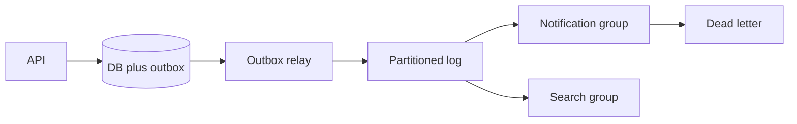

## Why this matters

Synchronous designs fall over when a slow dependency sits on the user path, or when one write must fan out to a thousand followers. A queue or a log lets the request record intent quickly and lets other workers drain that intent at their own pace. Interviewers look for delivery guarantees, ordering, backpressure, and what happens when a consumer crashes after a side effect but before an ack. "We will put Kafka in the middle" without those sentences is a slogan.

## Intuition

A queue is a take-a-number line. Each job is done by one worker and then forgotten. A log is a security camera: events stay in order, many people can watch the same tape, and a new detective can rewind. Use a queue when the work is a task to complete once. Use a log when several systems must each see every event, or when you may need to rebuild a database by replaying history.

Neither magically delivers exactly once. Networks duplicate messages. Your consumer must be safe when the same message arrives twice.

## Core concept in depth

### What a queue gives you

- **Temporal decoupling.** The producer succeeds after a durable enqueue, even if the worker is busy.
- **Load leveling.** A spike becomes a backlog instead of a pile of failed user requests, as long as the backlog drains before its SLO (for example, "emails may take 2 minutes").
- **Isolation.** A slow thumbnailer does not exhaust API threads.

Costs: operational complexity, delayed visibility, and the need for idempotency. The user path is only faster if the durable write to the queue is cheaper than the work you removed.

### Delivery guarantees

| Guarantee | Meaning | What you still do |
| --- | --- | --- |
| At-most-once | Send or ack without retry | Accept loss on a crash |
| At-least-once | Retry until the consumer acks | Deduplicate; side effects must be idempotent |
| Exactly-once | A processing effect becomes visible once | Usually "effectively once": transactional consume plus idempotent sink, in a defined scope |

True exactly-once across an external email provider or a bank is not something the broker can promise. The honest design is at-least-once plus an idempotency key stored with the side effect: "charge this id once," "send this notification id once."

Ack after the side effect commits, not before. If you ack first and then crash, the message is gone and the work did not happen (at-most-once by accident). If you do the side effect and crash before ack, the message redelivers and your idempotency key saves you.

### Ordering, visibility, and poison messages

Inside one partition or one queue group, messages can be ordered. Across partitions, order is not global. Choose a partition key equal to the entity whose order matters (conversation id, account id). Do not promise global order unless you use a single partition, which caps throughput at one log writer.

**Visibility timeout** (typical of task queues): a worker hides a message while handling it. If the worker dies, the message reappears. The timeout must exceed normal handling time, or a slow success becomes a double execution. It must not be infinite, or a dead worker stalls the queue.

**Dead-letter queue.** After N failures, park the message and alert. A poison message (a payload that always throws) must not block the partition forever. For a log, a consumer that cannot skip a poison record blocks that partition; you need a quarantine policy and a way to advance the offset after human inspection.

### Kafka-style logs

A **topic** is split into **partitions**. Each partition is an append-only ordered log. Producers append. Consumers in a **group** split partitions among themselves: one partition is read by one consumer in the group at a time, which is how you get both parallelism and per-key order. A second consumer group reads the same log independently (fan-out to analytics and to the notification service).

The **offset** is the consumer's bookmark. Committing an offset is the ack. Retention is by time or size, not "until ack," so multiple groups can move at different speeds, and you can replay after a bug by rewinding offsets. That replay ability is why logs are the backbone of event-driven systems and of rebuilding a search index.

Throughput scales by adding partitions, with caveats: keys hash to partitions, so a hot key is a hot partition; too many partitions costs memory and recovery time on the broker. Order is only inside the partition.

Replication in Kafka is a leader and followers per partition. The producer chooses durability with `acks`: leader only, or all in-sync replicas. The latter survives a leader crash without losing acknowledged writes, at higher latency. Say "acks all" for anything you cannot lose.

### Backpressure

A queue hides overload until disk fills or lag exceeds the product SLO. Monitor **time in queue** (age of the oldest message), not only message count. A million tiny messages may be fine; a thousand messages that are an hour old may violate the SLO.

When age grows, you have three levers: add consumers (if the bottleneck is CPU and partitions allow), shed low-value message types, or push back on the producer so it stops accepting user work you cannot finish. An unbounded "we will catch up tonight" story is how notification systems end up sending yesterday's alerts.

### Outbox pattern

A common bug is "commit the database, then publish the event," and the process crashes in between. The **transactional outbox** writes the business row and an outbox row in the same database transaction. A relay publishes the outbox to the log and marks it sent. Readers get at-least-once events that match committed data. Without this, your log and your database disagree, and no consumer can fix that.

## Diagram



### Dry-run: consumer crash

| Step | Offset | Side effect | Outcome |
| --- | --- | --- | --- |
| Message delivered | Not committed | Charge starts |  |
| Charge commits with key pay-88 | Not committed | Ledger row exists |  |
| Worker crashes | Still not committed |  | Redelivery |
| Second delivery | Same key pay-88 | Ledger insert is a no-op | One charge |
| Offset commits | Committed |  | Message will not redeliver to this group |

If the ledger insert is not idempotent, the user is charged twice. The log did its job. The bug is in the consumer.

## Runnable Python

```python
def handle(message: dict, ledger: dict) -> str:
    key = message["idempotency_key"]
    if key in ledger:
        return "duplicate"
    ledger[key] = {"amount": message["amount"], "status": "captured"}
    return "processed"


def partition(key: str, partitions: int) -> int:
    total = 0
    for ch in key:
        total = (total + ord(ch)) % 100_000
    return total % partitions


if __name__ == "__main__":
    ledger: dict = {}
    msg = {"idempotency_key": "pay-88", "amount": 500}
    print(handle(msg, ledger))
    print(handle(msg, ledger))
    print("p", partition("conversation-42", 12))
    print("same", partition("conversation-42", 12))
```

The first handle call records the charge. The second sees `pay-88` and does not capture again. That is the entire exactly-once-effect story most systems can honestly claim. The partition function is stable for a given key, so all messages for one conversation stay ordered on one partition. It is not a cryptographic hash; it is a teaching stand-in for "same key, same partition."

## Complexity / trade-off analysis

| Choice | Gain | Cost |
| --- | --- | --- |
| Task queue | Simple work distribution, hiding and retries | Weak replay, usually one consumer group semantics |
| Partitioned log | Replay, many consumer groups, order per key | Partition management, hot keys, retention cost |
| Ack after side effect | No lost work | Duplicates; must be idempotent |
| Ack before side effect | No duplicates from redelivery | Lost work if you crash |
| Many partitions | More parallel consumers | Hot key still sticks to one; slower recovery |
| acks = all replicas | Acknowledged writes survive leader loss | Higher produce latency |
| Outbox | DB and log agree | Relay lag, another moving piece |
| Single partition | Global order | Throughput ceiling |

## Tricks, tips, patterns

- Say at-least-once plus idempotency key. Do not promise exactly-once to an email provider.
- Partition by the entity that needs order. State that global order is not on offer.
- Commit offsets after the side effect. Park poison messages.
- Alert on queue age. Add consumers only if partitions and the downstream can take them.
- Use an outbox when an event must match a database commit.
- Keep payloads small. Put large bytes in object storage and the pointer in the message.
- Version the schema. Consumers must tolerate a new field and a missing old one during a rollout.

## Common mistakes and edge cases

- Doing a non-idempotent charge and hoping the broker will not redeliver. It will.
- Using one global topic with no key and then debugging order bugs that the system never promised to avoid.
- A visibility timeout shorter than processing. Successful work runs twice and also "times out."
- No dead-letter path. One bad payload halts a partition and the lag page never clears.
- Producing from the request path with a huge synchronous fan-out still in the request. The queue should replace the fan-out, not sit beside it.
- Retention so short that a consumer recovering from a bug cannot replay.
- Ignoring the dual-write crash between database and broker. That is the outbox's job.

## Interview notes

Draw producer, log with partitions, two consumer groups, and a dead-letter path. Say the key (conversation id or account id), the ack point, and the idempotency store. If the interviewer doubles traffic, add partitions and consumers, and call out the hot key that will not spread.

For a feed or notification fan-out: "The post API writes the post and an outbox row, returns, and the fan-out workers consume the log at their pace. The user does not wait for a million timeline inserts."

## Practice problems

1. **Duplicate delivery (easy).** A worker sends an email, then crashes before ack. What does the user receive if send is retried with no id? What do you store to prevent a second email?
2. **Ordering (medium).** Payments for one account must apply in order, but accounts are independent. How do you key partitions, and why is a single partition the wrong global fix?
3. **Lag (medium).** Queue age is 15 minutes and the SLO is 1 minute. Consumers are at 40 percent CPU and there are 4 partitions. What do you change first, and what do you not change?

Related: [Sagas](/lessons/sd-sagas), [Notifications](/lessons/sd-notifications).

## Summary / cheat sheet

- Queues level load and remove slow work from the user path. Logs retain an ordered history that many groups can read and rewind.
- Plan for at-least-once. Make the consumer idempotent with a key stored beside the side effect.
- Ack after success. Dead-letter poison messages. Alert on age.
- Order exists inside one partition. The partition key is the entity that needs order.
- Hot keys create hot partitions. More partitions do not fix one celebrity.
- The outbox pattern ties a database commit to a publish without a dual-write crash window.
- Exactly-once is a scope you define around an idempotent sink, not a checkbox on the broker.

## Further reading

- [Kafka documentation: design](https://kafka.apache.org/documentation/#design)
- [AWS SQS developer guide](https://docs.aws.amazon.com/AWSSimpleQueueService/latest/SQSDeveloperGuide/welcome.html)
- [Google SRE book: Handling Overload](https://sre.google/sre-book/handling-overload/)
- [Microservices: the transactional outbox, Richardson](https://microservices.io/patterns/data/transactional-outbox.html)
- [Designing Data-Intensive Applications, Kleppmann](https://dataintensive.net/)
