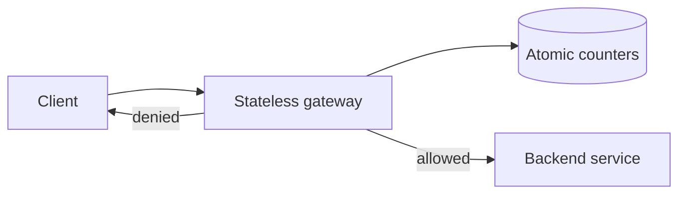

## Why this matters

The front door of a product API is where authentication, tenant routing, request budgets, and abuse control meet. If these live only inside one service, every new service reinvents them and the first public endpoint forgets. If they live in a gateway with no numbers, a single tenant can still drown the platform. This lesson covers the gateway's job and the rate-limit algorithms interviews expect you to derive, not just name.

## Intuition

A gateway is the building receptionist: checks the badge, tells you which floor, stops you from holding the elevator, and writes your name in the log. It is not the team that does the actual work. Rate limiting is the rule that a guest can only call the front desk so many times a minute. The shape of the rule matters. A token bucket lets a guest talk quickly for a short burst after staying quiet. A leaky bucket forces a steady pace. Picking the wrong shape either rejects legitimate traffic spikes or lets an attacker send a huge burst that still "averages" to the allowed rate.

## Core concept in depth

### What belongs in the gateway

- **Authentication verification.** Check a signature or introspect a token. Do not hide business authorization ("can this user refund this order?") only at the edge if the service can be reached another way. The service still checks identity. The gateway rejects anonymous junk early.
- **Routing.** `/payments` to the payments cluster, `/search` to search, with separate timeouts.
- **Request limits.** Body size, header size, connection count, and a coarse rate limit.
- **Cross-cutting policy.** Request ids, CORS, TLS, and maybe a WAF.
- **Edge aggregation** sparingly. A gateway that calls five services and stitches JSON becomes a bottleneck and a second monolith. Prefer a dedicated backend-for-frontend if you truly need aggregation.

What does not belong: long business transactions, direct database access, and unbounded transformations of the body. The gateway must stay stateless aside from a shared counter store, or it will not scale and will not fail independently.

### Limit dimensions

Decide the key and the budget:

| Key | Protects | Typical budget |
| --- | --- | --- |
| Per IP | Anonymous abuse, scraping | Low, with care for NAT (many users, one address) |
| Per user or API token | Tenant fairness | Product quota |
| Per route | A cheap endpoint versus an expensive search | Separate buckets |
| Global | The platform's absolute ceiling | Capacity of the bottleneck behind |

A single global limit does not create fairness. A single per-user limit does not save you from a million users acting together. You want both a local fairness limit and a global admission limit tied to real capacity.

Return `429` with a `Retry-After` hint. Failing as a generic 500 makes clients retry immediately and worsens the stampede.

### Token bucket

A bucket holds up to `capacity` tokens. Tokens refill at `rate` per second, capped at capacity. Each request takes one token (or more, if the route is expensive). If the bucket is empty, reject.

This allows a burst of size `capacity` and a sustained rate of `rate`. It matches human traffic: a user loads a page (burst) then reads (quiet). Parameters you must state: refill rate, burst capacity, and the key.

### Leaky bucket

Requests enter a queue that drains at a constant rate. The output is smooth. If the queue is full, reject. Good when a downstream system cannot tolerate bursts (a mainframe, a partner API with a strict steady quota). Worse when users legitimately burst, because you either queue (add latency) or reject the burst that a token bucket would have allowed.

### Fixed window versus sliding window

**Fixed window:** count requests in the current clock minute. Simple, and wrong at the boundary: a client can send the full quota at 12:00:59 and again at 12:01:00, nearly two quotas in two seconds.

**Sliding window log:** store each timestamp and count those inside the last 60 seconds. Accurate, memory-heavy at high QPS.

**Sliding window counter:** keep the previous window's count and the current count, and weight the previous window by how far you are into the current one. Approximate, cheap, and good enough for product quotas. Say that it is an approximation if you use it.

### Where the counter lives

A single gateway process can count in memory and be wrong as soon as you run two processes. A correct distributed limit uses a shared store (Redis or a dedicated service) with an atomic increment, or accepts a small error by counting locally and synchronizing.

Atomic token bucket in Redis is usually a small script: read tokens and last refill time, compute refill from elapsed time, decide allow or deny, write back. Do this in one round trip so two requests cannot both see one token. Local buckets in each gateway plus a periodic sync allow more burst than you configured (one burst per node). That is acceptable for best-effort abuse control and unacceptable for a billing quota. Say which you are building.

Hot keys appear here too: one tenant's counter is a single key. If that tenant is allowed a huge rate, the counter shard melts. Shard the counter into stripes and sum them, accepting a little race, or give that tenant a local budget on each gateway that sums to the global budget.

### Placement relative to capacity

Rate limits are not a substitute for autoscaling, and autoscaling is not a substitute for limits. Limits protect a dependency whose ceiling is real: a database, a partner API, a certificate authority. Set the global limit near the bottleneck's safe rate, not at a vanity number. If search can do 2,000 QPS before p99 breaks, the gateway should start shedding search traffic before 2,000, not after the database is already dead.

## Diagram



### Dry-run: token bucket, rate 1 per second, capacity 3

| Time (s) | Event | Tokens after | Decision |
| --- | --- | --- | --- |
| 0 | Start full | 3 |  |
| 0.0 | 3 requests | 0 | Allow all three (the burst) |
| 0.2 | 1 request | 0 | Deny |
| 2.0 | Refill 2, then 1 request | 1 | Allow |
| 2.0 | 2 more requests | 0 then deny | One allow, one deny |

A fixed window of 1 per second would have told a different story at the boundary and would not have expressed "burst of 3" as a separate knob. Call out both knobs in the interview.

## Runnable Python

```python
class TokenBucket:
    def __init__(self, rate: float, capacity: float):
        self.rate = rate
        self.capacity = capacity
        self.tokens = capacity
        self.updated_at = 0.0

    def allow(self, now: float, cost: float = 1.0) -> bool:
        elapsed = now - self.updated_at
        self.updated_at = now
        self.tokens = min(self.capacity, self.tokens + elapsed * self.rate)
        if self.tokens < cost:
            return False
        self.tokens -= cost
        return True


if __name__ == "__main__":
    bucket = TokenBucket(rate=1.0, capacity=3.0)
    for t in (0.0, 0.0, 0.0, 0.2, 2.0):
        print(t, bucket.allow(t), round(bucket.tokens, 2))
```

Walk the prints against the dry-run table. Three immediate allows drain the burst. The call at 0.2 seconds is rejected. After two seconds of refill the bucket has two tokens, so the next call succeeds and leaves one. This is the algorithm to recreate on a whiteboard if the interviewer asks "how would you implement it?"

## Complexity / trade-off analysis

| Approach | Burst behavior | Accuracy | Cost |
| --- | --- | --- | --- |
| Token bucket | Allows a configured burst, then a steady rate | Exact if the update is atomic | One shared key per subject |
| Leaky bucket | Smooth output | Exact drain rate | Queuing latency or hard rejects |
| Fixed window | Double allowance at the boundary | Poor at the edge | Very cheap |
| Sliding log | True trailing window | Exact | Memory grows with QPS |
| Sliding window counter | Close to a trailing window | Approximate | Two integers per key |
| In-process counters | Burst times N gateways | Weak globally | No extra hop |
| Central atomic counter | One shared truth | Strong | Latency and a hot key |

## Tricks, tips, patterns

- Separate gateway policy from service authorization. Defense in depth, not either-or.
- Use a token bucket for user APIs. Name rate and burst. Use a leaky bucket for a fragile partner.
- Key the limit by token and by route. A global cap backs both.
- Make the check atomic. Two gateways must not both spend the last token.
- Reject with 429 and Retry-After. Do not invite an immediate retry storm.
- Tie the global ceiling to the bottleneck you measured, not to a round number from a slide.
- Charge more tokens for expensive routes (search, report) than for a ping.

## Common mistakes and edge cases

- Limiting only by IP. Carrier NAT means one limit shared by a stadium, or one abuser rotating addresses.
- A limit so high it never fires, plus no global cap. The database dies first.
- Counting after the backend call. You paid the expensive work before deciding to reject.
- Forgetting that health checks and internal jobs share the gateway and burn the budget.
- Clock skew across gateways if each computes windows from its own clock without a shared store.
- Returning 500 on limit, so well-meaning clients retry with backoff that is still too aggressive, or with no backoff at all.
- Putting business workflows in the gateway until it is the only component that knows every service.

## Interview notes

Draw the client, a stateless gateway fleet, a counter store, and the backend. Say what is limited (per token, per route, global), which algorithm, and that the increment is atomic. Mention 429 and idempotent retries so a limit is not confused with a failed charge.

If the prompt is "design a rate limiter" as a whole system, keep going into the case study: multi-region counters, Redis failure mode, and configuration rollout. This lesson is the component; the case study is the product.

## Practice problems

1. **Boundary bug (easy).** A fixed window allows 100 requests per minute. Show a pattern that sends about 200 requests in a short span without breaking the counter. Which algorithm stops it?
2. **Parameters (medium).** A client may call `GET /feed` in a burst of 20, then sustain 5 per second. Pick token-bucket rate and capacity. What happens on request 21 at t = 0?
3. **Fairness (medium).** One tenant is allowed 50,000 requests per second and you have 10 gateway tasks. Why is a single counter key a problem, and what stripe or local-budget approach keeps the tenant inside twice the intended rate at worst?

Related: [Rate limiter case study](/lessons/sd-rate-limiter), [Load balancers and reverse proxies](/lessons/sd-load-balancing-reverse-proxy).

## Summary / cheat sheet

- The gateway authenticates early, routes, caps body and rate, and stays off the business transaction path.
- Token bucket: refill rate plus burst capacity. Leaky bucket: constant drain. Fixed windows double-allow at the boundary.
- Sliding window counters approximate a trailing window with two integers.
- Distributed quotas need an atomic shared update. In-memory counts allow one burst per node.
- Limit by identity and by route, and keep a global ceiling at the real bottleneck.
- Deny with 429 and a retry hint. Check the limit before the expensive call.
- Hot tenants create hot counter keys. Stripe them or split the budget across gateways on purpose.

## Further reading

- [RFC 6585: 429 Too Many Requests](https://www.rfc-editor.org/rfc/rfc6585)
- [Cloudflare rate limiting algorithms](https://developers.cloudflare.com/waf/rate-limiting-rules/)
- [Envoy global rate limiting](https://www.envoyproxy.io/docs/envoy/latest/configuration/http/http_filters/rate_limit_filter)
- [Stripe API rate limits](https://docs.stripe.com/rate-limits)
- [Redis documentation](https://redis.io/docs/latest/)
