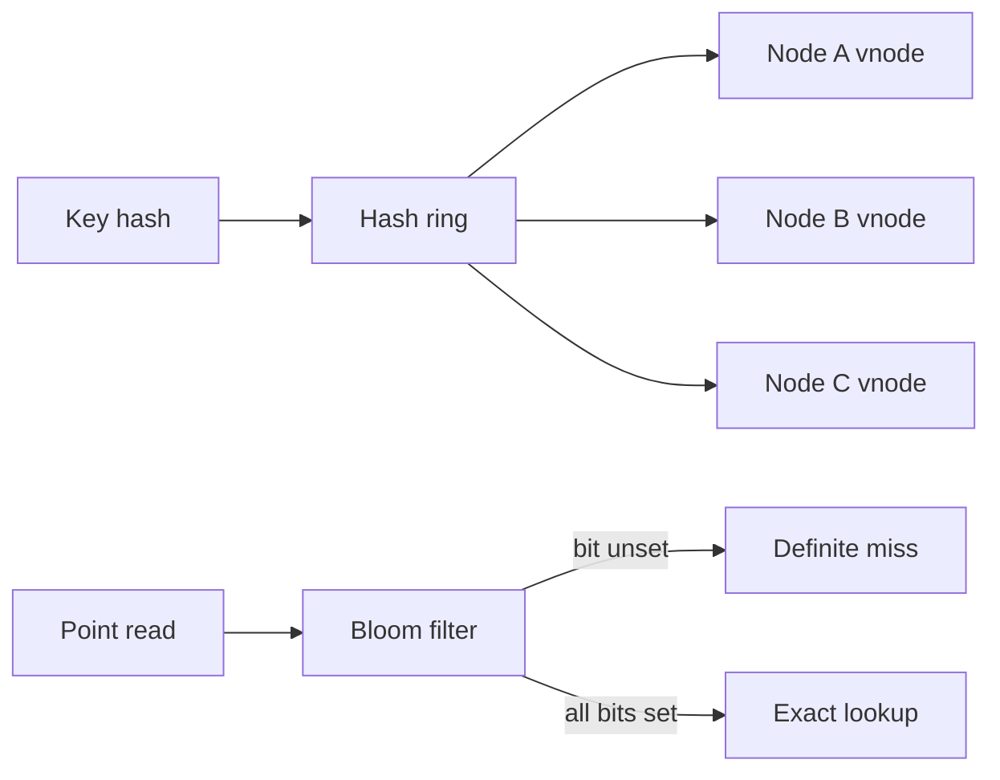

## Why this matters

Two interview whiteboards show up constantly: a cache or shard map that must not reshuffle every key when a node dies, and a lookup that is usually "no" and must not hit disk to prove it. Consistent hashing solves the first. A bloom filter solves the second. Both are small algorithms with sharp trade-offs. You should be able to derive them, place them in a real path, and say what they do not guarantee.

## Intuition

Consistent hashing is assigning seats around a circular table by the hash of a name. Each person walks clockwise to the next host. When a host leaves, only the people who were walking to that host continue to the next one. Everyone else keeps their seat. If you had numbered hosts from zero to N minus one and used hash modulo N, almost everyone would stand up and move when N changes.

A bloom filter is a checklist of bits that can say "this name was never written here" with certainty, and "this name might have been written here" with a known chance of being wrong. It never says "definitely yes." That asymmetry is the feature: a definite no skips an expensive lookup.

## Core concept in depth

### The ring

Hash the node id onto a circle (for example the range of a 64-bit hash, thought of as a ring). Hash the key the same way. The owner is the first node clockwise from the key. Adding a node takes over the arc between its predecessor and itself. Removing a node gives that arc to the clockwise neighbor. The fraction of keys that move is about 1/N when you add or remove one node from N, instead of almost all keys under modulo N.

**Virtual nodes** fix imbalance and heterogeneous hardware. Each physical server owns many points on the ring (V random positions). With one point per server, unlucky placement gives one server a huge arc. With 100 or more virtual nodes, arcs average out. A bigger machine gets more virtual nodes and therefore more keys. When a physical server dies, all of its virtual nodes leave, and the load spreads across many neighbors instead of dumping onto one unlucky successor.

**Replication** on the ring: store the key on the next R distinct physical servers clockwise, skipping virtual nodes that belong to a server you already chose. Losing one server leaves R minus one copies. This is the Dynamo placement style. It is not the same as a primary plus followers elected inside a fixed shard, but it solves a similar durability problem. Say which one you are using so you do not mix failover stories.

**Client view.** Clients need the ring. Options: a configuration service pushes the membership, or a small proxy tier owns the map so clients stay dumb. Stale maps cause misses: a client reads the old owner after a move. Version the map and treat a wrong-owner response as a refresh, not as "the key does not exist."

What the ring does not do: it does not split a single hot key. That key still hashes to one place. Salting and caching remain necessary.

### Bounded loads and rebalancing

Even with virtual nodes, a node can be hot because of key popularity, not arc length. **Bounded-load consistent hashing** tries the clockwise owner and, if that node is over a load threshold, walks further. You gain balance and may add an extra hop of indirection. Mention it if the interviewer pushes on imbalance; do not start there.

When you add capacity, only the moved arcs need to stream data. That is still a lot of bytes. Throttle the copy, serve reads from the old owner until the new owner has the key (or use a directory), and do not drop the old copy until the new one acks.

### Bloom filters

A bloom filter is a bit array of length m and k independent hash functions. Insert: set the k bits for the item. Query: if any of the k bits is 0, the item is **definitely absent**. If all are 1, the item is **maybe present**. You cannot delete by clearing bits, because another item may share them. (Counting bloom filters and cuckoo filters allow deletion; say so if deletes matter.)

The false-positive rate depends on m, k, and the number of inserted items n. A useful planning formula for the optimal k and a target false-positive rate p is:

- bits per item is about 1.44 × log2(1/p)
- k is about (m/n) × ln(2)

For about 1 percent false positives, plan roughly 10 bits per item and around 7 hash functions. For 0.1 percent, plan closer to 15 bits per item. These are interview-grade figures; the exact optimum can be computed, and you should not pretend a bloom filter is "a set."

Memory example: 100 million keys at 10 bits each is 1e9 bits, about 125 MB. That can sit in RAM in front of a multi-terabyte table. A 1 percent false-positive rate means 1 percent of absent keys still pay for a disk lookup. Present keys always pay for the lookup, because the filter cannot confirm them. So the win is entirely on the misses, which in many systems (cache, username availability is the opposite case, LSM "does this SSTable contain the key?") are the common case.

### Where bloom filters sit

- **LSM-tree SSTables.** Each file has a filter. A read skips files that definitely do not contain the key. This is why the structure can stay fast.
- **Cache miss shield.** "Do we even store this URL?" Avoids hammering a database with keys that were never written. Only if the filter is allowed to be slightly stale or is rebuilt with the data.
- **Distributed joins and backups.** "Does the other side have this id?" before shipping a payload.
- **Abuse.** A filter of leaked passwords or bot ids, where a false positive triggers a slower exact check.

Never use a bloom filter as the only authorization check. A false positive would grant or deny the wrong person if you treat "maybe" as "yes" without a second lookup. The pattern is: definite no stops; maybe continues to the source of truth.

### Cache plus bloom filter

A negative cache and a bloom filter both reduce misses. The filter is tiny and approximate. A negative cache entry is exact and short-lived. Combine them: the filter answers "we have never heard of this key" for the bulk of junk, and the database or an exact store answers the maybes. Rebuild the filter when the underlying set changes a lot, or use a structure that supports deletes if churn is high. A stale filter that still says "maybe" only costs extra lookups. A stale filter that says "no" after the key was inserted is a correctness bug. So you update the filter on insert before you consider the insert visible, or you accept a rebuild lag only on a path where "no" means "check origin anyway."

## Diagram



### Dry-run: remove one node

Four physical nodes, many virtual nodes, replication factor 2. Node C leaves.

| Keys | Before | After | Moved? |
| --- | --- | --- | --- |
| Arc owned by A | A, then B | A, then B | No |
| Arc owned by C | C, then D | D, then next distinct | Yes, about one quarter of keys if arcs are even |
| Arc owned by D | D, then A | D, then A | No |
| Hot key that hashed to A | Still A | Still A | No; hashing did not split popularity |

Modulo-4 placement would have moved most keys when the count became 3. That contrast is the whole reason the ring exists.

## Runnable Python

```python
import hashlib


def point(value: str) -> int:
    digest = hashlib.sha256(value.encode()).hexdigest()
    return int(digest[:8], 16)


def owner(key: str, nodes: list[str]) -> str:
    positions = sorted((point(n), n) for n in nodes)
    target = point(key)
    for pos, name in positions:
        if pos >= target:
            return name
    return positions[0][1]


class Bloom:
    def __init__(self, size: int):
        self.size = size
        self.bits = [0] * size

    def _indexes(self, item: str) -> list[int]:
        h1 = point(item) % self.size
        h2 = point("k2:" + item) % self.size
        return [h1, (h1 + h2) % self.size, (h1 + 2 * h2) % self.size]

    def add(self, item: str) -> None:
        for i in self._indexes(item):
            self.bits[i] = 1

    def might_contain(self, item: str) -> bool:
        return all(self.bits[i] == 1 for i in self._indexes(item))


if __name__ == "__main__":
    nodes = ["a", "b", "c", "d"]
    print("with c", owner("user-42", nodes))
    print("without c", owner("user-42", ["a", "b", "d"]))
    bloom = Bloom(64)
    bloom.add("alpha")
    print("alpha", bloom.might_contain("alpha"))
    print("missing", bloom.might_contain("no-such-key"))
```

`owner` walks clockwise and wraps to the first node, which is the ring. Removing `c` changes the owner only when `user-42` previously landed on `c`. Run it a few times with different keys in the playground and count how many owners flip; it will not be "almost all," which is the lesson. The bloom filter's `might_contain("alpha")` stays true after insert. A missing key is usually false in a large filter and only sometimes true. A 64-bit demo filter false-positives more than a production filter sized at about 10 bits per item. Use the demo to show the API, and use the bits-per-item formula to size the real one.

## Complexity / trade-off analysis

| Idea | Benefit | Cost |
| --- | --- | --- |
| Ring instead of modulo | About 1/N keys move on membership change | More complex routing and replication placement |
| Virtual nodes | Balanced arcs, weighted machines | Larger membership map |
| Bounded load | Fewer overloaded owners | Extra forwarding rules |
| Bloom filter on misses | Skips disk when bits are unset | False positives, no deletion in the basic form, RAM |
| More bits per item | Lower false-positive rate | Memory |
| Cuckoo filter | Deletion and often better space | More implementation care |
| Exact negative cache | No false answers | Much more memory per key, expiry policy |

Space for a bloom filter is O(n) bits with a small constant. Lookup is O(k) hash computations, independent of how many items you inserted, until the false-positive rate rots because you inserted more than you sized for. When n grows past the design point, rebuild with a larger array. Do not keep inserting forever.

## Tricks, tips, patterns

- Compare modulo and ring with one sentence: modulo moves almost everything, the ring moves about one node's share.
- Put virtual nodes in the first drawing if machines differ in size or you only have a handful of physical nodes.
- Replicate to the next R distinct physical machines, not the next R virtual nodes of the same machine.
- Version the membership map. A stale client must refresh, not invent a cache miss.
- Size a bloom filter from the false-positive rate: about 10 bits per key for roughly 1 percent.
- Treat "maybe" as "go to the source of truth." Treat "no" as authoritative only if inserts update the filter first.
- A hot key is still one key. Say so before the interviewer does.

## Common mistakes and edge cases

- Using `hash % N` and calling it consistent hashing. It is not, and a reshard will scramble the cache.
- One virtual node per machine with four machines. Arc imbalance will dominate. Use many points.
- Forgetting that two virtual nodes of the same server are not two replicas.
- Deleting from a classic bloom filter by clearing bits. You create false negatives, which are the dangerous direction.
- Sizing the filter for today's n and never rebuilding. False positives climb toward 100 percent and the filter becomes a pure cost.
- Using "maybe" as "authenticated" or "paid."
- A stale filter that answers "no" for a key that was just inserted. That is a false negative caused by ordering, which the data structure itself does not require if you add before publish.

## Interview notes

For a distributed cache, draw the ring, say virtual nodes, say replication to R physical successors, and say what moves when a node dies (about 1/N of the keys, rebuilt from replicas). For an LSM or a username check, draw the filter in front of disk, say definite miss versus maybe, and give the memory number from bits per key times key count.

If asked to combine them: the ring chooses the cache server; the bloom filter on that server or on an LSM skips empty lookups. They solve different problems and stack cleanly.

## Practice problems

1. **Movement (easy).** 50 cache nodes, one dies. About what fraction of keys change owner with consistent hashing, and about what fraction change if you used modulo 50 and then modulo 49?
2. **Memory (medium).** You expect 200 million distinct URLs and want about a 1 percent false-positive rate. Estimate bloom-filter RAM. What do you do when the URL set doubles?
3. **False negative (medium).** Explain how a bloom filter that is correct in isolation can still cause a false "not present" in a system that inserts into the database first and updates the filter later. What order avoids that?

Related: [Distributed cache](/lessons/sd-distributed-cache), [Indexing, sharding, and replication](/lessons/sd-indexing-sharding-replication).

## Summary / cheat sheet

- Consistent hashing places nodes and keys on a ring. A key is owned by the next node clockwise. Adding or removing a node moves about 1/N of the keys.
- Virtual nodes balance arcs and let larger machines own more points. Replicas are the next distinct physical nodes.
- The ring does not split a hot key. Membership maps must be versioned.
- A bloom filter says definitely absent or maybe present. It does not say definitely present. Basic filters do not support deletion.
- Plan roughly 10 bits per item and about 7 hashes for a 1 percent false-positive rate. Rebuild when n outgrows the design.
- Use the filter to skip expensive negative lookups. Confirm every "maybe" in the source of truth.
- False negatives are the bug to fear. They come from deletion by clearing bits or from publishing a key before the filter is updated.

## Further reading

- [Karger et al., Consistent Hashing and Random Trees](https://www.akamai.com/site/en/documents/research-paper/consistent-hashing-and-random-trees-distributed-caching-protocols-for-relieving-hot-spots-on-the-world-wide-web-technical-publication.pdf)
- [Amazon Dynamo paper](https://www.allthingsdistributed.com/files/amazon-dynamo-sosp2007.pdf)
- [Bloom filter, Wikipedia](https://en.wikipedia.org/wiki/Bloom_filter)
- [Google Bigtable paper](https://research.google/pubs/bigtable-a-distributed-storage-system-for-structured-data/)
- [Cuckoo filter paper](https://www.cs.cmu.edu/~dga/papers/cuckoo-conext2014.pdf)
