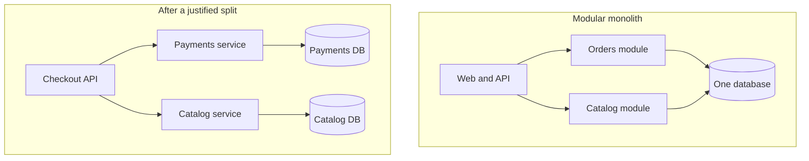

## Why this matters

Architecture style is a scaling strategy for teams and for failure domains, not a fashion choice. Interviewers ask "would you start with microservices?" because the wrong answer produces a system that is slow, inconsistent, and impossible to deploy. You should be able to defend a modular monolith, name the moment a split pays for itself, and describe how data ownership works after the split.

## Intuition

A monolith is one ship. Everyone rows together, turning is simple, and a hole floods every deck. A microservice fleet is many boats. Each boat can be repaired alone, but now you need radios, a rule for who owns the cargo, and a plan for what happens when a radio dies mid-sentence. Many boats with no ownership rules is not a fleet. It is debris that happens to share a harbor.

## Core concept in depth

### The modular monolith

A **modular monolith** is one deployable process (or a small fixed set, such as web plus workers) whose code is divided into modules with explicit boundaries. Modules talk through function calls or in-process interfaces, not through the network. They can still own tables, but a single database makes transactions easy.

Why it wins early:

- One deployment, one log stream, one debugger, one transaction.
- Refactors that move a boundary are code changes, not migrations across networks.
- Latency between "services" is a function call.
- You learn the real domain boundaries from production traffic instead of guessing them in week one.

The failure mode is a **big ball of mud**: any module reads any table, there is no internal API, and a change to checkout breaks search because they share a helper that also sends email. The modular part is the discipline. Enforce it with directories, allowed-dependency checks, and tables that only one module writes.

Scale a monolith further before you split it. Run several stateless copies behind a load balancer. Put slow work on a queue and workers in the same codebase. Add read replicas. Cache. Split a module out only when a specific force appears.

### Forces that justify a split

Split a capability into its own service when at least one of these is concrete:

- **Independent scaling.** Search needs 50 CPU-heavy nodes and checkout needs 5 latency-sensitive nodes. Coupling them wastes one of those shapes.
- **Independent release cadence or risk.** A recommendations model ships daily and must not be able to take down payments. A separate process and a separate failure domain are the point.
- **A hard resource or compliance boundary.** Cardholder data lives in a tightly controlled service. The rest of the product never sees the PAN.
- **A team boundary that matches a domain boundary.** Conway's law will give you a service shape that mirrors communication. Use that on purpose: one team owns orders end to end, including its database.

"We might need to scale" and "we want to try Kubernetes" are not forces. They are how you end up with 40 services and one shared database that couples their deploys anyway.

### What a microservice is

A microservice is a separately deployed process with its own data store, owned by a team, reached over the network through a versioned contract. The important phrase is **its own data store**. If five services write the same tables, you have a distributed monolith: all the latency and partial failure, plus the original coupling.

Consequences you must design for:

- No cross-service ACID transaction. Use a saga, an outbox, or redesign the aggregate so the transaction stays inside one service.
- Partial failure. Every call needs a timeout, a budget, and a fallback or a clear error.
- Versioning. Consumers do not deploy in lockstep. Add fields in a compatible way; do not change meaning in place.
- Observability across hops. A request id must travel, or you cannot debug a checkout that touched four services.

### How to split

1. Find a **seam** where the data is already conceptually separate (billing, search index, media processing).
2. Define the API by the use cases, not by exposing tables.
3. Move reads to the new API while writes still go to the old module (strangler).
4. Move writes. Use an outbox so events and rows agree.
5. Ban the old table access. Delete it.

Splitting by technical layer (a "DAO service") is usually wrong. Splitting by business capability (payments, catalog, delivery) is usually right. A capability that cannot be named in a sentence a product manager understands is a suspicious service.

### Data patterns after the split

- **Sync request** when the caller truly needs the answer now and the dependency is highly available (price check). Bound it.
- **Async event** when others need to react but the user does not wait (search indexing, email).
- **Copy of data** owned by someone else, updated by events, when you need local reads (catalog name on an order). You now have staleness. Say the bound.
- **API composition** in a backend-for-frontend when a screen needs several capabilities. Do not let every service call every other service in a mesh of point-to-point chat.

### Team and operational cost

Each service costs a pipeline, a dashboard, an on-call rotation, a capacity plan, and a security review. Ten engineers and thirty services means nobody is on call for a thing they understand. A useful heuristic: start with a modular monolith until team size and the forces above hurt, then split the one capability that hurts. Revisit. Do not publish a target service count.

Availability math from the fundamentals lesson applies directly. Three synchronous calls at 99.9 percent are not 99.9 percent. If you split without reducing synchronous depth, reliability gets worse while the diagram looks more sophisticated.

## Diagram



### Dry-run: the strangler cutover for payments

| Step | Traffic | Data | Risk |
| --- | --- | --- | --- |
| 0 | Monolith writes payments tables | One transaction with the order | Baseline |
| 1 | Monolith calls payments API, which writes both | Dual write via the new service | Bug in the new path, old path still exists |
| 2 | Read path prefers the new service | Compare results, log mismatches | Stale or divergent rows |
| 3 | Monolith stops writing old tables | New service is source of truth | Need a rollback plan for one release |
| 4 | Old tables removed | One writer | Coupling is actually gone |

Skipping to step 4 on day one, with a shared database "temporarily" that lasts three years, is the distributed monolith.

## Runnable Python

```python
def sync_availability(hops: list[float]) -> float:
    product = 1.0
    for hop in hops:
        product *= hop
    return round(product, 6)


def should_split(independent_scale: bool, compliance_boundary: bool, team_owns_domain: bool, sync_hops_after: int) -> str:
    forces = sum([independent_scale, compliance_boundary, team_owns_domain])
    if forces == 0:
        return "keep-modular-monolith"
    if sync_hops_after > 3:
        return "split-data-but-remove-sync-hops"
    return "split-capability"


if __name__ == "__main__":
    print("three hops", sync_availability([0.999, 0.999, 0.999]))
    print(should_split(False, False, False, 1))
    print(should_split(True, False, True, 2))
    print(should_split(True, True, True, 6))
```

Three 99.9 percent synchronous hops land near 99.7 percent. That number is the argument against a chatty split. The decision helper refuses to split when no force is present, and it refuses a split that deepens the synchronous chain without a plan to shrink it. Both checks belong in the interview answer, not only the happy-path diagram.

## Complexity / trade-off analysis

| Style | Strength | Pain |
| --- | --- | --- |
| Ball of mud monolith | None that lasts | Every change risks every feature |
| Modular monolith | Simple ops, real transactions, fast calls | One deploy unit, shared failure domain, scaling is uniform |
| Microservices with owned data | Independent scale and release, smaller blast radius | Network, partial failure, no cross-service transactions, more ops |
| Distributed monolith | Familiar tables | Worst of both: coupled data and network hops |
| Backend-for-frontend | Screen-shaped API, hides fan-out | Another layer to own; can become a grab bag |

## Tricks, tips, patterns

- Default to a modular monolith in a new product. Say what measurement would change your mind.
- One service, one writer of its data. Other services get an API or an event.
- Split along business capabilities, not along controllers, repositories, and "utils."
- Count synchronous hops and multiply availability before you praise the diagram.
- Use a strangler. Dual-run reads. Delete the old path.
- Keep a shared library small. A shared library that encodes business rules couples deploys.
- Put workers in the same service as the capability they serve until a scale force splits them.

## Common mistakes and edge cases

- Microservices on day one with a team of four. The architecture outruns the learning.
- A shared database as an integration style. Schema changes become distributed locks on human communication.
- Chatty services that call each other inside the user request. Latency and availability both drop.
- Splitting so finely that one user action is a saga across eight databases for no product reason.
- Ignoring Conway's law and drawing a service per noun from a textbook. You will not staff it.
- Versioning by "everyone upgrades Friday." That only works in a monolith, which is a point in favor of the monolith.
- Distributed tracing added after the third incident. Put the request id in on the first split.

## Interview notes

When asked to design a product, start with a small set of components and one database, then say which component you would split first and why. Example: "Checkout and catalog begin as modules. Catalog search moves out when CPU and the ranking model need an independent deploy. Payments moves out when the compliance boundary appears. I do not create a user service, a profile service, and a preferences service on day one."

If the interviewer is explicitly asking for a service-oriented design, still name data ownership and the one place a transaction lives. Offer events for the rest.

## Practice problems

1. **Forces (easy).** A 6-person team is building a notes app. Give the architecture you start with and two signals that would justify extracting attachments processing.
2. **Shared database (medium).** Orders and billing services both update an `orders` table. Name two production incidents that this layout makes likely, and describe a target ownership model.
3. **Availability (medium).** After a split, checkout synchronously calls pricing, tax, inventory, fraud, and loyalty. Each is 99.95 percent. What is the combined figure, and which two calls do you remove from the critical path first?

Related: [Sagas](/lessons/sd-sagas), [Hexagonal architecture and DDD](/lessons/sd-hexagonal-ddd).

## Summary / cheat sheet

- A modular monolith gives you boundaries, transactions, and one operational surface. Enforce the modules or you get a ball of mud.
- Split on a concrete force: scale shape, release risk, compliance, or a real team and domain boundary.
- A microservice owns its data. Shared tables are a distributed monolith.
- Synchronous depth multiplies unavailability. Prefer events and local copies with a stated staleness.
- Strangle a module out. Do not rewrite the company into services in one project.
- Service count is not a success metric. On-call comprehension is.

## Further reading

- [Newman, Building Microservices](https://samnewman.io/books/building_microservices_2nd_edition/)
- [Fowler, MonolithFirst](https://martinfowler.com/bliki/MonolithFirst.html)
- [Richardson, Microservices pattern language](https://microservices.io/patterns/microservices.html)
- [Google SRE book: Addressing Cascading Failures](https://sre.google/sre-book/addressing-cascading-failures/)
- [Conway's law](https://en.wikipedia.org/wiki/Conway%27s_law)
