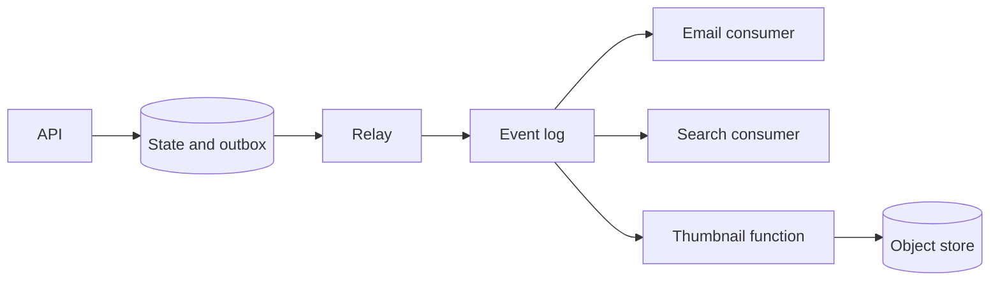

## Why this matters

Some products are a request and a response. Many are a fact that several parts of the company must react to: an order was paid, a file was uploaded, a model finished training. Event-driven design makes those reactions independent. Serverless is one way to run the reactions without owning idle servers. Interviewers want the guarantees, the failure story, and a clear line between "the user is waiting" and "the system will catch up."

## Intuition

An event is a diary entry: "seat 14 was sold at 10:01." It is not a command ("please sell seat 14"), and it is not a shared variable you mutate. Anyone with access to the diary can update their own notebooks. If a reader is sick, they catch up by reading the pages they missed. They do not get to rewrite yesterday.

Serverless is a kitchen that hires a cook for one dish and sends them home. Perfect when dishes arrive in unpredictable bursts and each dish finishes quickly. Absurd when you need the same cook to stand over a six-hour stew, or when hiring a cook takes longer than cooking the dish.

## Core concept in depth

### Events, commands, and queries

- A **command** is a request to change something ("reserve this seat"). It can be rejected.
- An **event** is a fact about something that already happened ("seat reserved"). Consumers do not reject history; they react or fail and retry.
- A **query** asks for state and changes nothing.

Event-driven architecture means components collaborate by publishing and consuming events, usually through a log or a bus, rather than by calling each other synchronously for every side effect. The publisher does not know how many consumers exist. That ignorance is the decoupling.

### Topology

**Broker-based (log or queue).** Producers append. Consumers pull. The broker holds the backlog. This is the default you should describe, because you can reason about retention, retries, and replay. A partitioned log gives per-key order and multiple consumer groups.

**Mediator or orchestrator.** A central workflow calls steps. This is useful when the business process is a known sequence with compensations (a saga orchestrator). It is less "pure" and much easier to understand. Do not be ashamed of it when the process is a business transaction rather than a fan-out of independent reactions.

Choreography (each service listens and emits the next fact) stays elegant until the fifth service, then nobody can tell you whether an order can get stuck. Prefer choreography for independent reactions (send email, update search, increment analytics) and orchestration for a multi-step business transaction that must complete or compensate.

### Delivery and time

Consumers see at-least-once delivery unless you did extra work. Handlers must be idempotent. Events should carry a stable id, the subject id, a version, and the facts needed to act without calling back to the publisher on the hot path. If every consumer calls the publisher to "get the order," you recreated synchronous coupling and a thundering herd.

**Ordering** is per partition key. An "order cancelled" event processed before "order placed," because they landed on different partitions, is a bug in the key choice. Key by order id.

**Replay** is the superpower and the hazard. You can rebuild a projection after a bug. You can also re-send a million emails if the email consumer is not idempotent and someone rewinds the group offset. Protect side effects with a processed-id table. Not every consumer should be rewindable casually; external side effects need a guard.

### Contracts

An event schema is a public API. Use a version field. Additive changes (new optional fields) are compatible. Removing a field or changing a unit (cents versus dollars) is a new event type or a versioned consumer migration. A schema registry helps, but discipline matters more than the product name. Publishers must not publish a type they cannot fill, and consumers must ignore unknown fields so a rollout does not require a flag day.

### Serverless functions

A function platform (Lambda, Cloud Functions, a Knative service that scales to zero) runs your handler in response to an event, an HTTP call, or a schedule. You do not patch the operating system. You pay per invocation and duration, and scale-out is someone else's controller.

Good fits:

- Bursty, short work: image thumbnail on upload, webhook fan-in, scheduled cleanup, light transforms.
- Glue between managed services, where the alternative is a fleet that sits at 2 percent CPU.
- Experiments and internal tools with low duty cycle.

Poor fits:

- Steady high QPS where a small always-on service is cheaper and more predictable. Do the arithmetic.
- Long work that exceeds the platform limit (many platforms cap at minutes). Use a queue and a worker, or split the job.
- Very low latency cold paths. A cold start can be tens of milliseconds to a few seconds depending on runtime and VPC setup. Do not put an un-warmed function on a p99 of 50 ms.
- Large in-memory models or heavy local disk. A function is a poor inference host for a multi-gigabyte model unless the platform is explicitly built for it.
- Chatty calls to a database inside a VPC, if connection setup dominates and you open a new connection per invoke. Use a pooler.

**Concurrency limits** are the serverless version of backpressure. Set a reserved concurrency so a spike in thumbnails cannot exhaust the account and starve the payment webhook. That limit is an availability feature.

**Idempotency** matters even more because platforms retry on timeout, and a timeout does not mean the function did not finish. If your function charges a card and then times out returning, the platform may run it again.

### Combining them

A clean interview architecture: the API commits state and an outbox row, returns to the user, a relay publishes the event, and serverless or ordinary consumers react. The user path's latency does not include thumbnailing, search, or email. The SLO for those is a queue-age SLO, monitored separately.

If there is no broker and every function calls the next function synchronously, you have a slow, opaque distributed call chain with extra cold starts. That is not event-driven. That is a latency bug.

## Diagram



### Dry-run: upload a photo

| Step | Waiting user? | Failure behavior |
| --- | --- | --- |
| API stores original and commits "uploaded" | Yes, until this commit | User sees an error and retries with the same id |
| Event published from outbox | No | Relay retries; API already succeeded |
| Thumbnail function runs | No | Platform retry; function checks if the thumb already exists |
| Search consumer indexes the caption | No | Lag SLO; replay on bug |
| User fetches the photo | Yes, on the read | Original is served even if the thumb is not ready; UI shows a generic stand-in image |

The product remains correct if the thumbnail is late. It is not correct if the API waits for the thumbnail and the function platform is slow.

## Runnable Python

```python
def handle_event(event: dict, processed: set[str], side_effects: list[str]) -> str:
    event_id = event["id"]
    if event_id in processed:
        return "skip"
    if event["type"] == "PhotoUploaded":
        side_effects.append("thumb:" + event["photo_id"])
    processed.add(event_id)
    return "done"


def serverless_fit(p99_budget_ms: int, typical_runtime_ms: int, duty_cycle: float, cold_start_ms: int) -> str:
    if typical_runtime_ms > 10 * 60 * 1000:
        return "use-a-worker-too-long"
    if duty_cycle > 0.6 and p99_budget_ms < cold_start_ms:
        return "prefer-always-on"
    if p99_budget_ms < cold_start_ms and duty_cycle > 0:
        return "warm-or-always-on"
    return "serverless-ok"


if __name__ == "__main__":
    seen: set[str] = set()
    effects: list[str] = []
    ev = {"id": "evt-1", "type": "PhotoUploaded", "photo_id": "p9"}
    print(handle_event(ev, seen, effects))
    print(handle_event(ev, seen, effects), effects)
    print(serverless_fit(80, 40, 0.05, 400))
    print(serverless_fit(80, 40, 0.9, 400))
```

The handler records `evt-1` and will not enqueue a second thumbnail when the platform retries. The fit helper rejects a tight interactive budget that cannot absorb a cold start, and it prefers an always-on process when the function would be busy most of the time anyway. Use both checks before you put business traffic on scale-to-zero.

## Complexity / trade-off analysis

| Choice | Gain | Cost |
| --- | --- | --- |
| Choreographed events | Loose coupling, easy new consumer | Hard to see the end-to-end process |
| Orchestrated saga | Explicit flow and compensation | Orchestrator is a thing you operate |
| Log with replay | Rebuild projections, audit | Dangerous external side effects if not guarded |
| Serverless consumer | No idle fleet, fast scale-out | Cold start, time limits, retries, harder local debug |
| Always-on worker | Predictable latency, long jobs | You run capacity, patching, and scale-in |
| Sync function chain | Simple to write badly | Latency sum, no backlog, coupled failures |

## Tricks, tips, patterns

- Publish facts, not "please do X," unless you mean a command on a queue aimed at one worker.
- Include an event id and the subject's id. Partition by the subject.
- Make every consumer idempotent before you turn on retries or replay.
- Keep the user path free of consumers. Give async work its own SLO (age, not request latency).
- Prefer a broker you can re-read over a chain of direct function calls.
- Use serverless for bursty short work. Do the cost and cold-start math for steady hot paths.
- Set a concurrency cap so one event type cannot consume the account.

## Common mistakes and edge cases

- Dual-writing the database and the bus. A crash drops the event or publishes a fact that never committed. Use an outbox.
- Consumers that call back into the source of truth for every event and fall over when they replay a year of data.
- Rewinding a consumer that charges cards or sends email, without a processed-id guard.
- Assuming global order across event types. Key them.
- A function per tiny step, each with a cold start, on the login path.
- Ignoring platform retries. "It timed out" can mean "it succeeded and the response was lost."
- No dead-letter path. A poison event blocks a partition or retries until the bill is interesting.
- Schema changes that rename a field on Friday and break a consumer that ships on Monday.

## Interview notes

Draw the command path (sync, transactional, small) and the event path (async, at least once, idempotent consumers). Name two consumers and what they do if they are down: the user still succeeds, and the consumer catches up. If you propose serverless, say why the work is short and bursty, what the cold start does to the SLO, and what the concurrency cap protects.

A crisp line: "Checkout commits the order and returns. `OrderPaid` is the fact. Email, fraud review, and warehouse allocation consume it. None of them are in the button's latency budget. Warehouse allocation is orchestrated because it has compensations. Email is pure choreography."

## Practice problems

1. **Command or event (easy).** "Cancel order 18" from a user, and "order 18 cancelled" seen by the email system. Which is which, and which one can be rejected?
2. **Retry (medium).** A function charges a card and the platform times out at 10 seconds even though the charge succeeded at 9 seconds. What happens on the automatic retry, and what do you store?
3. **Fit (medium).** Thumbnails take 300 ms, arrive in bursts of 100x, and the user does not wait. Login token exchange must finish in 80 ms and is steady all day. Where does serverless help, and where do you run a small always-on service?

Related: [Queues, logs, and Kafka](/lessons/sd-queues-kafka), [Sagas](/lessons/sd-sagas).

## Summary / cheat sheet

- Events are facts. Commands can fail. Do not mix them in one topic without a reason.
- Choreography suits independent reactions. Orchestration suits a business process with compensations.
- At-least-once plus idempotency is the contract. Replay is a tool and a foot-gun for external side effects.
- Partition by the subject so order is the order users expect.
- The outbox keeps the fact and the commit together.
- Serverless fits short, bursty, non-interactive work. Cold starts, time limits, and retries are part of the design.
- Never put a scale-to-zero cold path inside a tight p99 unless you have measured warmth.
- Async work gets a lag SLO. The user request stays small.

## Further reading

- [Kafka documentation](https://kafka.apache.org/documentation/)
- [Fowler, What do you mean by Event-Driven?](https://martinfowler.com/articles/201701-event-driven.html)
- [AWS Lambda developer guide](https://docs.aws.amazon.com/lambda/latest/dg/welcome.html)
- [Richardson, transactional outbox](https://microservices.io/patterns/data/transactional-outbox.html)
- [Google Cloud Functions concepts](https://cloud.google.com/functions/docs/concepts/overview)
