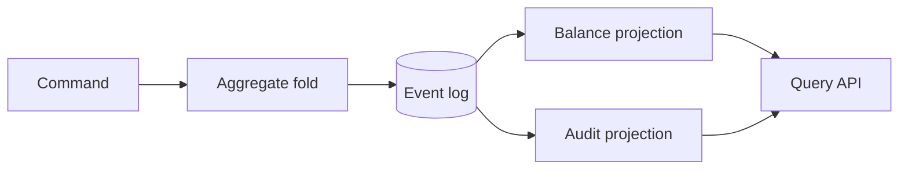

## Why this matters

CRUD on one table is the right design until the write model and the read model want different shapes, different scale, or different consistency. CQRS is the split. Event sourcing is a stronger choice: the write model stores events, and current state is derived. Interviewers ask about both because candidates apply them everywhere, including a profile page that needed a cache. You should know when each one earns its complexity, how projections lag, and how you rebuild them.

## Intuition

CQRS is a restaurant that takes orders on one counter and serves food from another. The order pad is optimized for getting a ticket right. The pass is optimized for handing plates to tables quickly. They are not the same notebook. For a while after a ticket is accepted, a table might not see the plate. That delay is the projection lag, and it is acceptable only if the product says so.

Event sourcing is keeping the order pad forever and never keeping a "current plate" as the source of truth. Any time you want to know what the table should have, you replay the tickets. You might keep a snapshot so you do not replay ten years at dinner time. If you lose the pad, you do not have a restaurant. If you only lose a plate in the pass, you can cook it again from the pad.

## Core concept in depth

### CQRS

**Command Query Responsibility Segregation** means the model that handles commands (writes) is not the model that handles queries (reads). At the mild end, this is one database with a write table and a read-optimized projection, maybe a cache. At the strong end, writes go to one store and reads are served from a different store that is updated asynchronously.

You want this when:

- The read shape is a join, a ranking, or a fan-out that you do not want on the write path (a home timeline, a dashboard).
- Read QPS dwarfs write QPS and you want to scale the read nodes independently.
- The write side needs strong invariants (one seat, one owner) and the read side can be stale for a bounded time.

You do not want this when a single row read after a single row write is the whole product. A repository with one table is simpler and immediately read-your-writes. CQRS is a cost: two models, a pipeline between them, and a class of bugs called "the read model is wrong."

**Consistency.** After a command succeeds, a query may still return the old projection. For the acting user, paper over this with read-your-writes: read from the write model for that user for a few seconds, or include the new state in the command response so the client does not have to query. For everyone else, publish a staleness budget ("search is under 5 seconds").

Validation and invariants live on the command side. The query side does not accept writes, so it cannot be the place you check "is this seat free?"

### Event sourcing

Event sourcing stores the sequence of domain events as the system of record. "Balance is 40" is not stored as the truth; it is the fold of `Opened`, `Deposited`, `Withdrawn`. A snapshot can accelerate the fold, but the snapshot is a cache of the fold. If the snapshot disagrees with the log, the log wins and you rebuild.

Use it when:

- The history is the product or the audit (ledger, document edits, game moves, workflow).
- You need to rebuild new projections you did not anticipate (a new report over last year's orders) and you still have the events.
- The domain is naturally a state machine and the transitions are the language the business uses.

Avoid it when:

- The state is a CRUD profile and nobody will ask why a field changed.
- Events would contain secrets or personal data you must delete. Erasure and event logs fight each other. You need encryption, key deletion, or a design that stores references you can tombstone. "We will just event-source the user table" collides with deletion requirements.
- The team has not operated a projection pipeline. You will debug dual writes you did not need.

**Fold and snapshots.** Loading an aggregate replays events after the last snapshot, then checks the command against that state, then appends a new event if the command is valid. The append must be conditional on the expected version so two commands cannot both succeed from version 7. That compare-and-append is your optimistic concurrency control. It replaces "update the row if version = 7."

**Projections** are consumers of the event log that build read models: a balance table, a search document, a notification. They are idempotent, checkpoint their offset, and can be dropped and rebuilt. A bug in a projection is fixed by replaying. A bug that appended a wrong event is forever, unless you append a compensating event. You do not silently edit history.

### Versioning events

Events are forever. Upcast old events in the reader (interpret version 1 as version 2) rather than rewriting the log. Never store framework objects in the log. Store a small explicit schema: type, version, aggregate id, payload. A rename of a field is a new version with an upcaster, not a find-and-replace in yesterday's partitions.

### How CQRS and event sourcing relate

You can do CQRS without event sourcing: the command side updates a relational aggregate, and a projection subscriber builds the search index. You can event-source a single aggregate and still serve reads from the same process's folded state, with no second store. The full combination (event log as source of truth, async projections as the API) is the heaviest form. Propose it for ledgers and collaboration, not for a settings page.

### Failure and operations

- Projection lag is visible as stale reads. Alert on the lag. Do not alert only on process crashes.
- A poison event stops a projection. Quarantine it, or the whole read model freezes behind that offset.
- Rebuilds need capacity. Replaying a billion events onto a production database at full speed is a self-inflicted incident. Throttle, build beside the live projection, and cut over.
- The write log must be durable and backed up. It is the database now. Treat it like one: replication, retention, and access control.
- Snapshots can be wrong after a code fix in the fold function. Include a snapshot schema version and ignore snapshots from older code.

## Diagram



### Dry-run: two withdrawals at the same version

State is the fold of deposits and withdrawals. Balance is 40. Version is 7. Two commands each try to withdraw 30.

| Step | Command A | Command B | Log |
| --- | --- | --- | --- |
| Read | Fold says 40 at version 7 | Fold says 40 at version 7 | Unchanged |
| Append | Expects version 7, appends Withdrawn 30, now version 8 | Expects version 7, rejected | Only A's event |
| Retry B |  | Fold says 10 at version 8, withdraw 30 rejected by invariant | No second event |
| Projection |  |  | Balance read model moves from 40 to 10 after it consumes version 8 |

Without the expected-version check, both events append and the fold either goes negative or you discover the bug in the projection. The invariant lives at append time, not in the read model.

## Runnable Python

```python
def fold(events: list[dict]) -> int:
    balance = 0
    for event in events:
        if event["type"] == "Deposited":
            balance += event["amount"]
        elif event["type"] == "Withdrawn":
            balance -= event["amount"]
    return balance


def withdraw(events: list[dict], amount: int, expected_version: int) -> str:
    if len(events) != expected_version:
        return "version-conflict"
    if fold(events) < amount:
        return "insufficient-funds"
    events.append({"type": "Withdrawn", "amount": amount})
    return "appended"


if __name__ == "__main__":
    log = [
        {"type": "Deposited", "amount": 50},
        {"type": "Withdrawn", "amount": 10},
    ]
    print("balance", fold(log))
    print(withdraw(log, 30, expected_version=2))
    print(withdraw(log, 30, expected_version=2))
    print("balance", fold(log))
```

The first withdrawal sees version 2 and balance 40, appends, and succeeds. The second still claims expected version 2, which is now stale, so it conflicts instead of driving the balance negative. A retry would pass expected version 3, fold to 10, and hit insufficient funds. That is optimistic concurrency on an event log, in the smallest possible form. A real system runs the check inside a compare-and-append so two processes cannot both pass it.

## Complexity / trade-off analysis

| Approach | Read model | Write model | When it pays |
| --- | --- | --- | --- |
| CRUD one table | Same rows | Same rows | Most products at the start |
| CQRS, same database | Projection table or cache | Normalized aggregate | Read shape differs, lag is tolerable |
| CQRS, two stores | Search or feed store | Transactional store | Read scale and write invariants diverge |
| Event sourcing, local fold | In-process state | Event log | Audit and rebuild matter for one aggregate |
| Event sourcing plus async CQRS | Rebuildable projections | Append-only log | History is the product and reads are varied |

The cost column is always: more moving parts, lag, and a harder onboarding story. Pay it for a measured reason.

## Tricks, tips, patterns

- Keep invariants on the command side at append or commit time. The projection is not a lock.
- Return enough of the new state from the command that the caller does not need the projection to be caught up.
- Use expected version (optimistic concurrency) on the aggregate stream.
- Snapshot long streams, and version the snapshot with the fold code.
- Treat projections as disposable. If you cannot rebuild one, it is not a projection; it is another source of truth.
- Upcast events. Do not rewrite history in place.
- Prefer "CQRS with a normal database" before "event-sourced everything."

## Common mistakes and edge cases

- Event-sourcing a CRUD screen and then discovering you cannot delete personal data from an immutable log you treated casually.
- Checking "seat still free?" on a stale projection, then appending an event. The check was on the wrong model.
- Two writers appending without a version check. Lost updates, negative balances, double seats.
- Projections that are not idempotent. A replay doubles a counter.
- Editing a past event to fix a bug. Every downstream system that already consumed it now disagrees. Append a correction.
- Rebuilding a projection into the live tables at unlimited speed during business hours.
- Snapshots that hide a bug in the fold. After you fix the code, old snapshots reintroduce the bug. Key snapshots by code version.
- Using CQRS and then serving the user their own write from the lagging side with no mitigation. The product feels broken even though the log is right.

## Interview notes

Propose CRUD first. Upgrade to CQRS when you can point at a read path whose shape or scale does not match the write aggregate (timeline, search, reporting). Upgrade to event sourcing when you can point at an audit or replay requirement, and mention deletion and expected-version concurrency in the same breath so the interviewer knows you have operated the idea, not only read it.

A ledger answer: "The account stream is the source of truth. Withdrawals append if the folded balance and the expected version allow it. The customer-facing balance is a projection. After a write, the API returns the new balance from the fold so we do not depend on projection lag. I can rebuild the statement view by replaying the stream."

## Practice problems

1. **Need (easy).** A user settings page updates four fields and reads them back. Is CQRS or event sourcing justified? What is the simpler design?
2. **Concurrency (medium).** Two devices sell the last seat using a projection that both read as "free." Where should the invariant be enforced, and what does the losing command receive?
3. **Rebuild (medium).** A projection double-counted for a week because of a retry bug. How do you repair reads without editing past events, and what do you throttle?

Related: [Event-driven architecture and serverless](/lessons/sd-event-driven-serverless), [Payments](/lessons/sd-payments).

## Summary / cheat sheet

- CQRS splits the write model from the read model. It is justified when shape, scale, or consistency needs diverge. It introduces lag.
- Serve the acting user from the command result or the write model so read-your-writes holds.
- Event sourcing stores facts. State is a fold. Snapshots are caches of that fold. The log wins.
- Append only if the expected version matches, and check invariants on that fold, not on a stale projection.
- Projections are idempotent and rebuildable. Compensating events fix business mistakes. Silent edits to history do not.
- Plan deletion and personal data before you make a log immutable.
- CRUD remains the default. Say the reason before you leave it.

## Further reading

- [Fowler, CQRS](https://martinfowler.com/bliki/CQRS.html)
- [Fowler, Event Sourcing](https://martinfowler.com/eaaDev/EventSourcing.html)
- [Young, CQRS and Event Sourcing talks and notes](https://cqrs.files.wordpress.com/2010/11/cqrs_documents.pdf)
- [Kleppmann, Designing Data-Intensive Applications](https://dataintensive.net/)
- [Kafka log compaction](https://kafka.apache.org/documentation/#compaction)
