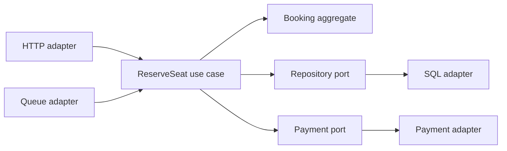

## Why this matters

Low-level and high-level design meet in the domain model. Interviewers who ask you to design a parking lot, a ledger, or a delivery service are listening for whether business rules live in one place or are smeared across controllers, SQL strings, and queue handlers. Hexagonal architecture is the dependency rule that keeps those rules testable. Domain-driven design is how you find the boundaries and the words. Together they stop a microservice split from freezing the wrong shape in place.

## Intuition

The domain is the kitchen's idea of a dish: what may be combined, when it is done, what "too salty" means. The dining room, the delivery app, and the supplier invoice are adapters. They are allowed to change without rewriting the recipe. If the recipe is written on the back of a particular delivery app's webhook payload, you cannot open a second dining room without copying the rule and drifting.

A bounded context is one kitchen with one dictionary. "Order" in the dining room means a ticket for a table. "Order" in procurement means a purchase from a farm. Using one class for both is how you get a status enum with 30 values and a bug in both businesses.

## Core concept in depth

### Hexagonal architecture

Hexagonal architecture (ports and adapters) says the application core depends on interfaces it defines, and the outside world implements those interfaces. The core does not import a web framework, a database driver, or a message SDK.

- A **port** is an interface the core owns. A driving port is how the outside starts a use case (`ReserveSeat`). A driven port is how the core asks for something it cannot do itself (`SeatRepository`, `PaymentGateway`, `Clock`).
- An **adapter** implements a port. The HTTP adapter turns a request into `ReserveSeat`. The Postgres adapter implements `SeatRepository`. A fake adapter implements it in memory for tests.

The dependency arrow points inward. The database depends on the repository interface in the core, not the other way around. In code this is "the domain module does not import infrastructure." In an interview you can say the same thing without drawing a hexagon: business rules are plain objects; SQL and HTTP sit at the edge.

Why it matters in production: you can test "a held seat cannot be held again" without a network. You can replace the payment SDK without touching the invariant. You can run the same use case from HTTP, from a queue consumer, and from a repair tool.

It does not matter if you do not actually isolate a domain. A folder named `domain` that calls SQL directly is a slogan. The test is whether the rule can run with in-memory fakes.

### Domain-driven design building blocks

DDD is a set of modeling habits, not a framework.

**Ubiquitous language.** The words in the code match the words specialists use. If they say "hold" and the code says `flag = 2`, the model is already wrong. The glossary is a design artifact.

**Bounded context.** A boundary inside which a word has one meaning and one model. Contexts integrate through explicit translations: an API, an event, or an anti-corruption layer that converts their "shipment" into your "delivery." Do not share a database table as the integration, or you have merged the contexts by accident.

**Entity.** An object defined by identity over time. Two seats with the same attributes are still different seats if their ids differ. Identity matters for a customer, an account, a vehicle.

**Value object.** Defined only by its attributes. Money, a date range, a coordinate. Immutable. Two Money(5, USD) values are interchangeable. This is where you kill primitive obsession: a balance is not a naked integer you can add across currencies.

**Aggregate.** A cluster of entities and value objects with a consistency boundary. One entity is the root. Outside objects may hold the root's id, not a pointer they use to poke inside. Invariants that must always be true are enforced inside the aggregate, in one transaction. Example: a `Booking` aggregate ensures a seat is not double-held. The email worker is outside the aggregate and is eventually consistent.

**Repository.** Loads and saves aggregates by identity. It does not offer "run any SQL the caller invented" as the domain API. Queries that do not need invariants (a report, a search) can bypass the aggregate through a separate read path. That is CQRS at code scale.

**Domain event.** A fact the aggregate emits when something that matters happens (`SeatHeld`). Handlers live outside. The aggregate does not send email itself.

**Domain service.** An operation that does not naturally sit on one entity (transfer between two accounts). Use it sparingly. If everything is a service, you have a procedure script and an anemic model.

**Anemic versus rich model.** An anemic model is a struct plus a service that does the work. A rich model puts the invariant next to the data (`account.withdraw`). Interview designs should be rich where the rules are real, and simple structs where the data is a DTO at the edge. Do not make every row a class with twenty methods. Do not leave "balance cannot go negative" only in a controller.

### Strategic design and services

Bounded contexts are the right seams for modular monolith modules and, later, for services. If you cannot name the context, you are not ready to deploy it separately. A **context map** shows how contexts relate: customer-supplier, conformist, anti-corruption layer, or separate ways. In an interview, a one-minute map ("checkout owns holds; pricing owns quotes; checkout stores the quoted price it accepted") is worth more than a class diagram of thirty DTOs.

### Application layer

Use cases sit between adapters and aggregates. `ReserveSeatHandler` loads the aggregate, calls `hold`, saves, and publishes events. It is thin. It does not contain the invariant, and it does not parse HTTP. This is the layer you describe when the interviewer asks "what does the service do when a request arrives?"

### What this looks like in a system-design answer

You will not implement ports in a 45-minute architecture interview. You will:

- Name aggregates and their invariants.
- Say which data is inside the transaction.
- Say which facts are events for other contexts.
- Keep HTTP status codes and table names out of the invariant description.

In an LLD interview you go further and draw the classes. The parking-lot, elevator, and library lessons do that. The rule is the same: the model enforces the rule, and I/O sits at the edge.

## Diagram



### Dry-run: hold a seat

| Step | Where the code lives | What is true after |
| --- | --- | --- |
| Parse JSON | HTTP adapter | A `ReserveSeat` command or a 400 |
| Load booking by id | SQL adapter via port | Aggregate in memory, or not found |
| `hold(seat, user, now)` | Aggregate | Rejects if seat is not free; otherwise seat is held and a `SeatHeld` fact exists in memory |
| Save and append event | SQL adapter in one transaction | Durable aggregate and outbox row |
| Publish and email | Queue adapter, later | Other contexts catch up; the hold does not depend on email |

If the HTTP handler updates a `status` column with a string and sends email inline, the invariant is trapped in the adapter and the use case cannot be tested or reused from the queue.

## Runnable Python

```python
from dataclasses import dataclass, field


@dataclass
class Seat:
    seat_id: str
    state: str = "free"
    holder: str | None = None


@dataclass
class Booking:
    booking_id: str
    seats: dict[str, Seat]
    events: list[str] = field(default_factory=list)

    def hold(self, seat_id: str, user_id: str) -> None:
        seat = self.seats[seat_id]
        if seat.state != "free":
            raise ValueError("seat not free")
        seat.state = "held"
        seat.holder = user_id
        self.events.append("SeatHeld:" + seat_id + ":" + user_id)


class InMemoryBookings:
    def __init__(self) -> None:
        self._items: dict[str, Booking] = {}

    def save(self, booking: Booking) -> None:
        self._items[booking.booking_id] = booking

    def get(self, booking_id: str) -> Booking:
        return self._items[booking_id]


def reserve(repo: InMemoryBookings, booking_id: str, seat_id: str, user_id: str) -> str:
    booking = repo.get(booking_id)
    booking.hold(seat_id, user_id)
    repo.save(booking)
    return booking.events[-1]


if __name__ == "__main__":
    repo = InMemoryBookings()
    repo.save(Booking("b1", {"s1": Seat("s1")}))
    print(reserve(repo, "b1", "s1", "ada"))
    try:
        reserve(repo, "b1", "s1", "grace")
    except ValueError as exc:
        print("rejected", str(exc))
```

`Booking.hold` is the domain rule. `reserve` is the use case. `InMemoryBookings` is a driven adapter you can swap for SQL without touching `hold`. The second reserve throws because the seat is no longer free. No HTTP stack was required to prove the invariant. That is the hexagonal test: if the rule only runs behind a live database, it is not isolated yet.

Notice the aggregate is the consistency boundary. The use case does not set `seat.state` from the outside. Callers who can poke fields will bypass the rule the first time a new adapter is added.

## Complexity / trade-off analysis

| Idea | Payoff | Cost |
| --- | --- | --- |
| Ports and adapters | Testable rules, replaceable I/O | More interfaces, easy to over-abstract a CRUD form |
| Ubiquitous language | Fewer misunderstandings, better reviews | Time with domain experts, renaming churn |
| Bounded contexts | Clean service seams | Translation layers, duplicated concepts on purpose |
| Small aggregates | Short transactions, clear invariants | Updates that span aggregates become eventual |
| Large aggregates | One transaction for a big rule | Contention and locking |
| Rich model | Invariants live in one place | Discipline; fat "manager" classes if done badly |
| Anemic model | Familiar, fast to scaffold | Rules scatter and contradict |

Abstract ports for a one-method script that will never grow is ceremony. The judgment is: isolate the rules that are expensive to get wrong, and do not build a generic enterprise framework.

## Tricks, tips, patterns

- Name the aggregate and the invariant before the classes around it.
- One transaction per aggregate. Between aggregates, use events or a saga.
- Value objects for money, ranges, and identifiers. Do not pass raw strings through the core if a wrong string is a real bug.
- Keep adapters thin. Parsing and status codes outside, domain errors inside, mapping at the edge.
- Draw a context map with three boxes before you draw fifteen services.
- Share ids across contexts, not object graphs and not tables.
- Test the aggregate in memory. If you cannot, the port is fake and the rule is in SQL where nobody sees it.

## Common mistakes and edge cases

- A "domain" class that imports the ORM and the mailer. The hexagon is inverted.
- One `Order` type used by billing, shipping, and the storefront. The word is overloaded and the enum becomes folklore.
- Aggregates so large that every seat in a venue is one row locked for every click. Shrink the aggregate to the seat, or to the seat plus its hold, so contention matches reality.
- Repositories that return half-loaded graphs and let callers save an incomplete invariant.
- Domain events dispatched synchronously to a flaky email provider inside the transaction. The event record commits; the send does not.
- An anti-corruption layer that is missing, so a partner's JSON shape leaks into your aggregate fields.
- Starting a greenfield app with five contexts and a message bus before anyone has used the product. Model inside a modular monolith first.

## Interview notes

For an LLD prompt, talk in this order: glossary, aggregates and invariants, use cases, then adapters you only name (HTTP, SQL, clock). Draw a few classes, not the framework. For an HLD prompt, use bounded contexts as the service candidates and say which invariant stays inside which transaction.

Example: "Hold is an aggregate on the seat. `hold` fails if the seat is not free. The repository saves that change. `SeatHeld` is an event the notification context consumes. Pricing is a different context; checkout stores the price it was given rather than reaching into pricing tables."

If the interviewer asks for frameworks, keep them in the adapter sentence and return to the rule.

## Practice problems

1. **Boundary (easy).** A library system has books, members, and loans. Which invariant belongs on a `Loan` aggregate, and which data should only store a member id rather than a member object?
2. **Port (medium).** `charge_card` is called from both an HTTP checkout and a retry worker. What is the driving port, what is the driven port, and what must not sit inside the aggregate?
3. **Context (medium).** The word "account" means a login in one team and a ledger account in another. What breaks if they share a table, and what does an anti-corruption layer translate?

Related: [Monoliths and microservices](/lessons/sd-monolith-microservices), [Parking lot LLD](/lessons/sd-lld-parking-lot).

## Summary / cheat sheet

- Hexagonal architecture points dependencies inward. The core defines ports; adapters do HTTP, SQL, and queues.
- A rule that cannot run on an in-memory fake is not isolated from infrastructure.
- DDD: one language per bounded context. Entities have identity. Value objects do not. Aggregates are consistency boundaries.
- Enforce invariants inside the aggregate. Talk to other aggregates by id and by events.
- Repositories save aggregates. Use cases stay thin. Adapters map errors and protocols.
- Bounded contexts are the seams you may later deploy separately. Do not share their tables.
- Isolate expensive rules. Do not wrap every form field in a framework.

## Further reading

- [Cockburn, Hexagonal architecture](https://alistair.cockburn.us/hexagonal-architecture/)
- [Evans, Domain-Driven Design reference](https://www.domainlanguage.com/ddd/reference/)
- [Fowler, Bounded Context](https://martinfowler.com/bliki/BoundedContext.html)
- [Vernon, Implementing Domain-Driven Design](https://www.informit.com/store/implementing-domain-driven-design-9780321834577)
- [Microsoft: DDD bounded contexts](https://learn.microsoft.com/en-us/dotnet/architecture/microservices/model/tactical-domain-driven-design)
