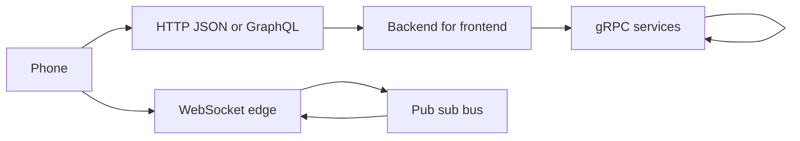

## Why this matters

The protocol is a product decision. A public API that partners will use for years wants stable resources and boring HTTP. A fleet of internal services that exchange small structured calls wants multiplexed RPC. A mobile home screen that was over-fetching three REST calls may want a query language. A chat or a live price wants a connection that stays open. Interviewers ask you to choose and to defend caching, errors, versioning, and what happens when the connection drops.

## Intuition

REST is a set of labeled drawers. You open the drawer named `/orders/18` and you get the order, or you put a new order in `/orders`. Everyone who has ever used the web already understands the drawers.

gRPC is a phone call with a strict script. Both sides generated the script from the same file, the call is small and fast, and if you change the script you know at build time.

GraphQL is a waiter who lets the table order exactly the side dishes they want, which is wonderful until every table invents a dish the kitchen cannot prepare efficiently.

A WebSocket is leaving the phone line open so either person can speak next. You must notice when the line has quietly died.

## Core concept in depth

### REST over HTTP

REST, in the form interviews mean, is HTTP with resources, a small set of methods, and status codes. A resource has a URL. `GET` is safe and idempotent. `PUT` replaces and is idempotent. `DELETE` is idempotent. `POST` creates or triggers and is not idempotent unless you add a key. `PATCH` applies a partial change and needs a documented merge.

Use status codes honestly: 400 for a bad request, 401 for unauthenticated, 403 for unauthorized, 404 for missing or for hidden existence, 409 for a conflict, 429 for rate limit, 503 for "I am shedding load." A body that says error inside a 200 trains every client to parse prose.

**Caching.** GET responses can be cached by browsers and CDNs if you set cache headers and the response does not depend on a hidden cookie. POST is not a cache key you should invent. This is a major reason public read APIs stay on HTTP.

**Versioning.** Prefer compatible evolution: add optional fields, do not change the meaning of a field. When you must break, version the URL or a header and run both until clients move. A breaking change on a mobile app is a multi-month project because old binaries stay in the world.

**Pagination and partial failure.** Large lists need cursors, not page numbers that shift while someone inserts rows. Bulk endpoints should say what happened per item. Timeouts and idempotency keys belong on any POST that charges or reserves.

REST is a weaker fit for a chatty internal call graph: HTTP/1.1 head-of-line blocking, text JSON, and no generated contract mean you discover breakage in production. HTTP/2 helps the transport. A schema still helps the contract.

### gRPC

gRPC is HTTP/2 plus Protocol Buffers. You define services and messages in a `.proto` file. Clients and servers generate code. Calls can be unary, server streaming, client streaming, or bidirectional streaming.

Why teams use it internally:

- Small binary payloads and header compression. Less CPU and less bandwidth than JSON for high QPS.
- Multiplexing many calls on one connection.
- Deadlines, cancellation, and metadata are part of the client story.
- The contract is reviewed as a file. Breaking changes fail the build.

Costs:

- Load balancers must understand HTTP/2. A naive L4 balancer can pin a whole process to one backend connection. Prefer L7 or look-aside balancing so RPCs spread.
- Browser clients do not speak gRPC natively. You put a grpc-gateway or a separate HTTP API at the edge.
- Long-lived streams interact badly with deploys unless you drain and let clients reconnect.
- Proto evolution has rules: do not reuse field numbers, add fields rather than rename, reserve deleted numbers.

Use gRPC between your services when both ends are yours and QPS or latency matters. Use HTTP at the public edge unless you control every client.

### GraphQL

GraphQL exposes one endpoint and a schema of types. The client sends a query that selects fields and nested objects. The server resolves them. Mutations change data. Subscriptions push updates, often over WebSockets.

The win is **one round trip shaped like the screen**, especially for mobile clients on high-latency networks that otherwise chain three REST calls and over-fetch columns they do not render.

The costs are real and you should say them:

- **N+1 queries.** A naive resolver that loads a user per friend will melt the database. You need batching (a DataLoader that collects ids in one tick and fetches them in one query).
- **Complexity and abuse.** A client can ask for a huge nested graph. You need query cost limits, depth limits, and persisted queries so production clients send an id, not an arbitrary document.
- **Caching.** There is one URL, so CDNs do not cache by resource unless you work at it (APQ, GET for queries, response caching keyed by query plus auth scope).
- **Authorization per field.** It is easy to forget a field resolver and leak another user's email because the parent object was allowed.
- **Aggregated failure.** One slow resolver delays the whole query unless you design partial errors carefully.

GraphQL is a good backend-for-frontend for a product UI you own. It is a questionable public partner API when partners need the cacheability and simplicity of HTTP resources. Do not put it in front of a write-heavy transactional core as the only way to talk; mutations still need idempotency and transactions inside the domain.

### WebSockets and streaming

A WebSocket starts as HTTP and upgrades to a full-duplex TCP-like session. Either side can send a frame at any time. Use it for chat, collaborative cursors, live odds, and multiplayer presence. Do not use it for ordinary CRUD to look modern: you lose caching, simple retries, and a lot of intermediary support.

Design points that decide whether it works:

- **Authentication** happens at upgrade time (a ticket or a header). You cannot rely on a header on every frame the way you do on every HTTP request. Re-check authorization for sensitive actions inside the session.
- **Heartbeats.** NATs and proxies drop idle connections. Send pings and treat a missed pong as dead. Clients reconnect with backoff and resume with a cursor ("messages after sequence 40").
- **Fan-out.** One connection lives on one gateway process. A message to a user must find that process: a registry (user id to gateway id) in a store, or a pub/sub bus every gateway listens to. Sticky load balancing without a registry fails the moment you have two gateway nodes.
- **Backpressure.** If a client stops reading, you must bound the buffer and disconnect. An unbounded per-socket queue is a memory leak with a user id.
- **Ordering and delivery.** TCP keeps order on the connection. It does not keep order across reconnects unless you put sequence numbers in the payload.

Server-Sent Events are a simpler server-to-client stream over HTTP when the client does not need to send much. They play better with some proxies and are enough for a live feed.

### Choosing

| Need | Prefer | Why |
| --- | --- | --- |
| Public, cacheable resources | REST or plain HTTP | Status codes, CDN, partner stability |
| Internal high QPS RPC | gRPC | Contract, payload size, deadlines |
| UI aggregates many resources | GraphQL or a BFF | One round trip, watch N+1 and auth |
| Server push, low latency, two-way | WebSocket or SSE | Connection plus a routing registry |
| File upload | HTTP | Range, resumable protocols, CDNs |

You may use three of these in one product. The mistake is using one for every hop because it was already on the diagram.

## Diagram



### Dry-run: a chat message

| Step | Protocol | What can go wrong |
| --- | --- | --- |
| Client upgrades | WebSocket | Auth ticket expired; proxy idle timeout later |
| Send frame with client msg id | WebSocket | Duplicate send after reconnect; server dedupes on msg id |
| Gateway publishes | Internal bus or gRPC stream | Recipient is on another gateway; registry must be current |
| Recipient gateway writes frame | WebSocket | Socket buffer full; drop the slow client |
| History repair | HTTP GET with cursor | Socket missed messages during reconnect; the cursor fills the gap |

The socket is the fast path. The HTTP history API is the correctness path. You need both.

## Runnable Python

```python
def choose(public: bool, server_push: bool, ui_aggregate: bool, internal_qps: int) -> str:
    if server_push:
        return "websocket-plus-history-http"
    if public and not ui_aggregate:
        return "http-resources"
    if ui_aggregate and public:
        return "graphql-or-bff"
    if internal_qps > 1000:
        return "grpc"
    return "http-internal"


def cursor_gap(last_seen: int, incoming: list[int]) -> list[int]:
    return [n for n in incoming if n > last_seen]


if __name__ == "__main__":
    print(choose(True, False, False, 100))
    print(choose(False, False, False, 8000))
    print(choose(True, True, False, 100))
    print(cursor_gap(40, [38, 41, 42]))
```

The chooser puts a public resource API on HTTP, a hot internal hop on gRPC, and any server-push product on a socket plus a history API. `cursor_gap` is the reconnect rule: after sequence 40, frames 41 and 42 are new and 38 is a duplicate the client already applied. Sequence numbers, not "the socket is reliable," are what make chat survive a dropped connection.

## Complexity / trade-off analysis

| Style | Strength | Weakness |
| --- | --- | --- |
| REST or HTTP resources | Caching, status codes, reach | Over-fetch, chatty screens, weak contracts unless you add a schema |
| gRPC | Performance, generated contracts, streams | Edge and browser friction, load-balancing care |
| GraphQL | Client-shaped reads, one round trip | N+1, cache, complexity limits, field auth |
| WebSocket | Two-way low latency | Sticky routing, heartbeats, reconnect, no CDN cache |
| SSE | Simple server push | Not full duplex; some proxies buffer |
| BFF | Stable UI API, hides internal RPC | Another service to own |

## Tricks, tips, patterns

- Public edge HTTP, internal gRPC, is a default you can defend.
- Idempotency keys on unsafe POST and on WebSocket sends.
- Cursor pagination, not offset, for feeds and chat history.
- Deadlines on every RPC. Convert them to the downstream call.
- For GraphQL, say DataLoader, query cost limits, and per-field auth in the same answer.
- For WebSockets, draw the connection registry and the heartbeat. Then draw the HTTP catch-up API.
- Evolve schemas by adding fields. Do not recycle proto numbers or JSON meanings.

## Common mistakes and edge cases

- gRPC behind an L4 balancer with one long-lived connection per client. All RPCs hit one pod.
- GraphQL resolver that queries the database inside a loop. Fine in a demo, fatal at fan-out.
- WebSocket with no sequence numbers. Reconnect drops or duplicates messages silently.
- Using 200 for every outcome. Clients cannot tell a conflict from a success.
- Breaking a mobile JSON field because the web client already shipped. Old apps are still out there.
- Subscriptions or sockets for data that changes once an hour. Polling or a short HTTP cache is simpler and survives proxies.
- Forgetting that a WebSocket authenticate-at-upgrade result can go stale. Sensitive actions re-check.

## Interview notes

State the edge protocol and the internal protocol separately. For chat or presence, include heartbeats, a routing registry, and cursor catch-up. For a mobile home screen, mention over-fetch and either a BFF or GraphQL with batching. For partner APIs, stay on HTTP resources and talk about versioning and cache headers.

Do not claim one protocol is "more scalable." Scalability comes from statelessness, data ownership, and backpressure. The protocol decides latency, contract safety, and cacheability.

## Practice problems

1. **Choice (easy).** A bank exposes account balances to third-party apps and also runs 20 internal services at 5,000 QPS. Which styles do you use at the edge and inside?
2. **GraphQL cost (medium).** A query asks for each friend, each friend's photos, and each photo's comments. Where is the N+1, and what batching boundary do you add?
3. **Reconnect (medium).** A client last applied sequence 100, disconnects for 20 seconds, and reconnects to a different gateway. What does it send, and what must the server be able to do without the old socket?

Related: [Discovery and resilience](/lessons/sd-discovery-resilience), [WhatsApp](/lessons/sd-whatsapp).

## Summary / cheat sheet

- HTTP resources: public, cacheable, explicit status codes, compatible evolution.
- gRPC: internal, schema-first, small and fast, watch load balancing of long-lived connections.
- GraphQL: client-shaped reads for a UI you own. Batch resolvers, cap query cost, authorize fields.
- WebSockets: two-way streams. Heartbeat, registry, bounded buffers, and a cursor history API.
- Idempotency keys and deadlines apply to all of them. The protocol does not supply product correctness by itself.
- Mix styles on purpose. Edge and internal hops do not have to look the same.

## Further reading

- [RFC 9110 HTTP semantics](https://www.rfc-editor.org/rfc/rfc9110)
- [gRPC core concepts](https://grpc.io/docs/what-is-grpc/core-concepts/)
- [Protocol Buffers language guide](https://protobuf.dev/programming-guides/proto3/)
- [GraphQL best practices](https://graphql.org/learn/best-practices/)
- [RFC 6455 The WebSocket Protocol](https://www.rfc-editor.org/rfc/rfc6455)
