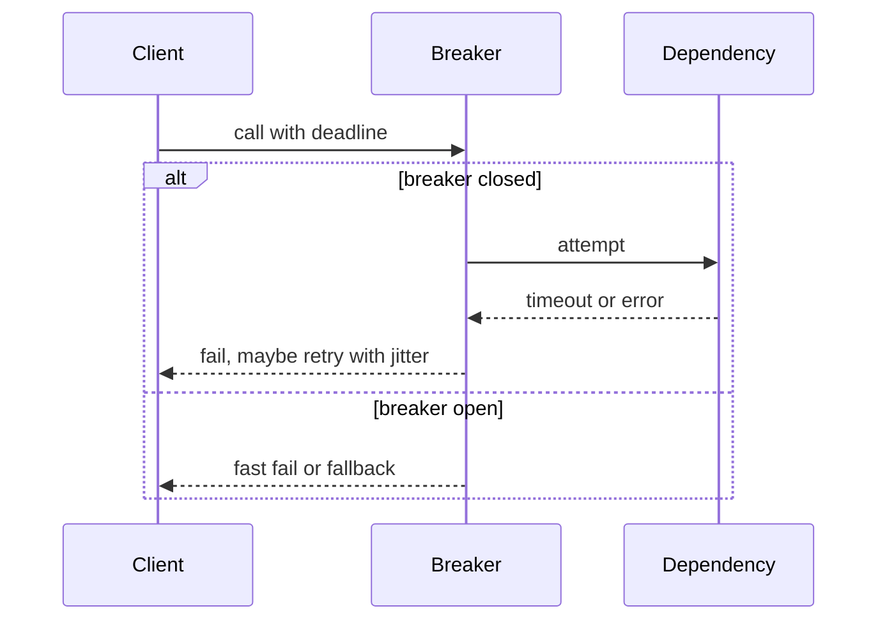

## Why this matters

Distributed systems do not fail cleanly. They get slow, and slowness spreads. A client that waits forever holds a thread. A client that retries immediately multiplies load on the thing that is already sick. A client that keeps a stale address sends traffic to a dead process. Interviewers use an outage story to see whether you have timeouts, jitter, circuit breakers, and idempotency as reflexes, or whether you only have happy-path arrows.

## Intuition

Service discovery is a living phone book. Timeouts are deciding the other person is not going to pick up, so you hang up and free the line. A retry is calling back, but not a hundred of you calling back in the same second. A circuit breaker is the receptionist who stops putting calls through to a department that is not answering, for a little while, so the department can recover. Idempotency is the ability to call back without ordering a second pizza.

## Core concept in depth

### Discovery

Clients need an address for a healthy instance.

- **DNS.** Simple, caches badly. Fine for a stable regional VIP in front of a load balancer. Poor as the only signal of instance health, because TTLs lie and dead backends remain in caches.
- **Client-side discovery.** The client looks up a registry (a control plane, a sidecar catalog) and picks an instance. You can implement least-connections or per-request hedging in the client. The client must refresh membership and must not cache a dead instance for minutes.
- **Server-side discovery.** The client calls a stable VIP or proxy, and the proxy picks the instance. Operationally easier for polyglot fleets. The proxy becomes the thing you must run with spare capacity.

Health belongs in the registry or the proxy, not in tribal knowledge. Deregister on shutdown (drain), and expire registrations with a heartbeat so a crashed host disappears even if it never deregistered.

Pass a **deadline** or a remaining budget with the request. Each hop subtracts its own time and refuses to start work it cannot finish. A 300 ms user budget that arrives at a third service with 20 ms left should fail fast, not start a 200 ms query.

### Timeouts

Every call has a timeout. The timeout is less than or equal to the time the caller still has. Connect timeout is short (you are looking for "can I get a socket?"). Request timeout matches the operation. A single infinite default in a client library undoes the rest of the design.

Slow is worse than down. A dependency at 30 seconds of latency with a 60 second client timeout will fill every thread pool in the building. Prefer a timeout near the latency SLO of that hop, and shed.

### Retries

Retry only when a second attempt can succeed and will not double a side effect, or when the side effect is idempotent.

- Retry on connect failures, on 503, and on a defined set of internal statuses.
- Do not retry on 400, 401, 403, 404, or a business rejection.
- Cap the number of attempts (often 2 or 3 total, not 10).
- Cap the extra load. A **retry budget** of, for example, 10 percent additional calls means that when 50 percent of calls are failing you stop retrying rather than tripling the traffic.
- **Exponential backoff with jitter.** Wait `base * 2^attempt` and add a random spread so a thousand clients do not retry on the same millisecond. Full jitter (random between 0 and the cap) is a solid default.
- Bound the total time by the deadline. A retry that starts after the user has gone is wasted load.

**Hedging** is a specialized retry for idempotent reads: send a second copy if the first is still running at p95. It cuts tails and it increases load. Cap it.

### Idempotency

A retry-safe write carries an **idempotency key** chosen by the client (or derived from a stable business id). The server stores the key and the result. A repeat returns the stored result and does not perform the side effect again. The key lives at least as long as clients might retry, which is longer than one HTTP timeout: think hours, not milliseconds, for payments.

`PUT` and `DELETE` can be naturally idempotent if the server's implementation really is. `POST` is not, unless you add the key. "We use REST" is not an idempotency story.

### Circuit breakers

A circuit breaker wraps a dependency and watches recent failures or slow calls.

- **Closed.** Calls go through. Failures increment a counter.
- **Open.** Calls fail immediately in the client, without waiting for the timeout. This protects both the caller thread pool and the sick dependency.
- **Half-open.** After a cool-down, a few trial calls go through. Success closes the breaker. Failure opens it again.

Tune the window so a single blip does not open, and a real brownout does. Typical signals: error rate over the last N seconds, or consecutive failures, plus a minimum volume so 1 failure out of 1 call is not a 100 percent outage. When the breaker is open, return a fallback (cached data, a degraded response) or a fast error. Do not queue unbounded work "until it closes."

Bulkheads complement breakers. Give the flaky dependency its own small thread pool or connection pool so it cannot consume the threads you need for healthy dependencies. A search outage should not exhaust the connections checkout needs for payments.

### Load shedding and pressure

If your own queue is too old or your concurrency limit is hit, fail new work with 503 before you accept it. Tell clients the truth so their breakers can open. A service that accepts everything and then times out looks healthier to naive retries and dies faster.

## Diagram



### Dry-run: a retry storm versus a budget

Dependency latency jumps. 1,000 clients each send 10 requests per second.

| Policy | Calls the dependency sees | What happens next |
| --- | --- | --- |
| No timeout | Threads block for a long time | Client pools exhaust, everything queues |
| Timeout, immediate retry, 3 attempts | About 30,000 rps | Dependency gets worse, never recovers |
| Timeout, exponential backoff, jitter, 2 attempts, 10 percent budget | A little above 10,000, then retries cut | Dependency has a chance to recover |
| Breaker opens after the error threshold | Trial calls only | Clients fail fast; user path degrades |

The middle row is the one you want to describe. The second row is how a small incident becomes a site outage.

## Runnable Python

```python
import random


def backoff_seconds(attempt: int, base: float = 0.05, cap: float = 2.0) -> float:
    # Full jitter: sleep a random fraction of the exponential cap.
    window = min(cap, base * (2**attempt))
    return random.uniform(0, window)


def allow_retry(error_rate: float, budget: float = 0.1) -> bool:
    return error_rate < budget


class Breaker:
    def __init__(self, threshold: int):
        self.threshold = threshold
        self.failures = 0
        self.open = False

    def record(self, ok: bool) -> None:
        if ok:
            self.failures = 0
            self.open = False
        else:
            self.failures += 1
            if self.failures >= self.threshold:
                self.open = True


if __name__ == "__main__":
    print("retry while healthy", allow_retry(0.02))
    print("stop retrying", allow_retry(0.4))
    breaker = Breaker(3)
    for ok in (False, False, False):
        breaker.record(ok)
    print("open", breaker.open)
    print("jitter sample", round(backoff_seconds(3), 3))
```

`allow_retry` is a crude retry budget: once 40 percent of calls are failing, more retries are not kindness. The breaker opens on the third consecutive failure and would then skip the socket entirely. The backoff sample is random and bounded, which is what stops a thousand clients from synchronizing. Production breakers use a time window and a half-open trial; the state machine above is the core you can draw.

## Complexity / trade-off analysis

| Mechanism | Protects | If you set it badly |
| --- | --- | --- |
| Short timeout | Thread pools, user budget | False failures on a slow but successful dependency |
| Retry with jitter | Transient blips | Extra load if uncapped |
| Retry budget | The dependency during an incident | Some clients give up earlier |
| Idempotency key | Correctness under retry | Storage of keys, and a bad key scope that collides |
| Circuit breaker | Caller and callee during a brownout | Opens on a tiny sample and hides a healthy service |
| Bulkhead | Other features on the same process | Too small, and the feature is artificially down |
| Client-side discovery | Smart routing | Stale membership, more client complexity |
| Server-side discovery | Simple clients | Proxy capacity and an extra hop |

## Tricks, tips, patterns

- Put a deadline on the request and honor it at every hop.
- Retry idempotent operations only, with jitter, a small attempt cap, and a budget.
- Store idempotency keys long enough for the slowest client retry, not just one RTT.
- Break the circuit on sustained errors, fail fast, and try again in half-open.
- Bulkhead the dependency you do not trust so it cannot eat every thread.
- Deregister instances on drain and expire them on missed heartbeats.
- Measure retries as their own metric. If retries exceed a few percent in steady state, something is wrong even if users look fine.

## Common mistakes and edge cases

- Retrying POST charges with no idempotency key. The outage ends and the duplicate payments remain.
- Retries without jitter after a brief network blip. You create a second incident.
- A timeout longer than the user will wait, and a chain of them. The root UI spins for a minute.
- Circuit breaker that counts only crashes, not timeouts. The slow failure mode never opens it.
- Opening the breaker on one error. A single 500 takes the feature down for everyone.
- DNS TTL of 60 seconds treated as health checking. You route to corpses for a minute.
- Hedging non-idempotent writes. Two charges, two emails, two seats.
- Forgetting that the fallback path must be cheaper than the primary. Falling back to a heavier query makes the outage worse.

## Interview notes

When you draw a call to another service, annotate timeout, retry policy, and whether the call is idempotent. Mention a circuit breaker and a bulkhead if the dependency is optional (recommendations) and a stricter idempotency key if it is not (payments). Say that an open circuit returns a degraded response for optional work and a clear error for mandatory work.

If the interviewer describes a retry storm, walk the table: remove immediate retries, add jitter and a budget, open the breaker, shed at the door.

## Practice problems

1. **Retry or not (easy).** Which of these do you retry: a DNS failure before any bytes were sent, a 409 conflict, a timeout after the server may have committed, a 503 from a read API?
2. **Budget (medium).** 20 percent of calls fail and each client retries twice immediately. By what factor does dependency QPS grow? What policy brings the factor near 1.1?
3. **Breaker (medium).** Recommendations time out. Checkout shares a process. Describe the bulkhead and the user-visible fallback so checkout latency stays inside its SLO.

Related: [Sagas](/lessons/sd-sagas), [API styles](/lessons/sd-api-styles).

## Summary / cheat sheet

- Discover healthy instances through a registry or a proxy. Do not trust a long DNS cache as a health check.
- Every hop has a deadline. If the budget is gone, fail fast.
- Retry with exponential backoff and full jitter, a small cap, and a budget. Retry only safe work.
- Idempotency keys make writes safe to retry. Keep the key longer than the retry window.
- Circuit breakers fail fast when a dependency is sick. Half-open trials test recovery.
- Bulkheads stop one sick call from exhausting the process.
- Shed load at the door. Unbounded queues and unbounded retries turn slowness into an outage.

## Further reading

- [AWS Builders' Library: Timeouts, retries, and backoff with jitter](https://aws.amazon.com/builders-library/timeouts-retries-and-backoff-with-jitter/)
- [Google SRE book: Addressing Cascading Failures](https://sre.google/sre-book/addressing-cascading-failures/)
- [Envoy circuit breaking](https://www.envoyproxy.io/docs/envoy/latest/intro/arch_overview/upstream/circuit_breaking)
- [Hystrix wiki: circuit breaker (historical but clear)](https://github.com/Netflix/Hystrix/wiki/How-it-Works)
- [RFC 9110 HTTP semantics](https://www.rfc-editor.org/rfc/rfc9110)
