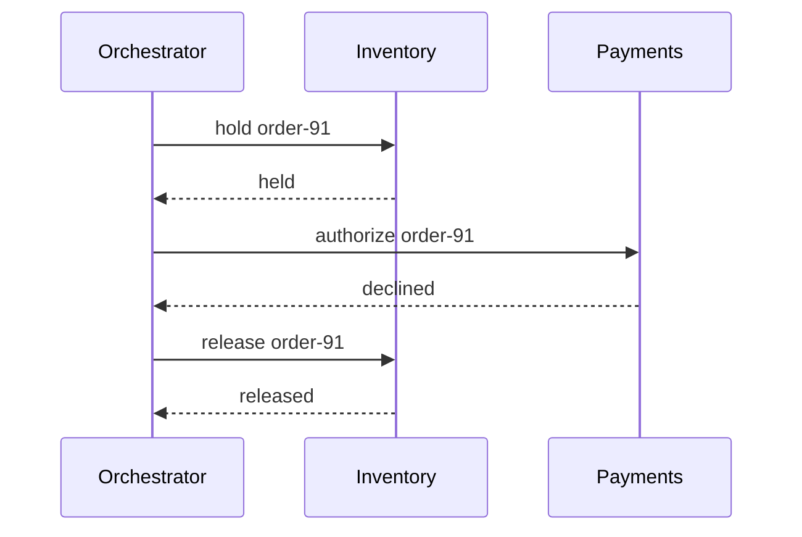

## Why this matters

The moment data is split across services, a single ACID transaction no longer covers "take payment, reserve inventory, and create the shipment." Two-phase commit across those services exists and is usually the wrong operational choice: it holds locks, couples availability, and fails in ugly ways when a participant is down. A saga breaks the business transaction into local transactions with an explicit way to undo or repair. Interviewers want the steps, the compensations, and the intermediate states a user can observe.

## Intuition

Booking a trip is a saga you already understand. You reserve a flight, then a hotel. If the hotel is full, you cancel the flight reservation rather than leaving the customer with a flight and nowhere to sleep. Canceling the flight is not a database rollback. The airline already committed a local reservation. The cancellation is a new action, a compensation, and it can fail too, which means a human or a retry must finish it.

If you can keep the flight and the hotel in one ledger with one transaction, do that and skip the saga. The saga is what you use after a real boundary forces the split, not before.

## Core concept in depth

### Local transactions first

Each saga step is a normal transaction inside one service: reserve these rows, commit, emit a fact. The step does not lock rows in another service. After it commits, other services can see that fact even if a later step fails. So a saga is **not atomic**. It is **eventually consistent**, and every intermediate state must be acceptable or at least explainable.

That is the design constraint people skip. If "payment captured and inventory not reserved" is intolerable even for a minute, you either keep those writes in one database or you change the business steps (authorize first, capture only after inventory is held).

### Orchestration versus choreography

**Orchestration.** A coordinator runs the recipe: call inventory, then payments, then shipping. It stores the saga state (which step succeeded). On failure it runs compensations in reverse. The flow is readable. The coordinator is a component you must run, version, and make idempotent. This is the right default for a business process with a known sequence.

**Choreography.** Each service listens for events and emits the next. There is no central recipe. It is fine for two or three steps. At six steps, "what happens if step four fails?" lives in nobody's head. Prefer orchestration when you cannot draw the failure path from memory.

### Compensations

A compensation undoes the business effect of a committed step:

| Step | Commit | Compensation |
| --- | --- | --- |
| Hold inventory | Stock is held for this order | Release the hold |
| Authorize payment | Funds are reserved on the card | Void the authorization |
| Capture payment | Money has moved | Refund |
| Create shipment | Warehouse is picking | Cancel the pick if it has not left; if it has left, start a return |

Some steps cannot be undone cleanly. An email cannot be unsent; you send a correction. A captured payment becomes a refund, which is a new money movement, not a time machine. A package that already shipped is a returns process. Say "compensatable, pivot, or retryable" when you classify a step. A **pivot** step is the point of no cheap return (capture, ship). Steps before it should be easy to compensate. Steps after it should be very likely to succeed.

### Idempotency and ordering

Every step and every compensation will be retried. Give each a key: order id plus step name. A second "reserve inventory" for the same order id returns the original hold. A second refund returns the original refund. Without this, the saga's own retries double-charge the customer it was trying to protect.

Out-of-order messages matter in choreography. "Compensate reserve" arriving before "reserve" must not be lost. Store the intent and apply it when the reserve lands, or use the orchestrator so you do not depend on global event order.

### State you must persist

The coordinator (or each choreographed participant) persists:

- Saga id, which equals a business id when possible (order id).
- Current step and status: pending, done, compensating, failed.
- The response payload needed to compensate (authorization id, hold id).
- A timestamp for timeouts.

If the coordinator crashes after a step commits and before it records the result, the retry must ask the participant "did this already happen?" Participants answer from their idempotency store. The coordinator is not a source of truth for money; the payment service is.

### Timeouts and the semantic lock

A hold that lasts forever blocks inventory if the saga crashes mid-way. Every hold has an expiry. A sweeper releases expired holds. The saga must treat "hold expired" as a failure even if it later resumes. This expiry is a **semantic lock**: you do not hold a database lock across services; you hold a business reservation with a clock.

### Isolation anomalies

Because there is no global lock, sagas see anomalies a single transaction would not:

- **Lost update** if two sagas read the same stock without a conditional write. Fix that inside the inventory service with a conditional update, not with a cross-service lock.
- **Dirty reads** of intermediate state. Another user can see "payment pending." The UI and the domain must allow that status.
- **Lack of isolation between sagas.** Saga A holds the last seat and fails; saga B should be able to take it after compensation or expiry, not before.

Do not "fix" these with a distributed lock around the whole saga unless the critical section is tiny and well understood. You will have reinvented two-phase commit with extra bugs.

### Two-phase commit, briefly

2PC has a prepare phase and a commit phase coordinated by a transaction manager. If every participant prepares, they commit. If one says no, they abort. It gives atomicity and it couples availability: a prepared participant holds locks until the coordinator recovers. Use it inside one datastore's distributed mode when you truly need it and the operator story is mature. Do not stretch 2PC across payments, email, and a warehouse.

## Diagram



### Dry-run: decline after a hold

| Step | Inventory | Payment | User-visible order |
| --- | --- | --- | --- |
| Start | Free | None | Draft |
| Hold commits | Held for order-91, expires in 10 minutes | None | Pending |
| Authorize declines | Still held | No capture | Pending |
| Compensation | Released | None | Failed, seat available |
| Compensation retries after a crash | Release is idempotent | None | Failed |
| Hold expiry if compensation was lost | Sweeper releases | None | Failed, slightly later |

The user never sees a captured charge for a failed order, because capture was not the second step. That ordering is the design. If you capture first and then hope inventory works, the compensation is a refund and the user experience is worse.

## Runnable Python

```python
def run_saga(inventory: dict, payments: dict, order_id: str, sku: str, amount: int) -> str:
    if inventory.get(sku, 0) < 1:
        return "rejected-no-stock"
    inventory[sku] -= 1
    inventory["hold:" + order_id] = sku
    if not payments.get("approve:" + order_id, False):
        # Compensation: release the hold. Safe to run twice.
        held = inventory.pop("hold:" + order_id, None)
        if held is not None:
            inventory[held] = inventory.get(held, 0) + 1
        return "compensated"
    payments["capture:" + order_id] = amount
    return "completed"


if __name__ == "__main__":
    stock = {"seat": 1}
    print(run_saga(stock, {}, "order-91", "seat", 40))
    print("stock", stock)
    stock = {"seat": 1}
    print(run_saga(stock, {"approve:order-91": True}, "order-91", "seat", 40))
    print("stock", stock)
```

The first run holds the only seat, sees no approval, and releases it. Stock ends at 1. The second run is approved and leaves stock at 0 with a capture recorded. This is not a real coordinator: a crash between the decrement and the release would need the persisted saga row and the sweeper described above. The snippet exists to make the forward step and the compensation visible in one place. In production those two steps are separate local transactions on the inventory service, and the payment decision is another service.

Run the compensation twice in your head: `pop` returns None the second time, so you do not increment stock twice. That is the idempotent compensation.

## Complexity / trade-off analysis

| Approach | Atomicity | Availability | Operational cost |
| --- | --- | --- | --- |
| One database transaction | Strong inside that database | Tied to one primary | Lowest, until the data must split |
| Orchestrated saga | Eventual, with explicit states | Each step fails independently; coordinator can retry | Saga state, compensations, expiry |
| Choreographed saga | Eventual | No coordinator bottleneck | Flow is hard to see and debug |
| Two-phase commit | Strong across participants | Blocked on any participant or the coordinator | Lock holding, recovery procedures |
| Manual repair queue | Whatever is left | Business keeps moving | Humans, only for rare leftovers |

## Tricks, tips, patterns

- Keep the business transaction in one database if the boundary is not real.
- Order steps so the pivot (capture, ship) happens after the risky reservations.
- Persist saga state. Assume the coordinator crashes after every commit.
- Make steps and compensations idempotent on order id plus step name.
- Expire semantic locks with a sweeper. Do not hold a row lock across the network.
- Show intermediate states in the API (`pending`, `failed`) so clients do not guess.
- Prefer an orchestrator when there are compensations. Use events for side effects that do not need to undo (email, analytics).

## Common mistakes and edge cases

- Calling a saga "a transaction" and promising the user it either fully happened or did not. They can observe the middle.
- Compensations that are not idempotent. The retry releases inventory twice and creates a free seat that is not real, or refunds twice.
- Capturing money before a fallible reservation. Every failure is now a refund.
- No timeout on a hold. Crashed sagas leak inventory until someone notices a chart.
- Distributed locks spanning services "to keep it simple." You built a worse 2PC.
- Choreography with six services and no picture of the compensate path.
- A coordinator that stores "payment succeeded" locally and never reconciles with the payment service, which declined on a retry. The payment service is authoritative.

## Interview notes

Say "I am avoiding a distributed transaction" and then either keep one database or list saga steps. For each step, say the local commit and the compensation. Mention idempotency keys, a persisted saga state, and hold expiry. Call out the user-visible status during the pending phase.

If the interviewer asks "what if the compensation fails?", the answer is: retry, then a dead-letter queue and an operator view. Compensations are code, and code fails. The system must be able to finish them later because the forward step already committed.

## Practice problems

1. **Order the steps (easy).** You must hold a seat, authorize a card, and send a confirmation email. Which order minimizes painful compensations, and which step is not really compensatable?
2. **Crash (medium).** The orchestrator commits "inventory held" in its log and crashes before calling payments. What state does inventory show, and how does recovery avoid a second hold?
3. **Anomaly (medium).** Two sagas read `stock = 1` outside the inventory service and both proceed. Where do you put the conditional update, and what does the loser do?

Related: [Event-driven architecture](/lessons/sd-event-driven-serverless), [Ticket booking](/lessons/sd-ticket-booking), [Payments](/lessons/sd-payments).

## Summary / cheat sheet

- A saga is a sequence of local transactions plus compensations. It is not atomically isolated.
- Prefer one database when the invariant truly must be atomic and the data can live together.
- Orchestrate business processes. Choreograph independent reactions.
- Put the hard-to-undo step last. Classify each step as compensatable or a pivot.
- Persist saga progress. Make every step and undo idempotent.
- Expire holds with a sweeper. Do not stretch database locks across services.
- Intermediate states are part of the API. Failed compensations retry onto a repair queue.
- Two-phase commit couples availability. Do not spread it across unrelated services.

## Further reading

- [Garcia-Molina and Salem, Sagas](https://www.cs.cornell.edu/andru/cs711/2002fa/reading/sagas.pdf)
- [Richardson, Saga pattern](https://microservices.io/patterns/data/saga.html)
- [Kleppmann, Designing Data-Intensive Applications](https://dataintensive.net/)
- [AWS Builders' Library: Avoiding fallback in distributed systems](https://aws.amazon.com/builders-library/avoiding-fallback-in-distributed-systems/)
- [PostgreSQL transaction isolation](https://www.postgresql.org/docs/current/transaction-iso.html)
