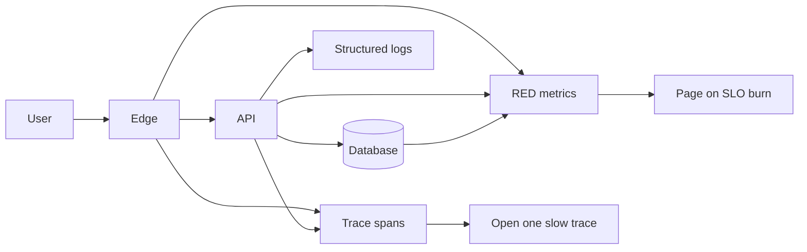

## Why this matters

A design you cannot debug in production is unfinished. Interviewers ask how you would know the system is failing, which signal pages a human, and how you would find the slow hop in a request that crosses five services. The answer is a small set of metrics, structured logs, and traces that share a request id. More dashboards are not more observability. The right signals, with the right cardinality, are.

## Intuition

Metrics are the dashboard of the car: speed, temperature, fuel. They are cheap to watch continuously and bad at explaining why one passenger is unhappy. Logs are the notebook in the glove box: a specific story, expensive if you write everything, useless if every entry says "something happened." Traces are a GPS track of one trip, showing which road ate the time. You need the dashboard to know a trip is going badly, the GPS to see where, and the notebook when the GPS is not enough.

## Core concept in depth

### Metrics

A metric is a number aggregated over time. Types:

- **Counter.** Only goes up. Requests, errors, bytes. You graph the rate.
- **Gauge.** Goes up and down. Queue depth, temperature, in-flight requests, saturation.
- **Histogram.** A distribution. Latency belongs here so you can read p50, p95, and p99. A single average gauge is not a latency metric.

**RED** is the service-level trio for a request path: **Rate** (requests per second), **Errors** (failed requests per second or a ratio), **Duration** (latency histogram). Every user-facing service should have these, sliced by route and status class, not by user id.

**USE** is the resource trio: **Utilization** (percent busy), **Saturation** (queue depth), **Errors** (device or subsystem errors). Apply it to CPU, memory, disk, and the database connection pool. A service can have a fine RED average while USE on the pool is exhausted; that pool is your tail latency.

Label carefully. A label is an extra dimension (`route`, `status`, `region`). **Cardinality** is the number of unique time series. Labels like user id, order id, or raw URL create millions of series, blow up the metrics system, and do not help paging. Put high-cardinality detail in logs and traces. Keep metric labels to a small set you would put on a dashboard.

Exemplars and trace ids can link a slow histogram bucket to one trace without making every user a time series. If you have that feature, mention it. If you do not, the discipline still stands: metrics for aggregates, traces for examples.

### Logs

Logs are event records. In production they are structured (JSON or key-value), not a sentence you have to regex. Minimum fields: timestamp, severity, service, request id, and a stable event name. Add the ids that help (order id, user id) as fields, not as a paragraph.

Levels mean something. **Error** is for a failed operation a human might care about. **Warn** is for a degraded path you took. **Info** is a business or lifecycle event, not every cache hit. **Debug** is off in production or sampled. A service that logs every success at info at 50,000 QPS creates a second outage in the logging bill and loses the real errors in noise.

Never log secrets, card numbers, raw session tokens, or full authorization headers. Log an id and a result code. Centralize logs in one place with a retention period that matches how you debug (often days to a few weeks for verbose logs, longer for security audit events, which may be a different pipeline).

### Traces

A **trace** is a tree of **spans**. The root span is the user request. Each downstream call is a child span with a start time and a duration. Context (trace id, span id, sampling decision) propagates in headers (W3C `traceparent` or a vendor equivalent). If one hop drops the header, the tree splits and you are back to guessing.

Sampling: tracing every request at very high QPS is expensive. **Head-based sampling** decides at the start, which can miss rare errors. **Tail-based sampling** keeps traces that were slow or failed, at the cost of buffering. A practical interview answer: always trace errors and a small percent of successes, and keep the ability to raise the rate during an incident.

Traces answer "where did the 800 ms go?" They do not replace metrics for paging. You page on a RED burn, then open a trace.

### What you page on

Page on user symptoms and on resources that are about to cause user symptoms:

- Error rate or latency SLO burn (next lesson goes deep on burn rates).
- Queue age above the product limit.
- Saturation of a critical pool (connections, threads) for more than a couple of minutes.
- A dependency circuit that is open on a mandatory path.

Do not page on CPU at 70 percent, a single log line, or a gauge you have not tied to a user effect. Every page that is not actionable trains the team to ignore pages.

### Instrumentation map for a design

When you finish an architecture diagram, add a sentence:

"The edge records RED per route. Each service propagates the trace id. The order database exports pool saturation and replication lag. The consumer exports queue age and poison-message count. Logs include order id and the idempotency key, not the card number. We page on checkout error rate, p99, and payment-queue age."

That sentence is worth more than a box labeled "monitoring."

### Health versus readiness

A health endpoint for humans can be rich. A **readiness** endpoint for the load balancer must be cheap and specific. Do not make readiness depend on a downstream that you can degrade, or one optional outage drains the whole fleet. Do not make it so shallow that a wedged process stays in rotation. Metrics tell you the middle ground is working; the probe only answers "send this process traffic or not."

## Diagram



### Dry-run: checkout feels slow

| Signal | What it shows | Next move |
| --- | --- | --- |
| Edge p99 is 900 ms, p50 is 80 ms | A tail, not a total outage | Open tail traces, do not restart everything |
| Trace: payment span is 700 ms, inventory is 20 ms | The time is in one hop | Look at payment USE: pool, CPU, downstream |
| Payment pool saturation is high, CPU is moderate | Waiting for connections | Pool size, slow queries, or too little concurrency bulkhead |
| Error rate flat | Slowness without failures | Do not chase the error log; chase the span |
| After the fix, p99 falls and the trace's payment span is 40 ms | You hit the right hop | Write the dashboard down so the next person starts here |

Without the trace, a team restarts the API because that is the box they own. The metric said the edge was slow. The trace said why.

## Runnable Python

```python
def redact(fields: dict) -> dict:
    secret = {"card", "password", "token", "authorization"}
    clean = {}
    for key, value in fields.items():
        if key.lower() in secret:
            clean[key] = "[redacted]"
        else:
            clean[key] = value
    return clean


def page(error_rate: float, p99_ms: float, queue_age_s: float) -> list[str]:
    reasons = []
    if error_rate > 0.01:
        reasons.append("error-rate")
    if p99_ms > 400:
        reasons.append("latency")
    if queue_age_s > 30:
        reasons.append("queue-age")
    return reasons


if __name__ == "__main__":
    print(redact({"order_id": "91", "card": "4242", "route": "/pay"}))
    print(page(0.002, 900, 4))
    print(page(0.0001, 80, 2))
```

The redactor keeps `order_id` and drops the card, which is the logging rule in code form. The pager fires on the latency example even though the error rate is fine, matching the dry-run. It stays quiet when all three signals are inside budget. A real pager also needs a burn window so one noisy second does not wake anyone; the SLO lesson adds that window. The point here is to page on symptoms you chose in advance, not on every log line.

## Complexity / trade-off analysis

| Choice | You gain | You pay |
| --- | --- | --- |
| RED and USE only | A pageable, small set | Less detail until you open a trace |
| High-cardinality metrics | Slice by user or URL | A dead metrics cluster and a large bill |
| Log every request | Easy forensics at low QPS | Cost and noise at high QPS; sample instead |
| Trace every request | Perfect examples | Storage and overhead; sample, keep errors |
| Head sampling | Simple | Misses rare bad traces |
| Tail sampling | Keeps slow and failed traces | Buffering and a more complex pipeline |
| Rich readiness | Fewer false "up" | Accidental full-fleet drain |

## Tricks, tips, patterns

- RED for every request path. USE for every scarce resource. Histograms for latency.
- Labels stay low cardinality. Ids go in logs and traces.
- One trace id from the edge to the database. Test that it survives your proxy.
- Sample successes, keep errors and timeouts.
- Structured logs, stable event names, no secrets.
- Page on SLO burn, queue age, and critical saturation. Dashboard the rest.
- When you add a new dependency, add its timeout metric and its error rate the same day.

## Common mistakes and edge cases

- A dashboard of host CPU and nothing that matches the user request. You see machines and not the product.
- Averaging latency. The tail is the incident.
- A label per endpoint when endpoints include raw ids. Cardinality incident.
- Logging the body of every payment request. Both a security incident and a disk incident.
- Traces that start at the API and ignore the edge and the database, so the missing 200 ms is "unexplained network."
- Alerting at 100 percent error for five minutes on a low-traffic endpoint that had two failures. Use a minimum volume or a burn rate.
- Readiness that calls the database with a heavy query. The probe causes the outage.

## Interview notes

Add an observability sentence to every design: what you measure (RED plus the one resource that will saturate), what you log (business ids, not secrets), how a trace crosses the slow hop, and what pages. If the interviewer says "users say it is slow," walk the dry-run from edge histogram to one span to resource saturation.

Mention cardinality out loud. It signals you have operated metrics, not only drawn a box.

## Practice problems

1. **Signals (easy).** For a queue consumer, which three numbers do you want on the first dashboard, and which one pages?
2. **Cardinality (medium).** Someone proposes a metric label for `user_id` on the request counter. What breaks, and where should the user id live instead?
3. **Slow, not failing (medium).** Error rate is 0.1 percent and p99 just tripled. Which pillar do you open first, and what do you expect to find if a connection pool is the cause?

Related: [SLOs, chaos, and disaster recovery](/lessons/sd-slo-chaos-dr), [Latency and throughput](/lessons/sd-latency-throughput).

## Summary / cheat sheet

- Metrics are aggregates. RED for services, USE for resources, histograms for latency.
- Low-cardinality labels only. High-cardinality detail belongs in logs and traces.
- Logs are structured, leveled, and free of secrets. They carry the request id.
- Traces are trees of spans. Propagate the trace id on every hop. Sample, but keep failures.
- Page on user symptoms and on saturation that predicts them. Do not page on idle curiosity.
- Readiness probes are routing signals, not full diagnostics.
- A design is observable when you can name the dashboard, the log fields, and the span that would explain a slow request.

## Further reading

- [Google SRE book: Monitoring Distributed Systems](https://sre.google/sre-book/monitoring-distributed-systems/)
- [OpenTelemetry documentation](https://opentelemetry.io/docs/)
- [W3C Trace Context](https://www.w3.org/TR/trace-context/)
- [Prometheus instrumentation best practices](https://prometheus.io/docs/practices/instrumentation/)
- [Honeycomb: observability for developers](https://www.honeycomb.io/blog/observability-101-for-developers)
