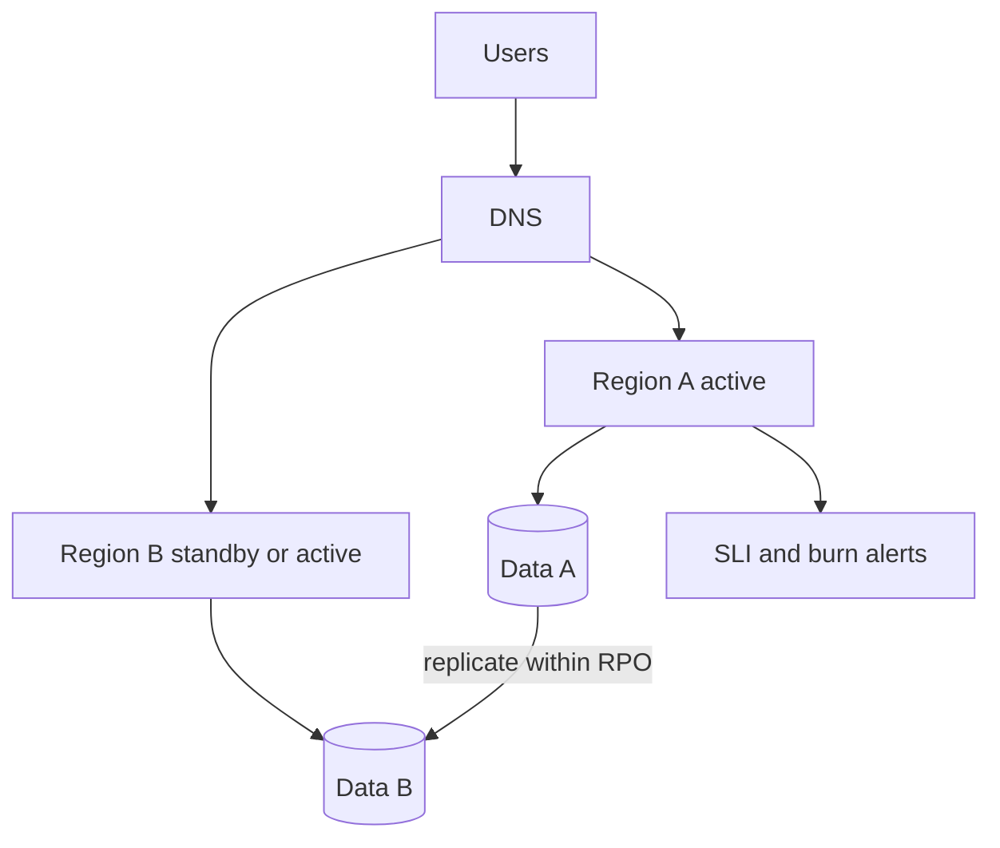

## Why this matters

Availability numbers are decoration until they change a release decision, a page, or a failover drill. SLOs do the first two. Chaos engineering checks that your failure story is true. Disaster recovery defines how much data you can lose and how long you can be down when a whole site is gone. Product interviews at this level ask "what do you do when a region fails?" and "how do you know you still meet 99.95 percent?" You should answer with budget, drill, RPO, and RTO, not with "we are multi-region" as a sticker.

## Intuition

An error budget is a jar of allowed pain. Four nines over a month is a small jar. Every outage, bad deploy, and dependency failure scoops some out. When the jar is empty, you stop shipping risk and you fix reliability. When the jar is full, you can spend it on launches. Without the jar, every team argues from vibes.

Chaos engineering is a fire drill. You do not start by lighting the data center on fire. You start by closing one door you claim does not matter, with the exits already marked, during the day, with someone watching.

Disaster recovery is the plan for the building actually burning: which notebooks you can recreate, how many hours of notes you might lose, and how long until you can open a stall across town.

## Core concept in depth

### SLI, SLO, SLA

- **SLI** is the indicator: a measured ratio. Example: the fraction of checkout requests that return a non-5xx response in under 400 ms, measured at the edge.
- **SLO** is the target: 99.95 percent of those requests succeed the SLI over 30 days.
- **SLA** is a contract with a customer that usually includes a penalty. It should be looser than the internal SLO so you have room to react before you owe money. Do not invent an SLA in an interview unless the prompt is about a platform with paying tenants. Do invent an SLO.

Pick SLIs users feel. CPU is not an SLI. "Recommendations were personalized" might be a product metric and a poor paging SLI. Checkout success and latency are SLIs. A feed can have a freshness SLI ("events appear within 5 seconds for 99 percent of viewers") separate from its availability SLI.

### Error budgets and burn

If the SLO is 99.9 percent over 30 days, the budget is 0.1 percent failed requests, which is also about 43 minutes if you think in time, but request-based budgets are better when traffic is uneven. **Burn rate** is how fast you are consuming the budget. A burn rate of 1 means you will exhaust the budget exactly at the end of the window. A burn rate of 14.4 over one hour consumes a large chunk of a monthly 99.9 percent budget quickly (the SRE workbook uses multi-window alerts so a one-hour page and a six-hour ticket catch different speeds without paging on a single blip).

The policy that makes the SLO real:

- Budget remaining: ship features, take measured risks.
- Budget burning fast: page, mitigate, freeze risky launches.
- Budget gone: only reliability work until the window recovers.

Say this policy in the interview when you quote nines. It shows the number has a consequence.

### Dependencies and budgets

Your SLO cannot be tighter than what your critical dependencies allow unless you degrade. If payments is 99.95 percent and you call it synchronously with no fallback, checkout cannot honestly promise 99.99 percent. Either loosen the SLO, split the SLI ("checkout attempted" versus "payment captured"), or change the architecture.

### Chaos engineering

Chaos engineering is experimenting on a system to build confidence it survives real conditions. The method:

1. Define steady state in terms of the SLI, not in terms of "the process is up."
2. Hypothesize: "if one instance dies, the SLI stays inside the SLO."
3. Inject a realistic fault: kill an instance, add latency, drop packets, fill a disk, expire a certificate in staging, fail a dependency.
4. Observe the SLI and the secondary effects (retry rate, queue age).
5. Stop if you approach the abort condition. Fix the surprise. Automate the experiment later.

Start in staging, then production with a tiny blast radius, during working hours, with a rollback (stop the injection). Never start with "delete the production database." Good first experiments: terminate one stateless instance, add 200 ms to a non-critical dependency, fail one availability zone in a game day.

**Game days** are scheduled, human, larger drills: region evacuation, restore from backup, certificate rotation. Chaos experiments are narrower and more repeatable. You want both. A failover you have not done is a design claim, not a capability.

What chaos often reveals: retries with no budget, readiness probes that do not notice a wedge, a single-instance cache, a client with no deadline, a runbook that references a dashboard nobody can open, and a "multi-AZ" deploy that actually pins volumes to one zone.

### Disaster recovery

Two numbers define DR:

- **RPO**, recovery point objective: how much data you can afford to lose, measured in time. RPO of 0 means every acknowledged write must survive the site loss (synchronous replication to another site, with the latency that implies). RPO of 15 minutes means a replica or a backup can be that stale.
- **RTO**, recovery time objective: how long until the service is usable again. RTO of minutes means automated failover and pre-provisioned capacity. RTO of hours means a restore from backup is acceptable.

| Pattern | Typical RPO | Typical RTO | Cost and catch |
| --- | --- | --- | --- |
| Backup and restore | Hours, whatever the last backup was | Hours to days | Cheap, easy to forget a restore test |
| Pilot light | Minutes if replication is continuous | Tens of minutes to hours | Small standby, scale-up time |
| Warm standby | Seconds to minutes | Minutes | Pay for a reduced fleet always |
| Active-active multi-region | Near 0 for data that is sync, or the replication lag if async | Very small for the healthy region | Conflict handling, data residency, highest cost |

Backups are not a strategy until you have restored them. A backup that depends on the same account, the same keys, and the same region as the primary is not a backup against the failure you think. Test restore into a clean account or region. Measure the time. That measured time is your RTO evidence.

**Replication lag** is the RPO of async multi-region. If you acknowledge a write in region A and A dies before shipping it, that write is gone. For a ledger, either wait for the other region (and pay the latency) or accept the loss explicitly and build reconciliation. Do not say "RPO zero" and "async replication" in the same answer.

**Failover mechanics.** Freeze writes or accept split brain. Fence the old region so it cannot accept writes after the new region is promoted (the same fencing idea as a database leader). Drain DNS with a low TTL only as a helper; long-lived clients need a way to refresh. Pre-provision enough capacity in the survivor, or your RTO includes a scale-out you have not tested.

**Data residency and dependencies.** A failover region that cannot legally store the data is not a failover region. A failover region that still calls a single-region email provider will fail the part of the product you forgot to list. Write the dependency list.

### Degraded modes

DR is not only "the other region is identical." Decide what you run if the survivor is smaller: read-only, no recommendations, queue writes for later, static status page. A smaller honest mode beats a full mode that falls over.

## Diagram



### Dry-run: region A is unreachable

Assume RPO of 1 minute, RTO of 15 minutes, async replication, warm standby at 30 percent capacity, peak needs 100 percent.

| Minute | Action | User effect |
| --- | --- | --- |
| 0 | Health checks fail, burn alert pages | Errors on A |
| 2 | On-call confirms A is the fault, not a bad deploy | Still down |
| 5 | Promote B, fence A so A cannot write if it returns | Writes move |
| 8 | Scale B from 30 to 100 percent | Some shedding meanwhile |
| 12 | DNS and client discovery point at B | Most users recover |
| 15 | SLI inside threshold | RTO met if this was rehearsed |
| Data | Last minute of A writes may be missing | Inside the stated RPO, must be reconciled if any client got an ack that did not replicate |

If you have never scaled B, minute 8 is a guess and the RTO is fiction. The drill exists to replace that guess with a measurement.

## Runnable Python

```python
def error_budget_requests(total_requests: int, slo: float) -> int:
    return int(total_requests * (1 - slo))


def burn_rate(failed: int, total: int, budget_fraction: float) -> float:
    if total == 0 or budget_fraction <= 0:
        raise ValueError("need traffic and a positive budget")
    actual = failed / total
    return actual / budget_fraction


def rpo_met(lag_seconds: float, rpo_seconds: float) -> bool:
    return lag_seconds <= rpo_seconds


if __name__ == "__main__":
    print("budget", error_budget_requests(50_000_000, 0.999))
    print("burn", round(burn_rate(failed=5_000, total=100_000, budget_fraction=0.001), 2))
    print("rpo", rpo_met(45, 60), rpo_met(90, 60))
```

Fifty million requests at a 99.9 percent SLO allow 50,000 failed requests in the window. The burn example fails 5 percent of a sample against a 0.1 percent budget, a burn rate of 50: you are consuming the month's budget on the order of hours, so this pages immediately. The RPO helper makes the replication-lag conversation numeric. If lag is 90 seconds and you promised 60, you are not in policy, even if both regions are "up."

## Complexity / trade-off analysis

| Choice | Reliability effect | Price |
| --- | --- | --- |
| Tight SLO | Clear user promise, less room to ship | More ops work, more conservative launches |
| Loose SLO | Room to move | Users feel pain you officially allow; set it honestly |
| Request-based budget | Matches uneven traffic | Needs a good SLI |
| Time-based budget | Easy to explain as minutes | Hides a bad minute at peak |
| Active-active | Best RTO | Conflict and cost |
| Backup only | Survives total loss eventually | RPO and RTO often measured in hours, if the restore works |
| Sync cross-region write | RPO near 0 | Write latency and availability tied to the far region |
| Game day | Finds the surprises | Risk if you skip abort conditions |

## Tricks, tips, patterns

- Define the SLI at the edge, in user language, before you draw a second region.
- Tie the SLO to a burn alert and a launch policy or it is a slogan.
- Make the SLO looser than any external penalty, and looser than a synchronous dependency you cannot beat.
- Chaos the fault you already claim to handle: one instance, one dependency, one zone.
- State RPO and RTO as numbers. Match replication to the RPO. Match automation to the RTO.
- Restore from backup on a schedule. Replication is not a backup against a bad delete.
- Fence the old site. Decide the degraded mode if the survivor is smaller.
- Abort a drill when the SLI crosses a pre-agreed line.

## Common mistakes and edge cases

- An SLO on internal CPU, and a surprised team when users are failing and the SLO is green.
- Paging on a single failed request on a quiet endpoint. Use burn and a minimum volume.
- Multi-region written on the diagram with async replication and a claim of zero data loss.
- Backups in the same failure domain as the data, or backups nobody has restored.
- A game day that skips the data tier because "that would be risky," which is the only part that is risky.
- Forgetting clients cache DNS. The new region is up and users still hit the old address.
- A chaos experiment with no steady-state metric, so you cannot tell if you learned anything.
- Two regions that both depend on one control plane or one secret store in region A.

## Interview notes

Quote one SLO, the SLI it is measured with, and what you do when the budget burns. For disasters, say RPO, RTO, the replication mode, how you fence, and that you have restored a backup or you schedule that as an explicit gap. Offer one chaos experiment that matches the design ("kill one partition consumer; queue age must stay under a minute").

If the interviewer asks "can you guarantee four nines?", say what would have to be true: no synchronous dependency worse than that, automated failover, and a budget you actually watch. Guarantees you cannot measure are marketing.

## Practice problems

1. **Budget (easy).** An SLO is 99.95 percent of 20 million requests in a month. How many failures are allowed? If you have already failed 8,000, what is the launch posture?
2. **Experiment (medium).** You claim checkout survives the recommendations service being slow. Design a chaos experiment: steady state, injection, abort condition.
3. **Region loss (medium).** Async replication lag is usually 5 seconds and sometimes 2 minutes. What RPO can you honestly advertise, and what would you change to get an RPO under 10 seconds?

Related: [Observability](/lessons/sd-observability), [Scalability, availability, and reliability](/lessons/scalability-availability-reliability).

## Summary / cheat sheet

- SLI is the measurement, SLO is the target, SLA is a penalty contract. Design the SLO first.
- Error budget is 1 minus the SLO. Burn rate says whether to page and whether to freeze launches.
- The SLO cannot outrun a synchronous dependency. Change the architecture or the promise.
- Chaos tests a hypothesis about the SLI with a small, reversible fault. Game days rehearse big procedures.
- RPO is how much data you can lose. RTO is how long until you are back. Replication and automation must match those numbers.
- Async replication cannot give RPO zero. Sync replication spends latency to try.
- Backups count only after a timed restore. Fence a failed region. Know the degraded mode.

## Further reading

- [Google SRE book: Service Level Objectives](https://sre.google/sre-book/service-level-objectives/)
- [Google SRE workbook: Alerting on SLOs](https://sre.google/workbook/alerting-on-slos/)
- [Principles of Chaos Engineering](https://principlesofchaos.org/)
- [AWS disaster recovery of workloads](https://docs.aws.amazon.com/whitepapers/latest/disaster-recovery-workloads-on-aws/disaster-recovery-options-in-the-cloud.html)
- [Kleppmann, Designing Data-Intensive Applications](https://dataintensive.net/)
