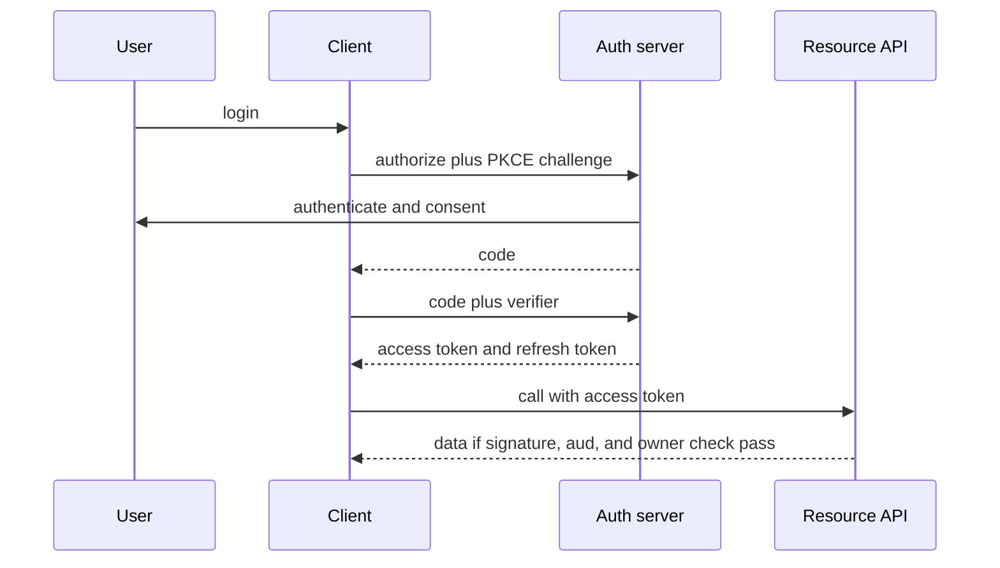

## Why this matters

Every product design eventually answers "who is calling?" and "what may they do?" Interviewers listen for the difference, for where tokens are checked, and for how you revoke access. Mixing up authentication and authorization, or treating a JWT as a session you cannot expire, is a common senior-interview failure. This lesson is the security model you attach to the API gateway and to every service behind it.

## Intuition

Authentication is checking the badge at the door. Authorization is checking whether that badge may open the server room. A valid badge does not imply every door. OAuth is a way for a building to let a visitor in because another building vouches for them, without sharing the master key. A JWT is a signed note that says "Alex, until 15:00, these claims." The note is easy to pass around. It is hard to take back before 15:00 unless you keep a list of notes you no longer trust, which means you have rebuilt a session store.

## Core concept in depth

### Authentication versus authorization

**Authentication (authn)** establishes identity: this request is user 42, or service `payments`, or an anonymous client. **Authorization (authz)** decides an action: user 42 may read order 7 because they own it, not because they are logged in. Do both at the service that owns the data. The gateway can reject missing credentials early. It should not be the only place that checks "may this user refund this payment?", or an internal caller that bypasses the gateway skips the rule.

Factors: something you know (password), something you have (device, key), something you are (biometric, usually via a platform). Passwords are stored as slow password hashes (Argon2id or bcrypt), never reversible encryption and never a raw SHA-256 of the password. Multi-factor authentication raises the cost of a stolen password. Session fixation and phishing are why a second factor and origin-bound cookies matter; name them without designing an attack.

### Sessions

A classic session: after login, the server stores a random session id in a server-side store and sets an **HttpOnly, Secure, SameSite** cookie. The browser sends the cookie; the server looks up the session. Revocation is a delete. Rotation on privilege change (login, password change) stops fixation. This model is easy to revoke and easy to reason about. The cost is a lookup (or a cache of that lookup) on each request.

Cookies need CSRF protection when they are sent automatically on cross-site requests. SameSite=Lax or Strict cuts the common cases. State-changing requests from other origins need a CSRF token or a custom header that triggers a preflight. A bearer token in an `Authorization` header is not sent automatically by the browser, which is why SPAs sometimes prefer it, and then they must store it somewhere that XSS cannot read. An HttpOnly cookie is not readable by script. There is no storage choice that survives XSS and also lets arbitrary script read the token. The real fix for XSS is to not have XSS; the cookie flags are defense in depth.

### OAuth 2.0 and OpenID Connect

OAuth 2.0 is an **authorization** framework. It lets a client obtain delegated access to a resource without seeing the user's password. **OpenID Connect** adds an identity layer so you also learn who the user is (an id token).

Roles: the **resource owner** (the user), the **client** (your app or a third party), the **authorization server** (issues tokens), and the **resource server** (your API).

Grants you should be able to place:

| Grant | Use | Do not use it for |
| --- | --- | --- |
| Authorization code with PKCE | User login in a browser, mobile app, or SPA | Nothing, this is the default user flow |
| Client credentials | A service calling another service, no user | User impersonation |
| Device code | A TV or CLI that cannot type a password easily | A normal website |
| Refresh token | Getting a new access token without asking the user again | An immortal credential; rotate and revoke them |
| Implicit grant | Legacy browsers, tokens in the URL fragment | New designs. It was removed from the security best practices |
| Resource owner password | Legacy only | Any new product. The client sees the password |

**Authorization code plus PKCE** in one paragraph: the client sends the user to the authorization server with a code challenge (a hash of a random verifier). The user authenticates and consents. The server redirects back with a short-lived code. The client exchanges the code plus the verifier for tokens, server-side. The hash means a stolen code from a log or a referrer is not enough to get tokens. Public clients (mobile, SPA) cannot keep a secret; PKCE is what protects them. Confidential clients (a backend) also use PKCE and can use a secret.

**Scopes** are the permissions the user delegated (`photos.read`), not your entire internal role model. Keep them coarse. Check them at the resource server. An access token is not a blank check because the user once logged in.

**Redirect URI** allow-lists must be exact. A wildcard that lets an attacker-controlled domain receive the code defeats the flow. State this as a configuration invariant.

### JWT

A JSON Web Token is three base64url parts: header, payload, signature. The payload is claims (`sub`, `exp`, `iss`, `aud`, and your own). The signature is HMAC with a shared secret or, better in a multi-service system, a signature with a private key (for example ES256 or RS256) that resource servers verify with a published public key (JWKS).

Rules that keep JWTs safe:

- Verify the signature. Do not decode and trust. Reject the `none` algorithm. Pin the algorithms you accept so a token cannot switch you from an asymmetric algorithm to a symmetric one that uses the public key as an HMAC secret.
- Check `exp`, `iss`, and `aud`. A token for another API is not a token for yours. Allow a small clock skew only.
- Keep access tokens short, on the order of minutes to an hour. Put long life in a refresh token you can revoke.
- Do not put secrets or bulky profiles in the token. It is sent often and is readable by anyone who has it (the signature is integrity, not confidentiality).
- Treat stolen access tokens as usable until `exp` unless you add a denylist. A denylist is a lookup, which removes the "stateless" property for those tokens. Say that trade honestly: short expiry limits the window; a denylist of token ids (jti) closes it faster and costs a cache read.
- Rotate signing keys. Publish new public keys, sign with the new key, keep the old public key until old tokens expire.

A JWT is a poor session store when you need instant logout of every device. Use a session id, or a short-lived JWT plus a refresh token family that you revoke server-side. **Refresh token rotation**: each refresh returns a new refresh token and invalidates the old one. Reuse of an old refresh token means theft, so you revoke the whole family.

### Service-to-service

Inside the fleet, prefer workload identity: a short-lived token or mTLS certificate issued to the workload, not a long-lived shared secret in an environment file. The resource server checks the caller identity and an authorization policy ("checkout may call capture, analytics may not"). Network location is not authorization. A service mesh can do mTLS and still leave application authz to the app.

### Where checks sit

| Layer | Checks |
| --- | --- |
| Gateway | TLS, token presence, signature, expiry, coarse rate limit |
| Service | Audience, scopes, and the business rule (owns this order, role, tenant) |
| Data | Tenant id on every query so a missing `WHERE` does not leak another tenant |

The last row is how authorization bugs become data leaks. Include the tenant or owner in the query, not only in the handler after a load.

## Diagram



### Dry-run: logout and a stolen access token

| Event | Session-cookie design | 15-minute JWT, no denylist | JWT plus jti denylist |
| --- | --- | --- | --- |
| User clicks logout | Delete session, cookie dies now | Access token works until exp | jti blocked on next request |
| Theft at minute 2 | Theft works until you delete the session, which you can do | Theft works up to 13 more minutes | Theft works until the denylist is read, typically the next request |
| Extra read on each API call | Session store | None | Denylist or a bloom of revoked ids |
| Refresh token stolen and used | Rotate and revoke family | Same, if you stored refresh server-side | Same |

There is no design where a bearer secret leaks and nothing can be done, unless the token is sender-constrained (mTLS or DPoP). Mention sender-constrained tokens if the interviewer pushes on theft. For most product interviews, short expiry plus refresh rotation is the expected answer, with a denylist if logout must be instant.

## Runnable Python

```python
import hmac
import hashlib
import json
import base64
import time


def b64(data: bytes) -> str:
    return base64.urlsafe_b64encode(data).rstrip(b"=").decode()


def sign(payload: dict, secret: bytes) -> str:
    header = b64(json.dumps({"alg": "HS256", "typ": "JWT"}).encode())
    body = b64(json.dumps(payload).encode())
    mac = hmac.new(secret, f"{header}.{body}".encode(), hashlib.sha256).digest()
    return f"{header}.{body}.{b64(mac)}"


def accepts(token: str, secret: bytes, audience: str, now: float) -> bool:
    try:
        header_b, body_b, mac_b = token.split(".")
    except ValueError:
        return False
    header = json.loads(base64.urlsafe_b64decode(header_b + "=="))
    if header.get("alg") != "HS256":
        return False
    expected = hmac.new(secret, f"{header_b}.{body_b}".encode(), hashlib.sha256).digest()
    got = base64.urlsafe_b64decode(mac_b + "==")
    if not hmac.compare_digest(expected, got):
        return False
    claims = json.loads(base64.urlsafe_b64decode(body_b + "=="))
    if claims.get("aud") != audience:
        return False
    if float(claims.get("exp", 0)) < now:
        return False
    return True


if __name__ == "__main__":
    secret = b"demo-only-not-for-prod"
    token = sign({"sub": "42", "aud": "api", "exp": time.time() + 60}, secret)
    print("good", accepts(token, secret, "api", time.time()))
    print("wrong aud", accepts(token, secret, "other", time.time()))
```

This is a teaching verifier, not a library to ship. It refuses an unexpected algorithm, checks the MAC with a constant-time compare, and checks audience and expiry. A production verifier uses a maintained JWT library, asymmetric keys from a JWKS document, and a clock-skew allowance of a few tens of seconds. The demo uses HMAC so it can run with no key files. The rejection of a wrong audience is the line that stops a token minted for one service from being replayed at another.

Do not invent your own crypto in a real system. Do understand which checks the library must be configured to perform, because libraries will happily decode a token if you forget to require an audience.

## Complexity / trade-off analysis

| Choice | Gain | Cost |
| --- | --- | --- |
| Server session plus cookie | Instant revoke, small cookie | Session store, CSRF care |
| Short-lived JWT | No session read on every call | Cannot kill it instantly; revocation needs extra state |
| Authorization code plus PKCE | Safe delegated login for public clients | Redirect and state management |
| Client credentials | Clear service identity | Not a user identity; do not overload it |
| Coarse scopes plus local authz | Simple consent | Every service must still check ownership |
| Long-lived access token | Fewer refreshes | A leak stays valid |
| Sender-constrained token | Theft of the token alone is not enough | Certificate or key management on the client |

## Tricks, tips, patterns

- Say authn and authz as two checks. Identity at the edge, ownership at the data owner.
- Default human login to authorization code with PKCE. Default machines to client credentials or workload identity.
- Pin JWT algorithms. Verify `exp`, `iss`, and `aud`. Keep access tokens short.
- Rotate refresh tokens and revoke the family on reuse.
- HttpOnly, Secure, SameSite cookies when the browser is the client. Do not put tokens in local storage and call it done.
- Put the tenant or owner predicate in the query.
- Store passwords with Argon2id or bcrypt. Store only a hash of refresh tokens if you only need to look them up by an id.

## Common mistakes and edge cases

- Decoding a JWT without verifying the signature, or allowing algorithm `none`.
- Using the public key as an HMAC secret because the library "just verifies."
- A 30-day access token and no denylist, then a surprised logout button.
- Implicit flow, or putting tokens in a query string where logs and referrers keep them.
- Wildcard redirect URIs.
- Authorization only in the UI ("we hide the button"). The API still performs the action.
- A missing tenant filter that returns another customer's rows to a valid user.
- Sharing one service credential across every workload, so you cannot revoke one caller.
- Clock skew of minutes combined with a 60-second token, which creates random 401s, or skew of zero on servers whose clocks drift.

## Interview notes

Draw the client, the authorization server, and the resource API. Name the grant. Say what the API verifies (signature, expiry, audience, ownership). Mention refresh rotation and what logout actually does in your design. If the system is multi-tenant, say the tenant predicate lives in the query.

For internal calls, say mTLS or a short-lived workload token, and a policy of which service may call which method. "We are inside the VPC" is not an authorization story.

## Practice problems

1. **Two checks (easy).** A logged-in user requests another user's invoice. Which check passes, which check fails, and where does the failing check run?
2. **Logout (medium).** Access tokens last 30 minutes and are not stored server-side. What can a stolen token still do after logout, and what two changes shrink that window?
3. **Grant (medium).** A mobile app and a nightly billing job both call your API. Which OAuth grants do you use, and which grant do you refuse because the client would see the user's password?

Related: [Encryption and OWASP](/lessons/sd-encryption-owasp), [API gateway and rate limiting](/lessons/sd-api-gateway-rate-limiting).

## Summary / cheat sheet

- Authentication names the caller. Authorization decides the action. Do authorization in the service that owns the data.
- Browser sessions: random id, server store, HttpOnly Secure SameSite cookie, rotate on login.
- OAuth 2 delegates access. OIDC adds identity. Use authorization code with PKCE for users and client credentials for services.
- JWTs are signed claims, not encrypted secrets. Pin the algorithm. Check exp, iss, and aud.
- Short access tokens, rotating refresh tokens, denylist or sessions when you need instant revoke.
- Scopes are not a substitute for object-level ownership checks.
- Never store raw passwords. Never trust a token because it base64-decodes.

## Further reading

- [RFC 6749 The OAuth 2.0 Authorization Framework](https://www.rfc-editor.org/rfc/rfc6749)
- [RFC 7636 PKCE](https://www.rfc-editor.org/rfc/rfc7636)
- [OpenID Connect Core](https://openid.net/specs/openid-connect-core-1_0.html)
- [RFC 7519 JSON Web Token](https://www.rfc-editor.org/rfc/rfc7519)
- [OAuth 2.0 Security Best Current Practice](https://datatracker.ietf.org/doc/html/draft-ietf-oauth-security-topics)
- [OWASP Authentication Cheat Sheet](https://cheatsheetseries.owasp.org/cheatsheets/Authentication_Cheat_Sheet.html)
