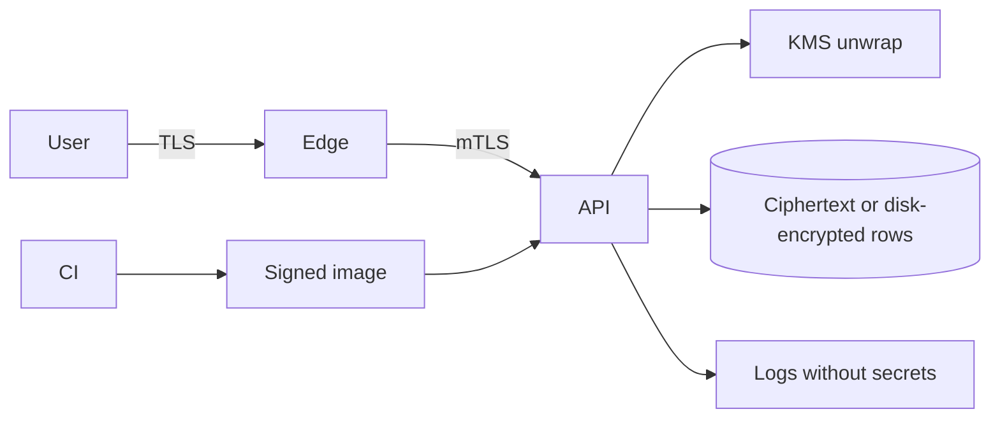

## Why this matters

Interviewers do not expect you to invent a cipher. They expect you to know where confidentiality and integrity come from, who holds the keys, and which common web failures your design already prevents. "We use HTTPS" is the start of the transport story, not the data story. A stolen database backup, a log line, or a forgotten internal HTTP hop can undo the lock on the front door. This lesson places encryption, key management, and the OWASP controls on a system diagram.

## Intuition

Encryption is a locked box. TLS is a locked box around one conversation, built fresh with the person you think you are talking to, and thrown away after. Encryption at rest is a locked box around stored bytes, and the interesting question is where the key lives while the application is running, because the application must open the box to do its job. Integrity is a wax seal: you notice if someone rewrites the message, even if you cannot stop them from reading it. Signatures and MACs are seals. Encryption without a seal can sometimes be rewritten; modern protocols therefore authenticate what they encrypt.

OWASP is a list of how web systems actually fail: not with a broken cipher, but with a query built from a string, an access check in the UI only, a default password, and a dependency nobody updated.

## Core concept in depth

### Transport: TLS

TLS gives you confidentiality, integrity, and server authentication (and client authentication if you use client certificates) for a connection. Use TLS 1.2 or 1.3 between the user and your edge, and prefer TLS on internal hops too (mTLS when both sides are your services). Plain HTTP inside a "private" network assumes every network neighbor is trusted. That assumption fails when a single workload is compromised or when a misconfigured security group is wider than you thought.

Certificates prove a name. Automate issuance and rotation (ACME or a platform CA). Pinning public keys in mobile apps stops some impostors and also bricks clients when you rotate badly, so if you pin, pin a backup key. Redirect HTTP to HTTPS. Set HSTS so browsers stop trying the cleartext port. Terminate TLS at a proxy you control, and decide explicitly whether the hop from the proxy to the app is encrypted again. Do not log decrypted bodies.

mTLS means the client presents a certificate too. It is a strong service identity. It does not replace authorization: a valid workload certificate still should not call every method.

### At rest

Disk encryption (volume or database encryption) protects against someone walking away with a disk or a snapshot that is not attached to a running system. It does **not** protect against the application, a stolen database password, or a SQL injection, because the database decrypts for any authorized query. You still need access control, network policy, and query discipline.

**Application-level encryption** encrypts a column before it hits the database. The database sees ciphertext. Use it for especially sensitive fields (national ids, some tokens) when you can search without the raw value, or when you search only by an equality token (a keyed hash) rather than by a range. Keyed hashes for lookup are not encryption; do not use a raw hash of a low-entropy identifier as if it were secret.

**Envelope encryption** is the pattern to describe. A data key encrypts the payload. A key-encryption key, stored in a KMS or HSM, wraps the data key. You can store the wrapped data key next to the ciphertext. Rotating the master key rewraps data keys; it does not rewrite every row. The KMS never needs to see the payload if the data key is generated and used in the app, and the KMS only unwraps. Either way, audit who can call unwrap.

### Hashing, passwords, and tokens

- Passwords: a slow password hash (Argon2id, bcrypt, scrypt), unique salt per password, which those algorithms store for you. Not SHA-256, not encryption.
- API tokens at rest: store a hash of the token so a database leak does not become a token leak. Show the raw token to the user once.
- Integrity of a cookie or a webhook: HMAC with a secret, compared in constant time. This is not encryption. The contents may be visible.
- Files you accept from users: treat them as untrusted bytes. Store them on a separate origin so they cannot run as your site's script. Scan if the product requires it. Do not serve them from the same host with the same cookies.

### Keys

Keys are inventory. Name who can use each key, how often it rotates, and what happens when it leaks. A key in the source repository is public. A key in an environment variable on every machine is one shell away from every developer who can exec. Prefer a KMS, short-lived credentials, and workload identity. Separate keys by purpose: one for token signing, one for data encryption, one for backups. A backup encrypted with a key that lives only inside the backed-up system cannot be restored, and a backup encrypted with a key stored next to the backup is not encrypted in any way that matters.

### OWASP Top 10 as design controls

The list moves slightly by year. The controls below match the long-running failures and the current Top 10 themes. Speak them as design decisions.

| Risk | What it means | Control you state in the interview |
| --- | --- | --- |
| Broken access control | A valid user reaches someone else's object or an admin route | Authz on every request, owner or tenant in the query, deny by default |
| Cryptographic failures | Weak TLS, raw secrets in the database, home-grown ciphers | TLS everywhere, KMS, password hashes, no custom crypto |
| Injection | Untrusted input changes a query, a command, or a template | Parameterized queries, avoid string-built SQL, encode output |
| Insecure design | A missing threat model, a flow that cannot be made safe later | Abuse cases next to features: scraping, replay, IDOR |
| Security misconfiguration | Default passwords, open buckets, debug in prod, wide CORS | Baselines, closed storage, review CORS and headers |
| Vulnerable components | Old libraries with known flaws | Dependency updates, a bill of materials, minimal base images |
| Auth failures | Weak login, session fixation, credential stuffing | MFA, rate limits, session rotation, breached-password checks |
| Integrity failures | Unsigned updates, insecure deserialization | Sign artifacts, do not deserialize untrusted types |
| Logging and monitoring gaps | You do not see the attack, or logs contain secrets | Authz failures are signals; secrets stay out of logs |
| SSRF | The server fetches a URL the attacker chose | Allow-lists, block link-local and metadata addresses |
| XSS | Untrusted HTML runs in your origin | Encode by context, Content-Security-Policy, no innerHTML of user text |
| CSRF | The browser sends the user's cookie to a site the attacker chose | SameSite cookies, anti-CSRF tokens for cross-site state changes |

**IDOR** (insecure direct object reference) is the access-control bug interviewers name most often: `/orders/18` returns the order if you are logged in, without checking that you own 18. The fix is an authorization check and a query that includes the caller.

**SSRF** matters as soon as you have a "fetch this URL" feature or a webhook. The attacker points you at your cloud metadata service or at an internal admin port. Allow-list destinations, resolve and block internal ranges, and do not blindly follow redirects.

**XSS** matters because it steals any token your script can read and acts as the user. Templating that escapes by default, a CSP that disallows inline script, and HttpOnly cookies reduce the blast radius. A design that renders raw user HTML on your main origin is a standing incident.

Injection's fix is structural: the SQL API takes parameters, the shell is not invoked with concatenated strings, and HTML is encoded for the context it is in. Validation of "expected shape" is useful and is not a substitute for parameterization.

### Secrets and supply chain in the architecture

Draw secrets as a dependency. The app fetches them at start or uses instance identity to call KMS. CI does not print them. Images are built from a lockfile. A leaked CI token is in your threat model because it can ship a backdoored artifact that your encryption will faithfully run.

### What to say about data the user wants deleted

Encryption does not delete data. Deletion deletes data, or destroys the only key for that user's ciphertext (crypto-shredding). If you crypto-shred, you must have per-user or per-tenant data keys, not one global key. Backups must age out or the key destruction is a lie. Mention this when the product stores personal data and you also proposed immutable logs.

## Diagram



### Dry-run: a stolen database snapshot

| Control in place | What the thief has | What they still need |
| --- | --- | --- |
| Disk encryption only, snapshot taken from the running system the usual way | Often plaintext inside the snapshot if the database engine wrote decrypted pages, or a snapshot that includes the attached volume key | Depends on how the platform snapshots; do not assume disk encryption saved you |
| Column encryption, data keys wrapped by KMS | Ciphertext | Permission to call KMS unwrap, which should not be in the snapshot |
| Password hashing | Hashes | A crack against weak passwords; slow hashes raise the cost |
| Tokens stored raw | Usable tokens | Nothing, so do not store them raw |
| TLS only | Nothing from the snapshot via the network | The snapshot is an at-rest problem, not a TLS problem |

The table is the interview answer to "we encrypt, so a backup leak is fine." It is fine only if the keys are not in the backup and the sensitive columns are actually ciphertext.

## Runnable Python

```python
import hashlib
import hmac
import os


def hash_password(password: str, salt: bytes | None = None) -> str:
    # Teaching stand-in. Production code calls Argon2id or bcrypt.
    salt = salt or os.urandom(16)
    digest = hashlib.scrypt(password.encode(), salt=salt, n=2**14, r=8, p=1, dklen=32)
    return salt.hex() + ":" + digest.hex()


def verify_password(password: str, stored: str) -> bool:
    salt_hex, digest_hex = stored.split(":")
    again = hash_password(password, bytes.fromhex(salt_hex))
    return hmac.compare_digest(again, stored)


def sign_webhook(body: bytes, secret: bytes) -> str:
    return hmac.new(secret, body, hashlib.sha256).hexdigest()


if __name__ == "__main__":
    stored = hash_password("correct horse battery")
    print("ok", verify_password("correct horse battery", stored))
    print("bad", verify_password("nope", stored))
    print("sig", sign_webhook(b'{"ok":true}', b"hook-secret")[:12])
```

`hash_password` uses scrypt, a real password hash, with a random salt. Argon2id is the current first choice in many guidelines; bcrypt remains acceptable. The point of the snippet is the shape: unique salt, slow hash, constant-time compare, no encryption of the password. `sign_webhook` is an integrity MAC so you can explain "this proves the sender knows the secret; it does not hide the body." Verify webhook signatures the same way, over the raw body, before you parse and act.

## Complexity / trade-off analysis

| Control | Protects against | Does not protect against |
| --- | --- | --- |
| TLS | Network eavesdropping and tampering on that hop | A compromised server, a stolen database |
| Disk encryption | Offline disks and some snapshot theft | Any query the database will run for you |
| Column encryption | Database readers without the KMS right | The application while it is allowed to unwrap |
| Password hash | Password disclosure from a leak | The user choosing "password123" if you allow it |
| HMAC | Tampering, unauthenticated webhooks | Anyone who stole the HMAC secret |
| CSP and escaping | Many XSS paths | A deliberate `eval` of user input |
| Parameterized SQL | Injection via query structure | Logic bugs and missing authorization |
| mTLS | Impersonation of a workload on the network | A stolen workload that is legitimately certified |

## Tricks, tips, patterns

- Say TLS to the edge and what happens on the next hop. Prefer mTLS inside.
- Disk encryption is table stakes, not a data-loss story. Name column encryption and KMS when the field is sensitive.
- Envelope encryption so you can rotate the master key without rewriting every object.
- Hash passwords and API tokens. MAC webhooks. Do not invent a cipher.
- Deny by default. Put the owner in the query. Rate-limit login.
- Allow-list outbound fetches. Separate origins for user content.
- Sign build artifacts. Keep secrets out of logs, images, and source.
- Crypto-shred only if the key is per tenant and backups expire.

## Common mistakes and edge cases

- "Internal HTTP is fine." One compromised neighbor can read the hop.
- Encrypting passwords instead of hashing them, then keeping the decryption key on the same machine.
- A KMS key policy that every developer and every service can use, so the audit log is noise.
- CORS `*` with credentials, or a reflection of any Origin.
- Serving user uploads from the application origin.
- Building SQL by formatting strings, including "we escaped quotes ourselves."
- Logging the Authorization header and the webhook secret while debugging, forever, in the central log store.
- One global data key and a promise that you can delete a user by throwing away "their" key.
- Dependency updates treated as optional. The OWASP item exists because this is how real incidents start.

## Interview notes

On any design that stores personal or payment data, add four sentences: TLS and internal transport, what is encrypted at rest and where the key lives, how you authorize the object, and how you prevent injection and SSRF if you take a URL or a query. Mention logs without secrets and a restore story that does not put keys next to backups.

If the interviewer asks "how would an attacker get another user's data?", start with broken access control and IDOR, not with breaking AES. That is the statistically honest answer, and it shows judgment.

## Practice problems

1. **Snapshot (easy).** Volume encryption is on, and an attacker steals a logical database dump produced by the application role. What can they read, and what extra control would have made the sensitive column useless to them?
2. **Object access (medium).** `GET /files/1002` checks only that the caller is logged in. Name the bug class and the query-shaped fix.
3. **Webhook (medium).** A partner posts order updates to your URL. What do you verify before you change order state, and why is encryption of the body optional if it already arrived over TLS?

Related: [Authentication and OAuth](/lessons/sd-authn-oauth-jwt), [Payments](/lessons/sd-payments).

## Summary / cheat sheet

- TLS protects a hop. mTLS identifies both workloads. Neither replaces authorization.
- Disk encryption protects offline media. Application encryption plus a KMS protects against readers of the database who cannot unwrap.
- Envelope encryption: data key wraps the payload, master key wraps the data key.
- Hash passwords with Argon2id or bcrypt. Hash stored API tokens. HMAC for integrity. No custom ciphers.
- OWASP in design language: access control on every object, parameterized queries, locked-down configuration, patched dependencies, MFA and rate limits, signed artifacts, logs that help without leaking, allow-listed outbound fetches, encoded output.
- User content lives on a separate origin. Secrets live in a KMS, not in git.
- Deletion and crypto-shredding only work if the key scope and the backups agree.

## Further reading

- [OWASP Top 10](https://owasp.org/www-project-top-ten/)
- [OWASP Cheat Sheet Series](https://cheatsheetseries.owasp.org/)
- [RFC 8446 TLS 1.3](https://www.rfc-editor.org/rfc/rfc8446)
- [NIST password guidelines, SP 800-63B](https://pages.nist.gov/800-63-3/sp800-63b.html)
- [AWS KMS envelope encryption](https://docs.aws.amazon.com/kms/latest/developerguide/concepts.html)
- [OWASP ASVS](https://owasp.org/www-project-application-security-verification-standard/)
