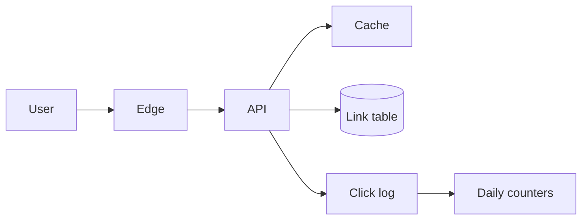
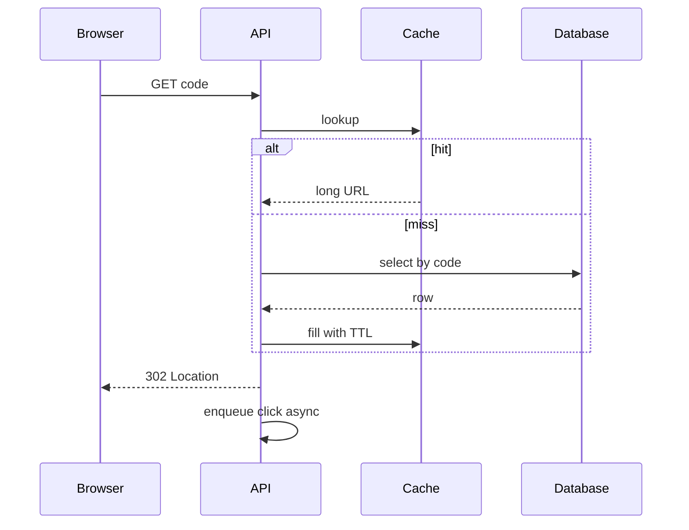

## Why this matters

The URL shortener is the interview's calibration problem. It looks small, and it exposes whether you estimate before you shard, whether you can generate an id without collisions, and whether you keep analytics off the redirect. Candidates who start with Kafka and five microservices for 30 writes per second lose the room. Candidates who ignore hot keys and cache headers lose it a minute later.

## Intuition

You are handing out short nicknames for long addresses and keeping a book at the door so anyone who says the nickname is sent onward immediately. Writing a new nickname is rare compared with people using one. Counting how many people used it is a different job from opening the door, and it must not make the door slow.

## Core concept in depth

### Requirements

Functional:

- Create a short link from a long URL. Optional custom alias and expiry.
- Redirect a short code to the long URL.
- Show the owner basic click counts, eventually.

Non-functional:

- Redirect p99 under 50 ms inside a region on a cache hit, under about 150 ms on a miss.
- Availability 99.9 percent for redirects. Creation can be slightly less precious.
- Codes are unguessable enough that people cannot walk the id space casually, or they are guessable and we accept that. State the choice.
- One code maps to one URL. A code is not edited in place; you can disable it.

Out of scope for the first design: a full marketing suite, A/B of destinations, and link malware scanning beyond a hook where it could be added.

### Capacity

Assumptions: 100 million new links per month, 100 reads per write, 5-year retention, 500 bytes per row, replication 3.

| Quantity | Estimate |
| --- | --- |
| Average creates | about 30 per second |
| Peak creates | about 150 per second |
| Average redirects | about 3,000 per second |
| Peak redirects | about 15,000 per second |
| Five-year metadata | about 9 TB including replicas, before index slack |

Writes fit on one primary. Reads want a cache. Storage does not force sharding on day one. Say the number that would change your mind: a 100x traffic jump, or analytics events (one row per click) which are a different table and a real write firehose.

If you record every click as a row, 3,000 redirects per second is 3,000 inserts per second average and 15,000 at peak. That is no longer "one casual primary" if the row is wide. Put clicks on a log or a daily aggregate, not on the redirect transaction.

### API

- `POST /links` with the long URL, optional alias, optional expiry. Returns the code. Idempotency key so a retry does not create two codes.
- `GET /:code` returns 302 and a Location header, or 404 if missing or disabled.
- `GET /links/:code/stats` for the owner, eventually consistent.

Use **302** rather than 301. A 301 is cached aggressively by clients, which makes your click counts wrong and makes a disable slow to take effect. A 302 (or 307) lets you observe the hit and change the destination or kill the link. You can still set a short cache header.

### Key generation

Three honest options:

| Method | How | Cost |
| --- | --- | --- |
| Base62 of a distributed counter | A single allocator hands out integers, encode in base62 | Codes are short and ordered, so they are guessable. The allocator must be highly available |
| Random base62, check-and-insert | Generate 7 or 8 characters, insert if the unique key is free | Simple, rare retry on collision. Codes are not sequential |
| Hash of the URL | Truncated hash | Same URL always maps to the same code, but collisions across different URLs are your problem, and you cannot have two owners of the same long URL with different codes without a salt |

For an interview, pick **random 7-character base62** (about 3.5 trillion values) with a unique constraint, or a counter range if you want short codes and accept enumeration. Seven characters is plenty at 100 million per month for decades if the space is random. State the birthday collision math qualitatively: at these rates, retries are rare; the unique index is the real guarantee, not your hope.

Custom aliases are a different unique index. They are a product feature and an abuse feature (someone claims `login`). Reserve a block list and require authentication for aliases.

### Data model

One row: `code` primary key, `long_url`, `owner_id`, `created_at`, `expires_at`, `disabled`. A second structure for stats: `code`, `day`, `clicks` updated asynchronously. Do not lock the link row to increment a counter on the redirect path.

### Read and write paths

**Create.** Auth, validate URL scheme (allow http and https only, reject others so you are not an open redirector to strange schemes), generate a code, insert. If the unique constraint fires, generate again, bounded attempts, then fail. Invalidate nothing, because the code is new.

**Redirect.** Cache lookup by code. Miss loads the database, fills the cache with a TTL, and returns 302. If the row is disabled or expired, cache a short negative entry so unknown codes do not all hit the database. Publish a click event to a queue after you have the answer, or sample it. Do not wait for analytics.

**Hot codes.** A link on a national broadcast becomes a hot key. One cache node can saturate. Replicate that value in process on the app tier for a few seconds, or split reads. The database should not see this traffic if the TTL is warm.

**Disable and expiry.** Delete or overwrite the cache key when the owner disables. TTL bounds the rest. Remember CDN or browser caches if you set long cache headers; another reason to keep redirect cache headers short.

## Diagram





### Dry-run: create then a viral read

| Step | Database writes | Cache | User |
| --- | --- | --- | --- |
| Create | 1 insert | empty | Receives code |
| First redirect | 1 read | fill | 302 |
| Next million redirects | about 0 if TTL holds | hot key | 302 |
| Owner disables | 1 update | delete key | Next uncached read is 404 |
| Click counter | async increments | not on the redirect | Stats lag by seconds |

## Runnable Python

```python
ALPHABET = "0123456789abcdefghijklmnopqrstuvwxyzABCDEFGHIJKLMNOPQRSTUVWXYZ"


def encode_base62(n: int) -> str:
    if n < 0:
        raise ValueError("n must be non-negative")
    if n == 0:
        return ALPHABET[0]
    chars = []
    while n:
        n, rem = divmod(n, 62)
        chars.append(ALPHABET[rem])
    return "".join(reversed(chars))


def decode_base62(text: str) -> int:
    value = 0
    for ch in text:
        value = value * 62 + ALPHABET.index(ch)
    return value


if __name__ == "__main__":
    print(encode_base62(125))
    print(decode_base62(encode_base62(125)))
    print("7 chars space is 62^7, sample code length", len(encode_base62(62**7 - 1)))
```

The encoder is what you use if ids come from a counter: 125 becomes a short string, and decode is the inverse. Random codes skip the counter and just sample from the alphabet. Either way the database unique key is the authority. Walk `encode_base62(125)` on a whiteboard if you chose the counter design, and mention that sequential codes leak volume and are easy to scan, so you do not put them on unguessable resources without another control.

## Complexity / trade-off analysis

| Choice | Gain | Cost |
| --- | --- | --- |
| Single primary | Simple at 150 writes/s | A later shard plan if creates grow 100x |
| Random code | Hard to scan | Occasional insert retry |
| Counter code | Short, no retry | Guessable, allocator availability |
| 302 and short cache | Correct counts, fast disable | More load than a 301 |
| Cache-aside | Redirect latency | Stampede on a cold viral key; single-flight it |
| Async analytics | Redirect stays thin | Stats are stale; event pipeline to run |
| Hash of URL as code | Dedupes the same URL | Collisions and no per-owner codes |

## Tricks, tips, patterns

- Estimate first. This problem often does not need sharding.
- Put the unique constraint on the code. Do not trust in-process randomness alone.
- 302, not 301, when the product cares about counts or revocation.
- Negative-cache unknown codes with a short TTL.
- Analytics on a log. Aggregates for the owner's page.
- Allow only http and https destinations.
- Plan the one hot key, because one link will be the whole QPS.

## Common mistakes and edge cases

- Generating codes in a single app process with a lock, then running two app processes.
- 301 plus a complaint that disable "does not work" because browsers cached it.
- Incrementing a counter on the link row inside the redirect transaction. You just serialized your hottest path.
- Open redirects to `javascript` or other schemes, or to lookalike login pages with no abuse hook.
- Storing the long URL without a length limit. A multi-megabyte "URL" is an attack on your row size.
- Custom alias `www` or `api` that captures your own routes. Reserve the namespace.
- Expiry checked only in a cron that deletes rows. Check expiry on read too, or a late cron serves dead links.

## Interview notes

Spend five minutes on requirements and the capacity table, then the data model and the redirect path. Mention cache, 302, and async clicks. Only if the interviewer multiplies traffic by 100 do you introduce sharding by code prefix. Offer key-generation options and pick one.

A strong close: "30 writes per second and 15,000 peak reads. One SQL primary, Redis cache, 302, click events on a queue. I shard when creates approach the primary's limit, using the code as the key, and I single-flight the fill for a viral code."

## Practice problems

1. **Guessable ids (easy).** You used a counter and a celebrity link is code `a91`. What can a stranger learn or do, and what change keeps codes short without a public counter?
2. **Viral key (medium).** One code is requested 50,000 times per second for 10 minutes. What breaks if the cache TTL expires all at once, and what do you add?
3. **Analytics (medium).** Product wants uniques per country per hour. Why does that not belong on the redirect transaction, and where do you compute it?

Related: [Back-of-envelope estimation](/lessons/sd-back-of-envelope), [Caching](/lessons/sd-caching).

## Summary / cheat sheet

- About 30 creates/s and 15,000 peak redirects in the standard assumption. Metadata fits one primary for years.
- Random base62 with a unique index, or a counter you accept is guessable.
- Redirect is cache-aside, 302, short TTL, negative cache for misses.
- Clicks are events. Daily aggregates feed the owner's stats.
- Hot codes need single-flight and maybe an in-process copy.
- Validate schemes, cap URL length, reserve alias names.
- Shard only after the estimate says the primary cannot take the writes.

## Further reading

- [HTTP status codes, RFC 9110](https://www.rfc-editor.org/rfc/rfc9110)
- [Kleppmann, Designing Data-Intensive Applications](https://dataintensive.net/)
- [Redis eviction and TTL](https://redis.io/docs/latest/develop/reference/eviction/)
- [OWASP unvalidated redirects](https://cheatsheetseries.owasp.org/cheatsheets/Unvalidated_Redirects_and_Forwards_Cheat_Sheet.html)
