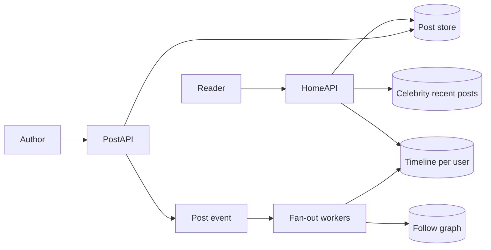
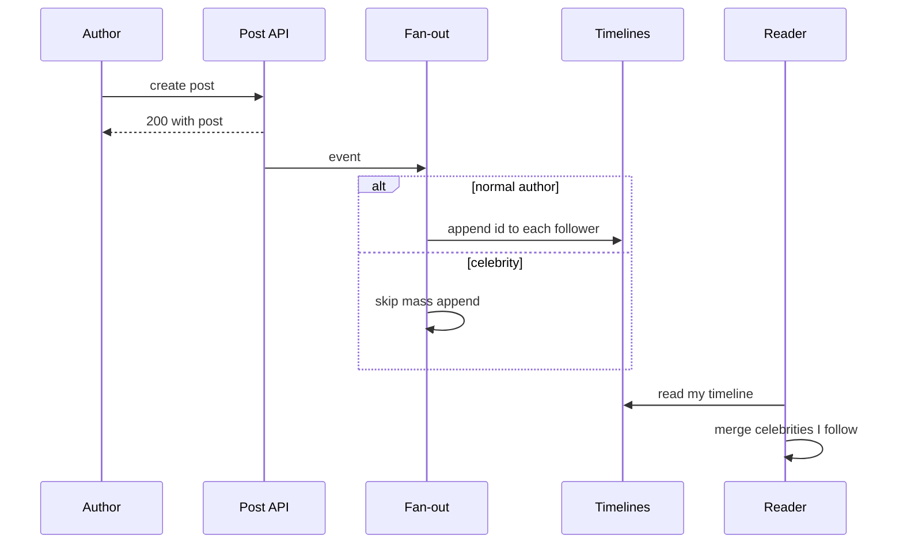

## Why this matters

A social feed is the standard fan-out interview. The average user is easy and the celebrity is the whole design. If you only describe "push to all followers" you melt on a 50-million-follower account. If you only describe "pull from everyone I follow at read time" you melt the read path for a normal user who follows 500 accounts. The job is to say which users are push, which are pull, where the data lives, and what is stale.

## Intuition

A post is a note on the author's door. A home timeline is a personal corkboard. Fan-out on write means the author photocopies the note onto every follower's board when they post. Reading the board is then cheap. Fan-out on read means the board is empty and, when you look, a clerk runs to every door you follow and collects the latest notes. Cheap to post, expensive to look. Celebrities would spend all day at the copier, so for them you skip the copier and let the clerk visit that one famous door at read time.

## Core concept in depth

### Requirements

Functional:

- Post a short text (media as an attachment id, not as bytes in the timeline row).
- Follow and unfollow.
- Home timeline: posts from accounts I follow, newest first, paged.
- The author sees their own post immediately.

Non-functional:

- Home timeline p99 under about 200 ms for a warm cache.
- Post API returns in well under a second, without waiting for fan-out.
- Timeline can be a few seconds stale for other people's posts.
- Availability 99.9 percent for reads. A delayed fan-out is a freshness bug, not a failed post.

Out of scope for the core: ads ranking, full-text search of all posts, and a complete abuse stack. Mention a ranker as a later stage if the interviewer wants "best" rather than "latest."

### Capacity

Assumptions: 200 million DAU, 10 million authors posting once a day on average (most users lurk), average 200 followers, 20 home-timeline fetches per DAU per day, 500 bytes per timeline entry.

| Quantity | Estimate |
| --- | --- |
| Posts per day | 10 million |
| Average post rate | about 100 posts per second |
| Peak posts | about 500 per second |
| Naive fan-out writes | 100 × 200 = 20,000 timeline inserts per second average, before celebrities |
| Timeline reads | 200e6 × 20 / 1e5 = about 40,000 reads per second average |
| Peak reads | about 100,000 to 200,000 per second |

One celebrity with 20 million followers is 20 million inserts for a single post. At 50,000 inserts per second that is several minutes if you do it synchronously, and it is a shard storm if you do it at all. This one row of arithmetic is why hybrid fan-out exists. Say it before you draw.

Storage of every timeline copy: if you keep 800 entries per active user and 100 million users open the app, 100e6 × 800 × 500 bytes is about 40 TB before replication. That is cache-and-store territory, partitioned by user id, not a single Redis. Many designs keep only a recent window (for example 800 ids) per user and drop the tail.

### Data model

- **Post** store, partitioned by `post_id` or by `author_id`. Source of truth. `author_id`, `created_at`, text, media ids.
- **Follow** graph, partitioned by follower id ("who I follow") and a second view by followee id ("who follows me") if fan-out needs the follower list. The second view is the expensive one to read for a celebrity; you still need it for push fan-out of normal users.
- **Timeline** per user: a list of post ids, newest first, partitioned by user id. Cache in front.
- **Celebrity set**: accounts above a follower threshold, or a manually flagged set. Their posts are not pushed to every follower.

### Hybrid fan-out

**Normal author (under the threshold).** On post: write the post row, publish an event. Fan-out workers read the follower list in pages and append the post id to each follower's timeline list. Bounded concurrency. Idempotent append so retries do not duplicate.

**Celebrity.** Write the post row only. Do not loop 20 million timelines. On read, the home assembler takes the user's pushed timeline and merges in recent posts from the celebrities that user follows, by querying those authors' recent post lists (a small number of extra reads if the user follows a handful of celebrities).

**Read path.** Load timeline ids from cache or the timeline store. Multi-get the post bodies. Merge celebrity posts. Sort by time. Cursor-paginate. Rank only if the product asks; ranking can be a second pass over a candidate set, not a scan of the world.

**Read-your-writes.** After a user posts, the post API returns the new post, and the fan-out also writes the author's own timeline (or the read path always unions "my recent posts"). Followers may wait seconds. The author must not.

**Unfollow.** Remove that author's ids from the cached timeline lazily or eagerly. Eager is cleaner and is a range delete in one user's partition, which is fine. Lazy filtration on read also works if you check "do I still follow this author?" and it costs a lookup.

### Hot partitions and ordering

Timeline partitions are per user, so a normal user's corkboard is one shard. The hot object is the celebrity's **follower list** and the celebrity's **post list**, which many readers hit. Cache the celebrity's recent posts heavily. The follower list of a celebrity, if you ever iterate it (you should not on the post path), is a batch job, not a request.

Ids should be time-ordered (Snowflake-style: timestamp plus shard plus sequence) so a timeline can sort without fetching every body, and so cursors are stable.

### Media and counts

Media goes to object storage; the post stores ids. Like counts are eventual counters, not a lock on the post row. A like from the user must show immediately for them (optimistic UI or a sticky write). The global count can lag.

## Diagram





### Dry-run: two authors

| Author | Followers | On write | On a follower's read |
| --- | --- | --- | --- |
| Ada, 400 followers | 400 | About 400 timeline appends, seconds or less | Id already on the board |
| A celebrity, 20 million | 20 million | Post row only | Merge that author's recent ids at read |
| Ada posts, then immediately refreshes |  | Her own timeline contains the id | Read-your-writes holds |
| Celebrity posts, follower refreshes at once |  | No per-follower write | Merge sees the new post if the celebrity recent-list is updated in the post transaction |

The celebrity recent-list update is one row or one cache key, not 20 million. That is the move.

## Runnable Python

```python
def assemble(pushed_ids: list[tuple[int, str]], celebrity_posts: list[tuple[int, str]], limit: int) -> list[str]:
    # Each item is (time_id, post_id). Larger time_id is newer.
    merged = {}
    for time_id, post_id in pushed_ids + celebrity_posts:
        merged[post_id] = max(time_id, merged.get(post_id, 0))
    ordered = sorted(merged.items(), key=lambda item: item[1], reverse=True)
    return [post_id for post_id, _ in ordered[:limit]]


def should_push(follower_count: int, threshold: int = 100_000) -> bool:
    return follower_count < threshold


if __name__ == "__main__":
    pushed = [(10, "p1"), (8, "p2")]
    celebs = [(12, "c1"), (9, "c2")]
    print(assemble(pushed, celebs, limit=3))
    print("push ada", should_push(400))
    print("push celeb", should_push(20_000_000))
```

`assemble` dedupes by post id and sorts by the time id, which is what the home API does after it has fetched the pushed list and the celebrity lists. `should_push` is the threshold. Walk a celebrity through `should_push` and you have justified why the read path has an extra merge. The threshold is a product knob: too low and reads fan out to many authors; too high and one post writes millions of timelines.

## Complexity / trade-off analysis

| Approach | Write cost | Read cost | Celebrity |
| --- | --- | --- | --- |
| Fan-out on write only | O(followers) | O(1) list read | Unbounded and unsafe |
| Fan-out on read only | O(1) | O(accounts I follow) | Fine for the celebrity, slow for a user who follows 2,000 accounts |
| Hybrid | O(followers) for normal authors | O(1) plus O(celebrities I follow) | The point of the design |
| Ranked feed | Same candidate generation | Extra ranker CPU and features | Needs a candidate cap |

## Tricks, tips, patterns

- Estimate the celebrity row separately from the average. The average hides the outage.
- Return from the post API after the post commit, not after fan-out.
- Time-ordered ids and cursor pagination.
- Cache timeline id lists and multi-get bodies. Do not cache one giant rendered HTML blob unless you accept a hard invalidation problem.
- The author always sees their post. Everyone else has a freshness SLO.
- Unfollow is a filter or a delete on one partition, the follower's.
- Keep media out of the timeline row.

## Common mistakes and edge cases

- Doing the fan-out inside the post request. A user with 100,000 followers holds the button down for the whole loop.
- A single global "timelines" table with no partition key, then a hot page lock.
- Forgetting the follow graph's "who follows me" view and scanning the world.
- Merging celebrities without a cap. A user who follows 2,000 celebrities becomes a fan-out-on-read of 2,000. Cap the merge or precompute for heavy readers.
- Duplicate post ids when a retry appends twice. Make the append idempotent.
- Read-your-writes broken because the author's own fan-out is async and the read does not union their latest post.
- Deleting a post and leaving ids everywhere. A delete marks the post, and the assembler skips missing or deleted bodies. You do not synchronously scrub every timeline.

## Interview notes

Write the capacity table, circle the celebrity, and say "hybrid" before the boxes. Draw post store, follow graph, fan-out workers, per-user timeline, and the read merge. Mention the threshold, the freshness SLO, and read-your-writes for the author.

If asked for ranking, keep candidate generation as this design and add a ranker over the newest few hundred ids with a timeout and a fallback to reverse-chronological. Do not let ranking erase the fan-out story.

## Practice problems

1. **Threshold (easy).** Average followers is 200. One account has 30 million. Why is the average fan-out cost a misleading capacity plan?
2. **Delete (medium).** A user deletes a post that was already fanned out to 400 timelines. What do you update synchronously, and what do readers do with a stale id?
3. **Heavy reader (medium).** A user follows 1,500 celebrities and 50 normal accounts. Where does hybrid fan-out get expensive, and what cap or precompute do you add?

Related: [Queues and Kafka](/lessons/sd-queues-kafka), [Caching](/lessons/sd-caching).

## Summary / cheat sheet

- Posts are the source of truth. Timelines are per-user lists of ids. Bodies are fetched by id.
- Fan-out on write for normal accounts, asynchronously, idempotently.
- Celebrities are not pushed to every follower. Readers merge those authors' recent posts.
- Post API does not wait for fan-out. The author still sees the post immediately.
- Size the celebrity write explicitly. It dominates any average.
- Cache the id list. Cursor-paginate with time-ordered ids.
- Deletes mark the post. Assemblers skip dead ids. Unfollow edits one user's list.

## Further reading

- [Raffi Krikorian, Timelines at Scale (InfoQ talk notes and slides widely mirrored)](https://www.infoq.com/presentations/Twitter-Timeline-Scalability/)
- [Kleppmann, Designing Data-Intensive Applications](https://dataintensive.net/)
- [Snowflake-style ids](https://en.wikipedia.org/wiki/Snowflake_ID)
- [Kafka documentation](https://kafka.apache.org/documentation/)
