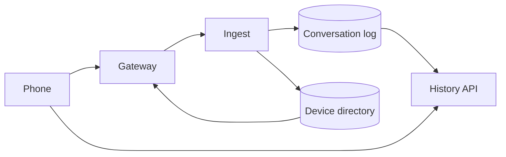
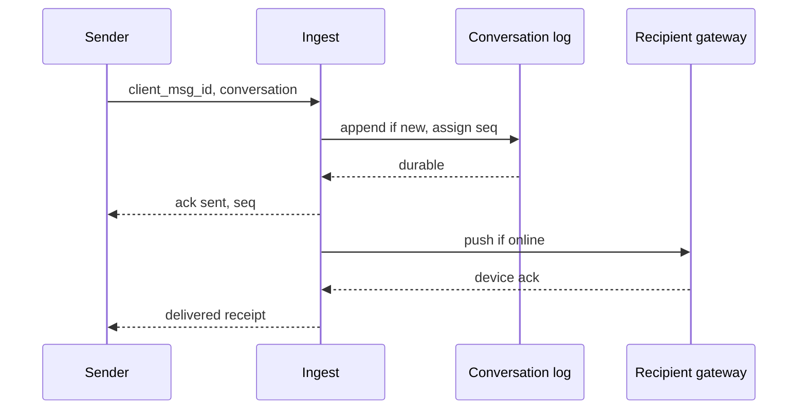

## Why this matters

Chat is a different shape from a feed. The hard parts are connections that stay open, ordering inside one conversation, messages that must arrive after a phone has been offline for hours, and groups that must not become a accidental fan-out of millions. Interviewers also ask what "delivered" and "read" mean, and what you do when the recipient has two devices. A design that is only "Kafka plus WebSockets" has not answered those questions.

## Intuition

Each conversation is a single notebook with a line number. Anyone in that conversation writes the next line, and every participant eventually copies the lines they are missing. If someone is asleep, you keep their unread lines until they wake up, but you do not keep them forever. A tick mark means the line reached their device. A colored tick means they opened the notebook. Those are different facts, and they travel as their own tiny messages.

The open socket is a convenience so the copy happens in milliseconds. The numbered notebook is the source of truth so a dropped socket does not invent or lose a line.

## Core concept in depth

### Requirements

Functional:

- 1:1 text messages and small groups (design for up to a few hundred members, not a million).
- Delivery when the recipient is offline, then sync on reconnect.
- Ordering preserved inside a conversation.
- Sent, delivered, and read receipts.
- Multiple devices per user eventually see the same history.
- Media as attachments, not as inline blobs.

Non-functional:

- Send API acknowledges after the message is durable, p99 under about 200 ms in region.
- Online delivery under a second when both sockets are healthy.
- At-least-once delivery with dedupe by message id. No silent loss after ack.
- A day to a few weeks of offline backlog, then a defined expiry. Say which.

Out of scope: a full end-to-end encryption protocol design. You can say "payloads are encrypted on the device and the server stores ciphertext" if the interviewer wants the product property, and then design the routing as if the body is opaque. Do not invent a custom cipher.

### Capacity

Assumptions: 200 million DAU, 40 messages sent per user per day, 200 bytes of metadata plus ciphertext, groups average 10 members but the send is stored once and delivered many times.

| Quantity | Estimate |
| --- | --- |
| Messages per day | 8 billion |
| Average ingest | about 80,000 messages per second |
| Peak ingest | about 250,000 per second |
| Metadata disk per day, 3 copies | about 8e9 × 200 × 3 bytes, about 5 TB/day |
| Fan-out deliveries | several times ingest, because of groups and extra devices |

This is a partitioned log problem, not a single database primary. Partition by `conversation_id`. Media bytes are a separate object store; even a small percent of messages being photos dominates disk.

### Identity and connection

Users have an account id. Devices have device ids. A **gateway** tier holds WebSockets. Each connection registers `(user_id, device_id, gateway_id)` in a directory with a short TTL refreshed by heartbeats. When you need to push, you look up the directory and publish to that gateway, or you publish to a per-user channel that every gateway consumes and filters. The directory lookup is the usual interview answer.

Heartbeats: ping on an interval shorter than the proxy idle timeout. Missed pongs drop the socket and the directory row. Clients reconnect with jittered backoff and send `last_seen_seq` for each conversation they care about, or a global per-device cursor if you have one.

### Message path

The client generates a **message id** (UUID) and sends it to the gateway with the conversation id and ciphertext. The ingest service appends to the conversation partition only if that message id is new, assigning a **monotonic sequence** for that conversation (a counter beside the partition, or the log offset if one partition is exactly one conversation). The ack to the sender means "this sequence is durable." That is the "sent" check.

Delivery workers, or the gateway itself, read the new sequence and push to online devices. Each device acks the sequence it has stored. Those acks update per-device cursors. When all of a user's devices that should count have the sequence, or when any device has it, you emit "delivered" according to the product rule. Pick one and stick to it: WhatsApp-like products often mean "at least one device acknowledged." **Read** is a separate client event when the conversation is opened, stored as a cursor, and fanned out as a receipt.

Offline devices get nothing live. On reconnect they ask for sequences greater than their cursor. You page those rows from the conversation log. That catch-up is the correctness path. The socket is an optimization.

### Groups

Store the message once in the conversation log. Deliver to N members. Do not copy the body N times into N personal inboxes if N can be large; a pointer and a sequence is enough, with the body in the conversation. Membership changes are their own sequenced events so "who was in the group when this line was written" is answerable. A user who joins later does not necessarily receive full history; say the product rule (history since join, or last 100).

A group of 256 online members is 256 pushes. That is fine. A "group" of a million is a feed; refuse it or move it to the feed design. State a max membership.

### Ordering and duplicates

Sequence numbers per conversation give you order. The client's message id gives you idempotency when the send is retried after a timeout. The client displays in sequence order, not in arrival order, and it can render a hole if sequence 11 arrives before 10 during a race across devices. Usually one partition means one order, so holes are rare and come from your own bugs; still, the client should not sort only by local clock.

Across conversations there is no global order. Do not promise one.

### Multi-device

Each device has a cursor. Catch-up is per device. A receipt policy must say whether delivery requires all devices or any. Session establishment for a new device needs an auth step and a decision about how much history to backfill. If payloads are end-to-end encrypted, a new device needs a key-distribution story you can name at a high level (the user approves the device, existing devices or an identity key establishes session keys) without pretending the server can read the body.

### Presence and last seen

Presence is a TTL on the directory row. It is deliberately lossy. Do not put presence on the message durability path. Last-seen is an occasional write, easy to abuse for stalking; treat it as a privacy feature with a user control, not as a free metric.

## Diagram





### Dry-run: recipient offline, then two devices

| Step | Log | Device A | Device B |
| --- | --- | --- | --- |
| Send, both offline | seq 10 durable, sender acked | cursor 9 | cursor 9 |
| A reconnects |  | fetch seq 10, ack, cursor 10 | still 9 |
| Delivered receipt | any-device policy fires |  |  |
| B reconnects later |  |  | fetch seq 10, cursor 10 |
| Duplicate send of same client_msg_id | no second row |  |  |
| Read on A | read cursor updated | receipt to sender | B may still show unread, per device |

If the product wants unread badges per device, the read cursor is per device. If it wants a single conversation tick, the read cursor is per user. Choose explicitly.

## Runnable Python

```python
def append(log: list[dict], seen: set[str], message: dict) -> dict:
    if message["client_id"] in seen:
        existing = next(row for row in log if row["client_id"] == message["client_id"])
        return {"status": "duplicate", "seq": existing["seq"]}
    seq = (log[-1]["seq"] + 1) if log else 1
    row = {"seq": seq, "client_id": message["client_id"], "body": message["body"]}
    log.append(row)
    seen.add(message["client_id"])
    return {"status": "accepted", "seq": seq}


def catch_up(log: list[dict], last_seq: int) -> list[dict]:
    return [row for row in log if row["seq"] > last_seq]


if __name__ == "__main__":
    log: list[dict] = []
    seen: set[str] = set()
    print(append(log, seen, {"client_id": "m1", "body": "hi"}))
    print(append(log, seen, {"client_id": "m1", "body": "hi"}))
    print(append(log, seen, {"client_id": "m2", "body": "again"}))
    print(catch_up(log, 1))
```

The first append assigns sequence 1 and acks. The retry with `m1` does not create sequence 2. The second distinct send becomes sequence 2. `catch_up` after cursor 1 returns only the second row, which is the reconnect path. In production the `seen` set is a key in the conversation partition, not a Python object on one machine, and the append is a conditional write so two gateways cannot both assign the next sequence. Walk that conditional write in the interview: "sequence = last + 1 if client_id is new, in one transaction per conversation."

## Complexity / trade-off analysis

| Choice | Gain | Cost |
| --- | --- | --- |
| Socket only, no log | Very fast when everyone is online | Loss on any disconnect. Unacceptable after you have acked |
| Per-conversation log | Order and catch-up | Throughput capped per conversation, which is what you want |
| Inbox copy per user | Simple per-user reads | Storage fan-out, painful large groups |
| Delivered = any device | Matches common chat UX | Another device may still be stale; catch-up handles it |
| Delivered = all devices | Stronger | A forgotten laptop blocks the tick forever unless you define "active devices" |
| Server-readable bodies | Easier spam scanning | Worse privacy. Say if you need scanning |
| Ciphertext at rest | Server cannot read content | Spam and preview features get harder; key distribution for new devices |

## Tricks, tips, patterns

- Ack only after the conversation append is durable. That ack is "sent."
- Client message ids dedupe. Server sequences order.
- Directory of sockets with heartbeats. History API with a cursor for the truth.
- One partition per conversation, so order is real.
- Cap group size. Store the body once.
- Receipts are events, not updates that rewrite history.
- Media in object storage, referenced by id, with size limits.

## Common mistakes and edge cases

- Using one global queue and claiming messages stay in order. They do not, across keys.
- Acking the sender before durability. A crash loses a message the UI said was sent.
- No cursor, so reconnect depends on "the socket probably got it."
- Presence written synchronously on the send path. A slow presence store delays chat.
- A group fan-out done by copying a 5 MB video into every member's row.
- Two devices, and a read receipt implementation that marks the conversation read for both when one device peeked.
- Unbounded offline retention. Define expiry and a user-visible gap if you compact.

## Interview notes

Draw the gateway, the directory, the conversation log, and the history API. Walk a message while the recipient is offline and then reconnects. Define sent, delivered, and read in one sentence each. Mention the per-conversation sequence and the client id. If encryption comes up, make the body opaque and keep the routing design; do not derail into a cipher lecture unless you actually remember a standard protocol at a high level.

Capacity: 80,000 messages per second average means partition by conversation from the start. A single chat is still one partition and does not need 80,000 writes; the aggregate does.

## Practice problems

1. **Ack meaning (easy).** The gateway accepted the bytes but the process died before the log append. Did the sender's tick correctly show "sent"? What should the client do with the same client message id?
2. **Group (medium).** A 200-person group sends one photo. How many body copies do you store, and how many delivery pushes might you do?
3. **Order (medium).** Device A receives sequence 12 before sequence 11 because of a bug that used two partitions. What should the client render, and what key change prevents the bug?

Related: [API styles](/lessons/sd-api-styles), [Queues and Kafka](/lessons/sd-queues-kafka).

## Summary / cheat sheet

- Durable per-conversation log is the source of truth. WebSockets are the fast path. A cursor catch-up repairs holes.
- Client message id for idempotency. Server sequence for order. One partition per conversation.
- Sent means durable. Delivered means a device ack. Read means the user opened the thread. Pick any-device versus all-devices on purpose.
- Directory plus heartbeats finds online sockets. Missed heartbeats drop the route.
- Groups store the body once and push to members. Cap the group size.
- Multi-device means per-device cursors. New devices need an explicit history and key story.
- Media is object storage. Presence is best-effort and off the durability path.
- Tens of thousands of messages per second means you partition from day one.

## Further reading

- [RFC 6455 WebSocket](https://www.rfc-editor.org/rfc/rfc6455)
- [Kafka documentation](https://kafka.apache.org/documentation/)
- [Signal protocol overview](https://signal.org/docs/)
- [Kleppmann, Designing Data-Intensive Applications](https://dataintensive.net/)
