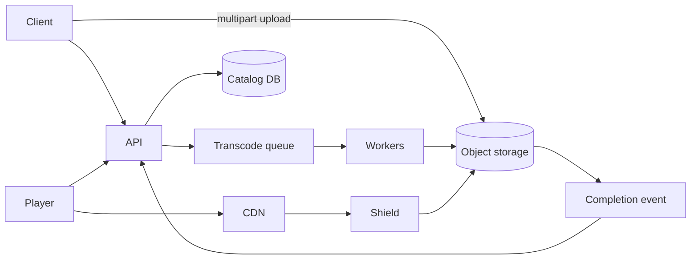
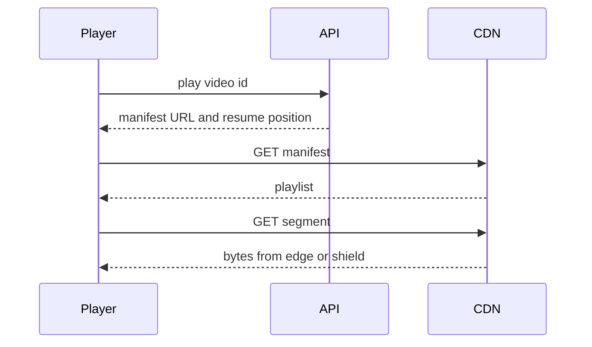

## Why this matters

Video is the interview where bandwidth math embarrasses a database-shaped design. The bytes do not belong in the database, the origin cannot serve the audience, and a single file is the wrong unit of playback. You need upload, background transcoding into renditions, a manifest the player understands, and a CDN in front. Metadata, recommendations, and "resume at 14:02" are smaller problems that still have to be correct.

## Intuition

A film reel is huge, so you do not mail the master to every town. You cut it into short clips in a few resolutions, put the popular clips in town warehouses, and hand the viewer a playlist that says which clip is next. If their connection slows, the playlist's next clip is a smaller picture of the same moment. The card catalog (title, owner, where the playlist lives) is tiny next to the reels and sits in a normal database.

## Core concept in depth

### Requirements

Functional:

- Upload a video, privately at first, then publish.
- Play on web and mobile, seeking and resuming.
- Several quality levels. The player adapts.
- Title, description, owner, view count, and a watch position per user.

Non-functional:

- Playback starts in a couple of seconds on a healthy network.
- Origin egress is a small fraction of user egress. State a hit-ratio goal.
- An upload is durable before you return success. Transcoding can take minutes and must be retried safely.
- Published videos stay available if one transcoder dies. Availability target for playback: 99.9 percent at the edge.

Out of scope: a full recommendation-model design, live low-latency broadcast (mention how it differs), DRM details beyond "a license service."

### Capacity

Assumptions: 20 million hours watched per day, average 5 Mbit/s. That is on the order of tens of PB per day of egress if served from origin (the estimation lesson walks the arithmetic). Uploads: 2 million uploads a day, average 500 MB source, is about 1 PB/day inbound before replication, concentrated in object storage, not in a database.

| Quantity | Estimate |
| --- | --- |
| Watch egress | tens of PB/day at 5 Mbit/s |
| Origin egress at 95 percent edge hit | still PB-scale unless the catalog is very skewed |
| Popular title | one title can be a large fraction of egress; cache it at the shield and the edge |
| Metadata QPS | orders of magnitude below video QPS; a catalog service is a normal read-heavy API |
| Resume writes | one small write per user every few seconds of watch if you are naive; sample or debounce |

The design conclusion is forced: object storage plus CDN plus a small metadata database. Anyone who puts the video in SQL has not done the estimate.

### Upload path

The client uploads the source directly to object storage with a resumable, multipart protocol, after the API issues a short-lived signed URL. The API does not proxy the bytes. On completion, the object store notifies your API (event). The API records `asset_id` in state `uploaded` and enqueues a transcode job with that id as the idempotency key.

Validate type and size before issuing the URL. Reject a completion event whose object does not match the signed upload.

### Transcoding

Workers read the source and write renditions: for example 240p, 480p, 1080p, each as a ladder of a few-second segments (often 2 to 6 seconds), plus a manifest (HLS or DASH). Segmenting is what makes seeking and CDN caching work: a segment is an immutable URL.

Jobs must be idempotent. If the worker dies after writing half the segments, a retry should overwrite the same keys or write to a new prefix and publish the manifest only at the end. Publish is the commit: the metadata row flips to `ready` and points at the manifest URL only when the manifest and segments are readable. Viewers never see a half-written ladder.

Queue age is the SLO for "my video is processing," not the upload request latency. Show it in the UI. Scale workers on queue age. A poison file (corrupt input) goes to a dead letter after N tries and the video is marked failed.

### Playback path

The player asks your API for the manifest URL and a short-lived authorization if the video is private. It then fetches the manifest and segments **from the CDN**, not through your API. The API must not be on the byte path.

Adaptive bitrate: the player picks a rung based on measured throughput and buffer level. Your design's job is to make every rung exist, to align segment boundaries so switching is possible, and to cache each segment under an immutable URL with a long TTL.

Seeking is "start at segment K." Resume is "the player asks for position, we stored it." Store resume as a row `(user, video, seconds)` updated every 10 to 30 seconds, not every second. That debounce is the difference between a tiny write rate and an accidental second write-path at video scale.

### Metadata, counts, and recommendations

Catalog rows live in a database, cached, with the manifest URL, duration, owner, visibility. View counts are approximate: the player beacons periodically, you aggregate, you do not increment a hot row on every segment. A very hot video's counter is a sharded counter or a log.

Recommendations are an offline or nearline model that writes "top N for this user" into a store the home screen reads. If the store is down, the home screen shows a cached or global trending list. Do not put the recommender on the playback critical path.

### Live versus on demand

On demand is what this design covers: full file, then transcode, then long-TTL segments. Live is a sliding manifest, segments appear just in time, TTLs are short, and you cannot wait to transcode the whole asset. If the interviewer pivots to live, say the manifest and the CDN stay, the pipeline becomes a continuous encoder, and cache TTLs collapse.

## Diagram





### Dry-run: publish and a cache miss storm

| Step | Metadata | Object storage | Viewer |
| --- | --- | --- | --- |
| Multipart complete | state uploaded | source durable | "processing" |
| Worker writes segments under a new prefix | still uploaded | segments exist but not referenced | cannot see them |
| Manifest written, row set to ready | manifest URL | immutable segment URLs | play works |
| First viewers in many cities |  | shield collapses misses to one origin fetch per segment | edge fills |
| Later viewers |  | origin idle for hot segments | edge hit |
| Takedown | visibility private, API stops handing out URLs | purge or short-lived signed URLs expire | playback fails closed as signatures die |

Do not point the catalog at the manifest before the segments exist. That publish order is the difference between a reliable premiere and a thousand failed plays.

## Runnable Python

```python
def egress_gb_per_day(hours: float, mbit_per_second: float) -> float:
    seconds = hours * 3600
    # megabits to gigabytes: / 8 / 1000
    return seconds * mbit_per_second / 8 / 1000


def origin_after_cache(total_gb: float, hit_ratio: float) -> float:
    if not 0 <= hit_ratio <= 1:
        raise ValueError("hit_ratio must be between 0 and 1")
    return total_gb * (1 - hit_ratio)


def resume_writes_per_second(concurrent_viewers: int, beacon_seconds: int) -> float:
    return concurrent_viewers / beacon_seconds


if __name__ == "__main__":
    total = egress_gb_per_day(20_000_000, 5)
    print("egress TB/day", round(total / 1000, 1))
    print("origin TB/day at 95 percent hit", round(origin_after_cache(total, 0.95) / 1000, 1))
    print("resume writes", round(resume_writes_per_second(1_000_000, 15), 1))
```

Twenty million hours at 5 Mbit/s is tens of thousands of TB per day. At a 95 percent edge hit ratio the origin still sees a large residue, which is why a shield and a skewed catalog matter; a flat catalog with a weak hit ratio will not be saved by "we use a CDN" as a slogan. The resume line shows a million concurrent viewers beaconing every 15 seconds is on the order of 60,000 writes per second. That is why you debounce and shard the resume table, or you have accidentally designed a second high-scale write path.

## Complexity / trade-off analysis

| Choice | Gain | Cost |
| --- | --- | --- |
| Direct-to-object upload | API does not carry bytes | Signed URL discipline, completion events |
| Several renditions | Smooth playback on bad networks | Storage multiplier, transcode cost and time |
| Short segments | Seeking, CDN granularity, ABR switching | More files, more requests |
| Long TTL on immutable segments | Hit ratio | Bad segment requires a new URL, not a quiet overwrite |
| API on the byte path | Simple | Origin dies, no edge cache |
| Exact view counts | Nicer number | Hot row, not worth it |
| Debounced resume | Survivable write rate | Position can be 15 seconds stale |

## Tricks, tips, patterns

- Separate metadata, source bytes, and rendition bytes in the first minute of the interview.
- Publish the manifest last. Idempotent transcode jobs. Dead-letter bad files.
- Immutable segment URLs, long TTL, origin shield.
- Player talks to the CDN for bytes. API only for manifest location, auth, and resume.
- Debounce resume and view beacons.
- Recommendations fail open to trending.
- Say HLS or DASH by name and what a manifest is.

## Common mistakes and edge cases

- Proxying video through the application servers. You will run out of NIC and money.
- One giant mp4 and no segments. Seeking and CDN caching both suffer, and ABR has nothing to switch.
- Flipping the video to "ready" when the job is enqueued, not when the manifest exists.
- A hot counter row for views of a premiere.
- Resume updates on every second of playback. The arithmetic above is the incident.
- Signed URLs that never expire for private video, or that expire before a two-hour film ends. Match expiry to the session and refresh.
- No plan for a corrupt upload. The queue retries forever and blocks a partition if you keyed the queue badly. Isolate poison files.

## Interview notes

Start from egress math so the CDN is earned. Then upload with signed URLs, transcode queue, manifest commit, playback sequence. Mention resume and counts as small writes with their own scale. If asked for live, contrast TTL and the continuous manifest. If asked for recommendations, take them off the play path.

A close: "Bytes live in object storage, cached as immutable segments at the CDN with a shield. The catalog stores the manifest URL and flips to ready only after publish. Resume is debounced. I never put the video through the API process."

## Practice problems

1. **Path (easy).** A teammate suggests the API stream the video from disk to the user so auth is easier. What capacity problem appears, and where should auth actually happen?
2. **Publish (medium).** A worker wrote 40 of 80 segments and died. What does a retry do, and when does a viewer first see the video?
3. **Beacon (medium).** Ten million concurrent viewers send a view increment every 2 seconds to one row. What rate is that, and what design replaces the single row?

Related: [CDN](/lessons/sd-cdn), [Back-of-envelope estimation](/lessons/sd-back-of-envelope).

## Summary / cheat sheet

- Egress dominates. Object storage and a CDN are the design; the database holds the catalog.
- Upload direct-to-storage with a signed URL. Transcode asynchronously into ABR segments and a manifest.
- Commit publish only when the manifest is complete. Jobs are idempotent.
- Players fetch segments from the edge. Long TTL on immutable URLs. Shield the origin.
- Resume and view counts are sampled or debounced so they do not become a hidden write hotspot.
- Recommendations and search are off the playback critical path.
- Live streaming keeps the CDN and shortens the TTL; it is not "the same pipeline but faster."

## Further reading

- [HLS specification](https://datatracker.ietf.org/doc/html/rfc8216)
- [DASH overview](https://dashif.org/)
- [AWS CloudFront with S3](https://docs.aws.amazon.com/AmazonCloudFront/latest/DeveloperGuide/Introduction.html)
- [RFC 9111 HTTP caching](https://www.rfc-editor.org/rfc/rfc9111)
- [Kleppmann, Designing Data-Intensive Applications](https://dataintensive.net/)
