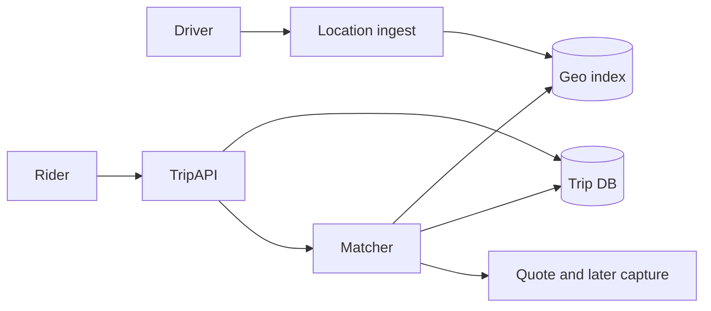
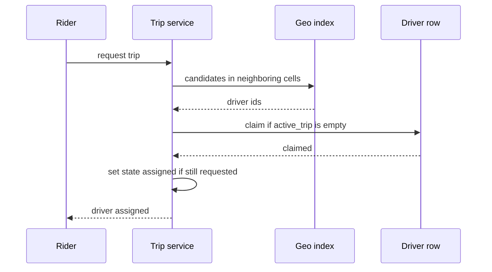

## Why this matters

A ride service is a location problem and a consistency problem taped together. Drivers move, so "who is nearby?" is a hot, write-heavy query. A rider should get one driver, a driver should get one trip, and payment should not capture before the trip exists. Interviewers look for a geo index, a trip state machine, and a clear statement that driver GPS is not stored as a million rows of history on the match path.

## Intuition

Think of the city as a grid of neighborhoods. Each driver drops a pin in one square every few seconds. A rider asks for the nearest pins in their square and the next squares over. You do not scan every driver in the country. Once a rider picks a trip, that trip is a ticket with states: requested, assigned, arrived, started, finished. Two riders cannot hold the same driver, just as two customers cannot hold the same theater seat. The pin moving around the city is approximate. The ticket is exact.

## Core concept in depth

### Requirements

Functional:

- Drivers toggle available and stream location.
- Riders request a pickup and see a nearby driver assigned.
- Trip lifecycle from assignment to completion, with cancel rules.
- Fare quote before the trip and a charge at the end.
- ETA that can be wrong by a little; assignment that must not double-book.

Non-functional:

- Match within a few seconds in a dense city.
- Location updates from millions of drivers do not take down the trip database.
- Assignment is linearizable for a given driver: at most one active trip.
- Availability of the match path around 99.9 percent. Degrade by widening the search, not by assigning two drivers.

Out of scope: a full mapping and routing engine (you may call one), driver background checks, and a complete pricing-science model. Surge can be a multiplier written by a separate job.

### Capacity

Assumptions: 5 million drivers online at peak, each sending a location every 4 seconds. Riders: 1 million trip requests per day in the first market you size, peak 20x the average for a commute spike. You can rescale if the interviewer gives a bigger number.

| Quantity | Estimate |
| --- | --- |
| Location updates | 5e6 / 4 = 1.25 million per second at peak |
| Trip creates | 1e6 / 1e5 = about 10 per second average, a few hundred per second at a harsh peak |
| Trip rows | tiny next to location traffic |
| Location retention | current location only for matching; history is a sampled log if you need it for disputes |

The location stream is two or three orders of magnitude above the trip stream. They must not be the same database table. Say that sentence early.

### Location and geo index

Each driver has a **current location** key: driver id, lat, lng, city, updated at, only if available. Updates are lossy. If one is dropped, the next arrives in 4 seconds. Do not retry forever and do not use a transaction with the trip table.

**Geohash or a grid.** Chop the world into cells. Store driver ids in a cell (a Redis set or a dedicated index per city). On update, remove the driver from the old cell and add to the new one if the cell changed. On search, compute the rider's cell and neighboring cells, fetch candidate ids, then sort the candidates by real distance (haversine or the routing service) and by freshness. A stale location older than 15 seconds is not a candidate.

Cell size is the trade-off. Small cells mean more neighbor lookups and fewer candidates. Large cells mean fat candidate lists in a downtown core. Pick a size that holds a manageable candidate count (tens to a few hundred) in your densest neighborhood and mention you would measure it.

Sharding: by city or by geohash prefix so one hot downtown is a partition you can split, not a global lock. A music festival is a hot cell. Cap candidates and add cells rather than scanning a million drivers.

### Trip state machine

States: `requested`, `driver_assigned`, `arriving`, `in_progress`, `completed`, `canceled`. Transitions are conditional updates on one trip row: `WHERE state = requested`. The driver row has `active_trip_id` set with a conditional write so a driver is not assigned twice.

**Match flow.**

1. Rider creates a trip in `requested` with pickup and dropoff. Fare quote is stored on the trip (the price you promised), computed from distance, time, and the current surge multiplier for the cell.
2. Matcher reads nearby candidates, filters those without an active trip, and tries to claim a driver: conditional set `active_trip_id` if null.
3. On claim, set the trip to `driver_assigned` if it is still `requested`. If the rider canceled in between, release the driver.
4. Notify both through the socket directory (same pattern as chat).
5. If no driver, widen rings a few times, then fail the request. Do not hold the rider in a silent loop.

This is a small saga. The conditional driver claim is the linearizable step. Do not lock every driver in the cell.

### Location versus trip store

| Store | Data | Pattern |
| --- | --- | --- |
| Geo index | driver id to cell, current coordinate | In-memory, lossy, partitioned by city or prefix |
| Trip DB | trip row, fare quote, state | SQL, conditional updates, one row per trip |
| Driver status | available, active_trip_id | Strong update, same DB as trips or a strongly consistent key |
| Position history | sampled points | Log, only for disputes, not for match |

### Payments

Quote is not a charge. At completion, compute the final fare from the quote rules (or actual time and distance, but say if you can exceed the quote). Capture through the payments service with an idempotency key of the trip id. If capture fails, the trip is still completed and a retry or a collections state kicks in. Do not roll back the trip because the card timed out. That is a saga compensation (retry capture), not a database rollback of a finished ride.

### ETA and maps

ETA comes from a routing service using current traffic. Cache it briefly. It is allowed to be wrong. Assignment is not. If the routing service is down, match by straight-line distance and show a coarser ETA rather than stopping rides in the city.

### Surge

A job reads recent requests and supply per cell and writes a multiplier. The quote service reads the multiplier. Riders see it before they confirm. Matching does not recompute surge inside the claim transaction. If you recompute later, you will argue with the user about the price. Freeze the quote on the trip.

## Diagram





### Dry-run: two riders, one driver

| Step | Rider A | Rider B | Driver row |
| --- | --- | --- | --- |
| Both see the driver in the cell | candidate | candidate | active_trip null |
| A claims | conditional write succeeds |  | active_trip = A |
| B claims |  | conditional write fails | still A |
| A cancels before pickup | trip canceled |  | conditional clear if still A |
| B retries |  | claim succeeds | active_trip = B |

The important line is the conditional claim. A read of the geo index is not a lock. Two matchers can see the same candidate. Only one claim commits.

## Runnable Python

```python
def claim(driver: dict, trip_id: str) -> bool:
    if driver.get("active_trip"):
        return False
    driver["active_trip"] = trip_id
    return True


def neighbors(cell: tuple[int, int]) -> list[tuple[int, int]]:
    x, y = cell
    return [(x + dx, y + dy) for dx in (-1, 0, 1) for dy in (-1, 0, 1)]


if __name__ == "__main__":
    driver = {"id": "d1", "active_trip": None}
    print("A", claim(driver, "trip-A"))
    print("B", claim(driver, "trip-B"))
    print("neighbors of 3,5", len(neighbors((3, 5))))
```

`claim` is the conditional update: the second call fails while `trip-A` is set. In a real database this is a single compare-and-set, not a read in the app followed by a write with a gap. Mention that gap when you explain the snippet, and close it with `UPDATE ... WHERE active_trip IS NULL`. `neighbors` shows why one cell is not enough: you search the ring of adjacent cells, then rank by true distance. Nine cells in this Moore neighborhood is the usual first ring.

## Complexity / trade-off analysis

| Choice | Gain | Cost |
| --- | --- | --- |
| Separate geo index | Survives a million location writes per second | Another store, slightly stale positions |
| Location in the trip SQL database | One system | The trip path drowns in GPS |
| Small geohash cells | Precise candidates | More cell lookups, edge effects at borders |
| Large cells | Simple | Huge candidate lists downtown |
| Conditional driver claim | No double booking | Matchers retry on contention |
| Frozen quote | User trust | You eat the error if the trip runs long, unless the policy says otherwise |
| Widen search on shortage | Higher match rate | Longer pickup, worse ETA |

## Tricks, tips, patterns

- Separate the location firehose from the trip transaction. Say the QPS of each.
- Geo index by cell, search neighbors, rank by real distance, drop stale pins.
- Claim the driver with a conditional write. Then move the trip state if it is still requested.
- Freeze the fare quote. Capture at the end with the trip id as the idempotency key.
- Surge is a per-cell multiplier written asynchronously, read at quote time.
- Cancels release the driver only if the active trip id still matches.
- ETA may degrade. Assignment may not guess.

## Common mistakes and edge cases

- Scanning all drivers on every request. That is the outage at city scale.
- Treating a geo-index read as a lock. Two riders get one driver.
- Writing every GPS point to a durable ledger. You built a 1 million write/s storage bill for data you overwrite.
- Charging the card before a driver is found. Every failed match is now a refund.
- No timeout on `requested`. A trip sits forever and a driver is not free. Expire and release.
- Festival hot cell with an unbounded candidate fetch. Cap and paginate candidates.
- Using straight-line distance across a river as if it were drive time, with no routing fallback story.

## Interview notes

Give the two QPS numbers first. Draw geo index, trip state machine, and the claim. Walk the double-match dry-run. Mention quote versus capture. If the interviewer adds carpool or deliveries, keep the same claim primitive and change the matching objective; do not throw away the state machine.

A close: "Location is a lossy geo index at about a million updates per second. Trips are conditional state transitions. A driver has at most one active trip because the claim is a compare-and-set. The quote is frozen on the trip and captured idempotently at the end."

## Practice problems

1. **QPS split (easy).** A million drivers update every 5 seconds. What is the location write rate, and why is the trip table the wrong place for it?
2. **Race (medium).** Two matchers read driver D as free and both set the trip to assigned in application memory before writing. What database predicate makes only one succeed, and what does the loser do?
3. **Cancel (medium).** The rider cancels after the driver is claimed but before pickup. List the writes so the driver can be matched again and the rider is not charged.

Related: [Sagas](/lessons/sd-sagas), [Indexing, sharding, and replication](/lessons/sd-indexing-sharding-replication).

## Summary / cheat sheet

- Location updates and trip transactions are different workloads. Keep them in different stores.
- Index drivers in geo cells. Search neighboring cells. Filter stale locations. Rank by real distance.
- A trip is a state machine. A driver has one `active_trip` set by compare-and-set.
- The geo read is not a lock. The claim is the lock.
- Freeze surge and fare on the trip. Capture payment after completion, idempotent on trip id.
- Expire unmatched requests. Release drivers on cancel only if the trip id matches.
- Hot cells need caps and a shard plan. Festivals are not the average cell.

## Further reading

- [Redis geospatial indexes](https://redis.io/docs/latest/develop/data-types/geospatial/)
- [Geohash](https://en.wikipedia.org/wiki/Geohash)
- [Kleppmann, Designing Data-Intensive Applications](https://dataintensive.net/)
- [Uber engineering blog](https://www.uber.com/blog/engineering/)
