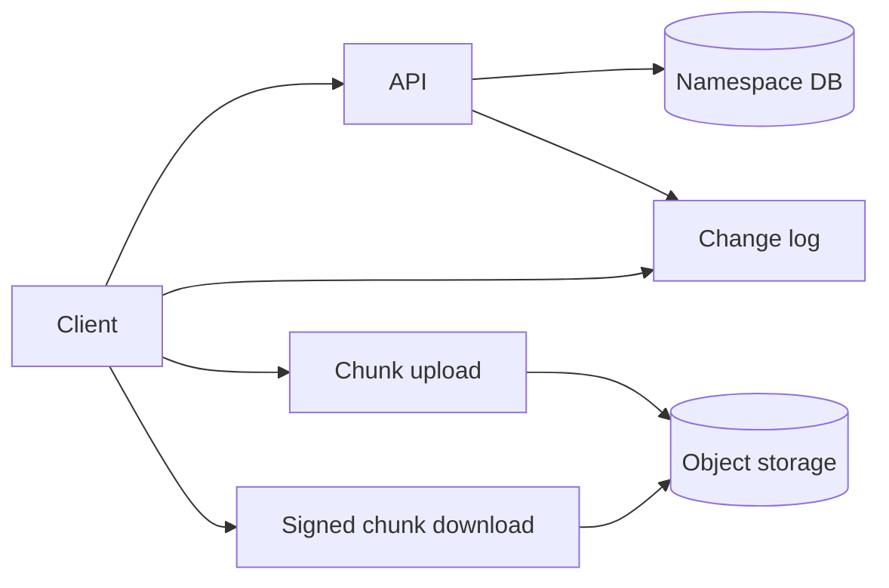
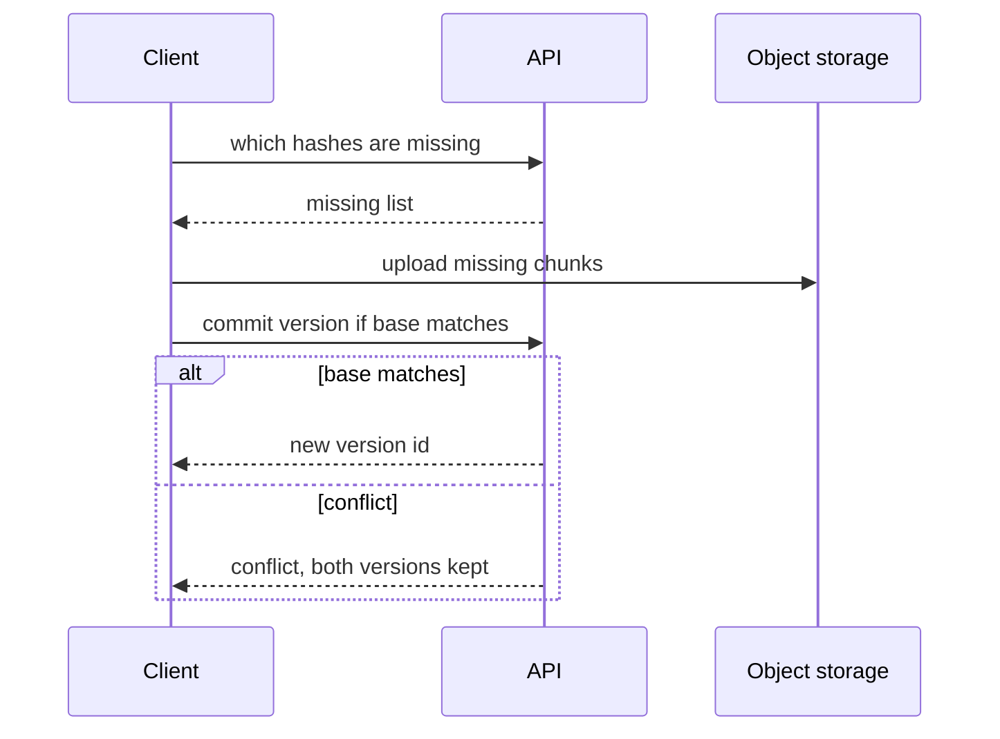

## Why this matters

File sync is the interview that separates "put it in S3" from a system. Users edit offline, two devices change the same file, uploads fail halfway, and a 5 GB video must not be re-sent because one block changed. You need chunking, a metadata transaction that commits a file version, and a conflict rule. Deduplication and sharing fall out of content-addressed chunks if you design them that way.

## Intuition

A file is a list of Lego bricks, not a single slab. If you change one page of a document, you manufacture one new brick and reuse the rest. The cloud stores each distinct brick once. What the user sees as "my file" is a named list of brick ids, and that list is the thing you update carefully so nobody observes a half-swapped file. If two people edit while disconnected, you now have two lists. You do not silently throw one away. You keep both and tell the user.

## Core concept in depth

### Requirements

Functional:

- Upload, download, and sync a folder across devices.
- Resume a failed upload.
- Share a file or folder with another user.
- See versions, and restore an earlier one.
- Work offline and reconcile later.

Non-functional:

- Metadata operations (list folder, rename) are strongly consistent for one account.
- An upload the client thinks finished is durable.
- Do not re-upload unchanged chunks.
- Sync lag of seconds when online, and a defined conflict behavior when not.

Out of scope: real-time collaborative editing of the same document (that is a CRDT or OT product). This design is file sync, version by version.

### Capacity

Assumptions: 100 million users, 2 million DAU actively syncing, average 1 GB stored per user but only a fraction changes daily, average chunk 4 MB, a changed file often rewrites 10 percent of chunks. These are interview assumptions; state them.

| Quantity | Estimate |
| --- | --- |
| Stored bytes | 100e6 × 1 GB = 100 PB before replication and before dedup |
| Replication 3× | 300 PB raw if nothing is shared |
| Dedup | identical chunks across users (popular binaries, memes) cut this; do not promise a number you have not measured |
| Metadata | file and chunk rows are kilobytes per file, so tens of TB, a database problem not an object-storage problem |
| Upload bandwidth | driven by changed chunks, not by full-file rewrites |

The split is the design: **object storage for chunk bytes, a database for the namespace and the chunk lists.**

### Chunking

Split a file into chunks. Fixed-size chunks are easy and wasteful on inserts (every later chunk shifts). **Content-defined chunking** (draw a boundary when a rolling hash hits a pattern) keeps most chunks stable when you insert a byte in the middle. Either is acceptable in an interview if you say why. Chunks are named by the hash of their bytes (content address). Upload only hashes the server does not already have. The client asks "which of these hashes are missing?" and uploads those.

A chunk is immutable. You never edit it. A new version of a file is a new list of hashes. That immutability makes caching and dedup safe.

### Metadata commit

The namespace is the source of truth:

- `nodes`: id, owner, parent id, name, type (file or folder), current version.
- `versions`: file id, version number, list of chunk hashes, size, client id, timestamp.
- `chunks`: hash, size, reference count or a ref from versions, storage key.

**Commit** is a transaction: write the version row and point the file node at it, if the base version is the one the client edited from. If the base version does not match, you have a conflict, not a lost update. This is optimistic concurrency on the file, the same expected-version idea as everywhere else.

Do not update the "current version" pointer before the chunk bytes are durable. The protocol is: upload missing chunks, then commit the metadata. A commit that references a hash the store does not have is a bug. Garbage-collect unreferenced chunks later, not during the user request.

### Sync protocol

Each device has a cursor: the last namespace change id it applied. The server stores an ordered change log per account (or per namespace): rename, delete, new version, share. Online clients either long-poll or receive a push and then pull changes after their cursor. This is the same catch-up pattern as chat, applied to a file tree.

Offline: the client queues local commits. On reconnect it tries each commit with the base version it started from. Success advances the file. Conflict creates a second file ("notes (conflict on laptop).txt") or a branched version the UI must show. Do not pick a winner by wall clock. Clocks lie, and silent data loss is the bug users never forgive.

### Sharing

A share grants another user or a link access to a node. The chunk bytes do not move; the other user gains permission to read those hashes. A public link is a capability: an unguessable token that maps to a node and an expiry, enforced at the download service. Revocation deletes the token and relies on short-lived signed download URLs so an old URL dies quickly.

Authorization is checked on every download, not only when the URL was created, unless the signed URL itself is the short-lived capability and you accept that it works until expiry. Say which.

### Download path

Client gets the version's hash list from the API, then fetches each chunk it does not have locally, via a signed URL to object storage or a CDN. Parallel fetches, reassemble in order, verify each hash. If a hash does not match, discard and retry. That check is both integrity and a safety net against a corrupted object.

### Versions and quota

Keep N versions or a time window, then drop old version rows. Chunks whose refcount hits zero are deletable. Refcount maintenance must be transactional with the version delete or you leak storage or, worse, delete a chunk a new version just reused. A garbage collector that only deletes chunks older than a grace period is safer than an eager delete.

Quota counts logical file size per owner, not physical chunk size after dedup, unless your pricing says otherwise. Dedup savings belong to you, not silently to the user's quota, or a support argument follows. State the policy.

## Diagram





### Dry-run: two laptops edit the same note

| Step | Laptop A | Laptop B | Server version |
| --- | --- | --- | --- |
| Both synced | base v3 | base v3 | v3 |
| A commits | sends chunks, commit base v3 | still offline | v4 |
| B reconnects and commits base v3 |  | rejected, conflict copy created | v4 plus a conflict node |
| User merges on A | new commit base v4 |  | v5 |
| B pulls |  | sees v5 and the conflict file | consistent |

Nobody's bytes were overwritten without a trace. That is the product requirement hiding inside the version check.

## Runnable Python

```python
def missing_chunks(local_hashes: list[str], remote_have: set[str]) -> list[str]:
    return [h for h in local_hashes if h not in remote_have]


def commit(file_row: dict, base_version: int, new_hashes: list[str]) -> str:
    if file_row["version"] != base_version:
        return "conflict"
    file_row["version"] = base_version + 1
    file_row["hashes"] = list(new_hashes)
    return "ok"


if __name__ == "__main__":
    have = {"aa", "bb"}
    print(missing_chunks(["aa", "cc", "bb"], have))
    row = {"version": 3, "hashes": ["aa", "bb"]}
    print(commit(row, 3, ["aa", "cc"]))
    print(commit(row, 3, ["aa", "dd"]))
    print(row)
```

`missing_chunks` is the "do not re-upload what the server already stores" call. The first `commit` moves version 3 to 4 because the base matches. The second still claims base 3, which is now stale, so it conflicts instead of destroying the first edit. Walk that second call explicitly; it is the offline-sync bug if you forget the predicate. A real commit also checks that every hash in the new list is present in object storage before it flips the pointer.

## Complexity / trade-off analysis

| Choice | Gain | Cost |
| --- | --- | --- |
| Content-defined chunks | Stable ids when a file is edited in the middle | More complex splitter |
| Fixed chunks | Simple | A one-byte insert rewrites every later chunk |
| Content-addressed storage | Dedup and integrity checks | Cannot "edit" a chunk; GC is a refcount problem |
| Expected-version commit | No silent lost updates | Clients must handle conflicts |
| Last-writer-wins by clock | Simple | Silent data loss, clock skew |
| Signed CDN download | Fast reads | Expiry and revocation story |
| Eager chunk delete | Low storage | A race can delete a chunk a new version needs |
| Per-account change log | Reliable catch-up | Log retention and cursor management |

## Tricks, tips, patterns

- Bytes in object storage, namespace in a database, commit the namespace only after chunks exist.
- Content hashes as chunk ids. Ask the server which hashes it already has.
- Optimistic concurrency on the file version. Conflicts become visible files, not dropped writes.
- Per-account change log and a cursor, same shape as a chat catch-up.
- Signed URLs for download. Re-check share permissions when issuing them.
- Garbage-collect chunks with a grace period.
- Quota policy stated out loud: logical bytes versus physical bytes.

## Common mistakes and edge cases

- Uploading the whole file through the API process on every save.
- Updating the filename pointer before the bytes are durable. Readers fetch hashes that 404.
- Last-writer-wins across offline devices. You will lose a user's work and they will leave.
- Refcount bugs that delete a shared chunk still used by another file. Prefer grace-period GC.
- A share that copies every byte to the other account. You double storage and break dedup.
- Hashing for integrity with a non-cryptographic hash only. Fine for a cache key, weak if an attacker can plant a colliding chunk. Use a cryptographic hash for content addresses in this design.
- Rename of a folder with a million children as a million synchronous row updates in one user click without batching. Do it, but bound and background the fan-out, and represent the folder move as one metadata change if children store parent id... if children store parent id, one row changes. Do that. Do not store the full path on every child or a rename is a rewrite of the subtree.

## Interview notes

Draw the client, metadata DB, object storage, and the commit sequence: hash, upload missing, commit if base version matches. Then the conflict dry-run. Mention the change log for other devices. Sharing is a permission row plus signed reads, not a byte copy.

If the interviewer asks about a 20 GB file, the answer is the same chunking protocol with resumable uploads of the missing chunks, parallelized, and a metadata commit at the end. The file size changes the number of chunks, not the architecture.

## Practice problems

1. **Upload (easy).** A 40 MB file becomes 10 chunks and the server already has 7. What is uploaded, and when is the file visible to another device?
2. **Conflict (medium).** Two devices commit version 5 from base version 4. What does the user see, and which write must the database reject?
3. **Share revoke (medium).** You revoke a link five minutes after emailing it. What stops the recipient from downloading an hour later, and what did you accept if the URL was signed for a day?

Related: [CDN](/lessons/sd-cdn), [CAP and consistency](/lessons/sd-cap-pacelc-consistency).

## Summary / cheat sheet

- Chunk bytes are immutable and content-addressed in object storage. The database holds the namespace and the ordered hash list.
- Upload only missing chunks, then commit metadata if every hash exists and the base version matches.
- A version mismatch is a conflict copy, not a silent overwrite.
- Other devices catch up through a per-account change log and a cursor.
- Sharing grants read access to existing chunks. It does not duplicate the file.
- Downloads use short-lived signed URLs and verify hashes.
- Garbage-collect unreferenced chunks after a grace period. Keep quota policy explicit.
- Folder rename is a parent-id change, not a rewrite of every child path.

## Further reading

- [Dropbox tech blog](https://dropbox.tech/)
- [Content-defined chunking](https://en.wikipedia.org/wiki/Rolling_hash)
- [Kleppmann, Designing Data-Intensive Applications](https://dataintensive.net/)
- [AWS S3 multipart upload](https://docs.aws.amazon.com/AmazonS3/latest/userguide/mpuoverview.html)
