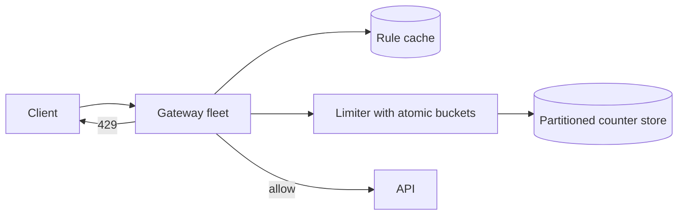
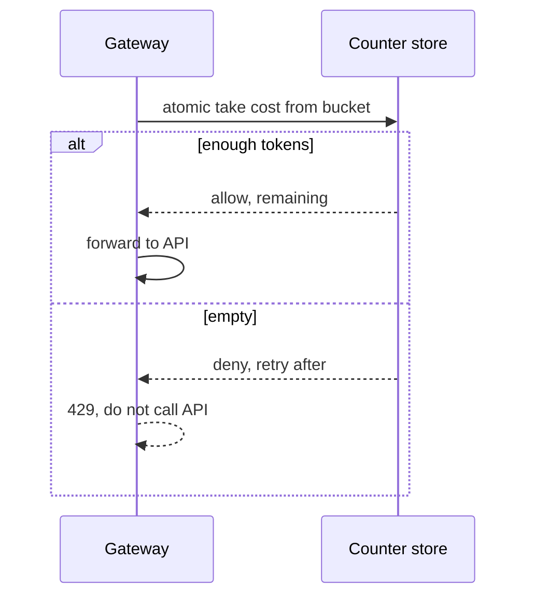

## Why this matters

The building-block lesson covered the algorithms. This case study is the system: many gateway instances, a shared counter store, tenants who are large enough to melt one key, and a decision about what happens when the counter store itself is down. Interviewers use this prompt to see whether "Redis" is the whole answer or whether you can talk about atomicity, accuracy, and failure.

## Intuition

Each guest has a punch card kept at a central desk so every door in the building punches the same card. If each door kept its own card, a guest could take a full stack of drinks at every door. The desk must punch in one motion, or two doors will both see "one punch left" and both allow the drink. If the desk is on fire, you decide in advance whether doors slam shut or wave people through. Both policies are real; they are not the same product.

## Core concept in depth

### Requirements

Functional:

- Allow or deny a request for a key (user, token, IP plus route) given a limit rule.
- Rules have a sustained rate and a burst, per route class.
- Return a decision fast enough to sit in front of the API, with remaining budget and a retry hint.
- Change a tenant's limit without a deploy.

Non-functional:

- Decision p99 under about 10 ms inside the region, so it is not the API's whole budget.
- Correctness: two gateways cannot both spend the last token. Small over-admit is acceptable only if you say so.
- A single tenant at 50,000 rps does not pin one CPU core on the store.
- If the store is unavailable, the policy is explicit: fail closed for anonymous and abuse keys, fail open with a local cap for a known paying tenant, or fail closed for everyone. Pick per tier.

Out of scope: a full WAF, and human identity proof. The limiter trusts the key the gateway extracted after authentication.

### Capacity

Assumptions: 20 gateway tasks, 100,000 request decisions per second globally, average 2 KB rule set cached locally, 10 million distinct keys touched per hour but a much smaller hot set.

| Quantity | Estimate |
| --- | --- |
| Store QPS | about 100,000 atomic updates per second if every request hits the store |
| Hot tenant | one key can be a large fraction of that QPS |
| Payload | a few integers per key, so RAM is small; CPU and the single-key serial update are the limits |
| Rule fetches | cached, not on the request path except on miss |

100,000 updates per second is within a partitioned in-memory store if keys spread. It is not within one key. The design must spread or cache the hot keys on purpose.

### Decision path

1. Gateway authenticates enough to know the key. Unauthenticated traffic uses IP with a low limit.
2. Local cache holds the rule: rate, burst, and fail policy. TTL of a few seconds so a console change propagates quickly.
3. Gateway calls the limiter service or the store with `key`, `cost`, `now`. Cost is 1 for cheap routes and higher for search or export.
4. The store runs an atomic token-bucket update and returns allow or deny, remaining tokens, and a suggested wait.
5. Gateway maps deny to HTTP 429 and `Retry-After`. It does not call the backend.

### Atomic bucket

The update reads the last timestamp and the token count, adds `elapsed * rate`, caps at burst, and subtracts cost if it can. This must be one atomic script. Two gateways doing read-modify-write in the application will over-admit. Say "Lua or a transaction in Redis, one key, one round trip."

Use one bucket per `(rule_id, subject)`. Do not encode the limit only in the gateway binary.

### Hot keys

A tenant allowed 20,000 rps sends 20,000 updates at one key. That serializes on one shard. Mitigations:

- **Stripes.** N sub-keys, each request picks a stripe (hash of a random or of a gateway id). The allow decision sums stripes, or each stripe holds `limit/N` and the gateway uses one stripe. Summing is more accurate and costs N reads. Independent stripes over-admit up to N times a small race but cap the tenant near the limit if each stripe is `limit/N`. Prefer **local grants**: each gateway periodically takes a lease of tokens (for example 100 ms of budget) from the global bucket and spends them in memory. The global key is touched hundreds of times per second instead of tens of thousands. You over-admit by at most one lease per gateway if a gateway dies holding tokens. That bound is explainable.

Local grants are the design I would defend for the hot tenant. Cold tenants can hit the global key directly because they are not hot.

### Multi-region

A global limit across regions needs a single counter in one region (adds cross-region latency) or a budget split per region (a tenant can burst in each region and exceed the global intent by a factor of the number of regions). For abuse control, per-region budgets are enough. For a billing quota, either pin the counter to a home region or accept a periodic reconciliation that is not per-request. Say which product you are building. Do not pretend two regions update one key in 1 ms.

### Failure

If the store times out:

- **Fail closed** rejects. Safe for the backend, harsh if the store blips, and you just created an outage from a safety tool.
- **Fail open** allows. The backend must still have its own concurrency cap or you have no protection during the blip.
- **Local fallback** uses a conservative in-process limit so one gateway cannot be driven without bound, and accepts that N gateways multiply it.

A good default: fail open with a tight local cap for authenticated first-party traffic, fail closed for anonymous IP limits that exist to stop floods. Measure store error rate as a page, because fail open means your protection is degraded.

### Configuration and fairness

Rules live in a database and cache. A bad deploy that sets rate to 0 should be guarded (minimum sane values, review). IP limits must be lower and combined with auth limits so a NAT does not lock a university out of the product entirely; when it does, you have a manual override key.

Return headers: remaining, limit, reset. Clients that honor `Retry-After` are part of the design. Document them.

## Diagram





### Dry-run: local grants for a hot tenant

Limit 10,000 rps, burst already handled globally, 10 gateways, lease of 500 tokens or 50 ms, whichever is smaller.

| Event | Global bucket | Each gateway |
| --- | --- | --- |
| Steady traffic | touched when leases refill, about 10 × 20 refills/s = 200 writes/s | spends the lease in memory |
| One gateway dies holding 500 tokens | those tokens are gone until the math refills | tenant lost at most 500, not a second of traffic |
| Store down | no new leases | gateways spend remaining lease, then local fail policy |
| Two gateways race on last lease | atomic script gives it to one | the other waits or denies |

200 writes per second instead of 10,000 is why the lease exists. The error is bounded by the lease size times the gateway count if you ever double-issued, which the atomic script prevents. The death of a gateway loses at most one lease.

## Runnable Python

```python
class Bucket:
    def __init__(self, rate: float, capacity: float):
        self.rate = rate
        self.capacity = capacity
        self.tokens = capacity
        self.updated = 0.0

    def take(self, now: float, cost: float) -> bool:
        self.tokens = min(self.capacity, self.tokens + (now - self.updated) * self.rate)
        self.updated = now
        if self.tokens < cost:
            return False
        self.tokens -= cost
        return True


def local_grant(global_bucket: Bucket, now: float, lease: float) -> float:
    if global_bucket.take(now, lease):
        return lease
    return 0.0


if __name__ == "__main__":
    bucket = Bucket(rate=100.0, capacity=100.0)
    print("grant", local_grant(bucket, now=0.0, lease=40))
    print("grant", local_grant(bucket, now=0.0, lease=40))
    print("grant", local_grant(bucket, now=0.0, lease=40))
    print("later", local_grant(bucket, now=1.0, lease=40))
```

At t = 0 the bucket holds 100. Two leases of 40 succeed and the third fails, leaving 20. One second later, 100 tokens have refilled up to capacity, so another lease succeeds. That third immediate failure is the atomic deny you want the gateway to turn into a 429 or a wait, not into an extra local invention of tokens. A production script does this in one round trip so two processes cannot both observe 100.

## Complexity / trade-off analysis

| Choice | Accuracy | Store load | Failure |
| --- | --- | --- | --- |
| Per-request atomic bucket | High | One write per request | Store outage hits the hot path |
| Local lease | Bounded over-admit on crash | Writes drop by the lease size | Degrades to local policy |
| Independent per-gateway counters | Low, N times the burst | None shared | Simple and unfair |
| Fail closed | Protects backend | n/a | Limiter outage becomes an API outage |
| Fail open | Protects availability of the limiter | n/a | Backend exposed |
| Per-region budgets | Weak global cap | Local latency | A tenant can multiply by region count |
| Single global key | True global cap | Cross-region latency and a hot key | One region dependency |

## Tricks, tips, patterns

- Authenticate before you spend an expensive identity's budget; still limit unauthenticated traffic by IP.
- One atomic update for the bucket. Never read-modify-write from the gateway.
- Hot tenants get leases or stripes. Quote the reduced QPS.
- Costly routes spend more tokens.
- 429 and Retry-After. Check the limit before the backend call.
- Fail policy is per tier, written down, not invented during the incident.
- Cache rules locally with a short TTL. The request path should not read the rules database.

## Common mistakes and edge cases

- In-memory limits on each gateway and a claim of a global quota. You have N times the quota.
- A Lua script that is not actually atomic with the reads you think it does. Keep the whole update in the script.
- One key for a huge tenant. The shard is hot even though the algorithm is right.
- Limiting after the database query. You paid for the work you meant to shed.
- A 0-rate rule from a bad config push that blocks the admin console. Exclude break-glass routes.
- Using the limiter as a billing system of record. It will drop or double under failure. Billing needs a ledger. The limiter needs a decision.
- Clock jumps. Use a monotonic elapsed time where you can, and do not let a backward clock refill a bucket without bound. Cap the refill.

## Interview notes

Draw gateways, an atomic store, and the 429 path. Name token bucket, then immediately say how a hot key is leased so the store is not touched per request. State the fail policy. Mention multi-region as a budget split unless the product is a strict global quota, in which case name the home region and the latency.

The building-block lesson has the algorithm. This interview is about distribution. Spend your time there.

## Practice problems

1. **Over-admit (easy).** Ten gateways each allow 100 rps in memory for a user whose plan is 100 rps. What is the worst case the backend sees, and what shared mechanism fixes it?
2. **Hot key (medium).** One tenant sends 30,000 rps and each decision updates one Redis key. What bottleneck appears, and how do 200 ms leases change the write rate?
3. **Outage (medium).** The counter store times out for 30 seconds. Choose a fail policy for anonymous traffic and for signed-in checkout, and justify both.

Related: [API gateway and rate limiting](/lessons/sd-api-gateway-rate-limiting), [Caching](/lessons/sd-caching).

## Summary / cheat sheet

- A distributed limiter is an atomic token bucket in a shared store, in front of the backend, returning 429.
- Read-modify-write in the gateway is not atomic and will over-admit.
- Hot keys use leases or stripes so one tenant cannot pin a shard.
- Leases bound extra admission and cut store QPS by the lease size.
- Multi-region is either a split budget or a home-region counter. Latency decides.
- Fail open and fail closed are product choices per traffic class. Write them down.
- Rules are cached configuration. Billing is a different system.
- Cap clock-based refill. Do not limit only after the expensive call.

## Further reading

- [Redis scripting](https://redis.io/docs/latest/develop/programmability/)
- [Cloudflare rate limiting](https://developers.cloudflare.com/waf/rate-limiting-rules/)
- [Stripe rate limits](https://docs.stripe.com/rate-limits)
- [RFC 6585](https://www.rfc-editor.org/rfc/rfc6585)
