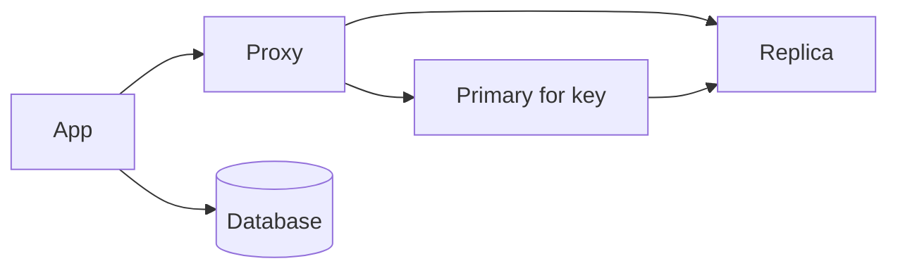
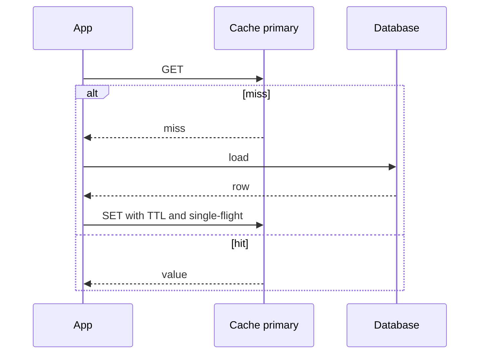

## Why this matters

"Use Redis" is not a distributed cache design. Interviewers want the placement of keys, what happens when a node dies, how you avoid losing the database when a popular key expires, and how big the fleet is. This case study uses the cache-aside pattern and the hash ring as parts, and adds membership, replication, and the failure mode when the cache is empty.

## Intuition

A distributed cache is a row of small notebooks with a rule for which notebook holds which name. The encyclopedia is the database. If a notebook tears, you either read the carbon copy on the next notebook or you walk back to the encyclopedia. If everyone tears the same page out at once, you must not let a thousand people through the encyclopedia door together. And if one name is so famous that its notebook catches fire from being opened, you copy that one page into a few notebooks on purpose.

## Core concept in depth

### Requirements

Functional:

- Get, set, and delete by key, with a TTL.
- Clients do not choose the server; the cluster does.
- A deleted or overwritten key is not served past a short bound.
- Operators can add and remove nodes.

Non-functional:

- Get p99 under a millisecond or a few milliseconds inside the region.
- A single node failure does not wipe the working set if you chose replication.
- Hit ratio target is an input, not a wish. Tie it to database budget.
- Memory per node is bounded. Eviction is explicit.
- Cache loss is a latency and load event, not a data-loss event, unless you wrongly used the cache as a database.

### Capacity

Assumptions: 500,000 gets per second peak, 5 percent miss ratio so the database sees 25,000 gets per second, average value 2 KB, hot set 200 million items, two replicas.

| Quantity | Estimate |
| --- | --- |
| Hot-set RAM | 200e6 × 2 KB × 2 replicas = about 800 GB, plus overhead, call it about 1 TB |
| Nodes at 64 GB usable | about 16 nodes, plus headroom, so plan near 20 |
| NIC per node | 500,000 × 2 KB / 20 is about 50 MB/s average per node if even, fine for modern NICs, not fine if one key is 10 percent of QPS |
| Database if the fleet restarts cold | 500,000 gets per second. If the database can take 25,000, a cold start is an incident |

That last row is the availability design. Either the database can absorb a cold cache, or you need replication, gradual restart, and stale serving so it never sees the full QPS.

### Placement

Consistent hashing with many virtual nodes per physical node. Replication to the next R distinct physical successors, here R = 2 (primary plus one replica) if you want to survive one node loss without a full refill. Clients, or a proxy tier, hold the membership map. A proxy is easier for many languages and hides ring changes. Client-side hashing saves a hop and couples every service to the map. Either is defensible; pick the proxy if the fleet is polyglot, and say the extra millisecond.

Writes go to the primary for the key and replicate to the backup. For a cache, async replication is usually enough: a failure can drop the newest sets, and the next read refills from the database. If you need the cache to be a session store, you are no longer in "cache" and you need ack-from-replica plus a durability story. Say no to session-only-in-cache unless the product accepts logout on a crash.

### Read and write path

**Get.** Proxy hashes to the primary. On hit, return. On miss, return miss to the application. The application loads the database and sets the cache (cache-aside). The cache service does not call the database itself, which avoids a hidden dependency from the cache tier to the schema. Single-flight the fill in the application or in a small lock on the key: one loader, others wait or serve stale.

**Set.** Primary stores the value, replica receives it, TTL starts. Delete on invalidation goes to primary and replica. A delete that hits only one of them resurrects a stale value when the other is promoted. Broadcast the delete to both, and keep TTL as a backstop.

**Eviction.** When a node is near its memory cap, evict by LRU or a sampled LRU, which is what many in-memory caches actually implement. TTL expiry is separate. Set a max value size so one 100 MB set cannot evict the working set. Refuse oversized values.

### Hot keys

The ring puts one key on one primary. Replication helps reads if you read from the replica too, which at most doubles read capacity for that key, and it does not help if the key is 100× one node. For a known hot key, replicate the value to several extra nodes and let the client pick one at random, or cache that key inside the application process for a second. Detect hot keys by a heavy-hitter sketch (count-min) on the proxy. Mention the sketch; you do not need to derive it unless asked.

### Membership changes

Adding a node takes a slice of the ring. Only that slice moves. Stream those keys from old owners, throttled, and prefer "lazy refill from database" for a pure cache: you can skip bulk copy and accept a temporary miss storm on a fraction of keys. For a 1/N move, the database sees roughly 1/N of the key space miss once. If 1/N of 500,000 QPS is still too much, warm the new node by copying.

Removing a node: the replica of each of its keys becomes primary. Clients with a stale map must refresh on a rejection, not treat "wrong node" as "key missing," or you will cache a false miss.

### Stampede and stale

Keep a stale copy for a short window after TTL and serve it while one request refreshes (stale-while-revalidate). Jitter TTLs. If the database errors, serve stale rather than caching the error for a long time. A short negative cache for missing keys stops a flood of identical misses.

### What you measure

Hit ratio, p99 get latency, eviction rate, memory, replication lag, and **database QPS from this service**. The last one tells you the cache is doing its job. Alert when miss QPS approaches the database budget, not when hit ratio drops by a point from 96 to 95 if both are safe.

## Diagram





### Dry-run: one node dies

Twenty nodes, one replica, even keys.

| Event | User get | Database |
| --- | --- | --- |
| Node 7 dies | Proxy uses the replica for keys that lived on 7 | About 0 extra if replica is warm |
| Replica was async and missed the last second of sets | A few misses | Small refill |
| Both copies die, or you ran with R = 1 | Misses for about 1/20 of keys | 5 percent of QPS extra, check the budget |
| Whole fleet flushed | All misses | 500,000 QPS, over budget, so do not flush the fleet |

Replication is the difference between "a node died" and "the database died."

## Runnable Python

```python
def node_for(key: str, nodes: list[str]) -> str:
    # Teaching ring: highest hash less than or equal, else wrap.
    # Production uses many virtual nodes; see the hashing lesson.
    def point(text: str) -> int:
        return sum(ord(ch) for ch in text) % 10_000

    ordered = sorted(nodes, key=point)
    target = point(key)
    for name in ordered:
        if point(name) >= target:
            return name
    return ordered[0]


def db_qps(total_qps: float, hit_ratio: float) -> float:
    return total_qps * (1 - hit_ratio)


if __name__ == "__main__":
    nodes = ["a", "b", "c", "d"]
    print(node_for("user-42", nodes))
    print("db qps", db_qps(500_000, 0.95))
    print("cold", db_qps(500_000, 0.0))
```

The helper shows a key landing on a node, and it shows why virtual nodes matter: with four names and a weak hash, balance will be poor. The QPS helper is the sizing argument. Ninety-five percent hits leave 25,000 database reads per second. A cold fleet leaves 500,000. Design the failure case, not only the hit case. Use the consistent-hashing lesson's virtual nodes when you explain placement; this snippet is the capacity check you should say out loud.

## Complexity / trade-off analysis

| Choice | Gain | Cost |
| --- | --- | --- |
| Proxy routing | Simple clients | Extra hop, proxy fleet to run |
| Client hashing | One fewer hop | Stale maps in every service |
| Async replica | Survives a node loss for most keys | Last writes can vanish |
| No replica | Half the RAM | Node loss is a partial cold start |
| LRU eviction | Adapts to workload | A scan of one-time keys can evict the hot set if you do not cap size |
| Stale-while-revalidate | No stampede, fresher than a long TTL | Slightly staler reads |
| Cache-aside | Database remains source of truth | Fill logic in the app |
| Cache as session store | Fast sessions | You just made it a database without the backups |

## Tricks, tips, patterns

- Size RAM from the hot set times replicas, then check NIC per node.
- Compute database QPS at the target hit ratio and at a cold start. Design for both.
- Consistent hashing, virtual nodes, replica on the next physical node.
- Single-flight plus jitter plus stale-while-revalidate for popular keys.
- Deletes go to every replica. TTL is the backstop.
- Detect hot keys and replicate those values beyond the default factor.
- Roll restarts. Never flush the fleet.
- Wrong-node responses refresh the map; they are not misses.

## Common mistakes and edge cases

- One giant cache instance. Failure and hot keys have nowhere to go.
- Modulo placement, then adding a node reshuffles every key and the database falls over.
- A stampede on the one key everyone wants at midnight because every TTL is exactly 60 seconds.
- Caching the database error for five minutes.
- Letting a client store a 1 GB value.
- Promoting a replica that never received deletes, and serving stale data until TTL with no TTL set. Always set a TTL on cache entries.
- Using the cache for the only copy of an order. When it evicts, the order is gone.

## Interview notes

Open with hit ratio and RAM. Draw the ring, a proxy, primary and replica, and the app doing cache-aside. Walk a node death and a cold start. Mention hot-key detection and single-flight. End by saying the database is the source of truth and the cache has TTLs.

If asked "write-through or write-back," default to cache-aside for a read cache and explain write-back only if they accept data loss or you replicate durably, at which point you should question whether it is still a cache.

## Practice problems

1. **RAM (easy).** 50 million hot keys, 4 KB values, replication factor 2. Estimate RAM and the node count at 50 GB usable per node.
2. **Expiry (medium).** A popular key's TTL is 30 seconds with no jitter and no single-flight. What does the database see every 30 seconds, and which two controls stop it?
3. **Topology (medium).** You add a 21st node to a 20-node ring. About what fraction of keys move, and how do you keep that move from a full-fleet miss storm?

Related: [Caching](/lessons/sd-caching), [Consistent hashing and bloom filters](/lessons/sd-consistent-hashing-bloom-filters).

## Summary / cheat sheet

- The cache is a TTL'd copy. Size it from the hot set and the hit ratio the database needs.
- Place keys with a virtual-node hash ring. Replicate to the next physical nodes.
- Cache-aside: miss, load database, single-flight the set. Do not let the cache tier own your schema.
- Jitter TTLs and serve stale while one refresher runs.
- Hot keys are detected and copied extra. The ring will not split them.
- Node loss uses the replica. Fleet-wide flush is a database incident. Roll changes.
- Evict on memory, refuse huge values, send deletes to all replicas.
- If losing the cache loses user data, it is not a cache.

## Further reading

- [Redis cluster specification](https://redis.io/docs/latest/operate/oss_and_stack/reference/cluster-spec/)
- [Memcached](https://memcached.org/)
- [Facebook, Scaling Memcache at Facebook](https://research.facebook.com/publications/scaling-memcache-at-facebook/)
- [Dynamo paper](https://www.allthingsdistributed.com/files/amazon-dynamo-sosp2007.pdf)
