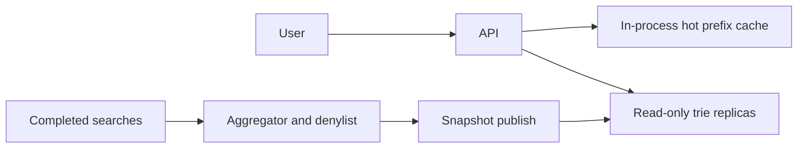
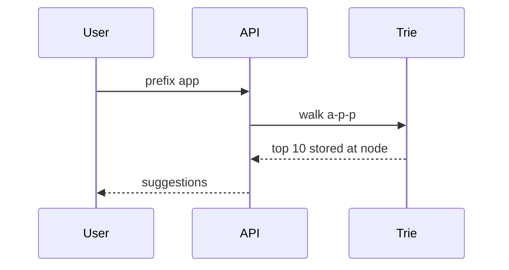

## Why this matters

Autocomplete looks like a trie exercise and is actually a latency and ranking problem. The user expects suggestions before they finish typing, so the budget is a few tens of milliseconds. The naive answer, "scan every title that starts with these letters," does not survive a large catalog. Interviewers want the index, the top-K precompute, how new queries become suggestions, and what you refuse to suggest.

## Intuition

A trie is a tree of letters where the path from the root spells a prefix. At each node you could store every phrase that passes through it, but that is a huge list at the letter "t." Instead, store only the ten best phrases at that node. Typing is a walk down the tree, and the answer is already sitting there. The hard part is keeping those ten best phrases current without rewriting the tree on every keystroke in the world, and not suggesting something harmful just because it is popular.

## Core concept in depth

### Requirements

Functional:

- Given a prefix, return up to 10 suggestions, most popular first.
- Suggestions can be queries people actually search, or titles in a catalog. Pick one. This design uses **search queries** with popularity counts. A catalog typeahead is the same shape with a different source.
- Update popularity within minutes, not on the keystroke path.
- Filter denylisted and unsafe queries.

Non-functional:

- p99 under about 50 ms in region, including network to the user only if you own the edge; otherwise the server budget is tighter, around 20 ms.
- High availability for the read path. Stale suggestions are acceptable for a few minutes.
- A prefix of one character must not fan out to millions of documents.

Out of scope: full document search, spelling correction beyond a mention, and personalization. Personalized typeahead multiplies storage by user or by cohort; say you would shard a second index if asked.

### Capacity

Assumptions: 50,000 prefix lookups per second at peak (many keystrokes per search), 500 million distinct queries ever seen, but the suggestion set is the top few million by count. Store top 10 phrases per prefix node. Alphabet plus digits is about 40 children, but real nodes are sparse.

| Quantity | Estimate |
| --- | --- |
| Lookups | 50,000 per second peak, read-heavy, cacheable |
| Distinct prefixes of length 1 to 3 | small (tens of thousands) and extremely hot |
| Index size | a few million phrases times a few prefixes each, comfortably a few GB to a few tens of GB, so it can be replicated in memory |
| Count updates | one increment per accepted search, not per keystroke. If 5,000 searches complete per second, that is the write rate |

The index fits in memory on a handful of replicas. This is not a sharding-first problem unless the interviewer forces personalization or a much larger catalog of long-tail phrases you insist on storing.

### Index structure

Build a **trie** (prefix tree). Each node holds:

- children pointers for the next character
- a list of at most K suggestion ids, already sorted by score

Alternatively, an **edge n-gram** map in a search engine: the term `app` maps to the top documents that contain that prefix. The interview does not require you to reimplement a search engine. The trie makes the top-K precompute obvious.

**Build, do not update the trie on the request.** A pipeline counts completed searches in a log, aggregates scores, applies the denylist, and publishes a new trie snapshot. Readers load snapshots by version and swap. A few minutes of lag is the SLO. This avoids write contention on the hot root of the trie.

Score can be a decayed count so "yesterday's meme" fades: for example, each day's count is weighted, or you keep an exponential moving average. Say that raw all-time counts make the index stale in spirit even if it is fresh in build time.

### Read path

The client debounces keystrokes (for example 50 to 100 ms of quiet) so you do not look up every intermediate letter if the user is fast. The request is `GET /suggest?q=app`. The service walks the trie from the root along `a`, `p`, `p`, and returns the stored top-K. If the prefix is missing, return nothing or a shorter prefix's list. Do not scan.

Cache the hottest prefixes (one- and two-character, plus whatever the heavy-hitter log shows) in a small in-process LRU. Those prefixes dominate QPS. The trie replicas sit behind a load balancer. The data is read-only per snapshot, so any replica can serve.

### Denylist and safety

The aggregator drops queries on a denylist before they enter the trie, and a second check at read time catches a list update that has not been rebuilt yet. Do not wait for the rebuild to stop suggesting a term you just banned. Log blocked terms without turning the log into a new public index.

### Personalization, if asked

Per-user tries do not fit. Practical options: a global trie plus a small per-user recent-query list merged at read time, or cohort tries (region, language). Merge by score with a cap. Language matters: do not suggest across scripts unless the product wants that. Partition snapshots by language so a Japanese prefix is not a walk through an English trie.

### Updates and deletes

A query that falls out of the top-K disappears on the next snapshot. There is no in-place delete on the serving trie except the denylist overlay. Old snapshots are discarded after the swap. If a snapshot build fails, keep serving the previous one and alert. Never serve an empty trie because the job crashed; that is a preventable outage.

## Diagram





### Dry-run: a new popular query

| Time | What is counted | What a user typing "ne" sees |
| --- | --- | --- |
| Minute 0 | "new phone" searched once | Previous top 10, no change |
| Minute 5 | Count crosses the threshold in the aggregator | Still the old snapshot |
| Minute 6 | Snapshot swapped | "new phone" appears if it beat the tenth item |
| Ban at minute 7 | Denylist updated | Read-path filter hides it immediately; next snapshot omits it |

Popularity is delayed. Safety is not, because the read-path filter does not wait for the snapshot.

## Runnable Python

```python
class Node:
    def __init__(self) -> None:
        self.children: dict[str, "Node"] = {}
        self.top: list[str] = []


class Trie:
    def __init__(self) -> None:
        self.root = Node()

    def insert(self, phrase: str, top_at_each_step: list[str]) -> None:
        node = self.root
        for ch in phrase:
            node = node.children.setdefault(ch, Node())
            # In the real builder, top_at_each_step is the global top-K for this prefix.
            node.top = top_at_each_step

    def suggest(self, prefix: str, limit: int = 10) -> list[str]:
        node = self.root
        for ch in prefix:
            if ch not in node.children:
                return []
            node = node.children[ch]
        return node.top[:limit]


if __name__ == "__main__":
    trie = Trie()
    trie.insert("app", ["apple", "amazon", "app store"])
    # Walk is per character; this demo sets the same list at each step.
    print(trie.suggest("app"))
    print(trie.suggest("z"))
```

The teaching trie stores a finished top list on the node, which is the serving structure: `suggest` is a walk and a slice, not a search of the catalog. The builder that computes those lists from counts is offline. A production node stores phrase ids, not full strings repeated at every depth, and the API hydrates the strings from a table. Repeating strings in the demo keeps the walk obvious. Empty prefixes should not call `suggest("")` and dump the root's list to an anonymous client without a product decision; the root is the hottest, least specific node. Often you require two characters before you suggest.

## Complexity / trade-off analysis

| Choice | Latency | Freshness | Risk |
| --- | --- | --- | --- |
| Walk a precomputed top-K trie | Tens of milliseconds or less | Snapshot lag | Stale trends |
| Query a search cluster per keystroke | Higher and variable | Fresher | Load multiplies by keystrokes |
| Update counts inside the trie on every search | Fresh | Write contention on the root | Can outage the read path |
| In-process cache of short prefixes | Protects the trie | Same snapshot | Needs a denylist check even on cache hits |
| Personalized tries | Relevant | Storage explosion | Usually the wrong first design |
| No denylist overlay | Simpler | Ban waits for rebuild | Unacceptable for safety |

## Tricks, tips, patterns

- Precompute top-K at each node. The read is a walk.
- Build snapshots from completed searches, not from keystrokes.
- Debounce the client. Require a minimum prefix length.
- Cache the hottest short prefixes in process.
- Apply the denylist on the read path and in the builder.
- Swap snapshots. Keep the last good one if the build fails.
- Decay counts so the index tracks this month, not 2014.
- Store ids in the trie and resolve display strings in one batch.

## Common mistakes and edge cases

- Scanning the corpus for every prefix. You will not meet 20 ms.
- Storing every phrase that matches, not the top K. The node for "t" becomes enormous.
- Incrementing the trie on the query path. The root is a write hotspot.
- Suggesting on the first character with no cache and no cap. That node is the whole product's QPS.
- Forgetting to filter a cached suggestion after a ban. The cache is not exempt.
- Ranking only by raw lifetime count, so old queries crowd out everything new.
- Returning different user's private queries from a shared trie. If any query is private, it never enters the global index.
- No snapshot version. A half-published trie serves broken walks. Publish immutably and then flip a pointer.

## Interview notes

Say "top-K precomputed in a trie, snapshot rebuilt every few minutes, read path is a walk plus a denylist." Draw the aggregator separately from the replicas. Mention debounce and the hot-prefix cache. If they ask about ranking quality, talk about time decay and a click signal, still offline. If they ask about scale beyond memory, shard by the first character or by language, knowing the first-character shard is unbalanced, so you shard hot letters further.

Do not start by installing Elasticsearch unless you also say what the prefix query and the precomputed top hits look like. The data shape is the answer, not the vendor.

## Practice problems

1. **Cost (easy).** The corpus has 200 million titles. Why is "SELECT titles WHERE title LIKE 'ap%' LIMIT 10" a bad keystroke path even with a limit?
2. **Ban (medium).** A query becomes unsafe and is in the current snapshot. How do you stop returning it in under a minute without rebuilding the whole trie first?
3. **Rank (medium).** A query was huge last year and quiet this week. What scoring change stops it from occupying every prefix, and when does a user actually see the change?

Related: [Caching](/lessons/sd-caching), [Distributed cache](/lessons/sd-distributed-cache).

## Summary / cheat sheet

- Autocomplete is a read of precomputed top-K phrases for a prefix, not a scan.
- A trie (or prefix map) stores at most K ids per node. The walk is the query.
- Rebuild snapshots from aggregated, decayed counts. Do not write the trie on the keystroke.
- Short prefixes are cached. Clients debounce. Minimum length avoids the root.
- Denylist is enforced at read time and at build time. Private queries never enter the global trie.
- Keep the last good snapshot if a build fails.
- The index fits in replicated memory at typical sizes. Shard by language or prefix only when it does not.
- Freshness is minutes. Safety is immediate.

## Further reading

- [Trie](https://en.wikipedia.org/wiki/Trie)
- [Elasticsearch completion suggester](https://www.elastic.co/guide/en/elasticsearch/reference/current/search-suggesters.html)
- [Kleppmann, Designing Data-Intensive Applications](https://dataintensive.net/)
- [Count-Min sketch](https://en.wikipedia.org/wiki/Count%E2%80%93min_sketch)
