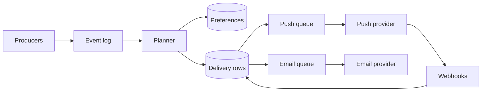
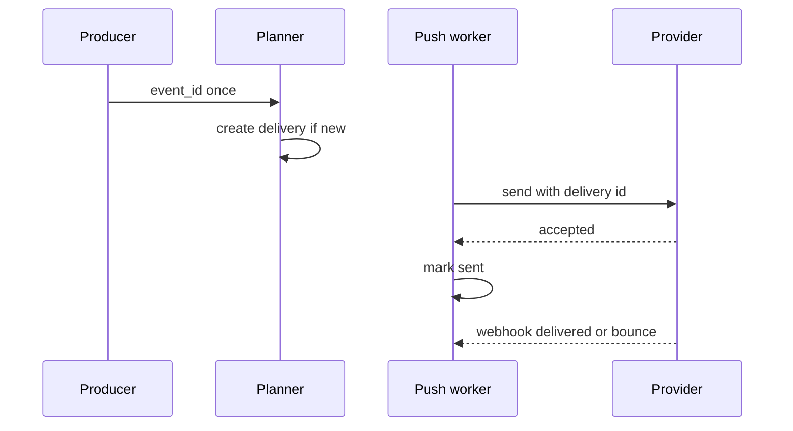

## Why this matters

Notifications look like a queue and become a product incident when they duplicate, arrive at 3 a.m., ignore a preference, or retry a payment receipt until the user blocks you. The design has to separate "something happened" from "we handed this to APNs" from "the user read it." Interviewers want preferences, idempotency, fan-out, and provider limits. They do not want one synchronous call to an email API inside checkout.

## Intuition

An event is a fact in a newsroom. An editor (preferences and caps) decides which desks care. Each desk (push, email, SMS) has its own printing press with its own speed limit and its own idea of success. If a press jams, you reprint that edition, but you do not rewrite the fact, and you do not reprint an edition the reader already has. A digest is the choice to bundle the afternoon mail instead of interrupting every hour.

## Core concept in depth

### Requirements

Functional:

- Other services emit events: message received, order shipped, comment, security alert.
- Deliver on one or more channels: in-app, mobile push, email, SMS.
- Users set preferences per category and channel, plus a quiet hours window.
- Security alerts bypass quiet hours. Marketing does not.
- At-least-once handoff to the provider, with no duplicate visible notification for the same event.

Non-functional:

- The producer request does not wait on APNs or an email provider.
- p99 time-to-provider under a minute for transactional events, faster for chat pushes (seconds) via a high-priority lane.
- A provider outage queues work; it does not fail the order.
- Per-user and global rate caps.

Out of scope: building your own global telecom network. SMS and email go through providers. You design the system around their limits and webhooks.

### Capacity

Assumptions: 50 million DAU, 20 notifiable events per user per day before preferences, 30 percent survive preferences, half of those are push and the rest split email and in-app. SMS is rare and expensive.

| Quantity | Estimate |
| --- | --- |
| Raw events | 50e6 × 20 / 1e5 = about 10,000 per second average |
| After preferences | about 3,000 per second |
| Peak | 5×, about 15,000 deliveries per second to schedule |
| Provider caps | email and SMS providers will be far below an uncapped peak; you need a per-provider limiter and a backlog SLO |
| Storage | one row per delivery attempt for a retention window of days, partitioned by time |

The math says a log plus workers, not a row locked inside the producer's database.

### Pipeline

1. **Ingest.** Producers write an outbox or publish to `notifications.events` with a stable `event_id`. The payload is small: user id, type, entity id, template variables. Not a rendered novel.
2. **Fan-out planner.** A consumer loads preferences and device tokens, decides channels, and writes one **delivery record** per channel with id `event_id + channel + device`. Idempotent insert.
3. **Channel workers.** Each channel has its own queue and its own rate limit matching the provider. Workers render the template, send, and store the provider's id.
4. **Receipts.** Provider webhooks (delivered, bounced, failed) update the delivery row. Push tokens that bounce are disabled.

In-app notifications are just a write to the user's notification inbox, which the client reads. They do not depend on APNs. Treat them as the reliable channel and push as a best-effort wake-up.

### Preferences and quiet hours

Store preferences in a service cached beside the planner. Cache invalidation on save, TTL as a backstop. Default to conservative: a new category does not email everyone until they opt in, except transactional mail they caused (receipts) and security.

Quiet hours delay non-critical deliveries until the window opens, or fold them into a digest. Do not delay a password-reset or a fraud alert. The planner writes `not_before` on the delivery row. Workers skip rows that are not due. A delayed row is not a failure.

### Templates and localization

Templates live in data, not in the worker binary: id, channel, locale, version. Render at send time so a copy fix does not require a queue rewrite. Missing variables are a dead-letter, not a half-rendered "Hello null" if you can help it. The planner can fail the delivery row with a clear reason.

### Idempotency and retries

The provider call uses the delivery id as the idempotency key where the provider supports it. Where it does not, you still store "sent at" before retrying carefully: if you crash after the provider accepted and before you recorded it, a retry can duplicate. Mitigations: record an intent, use provider idempotency if available, and make the visible in-app row unique so the inbox does not show two. For email, a rare duplicate is bad but a lost receipt is worse; prefer at-least-once and design templates so a duplicate is recognizable. Say this trade honestly.

Retries use backoff and a cap. Hard bounces do not retry. Rate-limit responses retry with the provider's hint. After N failures, the row is dead-lettered and the inbox item may still exist.

### Priority lanes

| Lane | Examples | Behavior |
| --- | --- | --- |
| Critical | Fraud, password reset | Bypass quiet hours, separate queue, tight SLO |
| Transactional | Shipping, receipts | Normal queue, respect nothing except rate caps |
| Social | Comments, likes | Preferences, quiet hours, digest option |
| Marketing | Campaigns | Strict opt-in, global and per-user caps, easy kill switch |

A comment storm must not delay a fraud SMS. Separate queues are the bulkhead.

### Device tokens and fan-out

A user can have several devices. Push fan-out is per device token, and each token has a delivery id. Disable tokens on provider feedback. Do not keep sending to a token that has been invalid for weeks; that wastes quota and looks like abuse to the provider.

Large campaigns (a million marketing pushes) are a scheduled job that writes deliveries in bulk and is capped, not a single message that synchronously fans out inside a web request. A kill switch flips the campaign status and workers stop pulling it.

## Diagram





### Dry-run: duplicate event and a quiet-hours like

| Step | Delivery row | User-visible effect |
| --- | --- | --- |
| Event pay-9 first time | push row created | queued |
| Event pay-9 retried | insert no-ops | one push |
| Like at 02:00 local, quiet hours | not_before = 07:00 | no push at night |
| In-app row for the like | written immediately | badge in the morning even if push waits |
| Provider 429 | retry with backoff | no new delivery id |
| Hard bounce | token disabled | later events skip that device |

The in-app row is how the product stays correct when push is delayed or dead.

## Runnable Python

```python
def plan(event: dict, prefs: dict, quiet: bool) -> list[dict]:
    channels = []
    category = event["category"]
    allowed = prefs.get(category, [])
    for channel in allowed:
        if channel == "sms" and category != "security":
            continue
        not_before = 0 if category == "security" or not quiet else event["quiet_until"]
        channels.append(
            {
                "id": event["id"] + ":" + channel,
                "channel": channel,
                "not_before": not_before,
            }
        )
    # In-app is always recorded for product categories so the inbox is complete.
    if category != "marketing":
        channels.append({"id": event["id"] + ":inapp", "channel": "inapp", "not_before": 0})
    return channels


if __name__ == "__main__":
    event = {"id": "evt-1", "category": "social", "quiet_until": 7}
    prefs = {"social": ["push", "email"], "security": ["sms", "push"]}
    print(plan(event, prefs, quiet=True))
    print(plan({"id": "evt-2", "category": "security", "quiet_until": 7}, prefs, quiet=True))
```

Social during quiet hours produces push and email rows with `not_before` set, plus an immediate in-app row. Security still produces an SMS-capable plan with `not_before` 0, so the worker may send now. The delivery id includes the event id and the channel, which is the idempotency key the planner inserts. Run the social event twice in the real system and the second insert does not create a second push. The snippet shows the decision, not the database constraint; say the unique key out loud.

## Complexity / trade-off analysis

| Choice | Gain | Cost |
| --- | --- | --- |
| Async pipeline | Producer latency stays low | Eventual delivery, more moving parts |
| Per-channel queues | A slow email provider does not block push | More workers to operate |
| Quiet hours | Trust | Delayed messages, clock and timezone bugs |
| Digest | Fewer interruptions | Less immediacy |
| Provider idempotency key | Fewer duplicates | Not offered by every provider |
| At-least-once without provider keys | Simple | Occasional duplicate email |
| Campaign kill switch | Stop a bad send | Must be checked by workers, not only by the API |
| In-app as source of truth | User can always see it | Inbox storage and read model |

## Tricks, tips, patterns

- Producers emit small events. They do not render or send.
- One delivery row per channel and device, keyed by event id, so retries do not multiply.
- Separate queues for critical, transactional, and marketing.
- Preferences and a denylist of dead tokens live on the planner's read path, cached.
- Quiet hours set `not_before`. They do not drop security alerts.
- Rate-limit per provider and per user.
- Webhooks update status. Disable bad tokens.
- Templates are versioned data. A kill switch stops campaigns already queued.

## Common mistakes and edge cases

- Sending email inside the order transaction. The provider's timeout fails the purchase.
- No idempotency, so a retried event texts the user five times.
- One queue for marketing and password reset. A sale blast delays account recovery.
- Ignoring provider rate limits and getting the account suspended.
- Quiet hours computed in UTC for every user. You wake people in one timezone to be polite in another.
- Retrying a hard bounce until the provider files an abuse report.
- A template bug that queues a million "Hello null" and no kill switch.
- Storing full card numbers or passwords in the event payload "for the template." The template should not need them, and the log must not have them.

## Interview notes

Draw ingest, planner, per-channel queues, providers, and webhooks. Define the delivery id. Mention preferences, quiet hours, and the critical lane. Say the producer's request returns before any provider call. Mention a kill switch if they ask about a bad campaign.

A close: "Events land on a log. The planner writes idempotent delivery rows based on preferences. Workers, bulkheaded by channel and priority, talk to providers under a rate limit. In-app is the record the user can always open. Push is a wake-up."

## Practice problems

1. **Duplicate (easy).** Checkout publishes `order-18-shipped` twice because of an outbox retry. How many emails does the user get, and which key makes that true?
2. **Blast (medium).** A marketing send of 5 million emails shares a queue with password reset. What goes wrong, and how do you isolate it?
3. **Night (medium).** A user in India sets quiet hours 10 p.m. to 7 a.m. A comment arrives at 11 p.m. What is written, what is sent now, and what is sent later?

Related: [Queues and Kafka](/lessons/sd-queues-kafka), [Event-driven architecture](/lessons/sd-event-driven-serverless).

## Summary / cheat sheet

- Notifications are an async pipeline. The business transaction only records a fact.
- Planner turns one event into per-channel delivery rows, filtered by preferences.
- Idempotency key is event plus channel plus device.
- Critical, transactional, and marketing do not share a queue.
- Quiet hours delay non-critical work with `not_before`. Security bypasses them.
- Provider rate limits, backoff, and bounce handling are part of the design.
- In-app inbox is the durable user-visible record. Push and SMS are best-effort wakes.
- Templates are data. Campaigns have a kill switch. Payloads stay small and non-secret.

## Further reading

- [Apple Push Notification service](https://developer.apple.com/documentation/usernotifications)
- [Firebase Cloud Messaging](https://firebase.google.com/docs/cloud-messaging)
- [AWS SES](https://docs.aws.amazon.com/ses/)
- [Transactional outbox](https://microservices.io/patterns/data/transactional-outbox.html)
