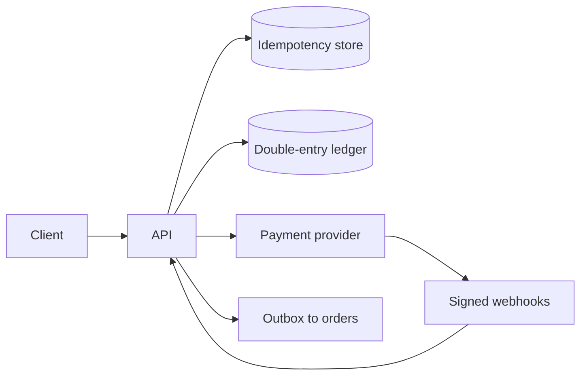
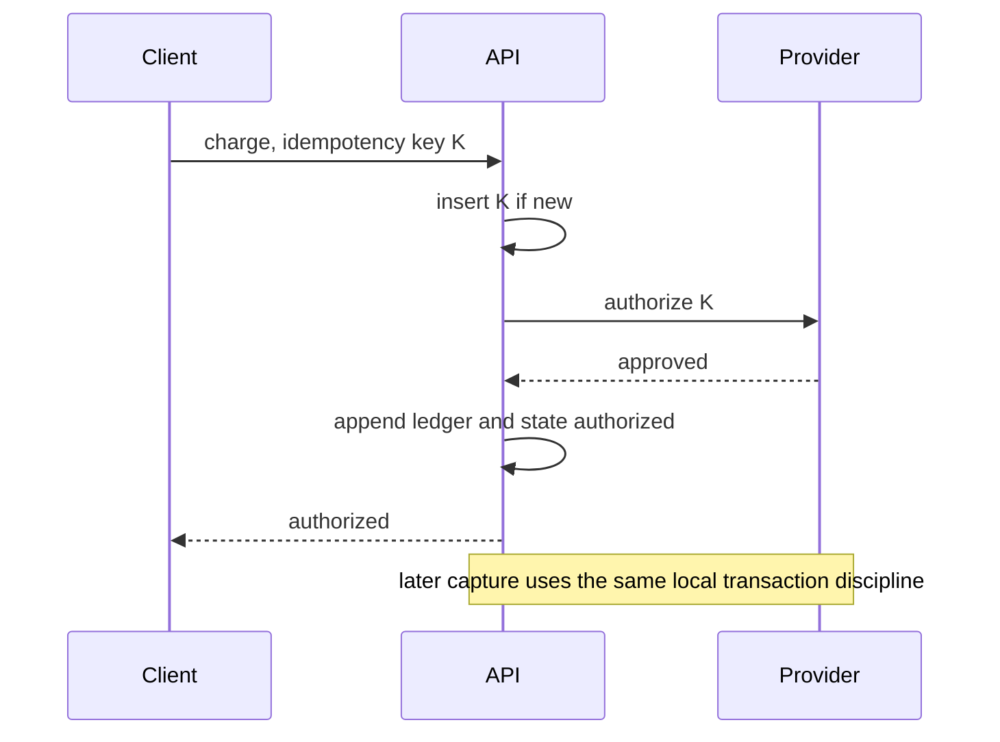

## Why this matters

Payments interviews separate engineers who have moved money from engineers who have stored a status column. You need an idempotency key, a ledger that does not lose a cent to a retry, a distinction between authorize and capture, and a webhook path that might arrive twice or before your database commits. You also need to say what you do not store. A design that keeps raw card numbers in your database because it was convenient is a failed design even if the diagram is pretty.

## Intuition

A payment is not a boolean. It is a story: we asked the bank to reserve the money, the bank agreed, later we took it, and every one of those moments is a line in a book that must add up. If the customer clicks twice, both clicks refer to the same story, not two stories. The bank may also call you later to say the story changed (a chargeback). Your book records that as a new line. You do not erase the old line.

## Core concept in depth

### Requirements

Functional:

- Charge a customer for an order once.
- Support authorize, then capture, and void or refund.
- Show a history that explains the balance.
- Accept asynchronous results from the payment provider.
- Let support see why a charge failed without seeing the full card number.

Non-functional:

- No double charge under retries, timeouts, or duplicate clicks.
- Strong consistency for a single account's ledger. Availability gives way to refusing a charge when you cannot append safely.
- p99 for the synchronous authorize call depends on the provider; your overhead should be small, and you need a timeout that does not strand an unknown outcome.
- PCI scope stays as small as possible. Prefer the provider's tokenization.

Out of scope: building a card network, full tax logic, and marketplace split payouts beyond a mention of separate ledger accounts.

### Capacity

Assumptions: 2 million successful charges per day, a few times that in attempts, peak 10× average during a sale.

| Quantity | Estimate |
| --- | --- |
| Average attempts | a few hundred per second if many attempts fail or are abandoned; size from the interviewer's number |
| Successful captures | 2e6 / 1e5 = about 20 per second average, about 200 per second at a 10× peak |
| Ledger rows | a handful per charge (authorize, capture, fee, refund), so tens of rows per second average |
| This is not a million-QPS problem | It is a correctness problem. A single partitioned ledger by account id is enough until you are a very large processor |

Say this so you do not shard away the consistency you need. Partition by merchant or account when one primary is actually hot, and keep one account's lines on one partition so the balance fold does not cross shards.

### Tokens, not PANs

The client sends the card to the provider (or to a provider-hosted field) and your server receives a token. You store the token, brand, last four, and expiry month. You do not store the PAN or CVV. That choice is the PCI story. Encryption of a PAN you did not have to store is the wrong control.

### Idempotency

The client sends `Idempotency-Key` on create. You store the key, the request hash, and the response. A retry with the same key and the same body returns the same response and does not call the provider again. The same key with a different body is a 409, not a second charge. The key is unique per merchant, and you keep it longer than any client retry window (days, not seconds).

If you time out **after** calling the provider and you do not know the result, you do not blindly call again. You look up by your idempotency key or by the provider's idempotency support. Your row stays `unknown` until a webhook or a reconcile job resolves it. An unknown outcome is a first-class state.

### Ledger

Use **double-entry** bookkeeping. Every movement is two postings that sum to zero: debit one account, credit another. Accounts include customer receivable, provider clearing, merchant payable, and fees. A capture posts from clearing to merchant payable (simplified). A refund posts the reverse. The balance of an account is the fold of its postings, and a transaction id groups the pair.

You never update a posting. You append a correcting posting. That is how you survive bugs and audits. A `status` column on the payment is a convenience projection of the ledger plus provider state, not the source of truth.

Optimistic concurrency: append postings only if the account version matches, so two captures cannot both run from the same authorized amount.

### State machine

`created`, `authorizing`, `authorized`, `capturing`, `captured`, `voided`, `refunded`, `failed`, `unknown`.

- **Authorize** reserves funds. It is not money you have taken. It can expire.
- **Capture** takes the money, fully or partially, up to the authorized amount.
- **Void** releases an authorization that was not captured.
- **Refund** moves captured money back, partially or fully, as new postings.

Do not jump from `created` to `captured` in the database because the provider's API returned 200, unless you have recorded the ledger lines in the same local transaction as the state change. Order: call provider when needed, then commit local ledger and new state together. If the local commit fails after the provider succeeded, you are in `unknown` and reconciliation repairs it. The outbox pattern publishes "payment captured" to the rest of the company only after that commit.

### Webhooks

Providers retry webhooks. Verify the signature (HMAC over the raw body with the provider secret). Deduplicate on the provider event id. Apply the event only if it is a legal transition: a `captured` event after you are already `captured` is a no-op success, not a second ledger entry. A `captured` event you have never seen, while your row is `unknown`, appends the ledger once.

Respond 2xx only after you have stored the event. If you respond first and then crash, the provider will not retry and you may never apply it. If processing is slow, store the event and ack, then process asynchronously, still idempotently.

### Reconciliation

A daily job compares provider reports to your ledger. Mismatches become cases, not silent overwrites. This job is how you sleep. Mention it.

### Failure and the user

If authorization is declined, return a clear failure and do not leave an open unknown. If the provider times out, show "processing" and resolve via webhook, or return a retryable error only when you know the provider did not receive the call. The idempotency key makes the client's retry safe in that second case.

Fraud checks can run before authorize. If they are down, decide the policy: fail closed for card-not-present is a common choice. Do not skip the check because the queue is long and then discover you have no ledger of the decision.

## Diagram





### Dry-run: timeout and a duplicate click

| Event | Provider | Ledger | Response |
| --- | --- | --- | --- |
| First request, key K | authorize called | row in authorizing |  |
| Timeout, outcome unknown | maybe charged | state unknown, no second call | "processing" |
| Webhook says approved, event id E |  | one authorize posting, state authorized | client polls and sees it |
| Webhook E retried |  | no new posting | 200 no-op |
| Client retries key K | not called again | unchanged | same payment id |
| Client sends key K with a different amount | not called | unchanged | 409 |

The dangerous row is the timeout. The design's job is to make that row boring.

## Runnable Python

```python
def apply_capture(state: str, authorized: int, capture_amount: int, postings: list[tuple[str, str, int]]) -> str:
    if state == "captured":
        return "idempotent-ok"
    if state != "authorized":
        return "illegal-state"
    if capture_amount > authorized or capture_amount <= 0:
        return "bad-amount"
    # Debit clearing, credit merchant. Amounts in minor units.
    postings.append(("clearing", "debit", capture_amount))
    postings.append(("merchant_payable", "credit", capture_amount))
    return "captured"


if __name__ == "__main__":
    book: list[tuple[str, str, int]] = []
    print(apply_capture("authorized", 5000, 5000, book))
    print(apply_capture("captured", 5000, 5000, book))
    print(book)
    print("balanced", sum(a if side == "credit" else -a for _, side, a in book) == 0)
```

The first call appends a balanced pair and would move the state to captured. The second call, already captured, does not append again. That is the webhook retry and the double-click, expressed as a pure function. The balance check sums credits and debits to zero, which is the invariant you can assert in a test on every transaction. Production code does this inside a database transaction with an expected version, in minor units (cents), never in floating point. Say "integer minor units" in the interview. Floats lose cents.

## Complexity / trade-off analysis

| Choice | Correctness | Cost |
| --- | --- | --- |
| Idempotency key stored with the response | Safe client retries | Storage and a 409 rule for mismatched bodies |
| Unknown state plus reconcile | No blind double charge | Slower UX, a reconciliation job |
| Double-entry append-only | Auditable, fixes are new lines | More rows, discipline |
| Update a balance column in place | Simple reads | Lost updates and no history |
| Provider tokens | Small PCI scope | Provider lock-in and token migration |
| Store PAN "encrypted" | You can charge without the provider | You are in the expensive compliance bucket, often for no benefit |
| Webhook ack after persist | You do not lose events | Provider waits; must be fast or queued carefully |
| Synchronous capture inside the order DB | One transaction if it is the same database | Couples you to the provider latency and to one schema |

## Tricks, tips, patterns

- Tokenize cards. Store last four, not PAN, never CVV.
- Idempotency key on every create. Same key and same body returns the same payment.
- Timeouts become `unknown`, not a second authorize.
- Ledger is append-only double-entry in integer minor units. Status is a projection.
- Authorize and capture are different states. Refunds are new postings.
- Verify webhook signatures and dedupe event ids. Ack after you store the event.
- Publish to the rest of the company via outbox after the ledger commit.
- Reconcile against provider reports every day.
- Partition by account so one balance stays on one shard.

## Common mistakes and edge cases

- Using a boolean `paid` and a balance column updated with read-modify-write. Two captures both read the old balance.
- Floating-point money. You will be off by a cent and then by a dollar.
- Retrying a timed-out authorize with a new idempotency key. You just defeated your own scheme. The client must reuse the key.
- Acking a webhook before saving it.
- Treating a decline and a timeout as the same `failed` state. One is final. The other is not.
- Logging the full request from the provider, including secrets or PANs that should have been redacted.
- Refunding by editing the original posting. The audit trail is gone.
- Running fraud "best effort" with no record when the checker times out.

## Interview notes

Draw client, API, idempotency store, ledger, provider, and webhooks. Walk the timeout dry-run before anyone asks. Mention double-entry, minor units, and tokens. If they ask about marketplaces, add a payable account per seller and a payout job that appends payout postings; do not invent a second informal balance.

A close: "One charge is one idempotency key. Money moves only as balanced postings. If I do not know what the provider did, I record unknown and reconcile. I never store the card number."

## Practice problems

1. **Retry (easy).** The user's app retries a charge after a timeout using a new idempotency key. What bug did the client introduce, and what should it have sent?
2. **Webhook (medium).** You receive `payment.captured` twice with the same event id, and once a `payment.captured` for a payment you already refunded. What do you write the second time in each case?
3. **Ledger (medium).** An authorization of 50.00 is captured for 40.00 and later refunded 10.00. Which postings exist, and why is the captured amount not stored only as a mutated integer on one row?

Related: [Sagas](/lessons/sd-sagas), [Encryption and OWASP](/lessons/sd-encryption-owasp).

## Summary / cheat sheet

- Store provider tokens and last four. Do not store PAN or CVV.
- Idempotency keys make retries return the original payment. A body mismatch is a conflict.
- Unknown outcomes are explicit. Do not fire a second authorize to "see what happens."
- The ledger is append-only double-entry in integer minor units. Balances are folds. Corrections are new lines.
- Authorize, capture, void, and refund are different transitions with legal edges.
- Webhooks are signed, deduped, and acknowledged after they are durable.
- Outbox the fact to the rest of the platform after the local commit.
- Reconcile with the provider daily. Partition by account, not by a random guess, so a balance stays consistent.

## Further reading

- [Stripe API idempotency](https://docs.stripe.com/api/idempotent_requests)
- [PCI DSS high-level overview](https://www.pcisecuritystandards.org/standards/pci-dss/)
- [Martin Fowler, Ledger](https://martinfowler.com/eaaDev/AccountingNarrative.html)
- [OWASP secrets and crypto cheat sheets](https://cheatsheetseries.owasp.org/)
