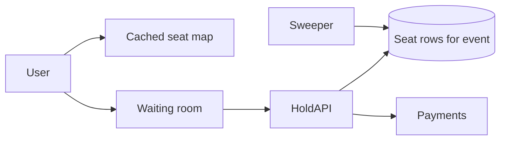
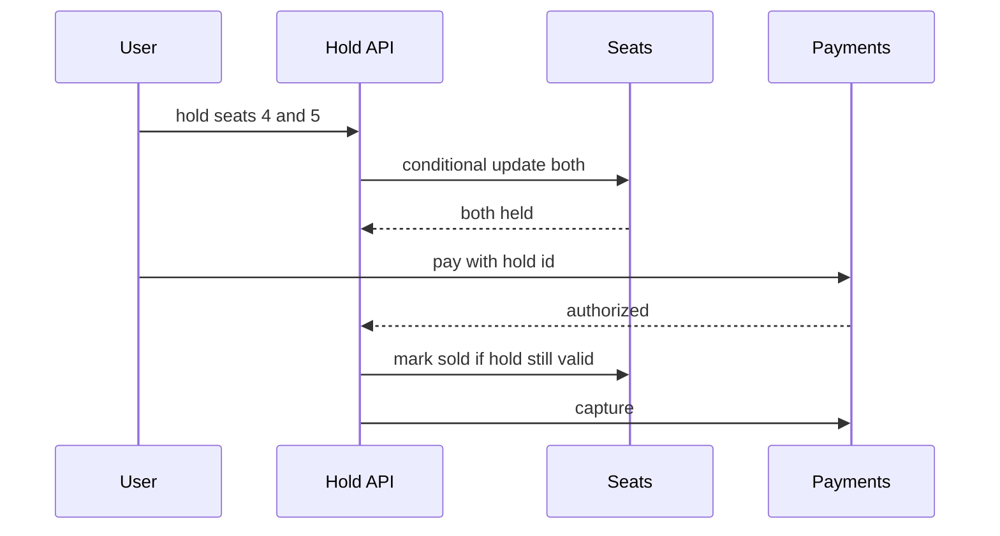

## Why this matters

Ticket booking is the interview for concurrency. The map of seats is easy to draw and brutal to get right when ten thousand people click one row at once. You need a hold with an expiry, a conditional write so two buyers cannot take the same seat, and a payment step that either confirms the hold or gives the seat back. Caching the seat map without a plan will sell the same seat twice or hide available seats.

## Intuition

A seat is a coat check with one ticket. A hold is the attendant setting the coat aside for five minutes while you pay. If you pay, the coat is yours. If you walk away, the attendant puts it back when the timer rings, even if you are still standing at the register arguing with your wallet. Two people cannot both have the coat set aside. Looking at a photo of the rack from a minute ago is not the same as asking the attendant.

## Core concept in depth

### Requirements

Functional:

- Browse an event's seat map and prices.
- Hold specific seats for a few minutes while paying.
- Confirm the booking and take payment, or release the seats.
- Prevent two confirmed bookings for one seat.
- Allow the user to see their booking.

Non-functional:

- A popular on-sale must not double-sell. Correctness beats availability for the confirm step.
- Browse can be slightly stale (a second or two) and must stay up.
- Hold expiry is reliable even if the user's browser dies.
- p99 for a hold attempt under a few hundred milliseconds when the row is not hot; a hot row will queue and some users will lose. Say that.

Out of scope: a full recommendation of events, scalper fraud beyond a mention, and assigned-seat algorithms for "best available" except as an extension.

### Capacity

Assumptions: a big on-sale, 50,000 people hitting one event, 2,000 seats, the sale starts at a single second. Browse QPS can spike to tens of thousands. Confirms are at most 2,000 successes, plus failed attempts.

| Quantity | Estimate |
| --- | --- |
| Seat rows | 2,000 for this event, trivial storage |
| Browse QPS | tens of thousands, cache the map |
| Hold attempts | burst of many per seat, serialized on that seat's row |
| Successful bookings | at most one per seat |
| The bottleneck | lock contention on hot seat rows, and the payment provider, not disk capacity |

This capacity table tells you not to shard the seats of one event across machines in a way that makes a hold of two adjacent seats a distributed transaction. Keep one event's seats in one database partition. Shard by event id so different events scale out.

### Seat state

Each seat row: `event_id`, `seat_id`, `status` (`free`, `held`, `sold`), `hold_id`, `hold_expires_at`, `version`.

**Hold:** `UPDATE seat SET status = held, hold_id = ?, expires = ? WHERE seat_id = ? AND status = free`. If the update count is 1, the user has the hold. If 0, someone else does. Do this for all requested seats in **one transaction** so you never hold 2 of 4 seats and charge for a broken set. If any seat fails, roll the transaction back and tell the user which seats are gone.

**Confirm:** update the seat to sold where the hold id matches, the status is still held, and the expiry is still in the future. Then take payment, or take payment and then confirm, but pick an order with a compensation. Preferred order: hold, authorize payment, mark sold, capture. If mark sold fails because the hold expired, void the authorization. If capture fails after sold, retry capture; do not unsell a confirmed ticket automatically while the customer is walking into the venue. That last policy should be said explicitly.

**Expiry:** a sweeper every few seconds sets status back to free and clears the hold id where status is held and the expiry is in the past. Also check expiry on read so a late sweeper does not show a dead hold as taken longer than one sweep interval. The sweeper is required because the user's browser will not call you back.

### Seat map read model

The interactive map can be served from a cache or a replica, updated by a short TTL or by publishing seat-status changes. It will be wrong by a moment. The hold request hits the primary and is the authority. If the map said free and the hold fails, the client refreshes. Do not confirm a purchase off the cached map.

For a huge on-sale, put the browse path on a CDN or cache and funnel holds through a queue or a token so you do not open 50,000 database transactions at once. A **waiting-room token** (you may attempt a hold only if you hold a token issued at a controlled rate) protects the primary. This is fairness and survival, and users understand a queue better than a timeout storm.

### Payments saga

1. Create hold transaction. Return `hold_id` and expiry to the client.
2. Client pays with idempotency key `hold_id`.
3. On authorization success, conditional sell.
4. On sell success, capture.
5. On authorization decline, release the hold immediately (do not wait for the sweeper).
6. On expiry during payment, void and ask the user to pick again.

Every step is idempotent on `hold_id`. A double click on pay returns the same booking.

### Best available, if asked

"Best available" is a query that picks N free seats in one section under a lock or with a conditional update of those ids. It is still one transaction inside the event partition. Do not lock the whole venue. Lock the candidate rows in a stable id order to avoid deadlocks when two buyers try overlapping sets.

### Abuse

Bots will hold every seat and let them expire, which is a denial of inventory. Mitigate with per-user hold caps, shorter holds, and the waiting-room token. Mention it. Do not pretend it is solved by a CAPTCHA alone.

## Diagram





### Dry-run: two buyers, one seat, one expiry

| Step | Buyer A | Buyer B | Seat row |
| --- | --- | --- | --- |
| Both see cached free |  |  | free |
| A holds | update count 1 |  | held by A until T+5 min |
| B holds |  | update count 0 | still A |
| A pays in time | sold |  | sold |
| Alternate: A never returns |  |  | sweeper sets free after expiry |
| B retries after sweep |  | hold succeeds | held by B |

The cache was allowed to be stale. The conditional update was not.

## Runnable Python

```python
def hold(seats: dict, wanted: list[str], hold_id: str, now: int, ttl: int) -> bool:
    if any(seats[s]["status"] != "free" for s in wanted):
        return False
    for seat_id in wanted:
        seats[seat_id] = {"status": "held", "hold": hold_id, "expires": now + ttl}
    return True


def confirm(seats: dict, hold_id: str, now: int) -> bool:
    mine = [sid for sid, row in seats.items() if row.get("hold") == hold_id]
    if not mine:
        return False
    if any(seats[sid]["expires"] <= now or seats[sid]["status"] != "held" for sid in mine):
        return False
    for sid in mine:
        seats[sid] = {"status": "sold", "hold": hold_id, "expires": None}
    return True


if __name__ == "__main__":
    seats = {sid: {"status": "free"} for sid in ("A1", "A2")}
    print("A holds", hold(seats, ["A1", "A2"], "h1", now=0, ttl=300))
    print("B holds", hold(seats, ["A2"], "h2", now=10, ttl=300))
    print("confirm", confirm(seats, "h1", now=100))
    print(seats["A1"]["status"], seats["A2"]["status"])
```

Buyer A takes both seats in one function call, which stands in for one transaction. Buyer B fails because A2 is not free. Confirm before expiry flips both to sold. If you called `confirm` with `now=400`, it would fail and the sweeper would have to free them. The real SQL must do the check and the update in one statement so two confirms cannot both pass. The Python version is single-threaded; say that, and point at `WHERE status = free` as the translation.

A partial hold is intentionally impossible here: if A2 were taken, A would not keep A1. That all-or-nothing rule is what users need when they pick a pair.

## Complexity / trade-off analysis

| Choice | Double-sell risk | User experience |
| --- | --- | --- |
| Conditional hold in one transaction | Low, this is the design | Some users get "seat gone" after a stale map |
| Check the cache then insert | High | Looks fine until the on-sale |
| Long holds | Low during the hold | Inventory appears sold out while abandoned |
| Very short holds | Frees seats quickly | Payment page times out unfairly |
| Waiting room | Protects the database | People wait, which is honest |
| Shard seats of one event by row | Spreads load | A multi-seat hold becomes a saga; avoid |
| Authorize after sold | Simple if payment never fails | You sold a seat you may not get paid for; have a retry |
| Sold only after capture | Money is certain | Hold may expire during capture; void carefully |

## Tricks, tips, patterns

- One event's seats live in one partition. Shard by event, not by seat, for the hot on-sale of a single show you may still need a queue in front.
- Hold with a conditional update of every requested seat in one transaction.
- Always set an expiry. Run a sweeper. Check expiry on confirm.
- The seat map is a cache. The hold API is the authority.
- Pay with idempotency key equal to the hold id.
- Release immediately on payment decline. Do not wait for the sweeper.
- A waiting-room token smooths the thundering herd.
- Cap holds per user so bots cannot freeze the venue.

## Common mistakes and edge cases

- `SELECT` then `INSERT` with a gap. Two buyers both saw free.
- Holding three of four seats and charging anyway. Make the hold atomic across the set.
- No sweeper. Abandoned checkouts lock the best seats until the event starts.
- Confirming based on the cached map without the conditional sold update.
- A payment retry that creates a second booking because the idempotency key was a random UUID per click.
- Deadlock from locking seat rows in different orders. Lock by seat id order.
- CDN caching the seat map for minutes during an on-sale. Stale is fine for a second, not for a minute, when the venue is small.

## Interview notes

Draw the seat row and the conditional update first. Then the expiry sweeper. Then payment as a saga that can void. Mention the cached map and the waiting room only after correctness is obvious. If they ask "what if the database dies?", a sold seat must not be forgotten: the seat partition is a real database with replication, not a cache. Holds can be lost and users will retry; sold rows cannot.

A close: "Browse is cached. Hold is a conditional update of the whole set in one transaction with a five-minute expiry. A sweeper frees abandoned holds. Confirm is conditional on the hold still being valid, and payment uses the hold id so retries do not double-charge or double-sell."

## Practice problems

1. **Race (easy).** Two transactions read seat A1 as free and both try to update it. What `WHERE` clause makes one of them update zero rows?
2. **Crash (medium).** The user paid, authorization succeeded, and your process died before marking the seat sold. The hold then expires. What state can the sweeper create, and how does reconciliation avoid charging without a ticket or a ticket without a charge?
3. **On-sale (medium).** Fifty thousand clients refresh the map at 10:00:00. What do you cache, and what do you put behind a waiting room so the primary stays up?

Related: [Sagas](/lessons/sd-sagas), [Payments](/lessons/sd-payments).

## Summary / cheat sheet

- Seats are rows with status free, held, or sold. One event stays in one partition.
- Hold is a conditional update of all requested seats in a single transaction, with an expiry.
- A sweeper releases expired holds. Decline releases them immediately.
- The map is a short-lived cache. Only the conditional write is authoritative.
- Confirm only if the hold is still valid. Payment is idempotent on the hold id.
- Authorize, then mark sold, then capture, with a void path if the hold died. Retry capture if sold and the provider blipped.
- A waiting room protects the on-sale. Per-user caps limit inventory freezing.
- Lock seat ids in order. Do not split one event's seats across databases.

## Further reading

- [PostgreSQL transaction isolation](https://www.postgresql.org/docs/current/transaction-iso.html)
- [Stripe idempotency](https://docs.stripe.com/api/idempotent_requests)
- [Sagas, Garcia-Molina and Salem](https://www.cs.cornell.edu/andru/cs711/2002fa/reading/sagas.pdf)
- [Kleppmann, Designing Data-Intensive Applications](https://dataintensive.net/)
