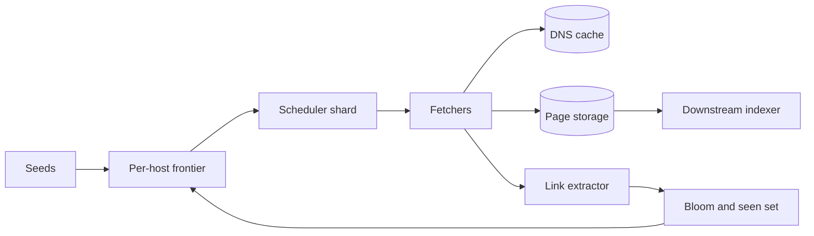
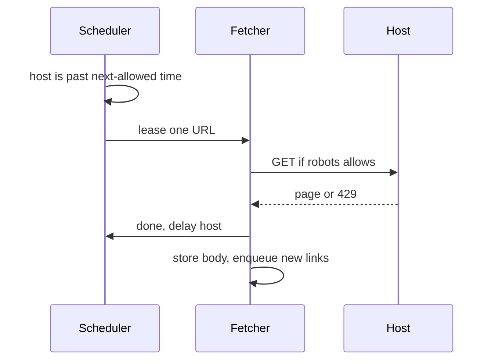

## Why this matters

A crawler is a distributed system whose bottleneck is not your CPU. It is other people's servers, DNS, and your own duplicate URL set. Interviewers want politeness, a frontier that does not hot-spot one domain, dedupe at web scale, and a clear line between fetching bytes and indexing them. A design that is a single queue of URLs will hammer one host and recrawl the same page forever.

## Intuition

You are a very large library sending clerks to read public bulletin boards. Each building (a host) allows only one clerk at a time, and the clerk must wait between visits and obey the sign on the door (`robots.txt`). The clerk writes down the page and the links, and does not go back if the library already has that exact note. The index, the card catalog the public searches, is built later from the notes. Fetching and cataloging are different jobs, or a slow cataloger will stall every clerk.

## Core concept in depth

### Requirements

Functional:

- Start from seed URLs, fetch pages, extract links, and continue.
- Obey `robots.txt` and a per-host rate limit.
- Do not fetch the same URL forever; recrawl on a schedule based on change rate.
- Store page content for a downstream indexer.
- Handle a large fraction of the public web, not a single site.

Non-functional:

- Politeness is a correctness constraint, not a nice-to-have. Getting blocked is a failed design.
- Fetch throughput scales by adding fetchers, limited by politeness and DNS.
- Dedupe must work across machines.
- A poison URL (huge page, slow host, redirect loop) must not stall the crawl.

Out of scope: building the search ranker. You hand documents to an indexer. Mention that boundary.

### Capacity

Assumptions: you want on the order of 1 billion fetches per day to start the interview math. That is about 1e9 / 1e5 = 10,000 fetches per second average. A page plus metadata averages 100 KB stored after you drop obvious junk, so about 100 TB/day before replication and compression. Compression on HTML helps a lot; say 3× to 10× and still plan object storage.

| Quantity | Estimate |
| --- | --- |
| Fetch rate | about 10,000 pages per second for this target |
| Per-host cap | for example 1 request every few seconds, so one host contributes a tiny fraction of QPS |
| Parallelism | tens of thousands of in-flight requests across many hosts |
| URL set | billions of seen URLs; a bloom filter plus a durable store |
| DNS | a cache is mandatory or DNS becomes the outage |

The politeness cap is why you cannot "just add threads" against one domain. Throughput comes from many hosts at once.

### URL frontier

The frontier is the to-do list. If it is one global FIFO, the first site with a million links occupies every worker and you violate politeness, or you check politeness so late that workers sit idle.

**Per-host queues** (or per-registrable-domain queues) are the fix. A scheduler picks hosts that are eligible now (their next-allowed time has passed and they have URLs) and hands one URL to a fetcher. Hosts are partitioned across scheduler shards by host hash so one shard owns the politeness clock for that host. Two shards must not both believe they may fetch `example.com`.

Priority: fresh seeds and sitemaps before infinite calendar URLs. A simple score (expected change rate, PageRank from the previous cycle, depth) keeps the crawl from drowning in low-value pages. Depth caps and URL pattern filters drop traps (`/calendar/2020/01/01` and friends).

### Politeness and robots

Before fetching a host, load `robots.txt`, cache it for its TTL or for a day, and refuse disallowed paths. Rate-limit even when robots is silent: a default delay, one or a few concurrent connections per host, and a backoff on 429 or 503. Identify the crawler with a user-agent and a contact URL. This is how you stay a guest.

Honor `Crawl-delay` when present. If a host is slow or erroring, increase the delay. Do not retry a 404. Do retry a connection reset a small number of times.

### Dedupe

Canonicalize before you enqueue: scheme and host lowercased, default ports removed, fragments removed, some query parameters dropped if you have a policy, and a decision about trailing slashes you apply consistently. Perfect canonicalization is impossible; be consistent.

**Seen URLs:** a bloom filter in front of a durable key store. The bloom filter says "definitely new" or "maybe seen." Maybe-seen checks the store. A false positive skips a URL you might have wanted; that is acceptable if the rate is low. A false negative recrawls. Size the filter for the URL count (about 10 bits per URL for roughly a 1 percent false-positive rate). At a billion URLs that is on the order of a gigabyte and up, sharded by URL hash.

Content dedupe is separate: hash the body and skip indexing a byte-identical page you already stored under another URL. That saves storage and index load. It does not replace URL dedupe.

### Fetch path

Fetchers are stateless workers. They DNS-resolve through a cache, fetch with a strict timeout and a max byte size, follow a limited number of redirects (and detect loops), and write the body to object storage. They emit a record: URL, status, content hash, links, fetch time. A parser extracts links and feeds the frontier. Parsing is a separate stage so a nasty HTML page cannot block the socket pool. Truncate enormous pages.

Use a head request or conditional GET (`If-Modified-Since` / `ETag`) on recrawl so unchanged pages are cheap. Store validators with the document.

### Recrawl

Not everything is fetched once. A scheduler puts URLs back on the frontier with a next-fetch time. Homepages of news sites return sooner than a static PDF. If the content hash did not change, lengthen the interval. If it changed, shorten it. Cap both ends.

### Politeness versus scale

Because each host queue is independent, adding fetcher capacity helps only if the scheduler has many eligible hosts. A crawl of one domain is politeness-bound. A crawl of the web is scheduler- and DNS-bound. Say which problem you are solving.

### Failure

A fetcher crash loses an in-flight URL; the frontier leases URLs with a visibility timeout and requeues them. A poison host that never responds is isolated by the timeout and a lowered rate, not by a global stall. Store the robots cache and the seen set durably enough that a process restart does not recrawl the world. The bloom filter can be rebuilt from the seen store; it is a cache of "no."

## Diagram





### Dry-run: one popular host and a duplicate link

| Event | Frontier | Fetcher behavior |
| --- | --- | --- |
| 100,000 URLs discovered on news.example | all in that host's queue | still one fetch at a time at the delay |
| Other hosts | their own queues | fetched in parallel, so total QPS stays high |
| news.example returns 429 |  | delay multiplies, URL retried later |
| Link already in the seen set | not enqueued | bloom or store says so |
| Page body matches an old hash |  | indexer can skip, recrawl interval grows |
| Fetcher dies mid-request | lease expires | URL returns to the host queue |

The news site does not consume the whole cluster, and a crash does not drop the URL.

## Runnable Python

```python
def allowed(url_path: str, disallowed_prefixes: list[str]) -> bool:
    return not any(url_path.startswith(prefix) for prefix in disallowed_prefixes)


def schedule(hosts: dict[str, dict], now: float) -> str | None:
    ready = [
        host
        for host, row in hosts.items()
        if row["next_ok"] <= now and row["queue"]
    ]
    if not ready:
        return None
    host = ready[0]
    url = row_url = hosts[host]["queue"].pop(0)
    hosts[host]["next_ok"] = now + hosts[host]["delay"]
    return host + url


if __name__ == "__main__":
    print("robots", allowed("/secret/a", ["/secret"]))
    print("public", allowed("/news/1", ["/secret"]))
    hosts = {
        "news.example": {"next_ok": 0, "delay": 2.0, "queue": ["/a", "/b"]},
        "other.example": {"next_ok": 0, "delay": 2.0, "queue": ["/z"]},
    }
    print(schedule(hosts, now=0))
    print(schedule(hosts, now=0))
    print("news next", hosts["news.example"]["next_ok"], "queue", hosts["news.example"]["queue"])
```

`allowed` is the robots check before a fetch. `schedule` will not pop a second URL from `news.example` at t = 0 if you call it twice, because `next_ok` moved forward; the second call should take `other.example` if it is ready. Walk the two prints: the first takes news `/a` and sets the host's next time to 2. The second takes the other host, leaving news `/b` queued. That is politeness with parallelism across hosts. A real scheduler picks fairly among thousands of ready hosts and owns each host on one shard.

## Complexity / trade-off analysis

| Choice | Politeness | Throughput | Cost |
| --- | --- | --- | --- |
| One global queue | Easy to violate | Looks high until one host dominates | Simple and wrong |
| Per-host queues and a clock | Strong | Scales with the number of eligible hosts | Scheduler shards to operate |
| Bloom plus exact store | n/a | Fast "definitely new" | False positives skip URLs; rebuild story |
| Exact store only | n/a | Every URL is a disk read | Too slow at the edge of the frontier |
| Store every byte forever | n/a | n/a | Disk; compress and set retention |
| Recrawl everything daily | Heavy on hosts | Waste | Use conditional GET and adaptive intervals |
| Ignore robots | Highest | You will be blocked and you are being rude | Not a real option |

## Tricks, tips, patterns

- Partition the frontier by host so one shard owns the politeness clock.
- Fetch many hosts in parallel, one host slowly.
- Cache robots and DNS. Time out fetches. Cap bytes and redirects.
- Canonicalize URLs before dedupe. Bloom filter in front of a durable seen set.
- Separate fetch, parse, and index. A bad page stalls only its stage.
- Lease URLs so crashes retry. Back off hosts that 429.
- Adaptive recrawl with conditional GET. Depth and pattern limits against traps.
- Content hashes stop the indexer from repeating identical bodies.

## Common mistakes and edge cases

- A thread pool pointed at one domain's links. You DDoS the site and get banned. Politeness is the design.
- Dedupe only inside one process. The same URL is fetched by every node.
- Following redirects without a hop limit. A loop occupies a worker forever.
- Downloading a 10 GB file into memory because you forgot a max size.
- Treating a bloom "maybe" as "definitely new" and skipping the exact check, or the reverse, treating "maybe" as "skip" without sizing the false-positive rate. Know which error you chose.
- Recrawling on a fixed short interval with no `If-Modified-Since`. You waste your budget and theirs.
- Parsing HTML on the fetcher thread and letting one page's entity expansion exhaust the process. Cap parser work.
- Ignoring `robots.txt` disallow for `/` and then being surprised the rest of the design never runs.

## Interview notes

Draw per-host queues, a scheduler that enforces the next-allowed time, fetchers, object storage, and a dedupe step before enqueue. State the default delay and what a 429 does. Mention robots caching and DNS caching. Separate the indexer as a downstream consumer of stored pages.

If they ask "how many machines?", go back to 10,000 fetches per second, politeness, and the fact that CPU is rarely the first limit. DNS, sockets, and the seen-set QPS are the limits to name.

## Practice problems

1. **Politeness (easy).** You have 500 threads and 2 million URLs, 90 percent of them on one host. What happens with one global queue, and what does a per-host scheduler change?
2. **Dedupe (medium).** A billion URLs and a bloom filter at about 10 bits per URL. How much RAM is that, roughly, and what do you do on a "maybe present" answer?
3. **Trap (medium).** A site generates a new calendar URL on every page. How do you stop the frontier from filling with it, and what did you give up?

Related: [Queues and Kafka](/lessons/sd-queues-kafka), [Consistent hashing and bloom filters](/lessons/sd-consistent-hashing-bloom-filters).

## Summary / cheat sheet

- A crawler is politeness-bound per host and throughput-bound across hosts.
- The frontier is per-host queues owned by scheduler shards that keep the next-allowed clock.
- Obey robots.txt, cache it, back off on 429, and use a default delay anyway.
- Canonicalize, then dedupe with a bloom filter and a durable seen set.
- Fetch with timeouts, size caps, and limited redirects. Store bodies in object storage.
- Parse and index in later stages. Leases retry crashed fetches.
- Recrawl adaptively with conditional GET. Filter infinite URL traps.
- The indexer is a consumer, not part of the fetch loop.

## Further reading

- [RFC 9309 Robots Exclusion Protocol](https://www.rfc-editor.org/rfc/rfc9309)
- [Mercator: a scalable, extensible web crawler](https://www.microsoft.com/en-us/research/wp-content/uploads/2009/08/www99-web.pdf)
- [Bloom filter sizing](https://en.wikipedia.org/wiki/Bloom_filter)
- [Kleppmann, Designing Data-Intensive Applications](https://dataintensive.net/)
