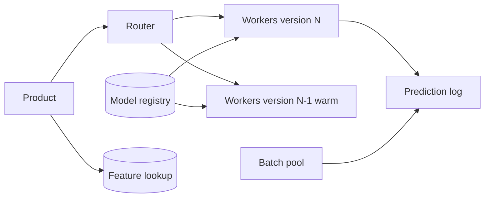
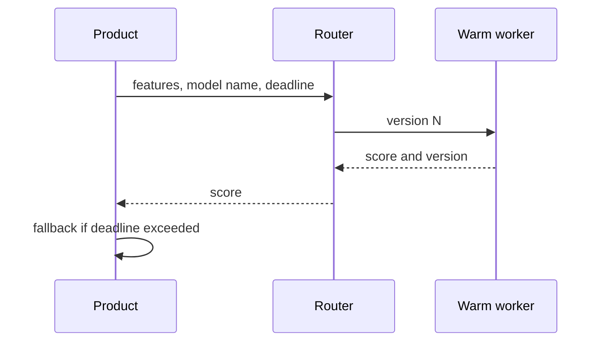

## Why this matters

An inference platform is a serving system with unusual artifacts: models are large, cold starts are slow, predictions must be tied to a version, and a bad rollout is a product incident rather than a crash. Interviewers want the online versus batch split, how you load a model without dropping traffic, how features get to the model in time, and how you roll back. They are not asking you to invent a neural network.

## Intuition

A model is a factory machine that turns a form (features) into a decision. The machine is heavy, so you do not ship it to every request process from scratch. You keep a few machines hot, you feed them forms that look like the forms they were trained on, and you label every decision with which machine made it. When a new machine arrives, you let it handle a trickle of forms before you trust it with the line. Batch work is the night shift: a pile of forms, no one waiting at the counter, throughput over latency.

## Core concept in depth

### Requirements

Functional:

- Online predictions for a product path (fraud score, ranking, classification) with a latency budget.
- Batch predictions over a dataset for jobs that can wait.
- Register a model version built elsewhere (training is out of scope except for the artifact contract).
- Route a fraction of traffic to a candidate version. Roll back quickly.
- Log inputs, outputs, and version for later analysis, with a sampling policy.

Non-functional:

- Online p99 inside the product budget, often 20 to 100 ms for the model hop, which you must state.
- A bad version can be removed in minutes without a full redeploy of the product.
- Batch jobs must not steal the GPUs that online traffic needs, or online needs a reserved pool.
- The prediction for a request is reproducible given version and features.

Out of scope: training loops, feature science, and a novel model architecture. You consume a versioned artifact.

### Capacity

Assumptions: 5,000 online predictions per second peak, p99 budget 50 ms for the model call, one GPU worker sustains 100 predictions per second of this model at the latency SLO (a number you would measure; state it as an assumption). Batch: 50 million rows overnight.

| Quantity | Estimate |
| --- | --- |
| Online workers | 5,000 / 100 = 50 at the measured rate, plus headroom, so about 70 |
| If one zone dies | those 70 must exist across zones, not in one failure domain |
| Batch | 50e6 rows at 200 per GPU-second is a different pool or a night window on spot capacity |
| Artifact size | a 2 GB model that takes 30 seconds to load changes every deploy plan |
| Logging | 5,000 full payloads per second is a lot; sample or log features by reference |

The 30-second load is why you do not scale from zero on the user path, and why a rolling restart has to be slow enough that capacity remains.

### Artifacts and versions

A model registry stores an immutable artifact: id, version, framework, feature schema, metrics from validation, and the object-storage URL. A version moves from `staged` to `production` by a pointer the router reads, not by overwriting the file. Old versions stay until you no longer need rollback or audit.

The feature schema is a contract. If the model expects `amount_cents` and the server sends `amount`, you fail the rollout in validation, not in production at 2 a.m.

### Online path

1. The product service builds a feature vector from the request and from a feature store (or joins them).
2. It calls the inference router with the model name and the vector.
3. The router picks a version (primary, or an experiment assignment sticky on user id).
4. A worker that already has that version loaded runs the model.
5. The response includes the prediction and the version id. The product service decides the action. The model service does not charge cards or hide posts by itself if you want a clean blame line; either way, log the version with the decision.

**Timeouts.** The product has a deadline. If the model exceeds it, the product takes a fallback: a simpler rule, a cached score, or "no personalization." A missing fallback means the model is on the critical path for availability, and your SLO cannot exceed the model's SLO. Say which.

**Batching inside a worker.** Micro-batching a few milliseconds of requests raises GPU throughput and adds latency. Only do it if the budget allows a 5 ms wait. Do not copy a batch-training habit into a 20 ms online path without measuring.

### Loading and scale

Workers pull the artifact on start and on a version change, load it, then mark ready. Readiness must mean "model loaded and a warmup request succeeded," not "process started." A load balancer that sends traffic during the 30-second load produces a latency spike.

Autoscaling on GPU utilization or queue depth, with a minimum floor so you never scale to zero on the online pool. Scale-in drains. A new node is slow to become useful; scale on a leading signal (QPS) and keep headroom.

Separate **pools** per hardware need. A small CPU model should not sit in the GPU queue behind a large one. Separate pools for batch and online so a backfill cannot evict the online model from GPU memory.

### Rollout

Shadow traffic: send a copy of the features to the candidate, ignore the result for the user, compare offline. Then a small percentage sticky on user id. Watch a business metric and a quality metric (not just latency). Promote by moving the pointer. Rollback is moving the pointer back, which is fast only if the previous version is still loaded on the fleet or can be loaded quickly. Keep the last version warm during a rollout.

### Batch path

A job reads a table, writes features, runs the same artifact on a batch pool, and writes predictions with the version id. It is idempotent per `(job_id, row_id)` so a retry does not double-publish. Batch can use larger batches and spot capacity. It must not share an unbounded queue with online requests.

### Logging and drift

Log version, a hash or id of the features, the prediction, and the request id. Sample full payloads if they are large or sensitive. Labels (did the user click, was it fraud) arrive later and join on the request id. That join is how you know the model decayed. The platform's job is to make the join possible, not to invent the metric.

Redact or avoid sensitive raw features in logs. A fraud model that logs full card numbers is a security incident.

### Consistency of features

Online features and training features that differ are training-serving skew, and the model looks "randomly bad." The platform should serve features from the same definitions the trainer used (a feature store with point-in-time correctness for training, and a low-latency lookup online). Mention skew even if you do not design the whole store. A cache in front of feature lookups needs a TTL short enough that a stale balance is acceptable for the product.

## Diagram





### Dry-run: rollout and a slow version

| Step | Traffic | What you watch | Action |
| --- | --- | --- | --- |
| Candidate loaded, not ready | 0 percent | warmup errors | do not send users |
| Shadow | copy only | disagreement rate | fix or abort |
| 5 percent sticky | users on the candidate | latency, error, business metric | hold |
| p99 doubles | 5 percent | timeout rate in the product | rollback pointer to N-1, which is still warm |
| Promote | 100 percent | same metrics | keep N-1 loaded until the window passes |

Rollback is a pointer move because you refused to unload the last version. That is the operational trick.

## Runnable Python

```python
def route(user_id: str, primary: str, candidate: str | None, percent: int) -> str:
    if candidate is None or percent <= 0:
        return primary
    bucket = sum(ord(ch) for ch in user_id) % 100
    if bucket < percent:
        return candidate
    return primary


def fallback(score: float | None, deadline_exceeded: bool) -> str:
    if deadline_exceeded or score is None:
        return "rules"
    return "model"


if __name__ == "__main__":
    print(route("user-42", "v3", "v4", percent=5))
    print(route("user-42", "v3", "v4", percent=5))
    print(fallback(None, deadline_exceeded=True))
    print(fallback(0.2, deadline_exceeded=False))
```

`route` is sticky: the same user id always lands in the same bucket, so a person does not flip between model versions on every request. Call it twice and show the bucket is stable. Five percent means buckets 0 through 4 see the candidate. `fallback` is the product behavior when the model misses the deadline: a deterministic rule, not an error page, if the product can tolerate a coarser decision. If the product cannot tolerate it, the model pool's availability is the product's availability and you staff it that way.

## Complexity / trade-off analysis

| Choice | Latency | Safety | Cost |
| --- | --- | --- | --- |
| Always-on warm workers | Predictable | Rollback can be warm | Idle GPUs |
| Scale to zero | Cheap when quiet | Cold start blows the SLO | Bad for online |
| Micro-batching | Worse p99, better throughput | None | Helps GPU utilization |
| Shared GPU pool for batch and online | Higher utilization | Batch can crowd out users | Need strict priority or separate pools |
| Shadow then percent | Extra cost for the copy | Catches bad versions | Router complexity |
| Log every raw feature | Best debugging | Privacy and volume | Sample instead |
| Fallback rule | Product stays up | Some requests are lower quality | Must be tested |
| Feature store lookup on the path | Fresher features | Extra dependency | Cache with a TTL and a deadline |

## Tricks, tips, patterns

- Immutable versioned artifacts and a router pointer. Do not overwrite the model file in place.
- Readiness means the model is loaded and warmed.
- Keep the previous version warm during rollout so rollback is a pointer, not a 30-second load.
- Separate online and batch pools. Floor the online capacity.
- Return the version id with every prediction. Log it with the request id.
- Timeouts and a product fallback. Do not let a slow model pin product threads.
- Sticky assignment for experiments. Shadow before you expose users.
- Same feature definitions in training and serving, or say you accept skew.

## Common mistakes and edge cases

- Deploying a model by copying a file onto a box that is already taking traffic, with no version in the response. You cannot tell who saw the bad model.
- Autoscaling from zero on a 2 GB model in a 50 ms path.
- One GPU cluster where the nightly batch evicts the online model.
- No fallback, and a model timeout that becomes a product outage.
- Logging raw sensitive features at full QPS.
- A feature joined "whatever is in the database now" for training and "whatever was cached" online, then a week of arguing that the model is mysteriously worse.
- Rollback that requires a container rebuild. You will miss the incident window.
- Non-sticky experiments that flicker the user between two rankings every request.

## Interview notes

Split online and batch in the first minute. Draw the registry, the router, warm workers, and the product fallback. Give the capacity assumption (predictions per second per worker) so the fleet size is earned. Walk the bad-version rollback using a warm previous version. Mention feature schema and training-serving skew at least once.

If they ask about GPUs versus CPUs, say you place the model on the hardware that meets the latency at the cheapest measured cost, and you do not share that pool with bulk jobs.

## Practice problems

1. **Fleet (easy).** Peak is 2,000 predictions per second and one worker safely does 80 at your latency SLO. How many workers do you run with about 40 percent headroom, and why not the bare minimum?
2. **Rollback (medium).** Version 9 is loaded and version 8 is still in memory. Version 9's p99 is 400 ms against a 50 ms budget. What do you change, and what must already be true for that change to be fast?
3. **Batch versus online (medium).** A backfill of 100 million rows is submitted to the same queue as user-facing scores. What fails, and how do you isolate it?

Related: [Latency and throughput](/lessons/sd-latency-throughput), [Observability](/lessons/sd-observability).

## Summary / cheat sheet

- Online inference is a latency path with warm workers. Batch is a throughput path on a separate pool.
- Models are immutable versions in a registry. The router points at a version.
- Readiness includes load and warmup. Do not scale the online path to zero if load takes seconds.
- Keep the last version warm so rollback is a pointer move.
- Shadow, then sticky percent, then promote. Watch business and latency metrics.
- Every response carries the version. Logs join to labels later. Sample sensitive payloads.
- The product has a deadline and a fallback, or the model SLO is the product SLO.
- Feature contracts must match training. Skew is a platform concern, not only a modeling one.

## Further reading

- [Google, Hidden Technical Debt in Machine Learning Systems](https://research.google/pubs/hidden-technical-debt-in-machine-learning-systems/)
- [NVIDIA Triton Inference Server](https://developer.nvidia.com/triton-inference-server)
- [AWS SageMaker inference](https://docs.aws.amazon.com/sagemaker/latest/dg/deploy-model.html)
- [Kleppmann, Designing Data-Intensive Applications](https://dataintensive.net/)
- [OpenTelemetry documentation](https://opentelemetry.io/docs/)
