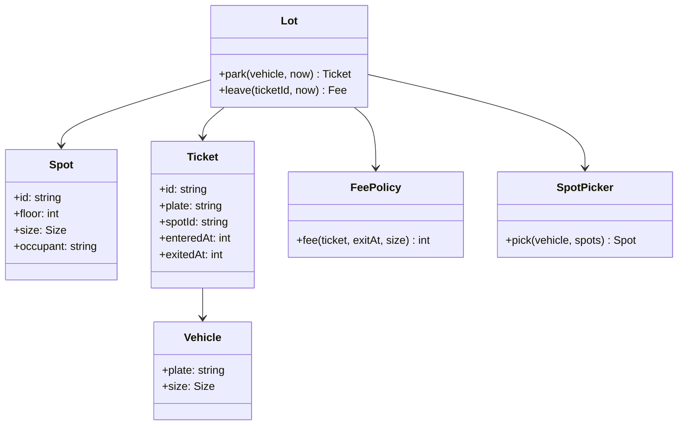

## Why this matters

The parking lot is the default low-level design screen. Interviewers use it to see whether you invent fifty classes or whether you name the nouns that protect an invariant: a spot is occupied by at most one vehicle, a ticket is the record of that stay, and pricing can change without rewriting parking. They also listen for how you test it without a database. This is an object model, not a distributed system, unless the interviewer explicitly adds multiple gates and shared storage.

## Intuition

A lot is a set of marked spaces and a clerk. The clerk does not memorize every car in town. The clerk knows which spaces are free, hands you a ticket when you park, and charges you from the ticket when you leave. A motorcycle should not be offered a bus space if a motorcycle space exists, but the rule "who may stand where" is a policy you can swap, not a pile of `if` statements copied into the gate, the payment kiosk, and the admin tool.

## Core concept in depth

### Requirements to pin down first

Ask, then assume if the interviewer shrugs:

- One lot, many floors, many spots. Spot types: motorcycle, compact, large.
- A vehicle parks in a spot of a compatible type. Large spots can take smaller vehicles only if you say so. This design allows a vehicle to take its size or larger, to keep the lot usable when small spots are gone.
- One vehicle occupies at most one spot. One spot holds at most one vehicle.
- Entrance issues a ticket. Exit computes a fee from entry and exit time and frees the spot.
- Fees depend on vehicle type and duration. No payments network unless asked. The fee calculator returns money; a `Payment` port can charge it later.

Out of scope until asked: reservations, EV charging, multiple gates with concurrency across processes. If they add concurrency, spots are claimed with a conditional update in whatever store you have; the in-memory model still shows the invariant.

### Types that earn their keep

**Vehicle** is a value with a plate and a size. Plates are the identity. Two calls with the same plate are the same vehicle.

**Spot** is an entity: id, floor, type, and either empty or holding a plate. It does not compute fees.

**Ticket** is an entity: id, plate, spot id, entry time, and optional exit time and fee. A ticket is open until exit.

**Lot** is the aggregate. It owns spots and open tickets. `park` and `leave` are methods on the lot (or on a `ParkingService` that is the only writer). Callers do not set `spot.occupied = true` from the gate controller. If they can, the invariant will be skipped by the next feature.

**FeePolicy** is a strategy interface: given a ticket and an exit time, return a fee. The first implementation is a rate card per size. A weekend policy can replace it without touching `Lot`.

**SpotPicker** is a strategy: given the vehicle and the free spots, return a spot or nothing. Nearest-to-entrance and "smallest adequate spot" are different pickers. The lot calls the picker; it does not hard-code a scan in three places.

### Invariants

- `park` fails if the plate already has an open ticket.
- `park` fails if the picker finds nothing.
- A spot is assigned to the ticket and marked occupied in the same method. There is no moment in the model where the ticket exists and the spot is still free.
- `leave` fails if the ticket is already closed or unknown.
- `leave` frees the spot, stamps the exit, and stores the fee.
- Fees are never negative. Duration rounds up to the next hour in the sample policy so the boundary is testable.

### Concurrency, if they ask

Two gates can call `park` at once. In one process, a lock around `park` and `leave` is enough for the exercise. Across processes, the spot row needs a conditional write: free to occupied only if still free, and the ticket insert commits with it. Say that in one sentence and go back to the model. Do not redesign Uber.

### What not to model

Do not make a class hierarchy for every vehicle brand. Size is the only axis the lot needs. Do not make `Floor` a god object. A floor id on the spot is enough unless floors have different policies. Do not put `SQL` in `Lot`. A repository loads and saves the aggregate in tests as an in-memory map.

## Diagram



The diagram is the interview picture: `Lot` is the only type that changes spots and tickets together. Policies are replaceable. `Vehicle` is not a subclass explosion.

### Dry-run: park and leave

| Step | Open tickets | Spot L1 | Fee |
| --- | --- | --- | --- |
| Start | none | free, large |  |
| Park bus B1 at t=0 | ticket T1 | occupant B1 |  |
| Park B1 again | still one | unchanged | rejected, already parked |
| Park motorcycle at t=0 | fails if no free spot |  |  |
| Leave T1 at t=3 hours | ticket closed | free | 3 times the large rate |

If the motorcycle is allowed to use a large spot, a second scenario parks it after the bus leaves. The picker decides. The lot enforces "picker returned a spot that is free and big enough" so a buggy picker cannot break the invariant.

## Runnable Python

```python
from dataclasses import dataclass


SIZES = {"motorcycle": 1, "compact": 2, "large": 3}


@dataclass
class Vehicle:
    plate: str
    size: str


@dataclass
class Spot:
    spot_id: str
    size: str
    occupant: str | None = None


@dataclass
class Ticket:
    ticket_id: str
    plate: str
    spot_id: str
    size: str
    entered_at: int
    exited_at: int | None = None
    fee: int | None = None


class HourlyFee:
    def __init__(self, rates: dict[str, int]):
        self.rates = rates

    def fee(self, entered_at: int, exit_at: int, size: str) -> int:
        hours = max(1, (exit_at - entered_at + 3599) // 3600)
        return hours * self.rates[size]


class SmallestFit:
    def pick(self, vehicle: Vehicle, spots: list[Spot]) -> Spot | None:
        fits = [
            s
            for s in spots
            if s.occupant is None and SIZES[s.size] >= SIZES[vehicle.size]
        ]
        if not fits:
            return None
        return sorted(fits, key=lambda s: (SIZES[s.size], s.spot_id))[0]


class Lot:
    def __init__(self, spots: list[Spot], fees: HourlyFee, picker: SmallestFit):
        self.spots = {s.spot_id: s for s in spots}
        self.tickets: dict[str, Ticket] = {}
        self.open_by_plate: dict[str, str] = {}
        self.fees = fees
        self.picker = picker
        self._seq = 0

    def park(self, vehicle: Vehicle, now: int) -> Ticket:
        if vehicle.plate in self.open_by_plate:
            raise ValueError("already parked")
        spot = self.picker.pick(vehicle, list(self.spots.values()))
        if spot is None:
            raise ValueError("full")
        spot.occupant = vehicle.plate
        self._seq += 1
        ticket = Ticket(f"T{self._seq}", vehicle.plate, spot.spot_id, vehicle.size, now)
        self.tickets[ticket.ticket_id] = ticket
        self.open_by_plate[vehicle.plate] = ticket.ticket_id
        return ticket

    def leave(self, ticket_id: str, now: int) -> int:
        ticket = self.tickets[ticket_id]
        if ticket.exited_at is not None:
            raise ValueError("already closed")
        amount = self.fees.fee(ticket.entered_at, now, ticket.size)
        ticket.exited_at = now
        ticket.fee = amount
        self.spots[ticket.spot_id].occupant = None
        del self.open_by_plate[ticket.plate]
        return amount


if __name__ == "__main__":
    lot = Lot(
        [Spot("L1", "large"), Spot("M1", "motorcycle")],
        HourlyFee({"motorcycle": 10, "compact": 20, "large": 30}),
        SmallestFit(),
    )
    bus = Vehicle("B1", "large")
    ticket = lot.park(bus, now=0)
    print(ticket.ticket_id, ticket.spot_id)
    try:
        lot.park(bus, now=10)
    except ValueError as exc:
        print("second park", str(exc))
    print("fee", lot.leave(ticket.ticket_id, now=3 * 3600))
    print("spot free", lot.spots["L1"].occupant)
```

Walk the script. The bus cannot fit in `M1`, so the picker selects `L1`. The second `park` raises because the plate is open. Leave after three hours charges 3 × 30. The spot occupant is cleared only inside `leave`. A controller that set `occupant` directly would skip the ticket. That is the design point: the aggregate method is the only mutation path you would expose.

Hour rounding uses integer seconds so money stays in integers. There is no float. If the interviewer wants a daily cap, it goes inside `HourlyFee`, not inside `Lot`.

## Complexity / trade-off analysis

| Choice | Benefit | Cost |
| --- | --- | --- |
| Lot as aggregate | Invariants live in one place | A very large lot is one lock if you add concurrency naively |
| Spot picker strategy | Swap nearest versus smallest without editing park | Another type, easy to overuse |
| Fee strategy | Pricing tests do not construct a lot | Same |
| Vehicle subclass per type | Familiar from textbooks | Fragile when the next type appears; a size field is enough |
| Allow smaller cars in larger spots | Higher occupancy | A bus may find the large spots full of motorcycles; the picker can prefer tight fits, which this one does |
| Ticket separate from spot | History after the car leaves | You must update both in one method |
| In-memory only | Interview-sized | Say the conditional write if they ask about two gates |

Time complexity of `pick` is linear in the number of spots, which is fine for thousands. If they ask about millions, index free spots by size. Do not start there.

## Tricks, tips, patterns

- Ask spot types, pricing, and whether a smaller vehicle may use a larger spot.
- Put `park` and `leave` on the aggregate. Keep fee and spot choice as strategies.
- Tickets, not a boolean, are the record. The spot only knows the current plate.
- Reject a second park of the same plate.
- Use integers for time and money in the exercise.
- Mention a lock or a conditional update only when they add a second gate.
- Tests call `Lot` with a fake clock (`now` argument), not `datetime.now()` buried inside.

## Common mistakes and edge cases

- A `ParkingSpot` hierarchy and a `Vehicle` hierarchy and no ticket. You cannot compute a fee or stop double parking.
- Fee logic inside `main` or the controller, copied at the exit gate.
- Forgetting to free the spot on leave, or freeing it without closing the ticket.
- Allowing `leave` twice and charging twice.
- A picker that returns an occupied or undersized spot, and a lot that trusts it blindly. The sample lot trusts the picker; say you would assert compatibility inside `park` in production.
- Using floating hours. 0.1 + 0.2 style bugs in a fee are an embarrassing demo.
- Modeling the entire city's lots as one aggregate. Each lot is its own consistency boundary.

## Interview notes

Spend two minutes on requirements, then draw the five types in the class diagram. Implement `park` and `leave` in pseudocode while pointing at the invariant. Offer `FeePolicy` when they say "what if pricing changes?" Offer the conditional update when they say "two entrances."

Stop. Do not add electric chargers, reservations, and a microservice split unless they ask. Each extra noun must earn an invariant.

## Practice problems

1. **Invariant (easy).** A motorcycle is parked in a compact spot under the smallest-fit rule, and a second motorcycle arrives with only a large spot left. What does `park` return, and which class decided the spot?
2. **Double leave (medium).** `leave` is called twice on the same ticket. What happens the second time, and which fields would be wrong if you forgot the guard?
3. **Two gates (medium).** Two processes load a free spot and both call park. What storage predicate keeps a single occupant, and which in-memory type still expresses the rule?

Related: [Hexagonal architecture and DDD](/lessons/sd-hexagonal-ddd), [Ticket booking](/lessons/sd-ticket-booking).

## Summary / cheat sheet

- `Lot` is the aggregate. `park` and `leave` are the only mutations.
- Spots know occupancy. Tickets remember the stay. Vehicles are plates plus a size.
- A picker chooses a free, large-enough spot. A fee policy prices a closed stay.
- One open ticket per plate. One occupant per spot. Both updates happen in `park`.
- Leave computes the fee, closes the ticket, and clears the spot. A second leave fails.
- Strategies keep pricing and selection out of the gate controller.
- Concurrency is a conditional write on the spot plus the same invariant, not a new model.
- Do not build a class per vehicle brand. Add a field.

## Further reading

- [Evans, Domain-Driven Design reference](https://www.domainlanguage.com/ddd/reference/)
- [Cockburn, Hexagonal architecture](https://alistair.cockburn.us/hexagonal-architecture/)
- [Fowler, Strategy](https://refactoring.guru/design-patterns/strategy)
- [PostgreSQL conditional updates](https://www.postgresql.org/docs/current/dml-update.html)
