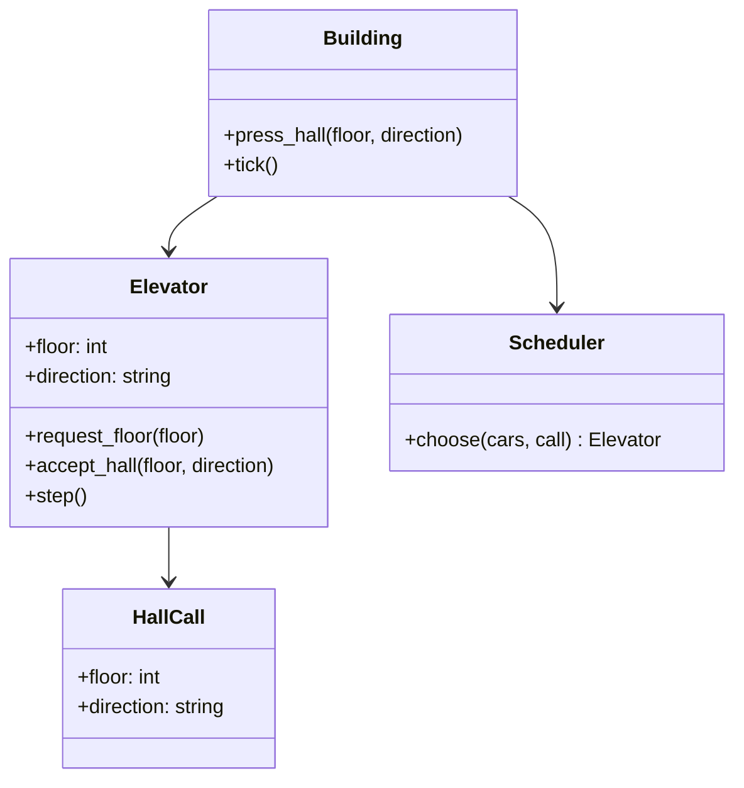

## Why this matters

The elevator question checks whether you can model state and a policy separately. A car has a direction and a set of stops. A building has cars and hall buttons. The interesting bug is not "add a stop." It is a car that reverses with someone still waiting ahead of it, or two cars sent to the same hall call. Interviewers want a small state machine and one scheduling policy you can simulate by hand.

## Intuition

An elevator is a clerk walking a staircase, carrying a list of floors where they must stop. While they are walking up, they do not turn around for a new request below them unless nobody above still needs them. People in the hallway press up or down, which is different from a person inside pressing a floor. The building's job is to decide which clerk should accept a new hallway press. The clerk's job is to honor the stops they already accepted, in an order that does not strand a rider.

## Core concept in depth

### Requirements

Assume a single building:

- N floors, M cars. Each car has a current floor, a direction (up, down, or idle), and a closed set of stop floors.
- Inside the car, a rider presses a destination floor. That adds a stop.
- In the hall, a rider presses up or down. The building assigns that call to one car.
- A car moves one floor at a time. At each floor it opens if that floor is a stop, or if it is an assigned hall call in the current direction.
- When the car has no stops above it in the current direction, it may reverse or go idle.

Out of scope unless asked: capacity limits, door timing, energy cost, and two elevator banks. If they add capacity, a car stops accepting hall calls when it is full but still serves destination buttons already pressed.

### Types

**Elevator** (the car) is an entity:

- `id`, `floor`, `direction`
- `stops`: set of destination floors requested inside
- `hall_stops`: set of `(floor, direction)` assigned from the hall

Methods: `request_floor(floor)`, `accept_hall(floor, direction)`, `step()`. `step` moves one floor toward the next stop or clears direction when idle. The car does not know about other cars.

**HallCall** is a value: floor and direction. It is outstanding until a car opens there for that direction.

**Building** (or `Controller`) holds the cars and the outstanding calls. `press_hall(floor, direction)` picks a car through a **Scheduler** and calls `accept_hall`. This is the only place that looks at every car.

**Scheduler** is a strategy. The interview policy is **nearest car already moving toward the call, else nearest idle, else nearest car**. Do not start with a genetic algorithm. Say the policy in a sentence so they can attack it.

### Direction rules

Inside `step` and when adding a stop:

- If the car is idle, set direction toward the new stop.
- If the car is moving up, a new stop above is served on this trip. A new stop below is kept for the return; the car does not reverse early.
- Same idea going down.
- When the car reaches a floor, it serves the stop if the floor is in `stops`, and it serves a hall call if the hall direction matches the travel direction (or the car is about to go idle and can pick a direction).
- After serving, if any stop remains in the current direction, continue. Otherwise reverse if stops remain, else idle.

That "do not reverse early" rule is the whole design. Write it down before code.

### Assignment rules

When a hall button is pressed:

- Ignore a duplicate call that is already outstanding.
- Ask the scheduler for a car. That car's `accept_hall` records the stop.
- Do not assign the same call to two cars. The building, not the cars, owns that uniqueness.

A simple scheduler scores each car by distance, penalizing cars that are moving away. Idle cars are good. A car moving toward the call is better than an idle car farther away. State the score and then leave it alone unless they ask for better traffic patterns.

### What the simulation clock looks like

`Building.tick()` calls `step()` on every car once. Tests advance time by ticks, not by threads. Threads hide the bugs you are trying to show. If they ask "in production?", each car is a process or a device, the controller sends commands, and the same state machine lives in the controller so a restart does not forget stops. Persistence is a sentence, not the core of the interview.

## Diagram



`Building` assigns. `Elevator.step` moves. The scheduler does not mutate cars except by returning a choice; the building calls `accept_hall`. Keeping mutation in one place avoids a scheduler that half-updates a car.

### Dry-run: one car, do not reverse early

Car at floor 1, idle. Rider inside requests 5. A hall call at floor 2 for up is assigned to it. Then someone inside, while passing 3, requests floor 1? Use this script instead, which is easier to simulate:

| Tick | Floor | Direction | Stops | What happened |
| --- | --- | --- | --- | --- |
| 0 | 1 | idle | none | request 5, direction becomes up, stops contain 5 |
| 1 | 2 | up | 5 and hall up at 2 | open at 2 for the hall call, then continue |
| 2 | 3 | up | 5 | no open |
| 3 | 4 | up | 5 | no open |
| 4 | 5 | up then idle | none | open, no remaining stops, idle |

Now a variant: at floor 3 a rider presses 1. Stops are 5 and 1. The car continues to 5, then reverses to 1. It does not turn around at floor 3. If your `step` turns around immediately, the rider going to 5 is stuck and the interviewer has their bug.

## Runnable Python

```python
class Elevator:
    def __init__(self, car_id: str, floor: int):
        self.car_id = car_id
        self.floor = floor
        self.direction = "idle"
        self.stops: set[int] = set()

    def request_floor(self, floor: int) -> None:
        if floor == self.floor and self.direction == "idle":
            return
        self.stops.add(floor)
        if self.direction == "idle":
            self.direction = "up" if floor > self.floor else "down"

    def step(self) -> int:
        ahead = self._ahead()
        if ahead is None:
            other = self._behind()
            if other is None:
                self.direction = "idle"
                return self.floor
            self.direction = "up" if other > self.floor else "down"
        self.floor += 1 if self.direction == "up" else -1
        if self.floor in self.stops:
            self.stops.remove(self.floor)
        return self.floor

    def _ahead(self) -> int | None:
        if self.direction == "up":
            choices = [f for f in self.stops if f > self.floor]
            return min(choices) if choices else None
        if self.direction == "down":
            choices = [f for f in self.stops if f < self.floor]
            return max(choices) if choices else None
        return None

    def _behind(self) -> int | None:
        if not self.stops:
            return None
        return min(self.stops, key=lambda f: abs(f - self.floor))


def choose(cars: list[Elevator], floor: int) -> Elevator:
    def score(car: Elevator) -> tuple[int, int]:
        distance = abs(car.floor - floor)
        moving_away = 0
        if car.direction == "up" and car.floor > floor:
            moving_away = 1
        if car.direction == "down" and car.floor < floor:
            moving_away = 1
        return (moving_away, distance)

    return min(cars, key=score)


if __name__ == "__main__":
    car = Elevator("A", 1)
    car.request_floor(5)
    # Rider boards conceptually at start; hall call is just another stop here.
    car.request_floor(2)
    seen = [car.floor]
    for _ in range(6):
        seen.append(car.step())
    print(seen, car.direction, sorted(car.stops))
```

The printed floors should climb 1, 2, 3, 4, 5 and then idle, having removed stops at 2 and 5. The car does not go 1, 2, then back down. `choose` prefers a car that is not moving away, then the shorter distance. Walk one case: a car at floor 10 going up, and an idle car at floor 1, for a hall call at floor 2. The moving-away penalty puts the idle car first even though you should also consider a car at floor 3 going up, which scores `(0, 1)` and wins. Explain that score in the interview with those two cars. Hall direction is simplified in this snippet to "stop at the floor"; mention that a full model stores `(floor, direction)` so a car going up does not open for a down button on the way up unless that is the end of the trip.

## Complexity / trade-off analysis

| Policy | Rider experience | Complexity |
| --- | --- | --- |
| Serve every stop in the current direction first | Predictable, no early reverse | Slightly longer waits for the opposite direction |
| Always nearest stop, including behind | Lower distance on paper | Reverses, strands riders, feels broken |
| Nearest car for hall calls | Good enough for the interview | Two cars can bunch; a better policy spreads them |
| Zone per car (car A owns floors 1 to 5) | Simple and avoids bunching | Worse when all demand is in one zone |
| Scan algorithm (classic elevator algorithm) | Same as "finish the direction" | This is that algorithm; name it if you know it |
| Instant teleport in the model | Easy tests | Hides the reverse bug; step one floor |

## Tricks, tips, patterns

- Separate inside requests from hall calls. Say so in the first minute.
- Write the no-early-reverse rule, then simulate five ticks.
- Scheduler is a function from cars and a call to one car. Building performs the mutation.
- One tick equals one floor. Tests are a loop, not threads.
- Idle, up, and down are the only directions.
- Duplicates: pressing 5 twice does not add two stops. A set is the right structure.
- If they ask for capacity, stop taking hall calls when full, but keep destination stops.

## Common mistakes and edge cases

- Reversing as soon as any stop exists behind the car. This is the bug in the dry-run variant.
- Sending every car to every hall call because each car listens to a global event.
- Forgetting idle as a state and leaving the car "up" forever at the top floor.
- Opening for a down hall call while traveling up through that floor, then continuing up, which confuses the passenger who wanted down. Match hall direction to travel direction.
- A scheduler that picks a car but nobody records the stop, so the call is dropped.
- Modeling doors, motors, and weight sensors before the stop set exists. Add them only if asked, as states around the same stops.
- Using threads in the interview. You will deadlock the whiteboard.

## Interview notes

Draw `Building`, `Elevator`, and `Scheduler`. State the reverse rule. Simulate the car from 1 to 5 with a stop at 2. Then add a destination of 1 requested at floor 3 and show you finish 5 first. Then show a hall call assigned to one car by the score. Stop.

If they push on performance, there are M cars and a handful of stops each; linear scans are fine. The design problem is correctness of direction, not big-O.

## Practice problems

1. **Direction (easy).** A car at floor 4 going up has stops at 6 and 2. Which floor does it visit next, and which after that?
2. **Assignment (medium).** Car A is at floor 9 going up. Car B is idle at floor 3. A down call is pressed at floor 4. Which car should take it under the penalty described, and why not A?
3. **Duplicate (medium).** Two people press hall-up on floor 6 before any car arrives. How many assignments do you create, and where is that uniqueness enforced?

Related: [Parking lot LLD](/lessons/sd-lld-parking-lot), [Hexagonal architecture and DDD](/lessons/sd-hexagonal-ddd).

## Summary / cheat sheet

- A car has a floor, a direction, and a set of stops. It moves one floor per tick.
- It finishes stops in the current direction before reversing. That is the elevator algorithm in miniature.
- Hall calls have a direction. Inside presses do not.
- The building assigns each hall call to one car through a scheduler. Cars do not all answer.
- A reasonable score is "not moving away, then distance."
- `tick` is a simulation loop. Persistence and motors are a sentence at the end.
- Sets stop duplicate presses. Idle is a real state.
- Capacity, if asked, blocks new hall calls and does not drop existing destinations.

## Further reading

- [Elevator algorithm](https://en.wikipedia.org/wiki/Elevator_algorithm)
- [Fowler, State](https://refactoring.guru/design-patterns/state)
- [Evans, Domain-Driven Design reference](https://www.domainlanguage.com/ddd/reference/)
