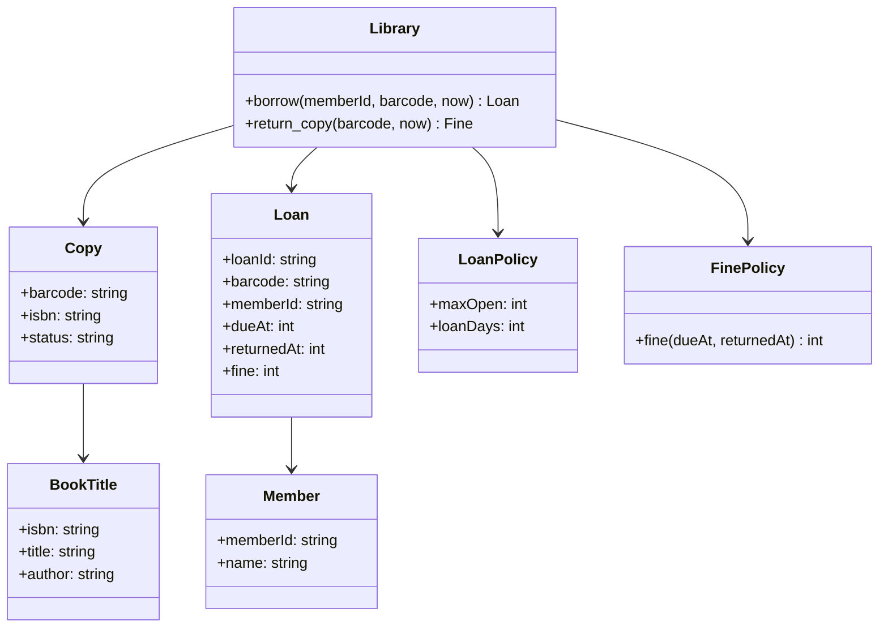

## Why this matters

The library exercise catches a specific modeling mistake: treating "book" as one object that is either on the shelf or not. A title has many copies. Members borrow copies. Fines and holds attach to those facts. Interviewers who like domain modeling ask this to see whether you separate the catalog from inventory, and whether `borrow` enforces a limit inside the model or in a comment above the controller.

## Intuition

The catalog is the idea of a book: title, author, ISBN. The shelf holds physical copies, each with a barcode, and each copy can be out with at most one member. A member can carry only so many copies. If you delete the catalog entry when the last copy is borrowed, you have mixed up the idea of the book with the object in someone's bag. Holds are a promise about the next return, not a second borrower of the same copy.

## Core concept in depth

### Requirements

Assume one branch:

- Search the catalog by title or ISBN.
- Several copies per title. Each copy has a barcode and a status: available, on loan, or lost.
- A member borrows a specific available copy. Loans last a fixed number of days.
- A member may have at most N open loans. Staff may have a higher N if you want a policy object; start with one limit.
- Return closes the loan, computes a fine if late, and marks the copy available.
- Optional if asked: a hold on a title, served when any copy returns. Do not block the basic borrow on this.

Out of scope: payments processors, multi-branch transfers, and e-books. If they add a second branch, a copy has a branch id and a transfer is a state, not a new kind of book.

### Types

**BookTitle** (catalog entry): isbn, title, author. No barcode. No "is available." Availability is a question over copies.

**Copy**: barcode, isbn, status. Identity is the barcode, not the ISBN.

**Member**: id, name, and the set of open loan ids, or you derive that from loans. A member does not store copies inside itself if that makes return easy to forget. Prefer a **Loan** as its own entity.

**Loan**: id, barcode, member id, borrowed_at, due_at, returned_at, fine. Open when `returned_at` is empty.

**Library** is the aggregate for one branch's inventory rules. `borrow(member, barcode, now)` and `return(barcode, now)` live here. A **FinePolicy** maps lateness to money. A **LoanPolicy** stores the max open loans and the loan length.

**Catalog** can be a separate service or repository that only searches titles. It has no `borrow` method. That split is the modeling win.

### Invariants

- Borrow fails if the copy is not available.
- Borrow fails if the member already has N open loans.
- Borrow fails if the member already holds this barcode (should be impossible if status is honest, but check the loan table anyway).
- Borrow creates a loan and sets the copy to on loan in one method.
- Return fails if the copy is not on loan to an open loan.
- Return sets the copy available, closes the loan, and records a fine of zero or more.
- Fines do not change the catalog. Losing a copy sets status lost and closes the loan with a replacement fee policy, if they ask. Do not delete the title.

### Holds, if asked

A **Hold** is member id plus ISBN, not plus barcode. When a copy of that ISBN is returned, the library does not mark it generally available if a hold queue is non-empty. It marks the copy `held` for the first member, with an expiry. If they do not pick it up, the next hold wins. This is a small state machine on the copy: available, on loan, held. Mention it after the basic loan works. Implementing holds before loans is how the interview runs out of time.

### Identity and equality

Two titles with the same ISBN are the same catalog row. Two copies with the same ISBN are different entities. Members are ids. Loans are ids. If you use the ISBN as the copy's primary key, you cannot buy a second copy. Say that sentence. It is the most common correction in this exercise.

## Diagram



`BookTitle` is referenced by ISBN. It is not the parent that gets mutated on borrow. The arrow from copy to title is a lookup, not an ownership that disappears when the copy is out.

### Dry-run: two copies, one title, a limit of one

| Step | Copy A | Copy B | Member loans | Result |
| --- | --- | --- | --- | --- |
| Start | available | available | 0 |  |
| Borrow A | on loan | available | 1, due in 14 days | loan L1 |
| Borrow B | on loan | available | 1 | rejected, limit |
| Return A on time | available | available | 0 | fine 0 |
| Borrow B | available | on loan | 1 | ok |
| Return B 3 days late |  | available | 0 | fine from policy |

The catalog row never changed. That is the dry-run's point.

## Runnable Python

```python
from dataclasses import dataclass


@dataclass
class Copy:
    barcode: str
    isbn: str
    status: str = "available"


@dataclass
class Loan:
    loan_id: str
    barcode: str
    member_id: str
    borrowed_at: int
    due_at: int
    returned_at: int | None = None
    fine: int = 0


class Library:
    def __init__(self, copies: list[Copy], max_open: int = 2, loan_seconds: int = 14 * 86400):
        self.copies = {c.barcode: c for c in copies}
        self.max_open = max_open
        self.loan_seconds = loan_seconds
        self.loans: dict[str, Loan] = {}
        self._seq = 0

    def open_loans(self, member_id: str) -> list[Loan]:
        return [
            loan
            for loan in self.loans.values()
            if loan.member_id == member_id and loan.returned_at is None
        ]

    def borrow(self, member_id: str, barcode: str, now: int) -> Loan:
        copy = self.copies[barcode]
        if copy.status != "available":
            raise ValueError("not available")
        if len(self.open_loans(member_id)) >= self.max_open:
            raise ValueError("limit")
        copy.status = "on_loan"
        self._seq += 1
        loan = Loan(
            f"L{self._seq}",
            barcode,
            member_id,
            now,
            now + self.loan_seconds,
        )
        self.loans[loan.loan_id] = loan
        return loan

    def return_copy(self, barcode: str, now: int) -> int:
        loan = next(
            item
            for item in self.loans.values()
            if item.barcode == barcode and item.returned_at is None
        )
        late_days = max(0, (now - loan.due_at + 86399) // 86400)
        loan.fine = late_days * 50
        loan.returned_at = now
        self.copies[barcode].status = "available"
        return loan.fine


if __name__ == "__main__":
    lib = Library(
        [Copy("A", "isbn-1"), Copy("B", "isbn-1")],
        max_open=1,
    )
    loan = lib.borrow("m1", "A", now=0)
    try:
        lib.borrow("m1", "B", now=10)
    except ValueError as exc:
        print("second", str(exc))
    print("on time", lib.return_copy("A", now=0))
    loan_b = lib.borrow("m1", "B", now=0)
    late = lib.return_copy("B", now=loan_b.due_at + 3 * 86400)
    print("late fine", late)
    print("catalog still two copies", len(lib.copies))
```

Member `m1` borrows copy A of isbn-1. The second borrow fails because `max_open` is 1, even though copy B is sitting on the shelf. After returning A, borrowing B works. Returning B three days after `due_at` charges 3 × 50. The copies dictionary still has two entries. Nothing in `borrow` deletes an ISBN. Walk the limit failure explicitly: the available copy is not sufficient. The member's open-loan count is part of the rule.

Fines use integer days and integer minor units. A real `FinePolicy` would be a separate object, as in the parking lot. It is inlined here so the loan close is visible in one place; say you would extract it when the interviewer changes the rate.

## Complexity / trade-off analysis

| Model | What it gets right | Where it hurts |
| --- | --- | --- |
| Title separate from copy | Many copies, stable catalog | You must join them on search results |
| One object per book, no copies | Fewer classes | Cannot represent two copies or a loan history |
| Limit checked in the UI only | Fast demo | Any other client bypasses it |
| Loan as an entity | History, fines, due dates | Another table |
| Status only, no loan row | Simple spot check | No due date and no history |
| Hold queue per ISBN | Fair waits | Extra copy states and expiry |
| Library aggregate per branch | Clear invariant | A huge branch is a large lock; lock per copy if they push scale |

Search is a read model: index titles, attach a count of available copies. Do not scan every loan on each keystroke if they turn this into a system-design follow-up. For LLD, a dictionary is enough, and you say the index is a separate query.

## Tricks, tips, patterns

- ISBN identifies the work. Barcode identifies the copy. Do not conflate them.
- `borrow` checks availability and the member limit, then writes the loan and the status together.
- `return` closes the loan and frees the copy together. Fines are a function of due and return time.
- Keep the catalog free of inventory methods.
- Add holds only after a clean borrow and return. Holds key off ISBN and a queue.
- Integer days, integer fines, an injected `now`.
- Staff versus member limits are a policy change, not a subclass of `Person` unless behavior really diverges.

## Common mistakes and edge cases

- `Book.checkout()` that flips a boolean on the title. The second copy cannot exist.
- A member limit enforced by counting a list the caller can forget to update. Derive open loans from loan records or update them only inside `Library`.
- Return marking the copy available but leaving the loan open, so the limit never drops.
- Fine calculated from "today" inside the domain, which makes tests flaky. Pass `now`.
- Deleting a title when all copies are loaned. Search and history break.
- Two loans open for one barcode because return was not required before the next borrow. Status must be checked.
- A hold that points at a barcode and breaks when that specific copy is lost. Hold the title.

## Interview notes

Clarify copy versus title in the first answer. Draw the class diagram with `Loan` on it. Implement borrow with the limit and return with the fine. If there is time, add a hold queue as a verbal extension: on return, if a hold exists, status becomes held instead of available.

If they ask about SQL, each box is a table, barcode and loan id are primary keys, and `borrow` is one transaction. Then stop. The LLD is the invariant, not the schema spelling.

## Practice problems

1. **Identity (easy).** The library buys a second copy of an existing ISBN. Which new row appears, and which existing row must not be duplicated?
2. **Limit (medium).** A member has two open loans and the policy max is two. A third barcode is available. What does `borrow` do, and why is "the copy is free" not sufficient?
3. **Late return (medium).** Due is day 10 and return is day 12. The fine policy is 50 per started late day. What is stored on the loan, and what is the copy's status afterward?

Related: [Parking lot LLD](/lessons/sd-lld-parking-lot), [Hexagonal architecture and DDD](/lessons/sd-hexagonal-ddd).

## Summary / cheat sheet

- Titles are the catalog. Copies are barcoded inventory. Loans connect a member to a copy for an interval.
- Availability is a property of a copy, not of an ISBN.
- `borrow` enforces copy status and the member's open-loan limit in one place, then writes both records.
- `return` closes the loan, assesses a fine, and frees the copy.
- Policies hold the numbers (limit, loan length, daily fine) so the aggregate keeps the rule.
- Holds, if added, queue on ISBN and change the copy to held on return.
- Do not delete catalog rows because inventory is out. Do not use ISBN as the only inventory key.
- Tests pass a clock in. Money and days stay integers.

## Further reading

- [Evans, Domain-Driven Design reference](https://www.domainlanguage.com/ddd/reference/)
- [Fowler, Bounded Context](https://martinfowler.com/bliki/BoundedContext.html)
- [Cockburn, Hexagonal architecture](https://alistair.cockburn.us/hexagonal-architecture/)
