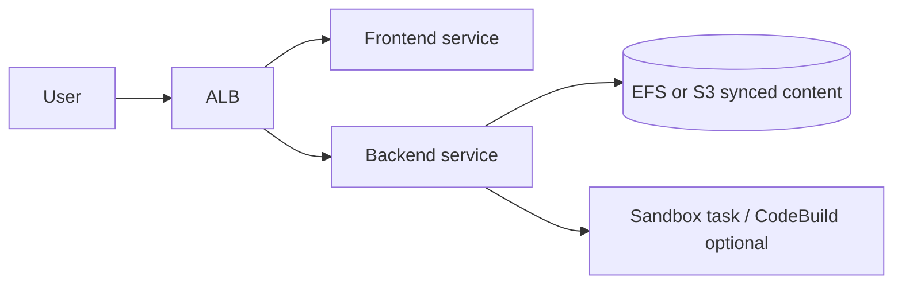

# Deployment Guide — CodeCraft Academy

## Option A — Vercel (frontend) + Railway/Render (backend)

### Frontend (Vercel)

1. Import the repo in Vercel; set **Root Directory** to `frontend`.
2. Environment variables:
   - `NEXT_PUBLIC_API_URL` = your backend public URL
   - `NEXT_PUBLIC_SITE_URL` = your Vercel URL
   - `NEXT_PUBLIC_USE_PYODIDE` = `true` (recommended on free hosting without Docker)
   - `CONTENT_DIR` = absolute path is not available on Vercel — **bundle content**: either copy `content/` into `frontend/content` at build time or keep using the repo-relative `../content` via a build step that copies content into the app.
3. Build command: `npm run build`
4. Output: Next.js standalone / default Vercel Next preset.

**Content on Vercel:** add a `prebuild` script that copies `../content` → `./content` and set `CONTENT_DIR` to `./content`.

### Backend (Railway or Render)

1. Root directory: `backend`
2. Start: `uvicorn app.main:app --host 0.0.0.0 --port $PORT`
3. Env:
   - `CORS_ORIGINS` = your Vercel origin
   - `CONTENT_DIR` = mount or bake `/content`
   - `SANDBOX_DISABLED` = `true` unless you attach a Docker socket / sidecar (most PaaS cannot)
4. Prefer `NEXT_PUBLIC_USE_PYODIDE=true` so execution works without a sandbox.

### Abuse protection

- Rate limit `/api/run` and `/api/submit` (slowapi, default 30/min/IP).
- Cap request body size (`MAX_REQUEST_SIZE_BYTES`).
- Never expose unrestricted Python without isolation.
- When Docker is available, enforce: `--network none`, memory/pids/CPU limits, read-only root, non-root user, wall-clock kill.

---

## Option B — AWS ECS Fargate



1. **ECR**: build & push `frontend`, `backend`, `codecraft-sandbox` images (`make build`).
2. **ECS Cluster** (Fargate):
   - Service `frontend` — port 3000, env `NEXT_PUBLIC_API_URL`
   - Service `backend` — port 8000, env `CONTENT_DIR`, `CORS_ORIGINS`, `SANDBOX_*`
3. **ALB** path routing: `/api/*` and `/health` → backend; `/*` → frontend.
4. **Content**: EFS volume mounted read-only at `/app/content`, or bake content into the image.
5. **Sandbox**:
   - Preferred: backend task with privilege to start sibling sandbox tasks (complex), or
   - Simpler: `SANDBOX_DISABLED=true` + Pyodide on the client for public demos; run Docker sandbox only on EC2 with Docker socket for trusted environments.
6. **IAM**: least privilege task roles; Secrets Manager for any future secrets (none required now).
7. **Observability**: CloudWatch logs for both services; alarms on 5xx and CPU.

### EC2 alternative

- Single `docker compose up -d` on an EC2 instance behind an ALB/Nginx.
- Attach IAM instance profile; open 80/443 only.
- Use Let's Encrypt for TLS.
- Schedule `docker system prune` and monitor disk (sandbox images + logs).

---

## Local without Docker

```powershell
# Frontend
cd frontend
$env:CONTENT_DIR = (Resolve-Path ..\content).Path
$env:NEXT_PUBLIC_USE_PYODIDE = "true"
npm run dev

# Backend (needs Python 3.12 recommended)
cd backend
$env:CONTENT_DIR = (Resolve-Path ..\content).Path
$env:SANDBOX_DISABLED = "true"
uvicorn app.main:app --reload --port 8000
```

Install [Docker Desktop for Windows](https://docs.docker.com/desktop/setup/install/windows-install/) if you want `docker compose up --build`.
